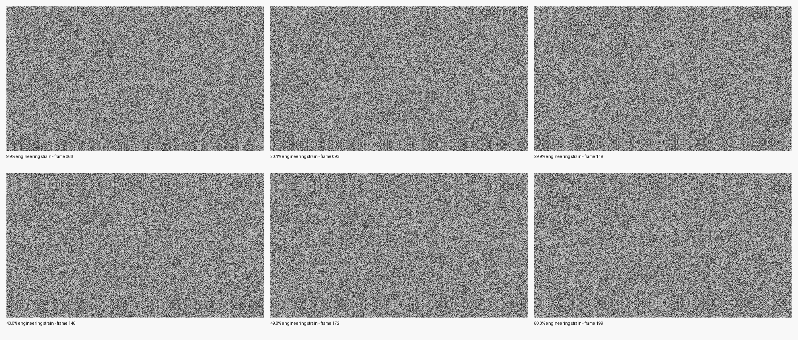

Benchmarks and results
======================

Each table states its machine, image size, evaluated population, and timed stages. Error comparisons use analytic truth from the Live-DIC dataset. Timing results are hardware- and workload-specific.

DeepMatching and HORG-DIC on the same POIs
------------------------------------------

Three UHD Live-DIC frames, the same grid of 32 POIs, images loaded before timing. The `≤ 2 px` count is **among accepted points**; read it together with accepted/visible coverage.

.. list-table:: Current per-frame comparison
   :header-rows: 1
   :widths: 10 18 17 17 16 12 10

   * - Frame
     - Method
     - Accepted / visible
     - Accepted at ≤ 2 px
     - Accepted RMSE (px)
     - Median time
     - Backend
   * - 040
     - DeepMatching
     - 32 / 32
     - 30 / 32
     - 1.314
     - 1.335 s
     - WebGPU
   * - 040
     - HORG subpixel
     - 32 / 32
     - 32 / 32
     - 0.088
     - 0.153 s
     - WebGPU
   * - 100
     - DeepMatching
     - 28 / 32
     - 22 / 28
     - 1.625
     - 1.333 s
     - WebGPU
   * - 100
     - HORG subpixel
     - 32 / 32
     - 32 / 32
     - 0.216
     - 0.149 s
     - WebGPU
   * - 199
     - DeepMatching
     - 28 / 32
     - 27 / 28
     - 1.165
     - 1.290 s
     - WebGPU
   * - 199
     - HORG subpixel
     - 23 / 32
     - 21 / 23
     - 1.047
     - 0.150 s
     - WebGPU

Across 96 seeds, DeepMatching accepts 88, with 79 at ≤2 px; HORG accepts 87, with 85 at ≤2 px. Their conditional RMSE values are 1.378 px and 0.557 px. HORG is about 8.8 times faster using this protocol's median timings. At frame 199, DeepMatching retains more accurate points than HORG (27 versus 21), so the aggregate comparison should not obscure this case.

Parity with CPU INRIA DeepMatching
-----------------------------------

The dedicated comparison uses 32 logical POIs per frame, selected from a consistent full grid. For the 88 positions found by both implementations, WebGPU displacements match the INRIA outputs exactly at pixel precision. Both have 79/88 errors at or below 2 px from analytic truth. Mean WebGPU time is 1.36 s; CPU INRIA takes 33.54 s with one thread and 9.73 s with eight.

These timings do not cover exactly the same stages: the CPU timing includes PNG loading and output writing, while the WebGPU timing excludes image decoding and grayscale conversion. The speed ratios are indicative even though output-vector equality is directly checked.

Deformation up to 60%
---------------------

The series contains six UHD snapshots generated from the Live-DIC setup up to 60% axial engineering strain. The denominator includes only seeds whose analytically transformed locations remain inside the target. At 60%, the default comparison accepts 6/16 reciprocal DeepMatching results, of which 2 are within 2 px; HORG accepts none from 20% strain onward in the tested defaults. The full table and protocol are in the series report.

The additional three-method browser run on frame 199 evaluates DeepMatching, HORG, and the experimental CPM-WGPU path on the same 16 visible seeds. CPM currently accepts none, and its rejected-vector error is reported separately from accepted-match metrics. The report includes three-repeat timings under a common Chromium/Vulkan protocol; its adapter and prototype limitations are explicit.

The progressive comparison on the original Live-DIC frames 040, 100, and 199 gives CPM 32/32, 2/28, and 0/28 accepted seeds respectively. At frame 199, 13 of 28 unfiltered CPM proposals are within 5 px, but none has enough reciprocal local support to be accepted. The analytic-oracle study separates search failure from the rigid-patch HOG cost limitation across matching supports. Both reports retain per-seed browser results and document that adapter identity was not exposed.

A separate experiment preconditions DeepMatching with affine RANSAC and WGSL ECC, then rematches the warped image. At 60%, it accepts 16/16 points, all within 2 px, with 0.000854 px RMSE. This uses the synthetic dataset's exact global affine image field; it does not establish the same precision on heterogeneous deformation. Its time is 4.107 s, compared with 4.112 s in an earlier CPU/OpenCV measurement of the full pipeline: no speed gain is established.

Sparse DeepMatching for selected windows
----------------------------------------

The regular INRIA-style path evaluates all 40 roots on these UHD frames, even when the caller requests only a small seed list. The experimental `mode="inria_sparse"` evaluates only roots covering explicit `seed_points`. On frames 040 and 199, one seed reduced median time from 1.817/1.586 s to 0.127/0.110 s. Eight seeds ran in 0.351/0.312 s; 32 seeds on frame 040 ran in 1.582 s, close to the 1.855 s full-grid call. All tested subsets on frames 040, 100, and 199 had identical accepted flags and displacement vectors between sparse and full-grid modes.

This is a local fallback, not a replacement for the global field: excluded roots no longer participate in reciprocal competition. It is useful when another solver or matcher has already identified a small set of difficult windows. The :doc:`full study <_generated_results/uniaxial/sparse_deepmatching_study>` describes the protocol, limits, and accuracy; browse the :doc:`per-run data <_generated_results/uniaxial/sparse_deepmatching_study.csv>` for timings and parity by subset.

Reports and raw data
--------------------

The native Python benchmark measures HORG and DeepMatching separately on Live-DIC frames 040, 100, and 199 using `wgpu-py`. Its protocol differs from the earlier browser benchmark.

* :doc:`DeepMatching–HORG accuracy and timing report <_generated_results/uniaxial/deepmatching_horg_current_comparison>`
* :doc:`DeepMatching–HORG raw comparison data <_generated_results/uniaxial/deepmatching_horg_current_comparison.csv>`
* :doc:`Native Python benchmark report <_generated_results/uniaxial/python_runtime_comparison>` and :doc:`timing data <_generated_results/uniaxial/python_runtime_comparison.csv>`
* :doc:`INRIA–WebGPU DeepMatching parity report <_generated_results/uniaxial/inria_webgpu_hierarchy_comparison>` and :doc:`per-seed data <_generated_results/uniaxial/inria_webgpu_hierarchy_comparison.csv>`
* :doc:`60% synthetic-series provenance and limitations <_generated_results/uniaxial/tensile_60pct/README>`
* :doc:`Matcher results through 60% strain <_generated_results/uniaxial/tensile_60pct/matcher_comparison.csv>`
* :doc:`Three-method 60% comparison <_generated_results/uniaxial/tensile_60pct/three_method_browser_60>` with :doc:`summary data <_generated_results/uniaxial/tensile_60pct/three_method_browser_60.csv>` and :doc:`per-seed raw data <_generated_results/uniaxial/tensile_60pct/three_method_browser_60.json>`
* :doc:`CPM progressive three-method qualification <_generated_results/cpm/progressive_tensile_040_100_199>` and :doc:`per-seed raw data <_generated_results/cpm/three_method_progressive_040_100_199.json>`
* :doc:`CPM analytic-oracle and matching-support diagnosis <_generated_results/cpm/oracle_diagnostics_60>` and :doc:`raw support sweep <_generated_results/cpm/oracle_support_study_60.json>`
* :doc:`Affine RANSAC/ECC preconditioning report <_generated_results/uniaxial/tensile_60pct/affine_preconditioning>`
