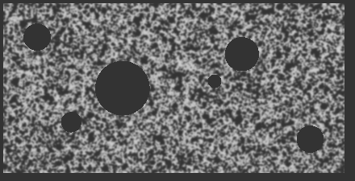
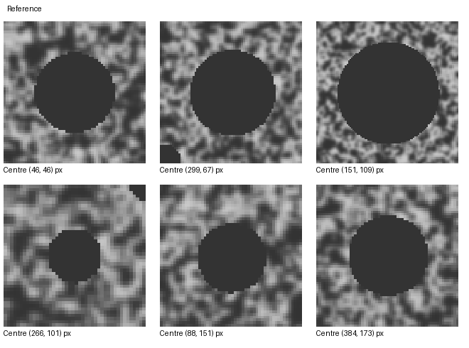
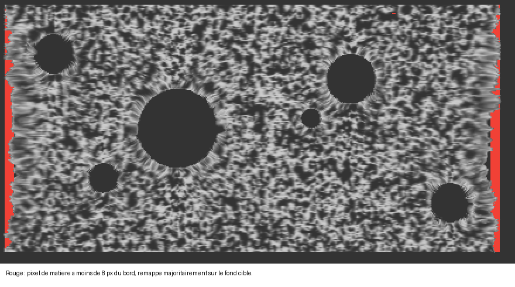
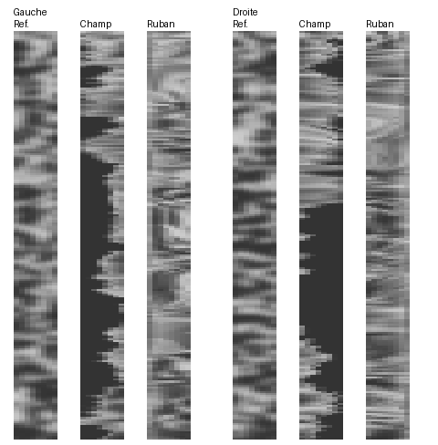

Plate 191 — failure of initialization at the lateral edges
=========================================================

The study initializes digital image correlation (DIC) from the reference and
frame 191 alone. The inverse-compositional Gauss–Newton (IC-GN) solver then
refines six local affine parameters on the original images. No independently
associated displacement truth is available for this plate. Acceptance by the
solver is a numerical and photometric criterion.

The current method remains inadequate on the left and right flanks. The whole
plate count of 4,408 accepted windows out of 5,126 obscures this spatial failure.

.. list-table:: Fixed population within eight reference pixels of each edge
   :header-rows: 1

   * - Side
     - Eligible windows
     - Earlier accepted
     - Current accepted
     - Material pixels mapped mainly onto background
   * - Left
     - 102
     - 22
     - 22
     - 881 / 1,632
   * - Right
     - 104
     - 33
     - 34
     - 853 / 1,632
   * - Top
     - 206
     - 24
     - 62
     - 3 / 3,312
   * - Bottom
     - 208
     - 27
     - 74
     - 10 / 3,312

Eighty-five of the 86 added edge windows lie at the top or bottom. Nineteen of
56 accepted lateral windows map over one quarter of their reference material
support onto the target background. The acceptance rule must account for target
material support before these windows can be regarded as useful measurements.

Visual evidence
---------------

   Reference alternating with the previous composed field.

   Reference alternating with three residual texture corrections and a narrow
   normal-to-boundary correction. Observe the remaining stretched lateral texture.

   Identical crops around the six holes, comparing reference, prior and final remaps.

   Red marks reference material in the eight-pixel outer strip whose target
   interpolation contains mostly background. The source material mask is computed
   from the rendered images. This diagnostic is independent of solver status.

   Left and right material strips. Columns show reference, current field and
   the candidate monotone ribbon correspondence. The latter was rejected.

Experiments and limitations
--------------------------

Dense residual matching was performed in the target image coordinates after
transporting the reference through the existing field. Corrections were composed
successively. Local backtracking restricted inversions of sampled material cells.
A 1.5-pixel normal boundary correction gave crown correlation 0.798 and hole
intersection-over-union 0.960, compared with 0.746 and 0.936 initially. A broader
four-pixel correction increased hole overlap to 0.972 while lowering crown
correlation to 0.775. Contour agreement alone does not establish texture alignment.

A numerical search for stationary states of the one-iteration IC-GN update
increased acceptance. Reproducibility from three initial states, using a
one-pixel displacement agreement threshold, retained 4,408 windows including
previously accepted windows. Perturbing the final seed made most additional
windows lose numerical convergence. A synthetic nonlinear twin recovered 242
additional correct windows, but retained 68 previously accepted false matches.
These observations establish useful numerical behavior with significant limits.

The endpoint-only ribbon experiment preserves the order of texture observations
along the entire flank. It explores tangential scale, shear and material depth.
On reserved depth samples its correlation changed from 0.366 to 0.381 on the
left and from 0.490 to 0.441 on the right. This experiment did not resolve the
lateral failure.

A separate diagnostic tracks intermediate frames with forward/backward checks.
These tracks are neither endpoint-only predictions nor analytical truth. Agreement
between two temporal sampling rates was insufficient to establish accurate
endpoint alignment, so it cannot validate the candidate edge displacements.

The current method is not qualified for complete plate initialization. Unresolved
lateral supports should remain explicitly unresolved. A future synthetic control
should reproduce transverse thinning and border sampling, then initialize the
solver with exact local affine parameters to distinguish correspondence-search
failure from support and discretization limits.

Reproduction and archived evidence
---------------------------------

Scripts are in ``python/benchmarks/hudge_*.py``. Per-window states, candidate
maps, metrics and animations are archived in
``results/hudge_dense_flow_20261118/``. In particular, ``edge_limits/sides.json``
contains the table diagnostics and ``comparison/twin_check.json`` records the
synthetic control. Input file hashes are recorded in
``results/hudge_hole_moments_20261117/proposals/summary.json``.

These research scripts require the separately installed Live-DIC solver, NumPy,
SciPy and Pillow. OpenCV is used for optical flow. Several historical scripts
retain workstation-specific paths to the external images and Live-DIC checkout.
A clone includes the code and evidence, but rerunning the original-image
experiments requires supplying those external data and adapting the paths.
The adjacent cross-specimen displacement files are not truth for this plate.

The scripts execute processor-side research orchestration and existing WebGPU
solver calls. The complete experimental pipeline has not been ported to WebGPU.
