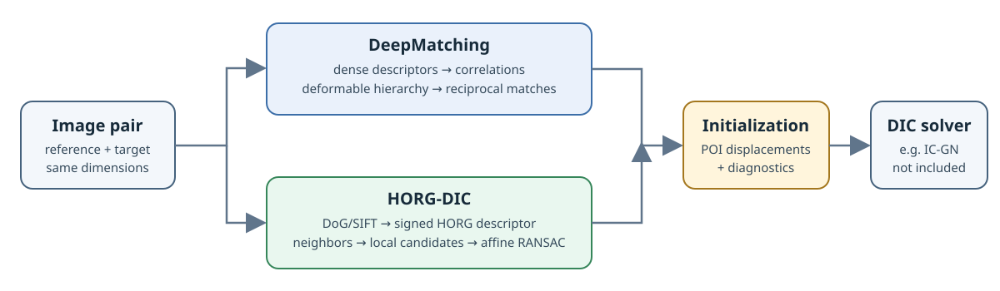

WGPU-Matching
=============

**WebGPU initializers for digital image correlation (DIC).**

WGPU-Matching provides three Python methods for finding correspondences between a reference image and a deformed image: DeepMatching, HORG-DIC, and the experimental CPM-HOG initializer. Their compute kernels are written in WGSL and run through ``wgpu-py`` on a native WebGPU adapter. Installing the package does not compile a project-specific extension.

These methods provide **initial displacement estimates** at points of interest. They do not compute a full DIC field or perform IC-GN refinement.

Choose a path
-------------

* :doc:`Tutorial <tutorials/first-matches>` — install the package, create a reproducible speckle pair, and compute your first displacements.
* :doc:`How-to guides <how-to/index>` — select an adapter, pass explicit seeds, run a benchmark, or inspect uncertain initializations.
* :doc:`Explanations <explanation/index>` — learn how the correlation hierarchy, HORG descriptors, and CPM-HOG PatchMatch work, how they fit into DIC, and what the measurements show.
* :doc:`Reference <reference/index>` — look up the Python API, options, result fields, metrics, and raw reports.
* :doc:`Reports and raw data <_generated_results/index>` — browse rendered experiment reports, CSV previews, and complete data downloads.

Headline results
----------------

On three Live-DIC tensile frames, the current comparison accepts **87/96** POIs with HORG and **88/96** with DeepMatching. Of accepted points, **85/87** HORG matches and **79/88** DeepMatching matches are within 2 px of the analytic truth. Their pooled RMSE values are **0.557 px** and **1.378 px**, respectively. On this protocol's native Python runs, mean repeated call times are about **0.151 s** for HORG and **1.319 s** for DeepMatching.

These figures describe three frames, one seed grid, and one adapter. They do not summarize every deformation regime: at frame 199, DeepMatching retains more accurate POIs, while HORG is faster and has lower pooled RMSE. The :doc:`benchmark report and protocol <benchmarks>` provide per-frame results and limitations.

Install
-------

Python 3.11 or later and a working WebGPU backend are required. From the repository root:

.. code-block:: console

   python -m pip install .

Then follow the :doc:`getting-started tutorial <tutorials/first-matches>`. For documentation development and quality checks, see :doc:`contributing <contributing>`.

.. toctree::
   :hidden:
   :maxdepth: 2

   tutorials/index
   how-to/index
   explanation/index
   benchmarks
   _generated_results/index
   reference/index
   contributing
