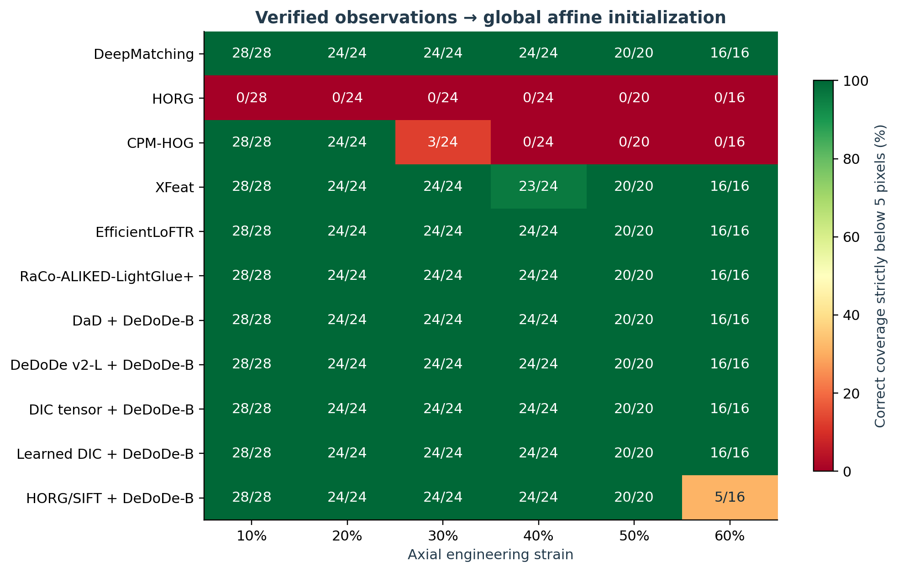
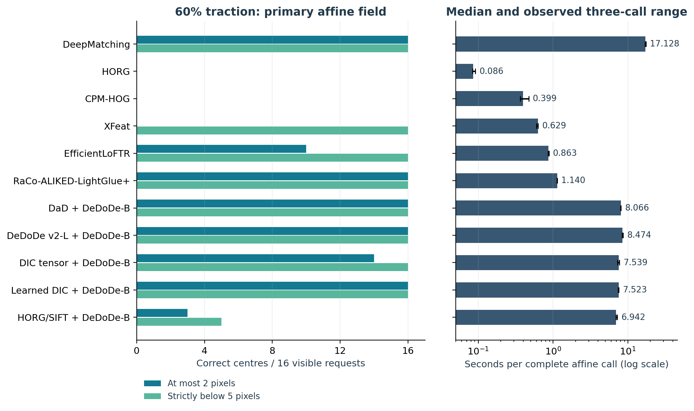

:orphan:

Complete initializer qualification: measurements and visual evidence
====================================================================

This chapter replaces the historical context tables for the current comparison. It is generated from the complete re-run and its independent artifact audit. All historical reports remain intact. The full web galleries contain every reference/corrected GIF, including failures; print shows static native-pixel crops.

The measured pipelines include DeepMatching, HORG, CPM-HOG, XFeat, EfficientLoFTR, RaCo-ALIKED-LightGlue+, DaD and DeDoDe v2-L with DeDoDe-B, tensor and learned DIC detection with DeDoDe-B, and HORG/SIFT detection with the same descriptor.

What passing means
------------------

A pass requires every analytically visible requested centre to have a finite displacement estimate with error strictly below 5 pixels. Exactly 5 pixels fails. Correct counts at most 2 pixels, conditional RMSE, P95, maximum error and false estimates are separate measurements. Passing assesses centre translation only, not an affine-gradient tolerance. No IC-GN convergence is measured. These are smooth field initializers inferred from verified direct matches, not independent image measurements at every seed.

The primary affine basis was declared before this campaign. The secondary Gaussian-RBF request selects between affine and Gaussian candidates using spatial cross-validation of observed pairs. Analytic truth only defines visible evaluation seeds and scores errors afterward. It never selects pairs or a basis.

The same local WGSL affine RANSAC verifies observations for all pipelines: 256-pixel radius, 3-pixel residual threshold, at least 6 inliers from 8 candidates and an inlier fraction of 0.2. A second WGSL kernel retains original observed pairs supported by accepted local models. Large sets use balanced source-space quotas to meet the projector's 8192-pair capacity. All original pairs remain downloadable; no model-predicted endpoint is counted as a new observation.

Homogeneous traction is exactly representable by a global affine field. This prior can recover more centres than the original local initializer. It does not establish performance on heterogeneous deformation or cracks. The raw-pair ablation documents what happens when common geometric verification is omitted. See :doc:`../explanation/field-projection` for the objective and limits.

Timing and execution scope
--------------------------

Each affine latency is the median of three complete calls after a per-case warm-up, including decoded-image preprocessing, extraction, geometric verification, field fit and patch initialization. Device/model creation, decoding, serialization and rendering are excluded. Both images are processed each time; no prepared-reference cache is used. Minimum and maximum are the observed three-call range, not a statistical confidence interval. Automatic-basis fit time is measured once on the last pair set and has no separately measured complete-pipeline frame rate.

Native tensile images are 3840 by 2160; Adrien is 7920 by 6004. Learned matching models use bounded reduced inputs with dimensions recorded in the source result. Tensor and learned DIC detection use native pixels, but the common DeDoDe-B descriptor and mutual matcher are CPU reference stages. ONNX outputs return host arrays before the independent wgpu-py context. This is not a pipeline resident on GPU from end to end, and it does not perform native-resolution photometric refinement.

DeepMatching uses a 1024-original-pixel search radius and all hierarchy roots here. Its timing is not a regression comparison against the historical default-radius or sparse-root protocols. Matcher defaults were preserved; benchmark settings are explicit.

The figures sample native target pixels through the estimated forward field with bilinear interpolation. Black indicates out-of-image samples, including expected loss of field of view under stretch; black margins alone do not establish failure. Source resize coordinates follow (x + 0.5) times scale minus 0.5. Central crops are fixed in advance and retain native pixel resolution; their location is never selected by error.

Run created: 2026-11-07T19:09:34.069773+00:00.

Adapter: Intel(R) Graphics (Lunar Lake); backend Vulkan; driver Mesa 25.2.8-0ubuntu0.24.04.4.

CPU: Intel Core Ultra 5 228V; numerical stages configured for eight threads.

Protocol fingerprint: ``f9f9b1b5c677454f857476d7f649c7f5c7c4048c427987e17c7e0a4e18a2043a``.

The :doc:`complete online report <../_generated_results/qualification/all_methods_20261107/index>` contains all stage timings, models, thresholds, file hashes, per-seed parameters, raw-pair rejection reasons and every animation. The independent audit decoded all animations and recomputed analytic metric counts from the exported patch parameters.

Qualification at 60 percent traction
------------------------------------

.. list-table:: Primary affine field; displacement errors in original pixels
   :header-rows: 1
   :widths: 34 10 12 12 14 18

   * - Pipeline
     - Verdict
     - At most 2
     - Below 5
     - RMSE
     - Seconds
   * - DeepMatching INRIA hierarchy
     - Pass
     - 16/16
     - 16/16
     - 0.18
     - 17.128
   * - HORG
     - Fail
     - 0/16
     - 0/16
     - —
     - 0.086
   * - CPM-HOG
     - Fail
     - 0/16
     - 0/16
     - —
     - 0.399
   * - XFeat
     - Pass
     - 0/16
     - 16/16
     - 3.05
     - 0.629
   * - EfficientLoFTR
     - Pass
     - 10/16
     - 16/16
     - 1.95
     - 0.863
   * - RaCo-ALIKED-LightGlue+
     - Pass
     - 16/16
     - 16/16
     - 0.71
     - 1.140
   * - DaD + DeDoDe-B
     - Pass
     - 16/16
     - 16/16
     - 0.44
     - 8.066
   * - DeDoDe v2-L + DeDoDe-B
     - Pass
     - 16/16
     - 16/16
     - 0.49
     - 8.474
   * - DIC tensor + DeDoDe-B
     - Pass
     - 14/16
     - 16/16
     - 1.40
     - 7.539
   * - Learned DIC + DeDoDe-B
     - Pass
     - 16/16
     - 16/16
     - 0.22
     - 7.523
   * - HORG/SIFT detector + DeDoDe-B
     - Fail
     - 3/16
     - 5/16
     - 9.13
     - 6.942

   Correct coverage below 5 pixels at every tensile strain; labels are correct/requested counts.

   Accuracy and measured complete-call latency at 60 percent. The observed timing range is not a confidence interval.

Live-DIC frame 040
------------------

Case identifier: ``progressive_040``.

Native images: 3840 by 2160 pixels. Prescribed stretch factors: x = 1.0011196739864576, y = 0.999664342060021; axial engineering strain 0.111967 percent. The analytical map scales coordinates about (width/2, height/2).

Counts use all visible requested centres. Missing estimates reduce coverage; RMSE, median, P95 and maximum are conditional on finite estimated centres.

Affine IRLS fits without numerical convergence: none among the returned fields. Accuracy and numerical convergence are separate checks.

.. list-table:: All requested centres versus finite estimates
   :header-rows: 1
   :widths: 31 12 11 11 11 12 12

   * - Pipeline
     - Estimated
     - At most 2
     - Below 5
     - False ≥5
     - Coverage
     - Precision
   * - DeepMatching INRIA hierarchy
     - 32/32
     - 28
     - 32
     - 0
     - 1.000
     - 1.000
   * - HORG
     - 32/32
     - 32
     - 32
     - 0
     - 1.000
     - 1.000
   * - CPM-HOG
     - 32/32
     - 28
     - 32
     - 0
     - 1.000
     - 1.000
   * - XFeat
     - 32/32
     - 14
     - 32
     - 0
     - 1.000
     - 1.000
   * - EfficientLoFTR
     - 32/32
     - 32
     - 32
     - 0
     - 1.000
     - 1.000
   * - RaCo-ALIKED-LightGlue+
     - 32/32
     - 32
     - 32
     - 0
     - 1.000
     - 1.000
   * - DaD + DeDoDe-B
     - 32/32
     - 32
     - 32
     - 0
     - 1.000
     - 1.000
   * - DeDoDe v2-L + DeDoDe-B
     - 32/32
     - 28
     - 32
     - 0
     - 1.000
     - 1.000
   * - DIC tensor + DeDoDe-B
     - 32/32
     - 32
     - 32
     - 0
     - 1.000
     - 1.000
   * - Learned DIC + DeDoDe-B
     - 32/32
     - 32
     - 32
     - 0
     - 1.000
     - 1.000
   * - HORG/SIFT detector + DeDoDe-B
     - 32/32
     - 32
     - 32
     - 0
     - 1.000
     - 1.000

.. list-table:: Affine field accuracy, pixels
   :header-rows: 1
   :widths: 32 12 11 11 11 11 12

   * - Pipeline
     - Estimated
     - Below 5
     - RMSE
     - Median
     - P95
     - Max
   * - DeepMatching INRIA hierarchy
     - 32/32
     - 32
     - 1.32
     - 1.17
     - 2.07
     - 2.09
   * - HORG
     - 32/32
     - 32
     - 0.03
     - 0.03
     - 0.05
     - 0.06
   * - CPM-HOG
     - 32/32
     - 32
     - 1.32
     - 1.17
     - 2.07
     - 2.09
   * - XFeat
     - 32/32
     - 32
     - 2.28
     - 2.07
     - 3.22
     - 3.44
   * - EfficientLoFTR
     - 32/32
     - 32
     - 0.60
     - 0.52
     - 0.94
     - 0.96
   * - RaCo-ALIKED-LightGlue+
     - 32/32
     - 32
     - 0.12
     - 0.10
     - 0.20
     - 0.22
   * - DaD + DeDoDe-B
     - 32/32
     - 32
     - 0.75
     - 0.66
     - 1.16
     - 1.18
   * - DeDoDe v2-L + DeDoDe-B
     - 32/32
     - 32
     - 1.33
     - 1.18
     - 2.09
     - 2.11
   * - DIC tensor + DeDoDe-B
     - 32/32
     - 32
     - 0.29
     - 0.27
     - 0.42
     - 0.48
   * - Learned DIC + DeDoDe-B
     - 32/32
     - 32
     - 0.08
     - 0.08
     - 0.12
     - 0.12
   * - HORG/SIFT detector + DeDoDe-B
     - 32/32
     - 32
     - 0.03
     - 0.02
     - 0.04
     - 0.05

.. list-table:: Repeated complete affine calls; observations after common verification
   :header-rows: 1
   :widths: 36 15 15 15 19

   * - Pipeline
     - Median s
     - Min s
     - Max s
     - Verified/raw
   * - DeepMatching INRIA hierarchy
     - 16.277
     - 16.171
     - 16.300
     - 21170/30720
   * - HORG
     - 0.129
     - 0.121
     - 0.133
     - 190/693
   * - CPM-HOG
     - 0.519
     - 0.515
     - 0.596
     - 21082/32026
   * - XFeat
     - 0.685
     - 0.635
     - 0.704
     - 2100/3087
   * - EfficientLoFTR
     - 0.969
     - 0.963
     - 0.970
     - 2210/3344
   * - RaCo-ALIKED-LightGlue+
     - 1.201
     - 1.126
     - 1.212
     - 550/883
   * - DaD + DeDoDe-B
     - 8.317
     - 8.222
     - 8.381
     - 4518/7289
   * - DeDoDe v2-L + DeDoDe-B
     - 8.651
     - 8.277
     - 8.755
     - 3708/6103
   * - DIC tensor + DeDoDe-B
     - 7.760
     - 7.335
     - 7.819
     - 3473/5984
   * - Learned DIC + DeDoDe-B
     - 7.558
     - 7.421
     - 7.690
     - 4024/6633
   * - HORG/SIFT detector + DeDoDe-B
     - 7.197
     - 7.121
     - 7.203
     - 310/547

.. list-table:: Automatic request: actual selected model and analytic errors
   :header-rows: 1
   :widths: 32 18 12 12 12 14

   * - Pipeline
     - Effective
     - Below 5
     - RMSE
     - Max
     - Converged
   * - DeepMatching INRIA hierarchy
     - gaussian_rbf
     - 32/32
     - 1.32
     - 2.06
     - True
   * - HORG
     - affine
     - 32/32
     - 0.03
     - 0.06
     - True
   * - CPM-HOG
     - gaussian_rbf
     - 32/32
     - 1.32
     - 2.06
     - True
   * - XFeat
     - affine
     - 32/32
     - 2.28
     - 3.44
     - True
   * - EfficientLoFTR
     - affine
     - 32/32
     - 0.60
     - 0.96
     - True
   * - RaCo-ALIKED-LightGlue+
     - affine
     - 32/32
     - 0.12
     - 0.22
     - True
   * - DaD + DeDoDe-B
     - affine
     - 32/32
     - 0.75
     - 1.18
     - True
   * - DeDoDe v2-L + DeDoDe-B
     - affine
     - 32/32
     - 1.33
     - 2.11
     - True
   * - DIC tensor + DeDoDe-B
     - affine
     - 32/32
     - 0.29
     - 0.48
     - True
   * - Learned DIC + DeDoDe-B
     - affine
     - 32/32
     - 0.08
     - 0.12
     - True
   * - HORG/SIFT detector + DeDoDe-B
     - affine
     - 32/32
     - 0.03
     - 0.05
     - True

:doc:`All methods, both requests and animations for this case <../_generated_results/qualification/all_methods_20261107/case_progressive_040>`.

Live-DIC frame 100
------------------

Case identifier: ``progressive_100``.

Native images: 3840 by 2160 pixels. Prescribed stretch factors: x = 1.0384330045576058, y = 0.9817227188104968; axial engineering strain 3.843300 percent. The analytical map scales coordinates about (width/2, height/2).

Counts use all visible requested centres. Missing estimates reduce coverage; RMSE, median, P95 and maximum are conditional on finite estimated centres.

Affine IRLS fits without numerical convergence: HORG. Accuracy and numerical convergence are separate checks.

.. list-table:: All requested centres versus finite estimates
   :header-rows: 1
   :widths: 31 12 11 11 11 12 12

   * - Pipeline
     - Estimated
     - At most 2
     - Below 5
     - False ≥5
     - Coverage
     - Precision
   * - DeepMatching INRIA hierarchy
     - 28/28
     - 28
     - 28
     - 0
     - 1.000
     - 1.000
   * - HORG
     - 28/28
     - 11
     - 28
     - 0
     - 1.000
     - 1.000
   * - CPM-HOG
     - 28/28
     - 28
     - 28
     - 0
     - 1.000
     - 1.000
   * - XFeat
     - 28/28
     - 20
     - 28
     - 0
     - 1.000
     - 1.000
   * - EfficientLoFTR
     - 28/28
     - 28
     - 28
     - 0
     - 1.000
     - 1.000
   * - RaCo-ALIKED-LightGlue+
     - 28/28
     - 28
     - 28
     - 0
     - 1.000
     - 1.000
   * - DaD + DeDoDe-B
     - 28/28
     - 28
     - 28
     - 0
     - 1.000
     - 1.000
   * - DeDoDe v2-L + DeDoDe-B
     - 28/28
     - 28
     - 28
     - 0
     - 1.000
     - 1.000
   * - DIC tensor + DeDoDe-B
     - 28/28
     - 28
     - 28
     - 0
     - 1.000
     - 1.000
   * - Learned DIC + DeDoDe-B
     - 28/28
     - 28
     - 28
     - 0
     - 1.000
     - 1.000
   * - HORG/SIFT detector + DeDoDe-B
     - 28/28
     - 28
     - 28
     - 0
     - 1.000
     - 1.000

.. list-table:: Affine field accuracy, pixels
   :header-rows: 1
   :widths: 32 12 11 11 11 11 12

   * - Pipeline
     - Estimated
     - Below 5
     - RMSE
     - Median
     - P95
     - Max
   * - DeepMatching INRIA hierarchy
     - 28/28
     - 28
     - 0.14
     - 0.13
     - 0.23
     - 0.26
   * - HORG
     - 28/28
     - 28
     - 2.68
     - 2.33
     - 4.35
     - 4.89
   * - CPM-HOG
     - 28/28
     - 28
     - 0.27
     - 0.23
     - 0.43
     - 0.45
   * - XFeat
     - 28/28
     - 28
     - 1.87
     - 1.70
     - 2.47
     - 2.83
   * - EfficientLoFTR
     - 28/28
     - 28
     - 0.31
     - 0.30
     - 0.43
     - 0.44
   * - RaCo-ALIKED-LightGlue+
     - 28/28
     - 28
     - 0.16
     - 0.15
     - 0.23
     - 0.24
   * - DaD + DeDoDe-B
     - 28/28
     - 28
     - 0.11
     - 0.09
     - 0.17
     - 0.17
   * - DeDoDe v2-L + DeDoDe-B
     - 28/28
     - 28
     - 0.27
     - 0.24
     - 0.40
     - 0.43
   * - DIC tensor + DeDoDe-B
     - 28/28
     - 28
     - 0.08
     - 0.06
     - 0.13
     - 0.14
   * - Learned DIC + DeDoDe-B
     - 28/28
     - 28
     - 0.09
     - 0.07
     - 0.16
     - 0.18
   * - HORG/SIFT detector + DeDoDe-B
     - 28/28
     - 28
     - 0.10
     - 0.09
     - 0.14
     - 0.14

.. list-table:: Repeated complete affine calls; observations after common verification
   :header-rows: 1
   :widths: 36 15 15 15 19

   * - Pipeline
     - Median s
     - Min s
     - Max s
     - Verified/raw
   * - DeepMatching INRIA hierarchy
     - 17.785
     - 17.085
     - 17.874
     - 14389/30720
   * - HORG
     - 0.128
     - 0.119
     - 0.129
     - 8/693
   * - CPM-HOG
     - 0.417
     - 0.411
     - 0.484
     - 1722/32026
   * - XFeat
     - 0.632
     - 0.623
     - 0.639
     - 835/1945
   * - EfficientLoFTR
     - 0.967
     - 0.965
     - 0.974
     - 1850/3188
   * - RaCo-ALIKED-LightGlue+
     - 1.126
     - 1.122
     - 1.141
     - 460/728
   * - DaD + DeDoDe-B
     - 8.292
     - 8.281
     - 8.306
     - 3046/6369
   * - DeDoDe v2-L + DeDoDe-B
     - 8.763
     - 8.733
     - 8.796
     - 1663/4834
   * - DIC tensor + DeDoDe-B
     - 7.729
     - 7.672
     - 7.843
     - 2399/5222
   * - Learned DIC + DeDoDe-B
     - 7.815
     - 7.645
     - 7.822
     - 3268/6077
   * - HORG/SIFT detector + DeDoDe-B
     - 7.297
     - 7.125
     - 7.608
     - 259/489

.. list-table:: Automatic request: actual selected model and analytic errors
   :header-rows: 1
   :widths: 32 18 12 12 12 14

   * - Pipeline
     - Effective
     - Below 5
     - RMSE
     - Max
     - Converged
   * - DeepMatching INRIA hierarchy
     - affine
     - 28/28
     - 0.14
     - 0.26
     - True
   * - HORG
     - affine
     - 28/28
     - 2.68
     - 4.89
     - False
   * - CPM-HOG
     - affine
     - 28/28
     - 0.27
     - 0.45
     - True
   * - XFeat
     - affine
     - 28/28
     - 1.87
     - 2.83
     - True
   * - EfficientLoFTR
     - gaussian_rbf
     - 28/28
     - 0.41
     - 0.77
     - False
   * - RaCo-ALIKED-LightGlue+
     - affine
     - 28/28
     - 0.16
     - 0.24
     - True
   * - DaD + DeDoDe-B
     - affine
     - 28/28
     - 0.11
     - 0.17
     - True
   * - DeDoDe v2-L + DeDoDe-B
     - affine
     - 28/28
     - 0.27
     - 0.43
     - True
   * - DIC tensor + DeDoDe-B
     - affine
     - 28/28
     - 0.08
     - 0.14
     - True
   * - Learned DIC + DeDoDe-B
     - affine
     - 28/28
     - 0.09
     - 0.18
     - True
   * - HORG/SIFT detector + DeDoDe-B
     - affine
     - 28/28
     - 0.10
     - 0.14
     - True

:doc:`All methods, both requests and animations for this case <../_generated_results/qualification/all_methods_20261107/case_progressive_100>`.

Live-DIC frame 199
------------------

Case identifier: ``progressive_199``.

Native images: 3840 by 2160 pixels. Prescribed stretch factors: x = 1.1, y = 0.9539017454387002; axial engineering strain 10.000000 percent. The analytical map scales coordinates about (width/2, height/2).

Counts use all visible requested centres. Missing estimates reduce coverage; RMSE, median, P95 and maximum are conditional on finite estimated centres.

Affine IRLS fits without numerical convergence: none among the returned fields. Accuracy and numerical convergence are separate checks.

.. list-table:: All requested centres versus finite estimates
   :header-rows: 1
   :widths: 31 12 11 11 11 12 12

   * - Pipeline
     - Estimated
     - At most 2
     - Below 5
     - False ≥5
     - Coverage
     - Precision
   * - DeepMatching INRIA hierarchy
     - 28/28
     - 28
     - 28
     - 0
     - 1.000
     - 1.000
   * - HORG
     - 0/28
     - 0
     - 0
     - 0
     - 0.000
     - —
   * - CPM-HOG
     - 28/28
     - 28
     - 28
     - 0
     - 1.000
     - 1.000
   * - XFeat
     - 28/28
     - 28
     - 28
     - 0
     - 1.000
     - 1.000
   * - EfficientLoFTR
     - 28/28
     - 28
     - 28
     - 0
     - 1.000
     - 1.000
   * - RaCo-ALIKED-LightGlue+
     - 28/28
     - 28
     - 28
     - 0
     - 1.000
     - 1.000
   * - DaD + DeDoDe-B
     - 28/28
     - 28
     - 28
     - 0
     - 1.000
     - 1.000
   * - DeDoDe v2-L + DeDoDe-B
     - 28/28
     - 28
     - 28
     - 0
     - 1.000
     - 1.000
   * - DIC tensor + DeDoDe-B
     - 28/28
     - 28
     - 28
     - 0
     - 1.000
     - 1.000
   * - Learned DIC + DeDoDe-B
     - 28/28
     - 28
     - 28
     - 0
     - 1.000
     - 1.000
   * - HORG/SIFT detector + DeDoDe-B
     - 28/28
     - 28
     - 28
     - 0
     - 1.000
     - 1.000

.. list-table:: Affine field accuracy, pixels
   :header-rows: 1
   :widths: 32 12 11 11 11 11 12

   * - Pipeline
     - Estimated
     - Below 5
     - RMSE
     - Median
     - P95
     - Max
   * - DeepMatching INRIA hierarchy
     - 28/28
     - 28
     - 0.08
     - 0.08
     - 0.12
     - 0.13
   * - HORG
     - 0/28
     - 0
     - —
     - —
     - —
     - —
   * - CPM-HOG
     - 28/28
     - 28
     - 0.52
     - 0.38
     - 0.90
     - 0.97
   * - XFeat
     - 28/28
     - 28
     - 1.75
     - 1.75
     - 1.84
     - 1.85
   * - EfficientLoFTR
     - 28/28
     - 28
     - 0.43
     - 0.42
     - 0.57
     - 0.62
   * - RaCo-ALIKED-LightGlue+
     - 28/28
     - 28
     - 0.20
     - 0.19
     - 0.29
     - 0.32
   * - DaD + DeDoDe-B
     - 28/28
     - 28
     - 0.18
     - 0.18
     - 0.26
     - 0.28
   * - DeDoDe v2-L + DeDoDe-B
     - 28/28
     - 28
     - 0.22
     - 0.20
     - 0.35
     - 0.41
   * - DIC tensor + DeDoDe-B
     - 28/28
     - 28
     - 0.09
     - 0.08
     - 0.14
     - 0.15
   * - Learned DIC + DeDoDe-B
     - 28/28
     - 28
     - 0.13
     - 0.11
     - 0.20
     - 0.22
   * - HORG/SIFT detector + DeDoDe-B
     - 28/28
     - 28
     - 0.38
     - 0.33
     - 0.62
     - 0.66

.. list-table:: Repeated complete affine calls; observations after common verification
   :header-rows: 1
   :widths: 36 15 15 15 19

   * - Pipeline
     - Median s
     - Min s
     - Max s
     - Verified/raw
   * - DeepMatching INRIA hierarchy
     - 17.975
     - 17.695
     - 18.217
     - 17935/30720
   * - HORG
     - 0.086
     - 0.086
     - 0.088
     - 0/693
   * - CPM-HOG
     - 0.392
     - 0.389
     - 0.448
     - 265/32026
   * - XFeat
     - 0.641
     - 0.635
     - 0.643
     - 733/1743
   * - EfficientLoFTR
     - 0.941
     - 0.937
     - 0.946
     - 1610/2820
   * - RaCo-ALIKED-LightGlue+
     - 1.143
     - 1.139
     - 1.169
     - 432/682
   * - DaD + DeDoDe-B
     - 8.242
     - 8.075
     - 8.409
     - 2811/6013
   * - DeDoDe v2-L + DeDoDe-B
     - 8.636
     - 8.463
     - 8.812
     - 1532/4665
   * - DIC tensor + DeDoDe-B
     - 7.874
     - 7.772
     - 8.148
     - 2057/4904
   * - Learned DIC + DeDoDe-B
     - 7.794
     - 7.636
     - 7.892
     - 3073/5781
   * - HORG/SIFT detector + DeDoDe-B
     - 7.109
     - 7.041
     - 7.191
     - 207/419

.. list-table:: Automatic request: actual selected model and analytic errors
   :header-rows: 1
   :widths: 32 18 12 12 12 14

   * - Pipeline
     - Effective
     - Below 5
     - RMSE
     - Max
     - Converged
   * - DeepMatching INRIA hierarchy
     - gaussian_rbf
     - 28/28
     - 0.11
     - 0.24
     - False
   * - HORG
     - none
     - 0/28
     - —
     - —
     - —
   * - CPM-HOG
     - affine
     - 28/28
     - 0.52
     - 0.97
     - True
   * - XFeat
     - affine
     - 28/28
     - 1.75
     - 1.85
     - True
   * - EfficientLoFTR
     - affine
     - 28/28
     - 0.43
     - 0.62
     - True
   * - RaCo-ALIKED-LightGlue+
     - affine
     - 28/28
     - 0.20
     - 0.32
     - True
   * - DaD + DeDoDe-B
     - affine
     - 28/28
     - 0.18
     - 0.28
     - True
   * - DeDoDe v2-L + DeDoDe-B
     - affine
     - 28/28
     - 0.22
     - 0.41
     - True
   * - DIC tensor + DeDoDe-B
     - gaussian_rbf
     - 28/28
     - 0.10
     - 0.21
     - False
   * - Learned DIC + DeDoDe-B
     - affine
     - 28/28
     - 0.13
     - 0.22
     - True
   * - HORG/SIFT detector + DeDoDe-B
     - affine
     - 28/28
     - 0.38
     - 0.66
     - True

:doc:`All methods, both requests and animations for this case <../_generated_results/qualification/all_methods_20261107/case_progressive_199>`.

Homogeneous traction: 10 percent
--------------------------------

Case identifier: ``tensile_10pct``.

Native images: 3840 by 2160 pixels. Prescribed stretch factors: x = 1.09904979018993, y = 0.9543134908259364; axial engineering strain 9.904979 percent. The analytical map scales coordinates about (width/2, height/2).

Counts use all visible requested centres. Missing estimates reduce coverage; RMSE, median, P95 and maximum are conditional on finite estimated centres.

Affine IRLS fits without numerical convergence: none among the returned fields. Accuracy and numerical convergence are separate checks.

.. list-table:: All requested centres versus finite estimates
   :header-rows: 1
   :widths: 31 12 11 11 11 12 12

   * - Pipeline
     - Estimated
     - At most 2
     - Below 5
     - False ≥5
     - Coverage
     - Precision
   * - DeepMatching INRIA hierarchy
     - 28/28
     - 28
     - 28
     - 0
     - 1.000
     - 1.000
   * - HORG
     - 0/28
     - 0
     - 0
     - 0
     - 0.000
     - —
   * - CPM-HOG
     - 28/28
     - 28
     - 28
     - 0
     - 1.000
     - 1.000
   * - XFeat
     - 28/28
     - 20
     - 28
     - 0
     - 1.000
     - 1.000
   * - EfficientLoFTR
     - 28/28
     - 28
     - 28
     - 0
     - 1.000
     - 1.000
   * - RaCo-ALIKED-LightGlue+
     - 28/28
     - 28
     - 28
     - 0
     - 1.000
     - 1.000
   * - DaD + DeDoDe-B
     - 28/28
     - 28
     - 28
     - 0
     - 1.000
     - 1.000
   * - DeDoDe v2-L + DeDoDe-B
     - 28/28
     - 28
     - 28
     - 0
     - 1.000
     - 1.000
   * - DIC tensor + DeDoDe-B
     - 28/28
     - 28
     - 28
     - 0
     - 1.000
     - 1.000
   * - Learned DIC + DeDoDe-B
     - 28/28
     - 28
     - 28
     - 0
     - 1.000
     - 1.000
   * - HORG/SIFT detector + DeDoDe-B
     - 28/28
     - 28
     - 28
     - 0
     - 1.000
     - 1.000

.. list-table:: Affine field accuracy, pixels
   :header-rows: 1
   :widths: 32 12 11 11 11 11 12

   * - Pipeline
     - Estimated
     - Below 5
     - RMSE
     - Median
     - P95
     - Max
   * - DeepMatching INRIA hierarchy
     - 28/28
     - 28
     - 0.11
     - 0.10
     - 0.17
     - 0.20
   * - HORG
     - 0/28
     - 0
     - —
     - —
     - —
     - —
   * - CPM-HOG
     - 28/28
     - 28
     - 0.41
     - 0.35
     - 0.70
     - 0.83
   * - XFeat
     - 28/28
     - 28
     - 1.97
     - 1.89
     - 2.34
     - 2.35
   * - EfficientLoFTR
     - 28/28
     - 28
     - 0.29
     - 0.29
     - 0.38
     - 0.40
   * - RaCo-ALIKED-LightGlue+
     - 28/28
     - 28
     - 0.26
     - 0.23
     - 0.40
     - 0.46
   * - DaD + DeDoDe-B
     - 28/28
     - 28
     - 0.14
     - 0.12
     - 0.22
     - 0.24
   * - DeDoDe v2-L + DeDoDe-B
     - 28/28
     - 28
     - 0.23
     - 0.19
     - 0.37
     - 0.45
   * - DIC tensor + DeDoDe-B
     - 28/28
     - 28
     - 0.12
     - 0.11
     - 0.18
     - 0.20
   * - Learned DIC + DeDoDe-B
     - 28/28
     - 28
     - 0.06
     - 0.05
     - 0.10
     - 0.11
   * - HORG/SIFT detector + DeDoDe-B
     - 28/28
     - 28
     - 0.21
     - 0.20
     - 0.29
     - 0.31

.. list-table:: Repeated complete affine calls; observations after common verification
   :header-rows: 1
   :widths: 36 15 15 15 19

   * - Pipeline
     - Median s
     - Min s
     - Max s
     - Verified/raw
   * - DeepMatching INRIA hierarchy
     - 17.588
     - 17.112
     - 17.682
     - 17924/30720
   * - HORG
     - 0.086
     - 0.084
     - 0.091
     - 0/693
   * - CPM-HOG
     - 0.392
     - 0.390
     - 0.395
     - 395/32026
   * - XFeat
     - 0.642
     - 0.636
     - 0.676
     - 731/1761
   * - EfficientLoFTR
     - 0.936
     - 0.933
     - 0.944
     - 1593/2828
   * - RaCo-ALIKED-LightGlue+
     - 1.126
     - 1.117
     - 1.149
     - 428/681
   * - DaD + DeDoDe-B
     - 8.188
     - 7.997
     - 8.508
     - 2805/6066
   * - DeDoDe v2-L + DeDoDe-B
     - 8.535
     - 8.498
     - 8.580
     - 1565/4660
   * - DIC tensor + DeDoDe-B
     - 7.886
     - 7.488
     - 8.025
     - 2102/4939
   * - Learned DIC + DeDoDe-B
     - 7.620
     - 7.463
     - 7.688
     - 3094/5817
   * - HORG/SIFT detector + DeDoDe-B
     - 7.357
     - 7.247
     - 7.383
     - 207/425

.. list-table:: Automatic request: actual selected model and analytic errors
   :header-rows: 1
   :widths: 32 18 12 12 12 14

   * - Pipeline
     - Effective
     - Below 5
     - RMSE
     - Max
     - Converged
   * - DeepMatching INRIA hierarchy
     - affine
     - 28/28
     - 0.11
     - 0.20
     - True
   * - HORG
     - none
     - 0/28
     - —
     - —
     - —
   * - CPM-HOG
     - affine
     - 28/28
     - 0.41
     - 0.83
     - True
   * - XFeat
     - gaussian_rbf
     - 28/28
     - 1.98
     - 2.48
     - False
   * - EfficientLoFTR
     - affine
     - 28/28
     - 0.29
     - 0.40
     - True
   * - RaCo-ALIKED-LightGlue+
     - affine
     - 28/28
     - 0.26
     - 0.46
     - True
   * - DaD + DeDoDe-B
     - affine
     - 28/28
     - 0.14
     - 0.24
     - True
   * - DeDoDe v2-L + DeDoDe-B
     - affine
     - 28/28
     - 0.23
     - 0.45
     - True
   * - DIC tensor + DeDoDe-B
     - affine
     - 28/28
     - 0.12
     - 0.20
     - True
   * - Learned DIC + DeDoDe-B
     - affine
     - 28/28
     - 0.06
     - 0.11
     - True
   * - HORG/SIFT detector + DeDoDe-B
     - affine
     - 28/28
     - 0.21
     - 0.31
     - True

:doc:`All methods, both requests and animations for this case <../_generated_results/qualification/all_methods_20261107/case_tensile_10pct>`.

Homogeneous traction: 20 percent
--------------------------------

Case identifier: ``tensile_20pct``.

Native images: 3840 by 2160 pixels. Prescribed stretch factors: x = 1.2007464493243052, y = 0.9130464032558431; axial engineering strain 20.074645 percent. The analytical map scales coordinates about (width/2, height/2).

Counts use all visible requested centres. Missing estimates reduce coverage; RMSE, median, P95 and maximum are conditional on finite estimated centres.

Affine IRLS fits without numerical convergence: DeepMatching INRIA hierarchy, DaD + DeDoDe-B, Learned DIC + DeDoDe-B. Accuracy and numerical convergence are separate checks.

.. list-table:: All requested centres versus finite estimates
   :header-rows: 1
   :widths: 31 12 11 11 11 12 12

   * - Pipeline
     - Estimated
     - At most 2
     - Below 5
     - False ≥5
     - Coverage
     - Precision
   * - DeepMatching INRIA hierarchy
     - 24/24
     - 24
     - 24
     - 0
     - 1.000
     - 1.000
   * - HORG
     - 0/24
     - 0
     - 0
     - 0
     - 0.000
     - —
   * - CPM-HOG
     - 24/24
     - 24
     - 24
     - 0
     - 1.000
     - 1.000
   * - XFeat
     - 24/24
     - 18
     - 24
     - 0
     - 1.000
     - 1.000
   * - EfficientLoFTR
     - 24/24
     - 24
     - 24
     - 0
     - 1.000
     - 1.000
   * - RaCo-ALIKED-LightGlue+
     - 24/24
     - 24
     - 24
     - 0
     - 1.000
     - 1.000
   * - DaD + DeDoDe-B
     - 24/24
     - 24
     - 24
     - 0
     - 1.000
     - 1.000
   * - DeDoDe v2-L + DeDoDe-B
     - 24/24
     - 24
     - 24
     - 0
     - 1.000
     - 1.000
   * - DIC tensor + DeDoDe-B
     - 24/24
     - 24
     - 24
     - 0
     - 1.000
     - 1.000
   * - Learned DIC + DeDoDe-B
     - 24/24
     - 24
     - 24
     - 0
     - 1.000
     - 1.000
   * - HORG/SIFT detector + DeDoDe-B
     - 24/24
     - 24
     - 24
     - 0
     - 1.000
     - 1.000

.. list-table:: Affine field accuracy, pixels
   :header-rows: 1
   :widths: 32 12 11 11 11 11 12

   * - Pipeline
     - Estimated
     - Below 5
     - RMSE
     - Median
     - P95
     - Max
   * - DeepMatching INRIA hierarchy
     - 24/24
     - 24
     - 0.13
     - 0.10
     - 0.22
     - 0.24
   * - HORG
     - 0/24
     - 0
     - —
     - —
     - —
     - —
   * - CPM-HOG
     - 24/24
     - 24
     - 0.72
     - 0.59
     - 1.09
     - 1.27
   * - XFeat
     - 24/24
     - 24
     - 1.90
     - 1.90
     - 2.05
     - 2.06
   * - EfficientLoFTR
     - 24/24
     - 24
     - 0.61
     - 0.61
     - 0.76
     - 0.77
   * - RaCo-ALIKED-LightGlue+
     - 24/24
     - 24
     - 0.21
     - 0.17
     - 0.32
     - 0.36
   * - DaD + DeDoDe-B
     - 24/24
     - 24
     - 0.17
     - 0.13
     - 0.30
     - 0.36
   * - DeDoDe v2-L + DeDoDe-B
     - 24/24
     - 24
     - 0.12
     - 0.10
     - 0.21
     - 0.24
   * - DIC tensor + DeDoDe-B
     - 24/24
     - 24
     - 0.22
     - 0.18
     - 0.35
     - 0.41
   * - Learned DIC + DeDoDe-B
     - 24/24
     - 24
     - 0.10
     - 0.08
     - 0.16
     - 0.19
   * - HORG/SIFT detector + DeDoDe-B
     - 24/24
     - 24
     - 0.41
     - 0.35
     - 0.68
     - 0.77

.. list-table:: Repeated complete affine calls; observations after common verification
   :header-rows: 1
   :widths: 36 15 15 15 19

   * - Pipeline
     - Median s
     - Min s
     - Max s
     - Verified/raw
   * - DeepMatching INRIA hierarchy
     - 17.611
     - 17.449
     - 17.699
     - 15740/30720
   * - HORG
     - 0.083
     - 0.080
     - 0.087
     - 0/693
   * - CPM-HOG
     - 0.390
     - 0.383
     - 0.447
     - 111/32026
   * - XFeat
     - 0.640
     - 0.623
     - 0.649
     - 546/1517
   * - EfficientLoFTR
     - 0.906
     - 0.905
     - 0.919
     - 1471/2495
   * - RaCo-ALIKED-LightGlue+
     - 1.147
     - 1.126
     - 1.148
     - 366/605
   * - DaD + DeDoDe-B
     - 8.305
     - 8.057
     - 8.546
     - 2383/5584
   * - DeDoDe v2-L + DeDoDe-B
     - 8.552
     - 8.419
     - 8.641
     - 1287/4274
   * - DIC tensor + DeDoDe-B
     - 7.627
     - 7.435
     - 7.930
     - 1281/4352
   * - Learned DIC + DeDoDe-B
     - 7.775
     - 7.572
     - 7.810
     - 2891/5467
   * - HORG/SIFT detector + DeDoDe-B
     - 7.014
     - 6.861
     - 7.248
     - 160/383

.. list-table:: Automatic request: actual selected model and analytic errors
   :header-rows: 1
   :widths: 32 18 12 12 12 14

   * - Pipeline
     - Effective
     - Below 5
     - RMSE
     - Max
     - Converged
   * - DeepMatching INRIA hierarchy
     - affine
     - 24/24
     - 0.13
     - 0.24
     - False
   * - HORG
     - none
     - 0/24
     - —
     - —
     - —
   * - CPM-HOG
     - affine
     - 24/24
     - 0.72
     - 1.27
     - True
   * - XFeat
     - gaussian_rbf
     - 24/24
     - 2.11
     - 2.96
     - False
   * - EfficientLoFTR
     - gaussian_rbf
     - 24/24
     - 0.61
     - 0.83
     - False
   * - RaCo-ALIKED-LightGlue+
     - affine
     - 24/24
     - 0.21
     - 0.36
     - True
   * - DaD + DeDoDe-B
     - affine
     - 24/24
     - 0.17
     - 0.36
     - False
   * - DeDoDe v2-L + DeDoDe-B
     - affine
     - 24/24
     - 0.12
     - 0.24
     - True
   * - DIC tensor + DeDoDe-B
     - gaussian_rbf
     - 24/24
     - 0.37
     - 0.78
     - False
   * - Learned DIC + DeDoDe-B
     - affine
     - 24/24
     - 0.10
     - 0.19
     - False
   * - HORG/SIFT detector + DeDoDe-B
     - affine
     - 24/24
     - 0.41
     - 0.77
     - True

:doc:`All methods, both requests and animations for this case <../_generated_results/qualification/all_methods_20261107/case_tensile_20pct>`.

Homogeneous traction: 30 percent
--------------------------------

Case identifier: ``tensile_30pct``.

Native images: 3840 by 2160 pixels. Prescribed stretch factors: x = 1.2986765655277774, y = 0.877969519213963; axial engineering strain 29.867657 percent. The analytical map scales coordinates about (width/2, height/2).

Counts use all visible requested centres. Missing estimates reduce coverage; RMSE, median, P95 and maximum are conditional on finite estimated centres.

Affine IRLS fits without numerical convergence: DeepMatching INRIA hierarchy, DaD + DeDoDe-B, Learned DIC + DeDoDe-B. Accuracy and numerical convergence are separate checks.

.. list-table:: All requested centres versus finite estimates
   :header-rows: 1
   :widths: 31 12 11 11 11 12 12

   * - Pipeline
     - Estimated
     - At most 2
     - Below 5
     - False ≥5
     - Coverage
     - Precision
   * - DeepMatching INRIA hierarchy
     - 24/24
     - 24
     - 24
     - 0
     - 1.000
     - 1.000
   * - HORG
     - 0/24
     - 0
     - 0
     - 0
     - 0.000
     - —
   * - CPM-HOG
     - 24/24
     - 1
     - 3
     - 21
     - 0.125
     - 0.125
   * - XFeat
     - 24/24
     - 4
     - 24
     - 0
     - 1.000
     - 1.000
   * - EfficientLoFTR
     - 24/24
     - 24
     - 24
     - 0
     - 1.000
     - 1.000
   * - RaCo-ALIKED-LightGlue+
     - 24/24
     - 24
     - 24
     - 0
     - 1.000
     - 1.000
   * - DaD + DeDoDe-B
     - 24/24
     - 24
     - 24
     - 0
     - 1.000
     - 1.000
   * - DeDoDe v2-L + DeDoDe-B
     - 24/24
     - 24
     - 24
     - 0
     - 1.000
     - 1.000
   * - DIC tensor + DeDoDe-B
     - 24/24
     - 24
     - 24
     - 0
     - 1.000
     - 1.000
   * - Learned DIC + DeDoDe-B
     - 24/24
     - 24
     - 24
     - 0
     - 1.000
     - 1.000
   * - HORG/SIFT detector + DeDoDe-B
     - 24/24
     - 21
     - 24
     - 0
     - 1.000
     - 1.000

.. list-table:: Affine field accuracy, pixels
   :header-rows: 1
   :widths: 32 12 11 11 11 11 12

   * - Pipeline
     - Estimated
     - Below 5
     - RMSE
     - Median
     - P95
     - Max
   * - DeepMatching INRIA hierarchy
     - 24/24
     - 24
     - 0.07
     - 0.06
     - 0.12
     - 0.12
   * - HORG
     - 0/24
     - 0
     - —
     - —
     - —
     - —
   * - CPM-HOG
     - 24/24
     - 3
     - 23.82
     - 18.43
     - 41.68
     - 48.29
   * - XFeat
     - 24/24
     - 24
     - 2.65
     - 2.57
     - 3.47
     - 3.66
   * - EfficientLoFTR
     - 24/24
     - 24
     - 0.61
     - 0.53
     - 0.94
     - 1.04
   * - RaCo-ALIKED-LightGlue+
     - 24/24
     - 24
     - 0.25
     - 0.22
     - 0.37
     - 0.42
   * - DaD + DeDoDe-B
     - 24/24
     - 24
     - 0.18
     - 0.14
     - 0.30
     - 0.35
   * - DeDoDe v2-L + DeDoDe-B
     - 24/24
     - 24
     - 0.30
     - 0.29
     - 0.35
     - 0.38
   * - DIC tensor + DeDoDe-B
     - 24/24
     - 24
     - 0.16
     - 0.15
     - 0.26
     - 0.28
   * - Learned DIC + DeDoDe-B
     - 24/24
     - 24
     - 0.12
     - 0.12
     - 0.17
     - 0.17
   * - HORG/SIFT detector + DeDoDe-B
     - 24/24
     - 24
     - 1.35
     - 1.06
     - 2.30
     - 2.72

.. list-table:: Repeated complete affine calls; observations after common verification
   :header-rows: 1
   :widths: 36 15 15 15 19

   * - Pipeline
     - Median s
     - Min s
     - Max s
     - Verified/raw
   * - DeepMatching INRIA hierarchy
     - 17.314
     - 17.081
     - 17.465
     - 13588/30720
   * - HORG
     - 0.096
     - 0.095
     - 0.096
     - 0/693
   * - CPM-HOG
     - 0.386
     - 0.380
     - 0.442
     - 30/32026
   * - XFeat
     - 0.634
     - 0.634
     - 0.643
     - 415/1307
   * - EfficientLoFTR
     - 0.883
     - 0.879
     - 0.892
     - 1134/2180
   * - RaCo-ALIKED-LightGlue+
     - 1.123
     - 1.119
     - 1.130
     - 310/532
   * - DaD + DeDoDe-B
     - 8.214
     - 8.143
     - 8.324
     - 1962/5156
   * - DeDoDe v2-L + DeDoDe-B
     - 8.518
     - 8.479
     - 8.833
     - 1139/4122
   * - DIC tensor + DeDoDe-B
     - 7.854
     - 7.450
     - 7.912
     - 795/3991
   * - Learned DIC + DeDoDe-B
     - 7.711
     - 7.706
     - 8.189
     - 2685/5163
   * - HORG/SIFT detector + DeDoDe-B
     - 7.072
     - 7.048
     - 7.147
     - 74/346

.. list-table:: Automatic request: actual selected model and analytic errors
   :header-rows: 1
   :widths: 32 18 12 12 12 14

   * - Pipeline
     - Effective
     - Below 5
     - RMSE
     - Max
     - Converged
   * - DeepMatching INRIA hierarchy
     - affine
     - 24/24
     - 0.07
     - 0.12
     - False
   * - HORG
     - none
     - 0/24
     - —
     - —
     - —
   * - CPM-HOG
     - gaussian_rbf
     - 0/24
     - 81.93
     - 155.53
     - False
   * - XFeat
     - affine
     - 24/24
     - 2.65
     - 3.66
     - True
   * - EfficientLoFTR
     - affine
     - 24/24
     - 0.61
     - 1.04
     - True
   * - RaCo-ALIKED-LightGlue+
     - gaussian_rbf
     - 24/24
     - 0.63
     - 1.42
     - False
   * - DaD + DeDoDe-B
     - affine
     - 24/24
     - 0.18
     - 0.35
     - False
   * - DeDoDe v2-L + DeDoDe-B
     - affine
     - 24/24
     - 0.30
     - 0.38
     - True
   * - DIC tensor + DeDoDe-B
     - affine
     - 24/24
     - 0.16
     - 0.28
     - True
   * - Learned DIC + DeDoDe-B
     - affine
     - 24/24
     - 0.12
     - 0.17
     - False
   * - HORG/SIFT detector + DeDoDe-B
     - affine
     - 24/24
     - 1.35
     - 2.72
     - True

:doc:`All methods, both requests and animations for this case <../_generated_results/qualification/all_methods_20261107/case_tensile_30pct>`.

Homogeneous traction: 40 percent
--------------------------------

Case identifier: ``tensile_40pct``.

Native images: 3840 by 2160 pixels. Prescribed stretch factors: x = 1.4003732246621525, y = 0.8455061970313845; axial engineering strain 40.037322 percent. The analytical map scales coordinates about (width/2, height/2).

Counts use all visible requested centres. Missing estimates reduce coverage; RMSE, median, P95 and maximum are conditional on finite estimated centres.

Affine IRLS fits without numerical convergence: DeepMatching INRIA hierarchy, DaD + DeDoDe-B, Learned DIC + DeDoDe-B. Accuracy and numerical convergence are separate checks.

.. list-table:: All requested centres versus finite estimates
   :header-rows: 1
   :widths: 31 12 11 11 11 12 12

   * - Pipeline
     - Estimated
     - At most 2
     - Below 5
     - False ≥5
     - Coverage
     - Precision
   * - DeepMatching INRIA hierarchy
     - 24/24
     - 24
     - 24
     - 0
     - 1.000
     - 1.000
   * - HORG
     - 0/24
     - 0
     - 0
     - 0
     - 0.000
     - —
   * - CPM-HOG
     - 0/24
     - 0
     - 0
     - 0
     - 0.000
     - —
   * - XFeat
     - 24/24
     - 0
     - 23
     - 1
     - 0.958
     - 0.958
   * - EfficientLoFTR
     - 24/24
     - 24
     - 24
     - 0
     - 1.000
     - 1.000
   * - RaCo-ALIKED-LightGlue+
     - 24/24
     - 24
     - 24
     - 0
     - 1.000
     - 1.000
   * - DaD + DeDoDe-B
     - 24/24
     - 24
     - 24
     - 0
     - 1.000
     - 1.000
   * - DeDoDe v2-L + DeDoDe-B
     - 24/24
     - 24
     - 24
     - 0
     - 1.000
     - 1.000
   * - DIC tensor + DeDoDe-B
     - 24/24
     - 24
     - 24
     - 0
     - 1.000
     - 1.000
   * - Learned DIC + DeDoDe-B
     - 24/24
     - 24
     - 24
     - 0
     - 1.000
     - 1.000
   * - HORG/SIFT detector + DeDoDe-B
     - 24/24
     - 19
     - 24
     - 0
     - 1.000
     - 1.000

.. list-table:: Affine field accuracy, pixels
   :header-rows: 1
   :widths: 32 12 11 11 11 11 12

   * - Pipeline
     - Estimated
     - Below 5
     - RMSE
     - Median
     - P95
     - Max
   * - DeepMatching INRIA hierarchy
     - 24/24
     - 24
     - 0.29
     - 0.25
     - 0.45
     - 0.51
   * - HORG
     - 0/24
     - 0
     - —
     - —
     - —
     - —
   * - CPM-HOG
     - 0/24
     - 0
     - —
     - —
     - —
     - —
   * - XFeat
     - 24/24
     - 23
     - 3.49
     - 3.23
     - 4.94
     - 5.49
   * - EfficientLoFTR
     - 24/24
     - 24
     - 0.72
     - 0.67
     - 0.98
     - 1.06
   * - RaCo-ALIKED-LightGlue+
     - 24/24
     - 24
     - 0.34
     - 0.29
     - 0.56
     - 0.64
   * - DaD + DeDoDe-B
     - 24/24
     - 24
     - 0.20
     - 0.17
     - 0.34
     - 0.37
   * - DeDoDe v2-L + DeDoDe-B
     - 24/24
     - 24
     - 0.43
     - 0.40
     - 0.59
     - 0.59
   * - DIC tensor + DeDoDe-B
     - 24/24
     - 24
     - 0.99
     - 0.94
     - 1.18
     - 1.26
   * - Learned DIC + DeDoDe-B
     - 24/24
     - 24
     - 0.10
     - 0.08
     - 0.16
     - 0.19
   * - HORG/SIFT detector + DeDoDe-B
     - 24/24
     - 24
     - 1.70
     - 1.52
     - 2.80
     - 2.82

.. list-table:: Repeated complete affine calls; observations after common verification
   :header-rows: 1
   :widths: 36 15 15 15 19

   * - Pipeline
     - Median s
     - Min s
     - Max s
     - Verified/raw
   * - DeepMatching INRIA hierarchy
     - 17.437
     - 17.193
     - 17.995
     - 9964/30720
   * - HORG
     - 0.086
     - 0.085
     - 0.090
     - 0/693
   * - CPM-HOG
     - 0.407
     - 0.386
     - 0.436
     - 0/32026
   * - XFeat
     - 0.635
     - 0.635
     - 0.639
     - 290/1135
   * - EfficientLoFTR
     - 0.881
     - 0.874
     - 0.890
     - 877/1992
   * - RaCo-ALIKED-LightGlue+
     - 1.133
     - 1.131
     - 1.160
     - 247/471
   * - DaD + DeDoDe-B
     - 7.974
     - 7.968
     - 8.454
     - 1632/4827
   * - DeDoDe v2-L + DeDoDe-B
     - 8.085
     - 8.079
     - 8.621
     - 967/3841
   * - DIC tensor + DeDoDe-B
     - 7.611
     - 7.461
     - 7.802
     - 475/3658
   * - Learned DIC + DeDoDe-B
     - 7.587
     - 7.469
     - 7.630
     - 2336/4881
   * - HORG/SIFT detector + DeDoDe-B
     - 7.068
     - 7.055
     - 7.070
     - 39/335

.. list-table:: Automatic request: actual selected model and analytic errors
   :header-rows: 1
   :widths: 32 18 12 12 12 14

   * - Pipeline
     - Effective
     - Below 5
     - RMSE
     - Max
     - Converged
   * - DeepMatching INRIA hierarchy
     - gaussian_rbf
     - 24/24
     - 0.29
     - 0.43
     - False
   * - HORG
     - none
     - 0/24
     - —
     - —
     - —
   * - CPM-HOG
     - none
     - 0/24
     - —
     - —
     - —
   * - XFeat
     - gaussian_rbf
     - 21/24
     - 3.68
     - 6.92
     - False
   * - EfficientLoFTR
     - affine
     - 24/24
     - 0.72
     - 1.06
     - True
   * - RaCo-ALIKED-LightGlue+
     - affine
     - 24/24
     - 0.34
     - 0.64
     - True
   * - DaD + DeDoDe-B
     - affine
     - 24/24
     - 0.20
     - 0.37
     - False
   * - DeDoDe v2-L + DeDoDe-B
     - affine
     - 24/24
     - 0.43
     - 0.59
     - True
   * - DIC tensor + DeDoDe-B
     - affine
     - 24/24
     - 0.99
     - 1.26
     - True
   * - Learned DIC + DeDoDe-B
     - affine
     - 24/24
     - 0.10
     - 0.19
     - False
   * - HORG/SIFT detector + DeDoDe-B
     - affine
     - 24/24
     - 1.70
     - 2.82
     - True

:doc:`All methods, both requests and animations for this case <../_generated_results/qualification/all_methods_20261107/case_tensile_40pct>`.

Homogeneous traction: 50 percent
--------------------------------

Case identifier: ``tensile_50pct``.

Native images: 3840 by 2160 pixels. Prescribed stretch factors: x = 1.498303340865625, y = 0.8174204251753675; axial engineering strain 49.830334 percent. The analytical map scales coordinates about (width/2, height/2).

Counts use all visible requested centres. Missing estimates reduce coverage; RMSE, median, P95 and maximum are conditional on finite estimated centres.

Affine IRLS fits without numerical convergence: DaD + DeDoDe-B, Learned DIC + DeDoDe-B. Accuracy and numerical convergence are separate checks.

.. list-table:: All requested centres versus finite estimates
   :header-rows: 1
   :widths: 31 12 11 11 11 12 12

   * - Pipeline
     - Estimated
     - At most 2
     - Below 5
     - False ≥5
     - Coverage
     - Precision
   * - DeepMatching INRIA hierarchy
     - 20/20
     - 20
     - 20
     - 0
     - 1.000
     - 1.000
   * - HORG
     - 0/20
     - 0
     - 0
     - 0
     - 0.000
     - —
   * - CPM-HOG
     - 0/20
     - 0
     - 0
     - 0
     - 0.000
     - —
   * - XFeat
     - 20/20
     - 0
     - 20
     - 0
     - 1.000
     - 1.000
   * - EfficientLoFTR
     - 20/20
     - 20
     - 20
     - 0
     - 1.000
     - 1.000
   * - RaCo-ALIKED-LightGlue+
     - 20/20
     - 20
     - 20
     - 0
     - 1.000
     - 1.000
   * - DaD + DeDoDe-B
     - 20/20
     - 20
     - 20
     - 0
     - 1.000
     - 1.000
   * - DeDoDe v2-L + DeDoDe-B
     - 20/20
     - 20
     - 20
     - 0
     - 1.000
     - 1.000
   * - DIC tensor + DeDoDe-B
     - 20/20
     - 20
     - 20
     - 0
     - 1.000
     - 1.000
   * - Learned DIC + DeDoDe-B
     - 20/20
     - 20
     - 20
     - 0
     - 1.000
     - 1.000
   * - HORG/SIFT detector + DeDoDe-B
     - 20/20
     - 12
     - 20
     - 0
     - 1.000
     - 1.000

.. list-table:: Affine field accuracy, pixels
   :header-rows: 1
   :widths: 32 12 11 11 11 11 12

   * - Pipeline
     - Estimated
     - Below 5
     - RMSE
     - Median
     - P95
     - Max
   * - DeepMatching INRIA hierarchy
     - 20/20
     - 20
     - 1.20
     - 1.10
     - 1.94
     - 1.98
   * - HORG
     - 0/20
     - 0
     - —
     - —
     - —
     - —
   * - CPM-HOG
     - 0/20
     - 0
     - —
     - —
     - —
     - —
   * - XFeat
     - 20/20
     - 20
     - 3.73
     - 3.71
     - 4.36
     - 4.45
   * - EfficientLoFTR
     - 20/20
     - 20
     - 1.00
     - 0.89
     - 1.54
     - 1.74
   * - RaCo-ALIKED-LightGlue+
     - 20/20
     - 20
     - 0.56
     - 0.49
     - 0.85
     - 0.93
   * - DaD + DeDoDe-B
     - 20/20
     - 20
     - 0.35
     - 0.26
     - 0.59
     - 0.72
   * - DeDoDe v2-L + DeDoDe-B
     - 20/20
     - 20
     - 0.42
     - 0.31
     - 0.67
     - 0.85
   * - DIC tensor + DeDoDe-B
     - 20/20
     - 20
     - 0.70
     - 0.67
     - 1.04
     - 1.21
   * - Learned DIC + DeDoDe-B
     - 20/20
     - 20
     - 0.13
     - 0.12
     - 0.18
     - 0.19
   * - HORG/SIFT detector + DeDoDe-B
     - 20/20
     - 20
     - 2.21
     - 1.65
     - 3.90
     - 4.63

.. list-table:: Repeated complete affine calls; observations after common verification
   :header-rows: 1
   :widths: 36 15 15 15 19

   * - Pipeline
     - Median s
     - Min s
     - Max s
     - Verified/raw
   * - DeepMatching INRIA hierarchy
     - 17.114
     - 16.726
     - 17.723
     - 9765/30720
   * - HORG
     - 0.086
     - 0.084
     - 0.088
     - 0/693
   * - CPM-HOG
     - 0.377
     - 0.376
     - 0.442
     - 0/32026
   * - XFeat
     - 0.674
     - 0.629
     - 0.711
     - 205/981
   * - EfficientLoFTR
     - 0.876
     - 0.875
     - 0.912
     - 595/1697
   * - RaCo-ALIKED-LightGlue+
     - 1.119
     - 1.114
     - 1.199
     - 208/426
   * - DaD + DeDoDe-B
     - 8.121
     - 8.095
     - 8.300
     - 1223/4502
   * - DeDoDe v2-L + DeDoDe-B
     - 8.362
     - 8.329
     - 8.492
     - 745/3674
   * - DIC tensor + DeDoDe-B
     - 7.537
     - 7.479
     - 7.619
     - 341/3495
   * - Learned DIC + DeDoDe-B
     - 7.636
     - 7.543
     - 7.668
     - 1874/4622
   * - HORG/SIFT detector + DeDoDe-B
     - 6.930
     - 6.926
     - 7.134
     - 21/307

.. list-table:: Automatic request: actual selected model and analytic errors
   :header-rows: 1
   :widths: 32 18 12 12 12 14

   * - Pipeline
     - Effective
     - Below 5
     - RMSE
     - Max
     - Converged
   * - DeepMatching INRIA hierarchy
     - affine
     - 20/20
     - 1.20
     - 1.98
     - True
   * - HORG
     - none
     - 0/20
     - —
     - —
     - —
   * - CPM-HOG
     - none
     - 0/20
     - —
     - —
     - —
   * - XFeat
     - affine
     - 20/20
     - 3.73
     - 4.45
     - True
   * - EfficientLoFTR
     - affine
     - 20/20
     - 1.00
     - 1.74
     - True
   * - RaCo-ALIKED-LightGlue+
     - affine
     - 20/20
     - 0.56
     - 0.93
     - True
   * - DaD + DeDoDe-B
     - affine
     - 20/20
     - 0.35
     - 0.72
     - False
   * - DeDoDe v2-L + DeDoDe-B
     - gaussian_rbf
     - 20/20
     - 0.57
     - 1.40
     - False
   * - DIC tensor + DeDoDe-B
     - gaussian_rbf
     - 20/20
     - 1.63
     - 3.74
     - False
   * - Learned DIC + DeDoDe-B
     - affine
     - 20/20
     - 0.13
     - 0.19
     - False
   * - HORG/SIFT detector + DeDoDe-B
     - affine
     - 20/20
     - 2.21
     - 4.63
     - True

:doc:`All methods, both requests and animations for this case <../_generated_results/qualification/all_methods_20261107/case_tensile_50pct>`.

Homogeneous traction: 60 percent
--------------------------------

Case identifier: ``tensile_60pct``.

Native images: 3840 by 2160 pixels. Prescribed stretch factors: x = 1.6, y = 0.7910265877644076; axial engineering strain 60.000000 percent. The analytical map scales coordinates about (width/2, height/2).

Counts use all visible requested centres. Missing estimates reduce coverage; RMSE, median, P95 and maximum are conditional on finite estimated centres.

Affine IRLS fits without numerical convergence: DeepMatching INRIA hierarchy, Learned DIC + DeDoDe-B. Accuracy and numerical convergence are separate checks.

.. list-table:: All requested centres versus finite estimates
   :header-rows: 1
   :widths: 31 12 11 11 11 12 12

   * - Pipeline
     - Estimated
     - At most 2
     - Below 5
     - False ≥5
     - Coverage
     - Precision
   * - DeepMatching INRIA hierarchy
     - 16/16
     - 16
     - 16
     - 0
     - 1.000
     - 1.000
   * - HORG
     - 0/16
     - 0
     - 0
     - 0
     - 0.000
     - —
   * - CPM-HOG
     - 0/16
     - 0
     - 0
     - 0
     - 0.000
     - —
   * - XFeat
     - 16/16
     - 0
     - 16
     - 0
     - 1.000
     - 1.000
   * - EfficientLoFTR
     - 16/16
     - 10
     - 16
     - 0
     - 1.000
     - 1.000
   * - RaCo-ALIKED-LightGlue+
     - 16/16
     - 16
     - 16
     - 0
     - 1.000
     - 1.000
   * - DaD + DeDoDe-B
     - 16/16
     - 16
     - 16
     - 0
     - 1.000
     - 1.000
   * - DeDoDe v2-L + DeDoDe-B
     - 16/16
     - 16
     - 16
     - 0
     - 1.000
     - 1.000
   * - DIC tensor + DeDoDe-B
     - 16/16
     - 14
     - 16
     - 0
     - 1.000
     - 1.000
   * - Learned DIC + DeDoDe-B
     - 16/16
     - 16
     - 16
     - 0
     - 1.000
     - 1.000
   * - HORG/SIFT detector + DeDoDe-B
     - 16/16
     - 3
     - 5
     - 11
     - 0.312
     - 0.312

.. list-table:: Affine field accuracy, pixels
   :header-rows: 1
   :widths: 32 12 11 11 11 11 12

   * - Pipeline
     - Estimated
     - Below 5
     - RMSE
     - Median
     - P95
     - Max
   * - DeepMatching INRIA hierarchy
     - 16/16
     - 16
     - 0.18
     - 0.16
     - 0.27
     - 0.30
   * - HORG
     - 0/16
     - 0
     - —
     - —
     - —
     - —
   * - CPM-HOG
     - 0/16
     - 0
     - —
     - —
     - —
     - —
   * - XFeat
     - 16/16
     - 16
     - 3.05
     - 3.04
     - 3.22
     - 3.23
   * - EfficientLoFTR
     - 16/16
     - 16
     - 1.95
     - 1.94
     - 2.23
     - 2.29
   * - RaCo-ALIKED-LightGlue+
     - 16/16
     - 16
     - 0.71
     - 0.68
     - 1.01
     - 1.15
   * - DaD + DeDoDe-B
     - 16/16
     - 16
     - 0.44
     - 0.36
     - 0.68
     - 0.70
   * - DeDoDe v2-L + DeDoDe-B
     - 16/16
     - 16
     - 0.49
     - 0.44
     - 0.71
     - 0.81
   * - DIC tensor + DeDoDe-B
     - 16/16
     - 16
     - 1.40
     - 1.20
     - 2.16
     - 2.56
   * - Learned DIC + DeDoDe-B
     - 16/16
     - 16
     - 0.22
     - 0.20
     - 0.34
     - 0.38
   * - HORG/SIFT detector + DeDoDe-B
     - 16/16
     - 5
     - 9.13
     - 6.72
     - 15.54
     - 18.66

.. list-table:: Repeated complete affine calls; observations after common verification
   :header-rows: 1
   :widths: 36 15 15 15 19

   * - Pipeline
     - Median s
     - Min s
     - Max s
     - Verified/raw
   * - DeepMatching INRIA hierarchy
     - 17.128
     - 17.013
     - 17.448
     - 5014/30720
   * - HORG
     - 0.086
     - 0.084
     - 0.092
     - 0/693
   * - CPM-HOG
     - 0.399
     - 0.365
     - 0.473
     - 0/32026
   * - XFeat
     - 0.629
     - 0.598
     - 0.632
     - 143/893
   * - EfficientLoFTR
     - 0.863
     - 0.863
     - 0.880
     - 379/1434
   * - RaCo-ALIKED-LightGlue+
     - 1.140
     - 1.124
     - 1.143
     - 148/389
   * - DaD + DeDoDe-B
     - 8.066
     - 7.998
     - 8.084
     - 856/4186
   * - DeDoDe v2-L + DeDoDe-B
     - 8.474
     - 8.401
     - 8.638
     - 563/3513
   * - DIC tensor + DeDoDe-B
     - 7.539
     - 7.303
     - 7.729
     - 194/3289
   * - Learned DIC + DeDoDe-B
     - 7.523
     - 7.398
     - 7.586
     - 1496/4311
   * - HORG/SIFT detector + DeDoDe-B
     - 6.942
     - 6.914
     - 7.187
     - 15/310

.. list-table:: Automatic request: actual selected model and analytic errors
   :header-rows: 1
   :widths: 32 18 12 12 12 14

   * - Pipeline
     - Effective
     - Below 5
     - RMSE
     - Max
     - Converged
   * - DeepMatching INRIA hierarchy
     - affine
     - 16/16
     - 0.18
     - 0.30
     - False
   * - HORG
     - none
     - 0/16
     - —
     - —
     - —
   * - CPM-HOG
     - none
     - 0/16
     - —
     - —
     - —
   * - XFeat
     - affine
     - 16/16
     - 3.05
     - 3.23
     - True
   * - EfficientLoFTR
     - affine
     - 16/16
     - 1.95
     - 2.29
     - True
   * - RaCo-ALIKED-LightGlue+
     - affine
     - 16/16
     - 0.71
     - 1.15
     - True
   * - DaD + DeDoDe-B
     - affine
     - 16/16
     - 0.44
     - 0.70
     - True
   * - DeDoDe v2-L + DeDoDe-B
     - affine
     - 16/16
     - 0.49
     - 0.81
     - True
   * - DIC tensor + DeDoDe-B
     - affine
     - 16/16
     - 1.40
     - 2.56
     - True
   * - Learned DIC + DeDoDe-B
     - affine
     - 16/16
     - 0.22
     - 0.38
     - False
   * - HORG/SIFT detector + DeDoDe-B
     - affine
     - 5/16
     - 9.13
     - 18.66
     - True

:doc:`All methods, both requests and animations for this case <../_generated_results/qualification/all_methods_20261107/case_tensile_60pct>`.

Adrien: reference 000000 and target 000075
------------------------------------------

Case identifier: ``adrien_000000_to_000075``.

No analytic truth is available for this experimental pair. No accuracy pass is assigned. Residuals, visual alignment and photometric differences are diagnostics only. Each method's synthetic 60-percent status appears in the separate table above.

Affine IRLS fits without numerical convergence: none among the returned fields. Accuracy and numerical convergence are separate checks.

.. list-table:: All requested centres versus finite estimates
   :header-rows: 1
   :widths: 31 12 11 11 11 12 12

   * - Pipeline
     - Estimated
     - At most 2
     - Below 5
     - False ≥5
     - Coverage
     - Precision
   * - DeepMatching INRIA hierarchy
     - 112/112
     - —
     - —
     - —
     - —
     - —
   * - HORG
     - 0/112
     - —
     - —
     - —
     - —
     - —
   * - CPM-HOG
     - 112/112
     - —
     - —
     - —
     - —
     - —
   * - XFeat
     - 112/112
     - —
     - —
     - —
     - —
     - —
   * - EfficientLoFTR
     - 112/112
     - —
     - —
     - —
     - —
     - —
   * - RaCo-ALIKED-LightGlue+
     - 112/112
     - —
     - —
     - —
     - —
     - —
   * - DaD + DeDoDe-B
     - 112/112
     - —
     - —
     - —
     - —
     - —
   * - DeDoDe v2-L + DeDoDe-B
     - 112/112
     - —
     - —
     - —
     - —
     - —
   * - DIC tensor + DeDoDe-B
     - 112/112
     - —
     - —
     - —
     - —
     - —
   * - Learned DIC + DeDoDe-B
     - 112/112
     - —
     - —
     - —
     - —
     - —
   * - HORG/SIFT detector + DeDoDe-B
     - 112/112
     - —
     - —
     - —
     - —
     - —

.. list-table:: Affine field accuracy, pixels
   :header-rows: 1
   :widths: 32 12 11 11 11 11 12

   * - Pipeline
     - Estimated
     - Below 5
     - RMSE
     - Median
     - P95
     - Max
   * - DeepMatching INRIA hierarchy
     - 112/112
     - —
     - —
     - —
     - —
     - —
   * - HORG
     - 0/112
     - —
     - —
     - —
     - —
     - —
   * - CPM-HOG
     - 112/112
     - —
     - —
     - —
     - —
     - —
   * - XFeat
     - 112/112
     - —
     - —
     - —
     - —
     - —
   * - EfficientLoFTR
     - 112/112
     - —
     - —
     - —
     - —
     - —
   * - RaCo-ALIKED-LightGlue+
     - 112/112
     - —
     - —
     - —
     - —
     - —
   * - DaD + DeDoDe-B
     - 112/112
     - —
     - —
     - —
     - —
     - —
   * - DeDoDe v2-L + DeDoDe-B
     - 112/112
     - —
     - —
     - —
     - —
     - —
   * - DIC tensor + DeDoDe-B
     - 112/112
     - —
     - —
     - —
     - —
     - —
   * - Learned DIC + DeDoDe-B
     - 112/112
     - —
     - —
     - —
     - —
     - —
   * - HORG/SIFT detector + DeDoDe-B
     - 112/112
     - —
     - —
     - —
     - —
     - —

.. list-table:: Repeated complete affine calls; observations after common verification
   :header-rows: 1
   :widths: 36 15 15 15 19

   * - Pipeline
     - Median s
     - Min s
     - Max s
     - Verified/raw
   * - DeepMatching INRIA hierarchy
     - 108.215
     - 107.554
     - 108.420
     - 31811/182160
   * - HORG
     - 0.218
     - 0.216
     - 0.224
     - 0/1024
   * - CPM-HOG
     - 3.488
     - 3.451
     - 3.516
     - 3110/184756
   * - XFeat
     - 1.123
     - 1.121
     - 1.137
     - 257/1541
   * - EfficientLoFTR
     - 1.753
     - 1.699
     - 1.776
     - 1008/3272
   * - RaCo-ALIKED-LightGlue+
     - 1.761
     - 1.753
     - 1.762
     - 37/701
   * - DaD + DeDoDe-B
     - 11.255
     - 11.131
     - 11.360
     - 1538/6224
   * - DeDoDe v2-L + DeDoDe-B
     - 12.122
     - 11.907
     - 12.269
     - 1137/5361
   * - DIC tensor + DeDoDe-B
     - 10.691
     - 10.612
     - 10.962
     - 1388/3664
   * - Learned DIC + DeDoDe-B
     - 10.971
     - 10.868
     - 11.019
     - 1425/3434
   * - HORG/SIFT detector + DeDoDe-B
     - 9.991
     - 9.884
     - 10.363
     - 1995/4478

.. list-table:: Automatic request: actual selected model and analytic errors
   :header-rows: 1
   :widths: 32 18 12 12 12 14

   * - Pipeline
     - Effective
     - Below 5
     - RMSE
     - Max
     - Converged
   * - DeepMatching INRIA hierarchy
     - gaussian_rbf
     - —
     - —
     - —
     - False
   * - HORG
     - none
     - —
     - —
     - —
     - —
   * - CPM-HOG
     - gaussian_rbf
     - —
     - —
     - —
     - False
   * - XFeat
     - affine
     - —
     - —
     - —
     - True
   * - EfficientLoFTR
     - gaussian_rbf
     - —
     - —
     - —
     - False
   * - RaCo-ALIKED-LightGlue+
     - affine
     - —
     - —
     - —
     - True
   * - DaD + DeDoDe-B
     - gaussian_rbf
     - —
     - —
     - —
     - False
   * - DeDoDe v2-L + DeDoDe-B
     - gaussian_rbf
     - —
     - —
     - —
     - False
   * - DIC tensor + DeDoDe-B
     - gaussian_rbf
     - —
     - —
     - —
     - False
   * - Learned DIC + DeDoDe-B
     - gaussian_rbf
     - —
     - —
     - —
     - False
   * - HORG/SIFT detector + DeDoDe-B
     - gaussian_rbf
     - —
     - —
     - —
     - False

:doc:`All methods, both requests and animations for this case <../_generated_results/qualification/all_methods_20261107/case_adrien_000000_to_000075>`.

Native-pixel visual checks
--------------------------

The following fixed central crops alternate in the web edition. Print places the unchanged reference on the left and corrected target on the right. All methods are shown at 60 percent and for Adrien, including failures. The main galleries also retain whole-image views and both basis requests.

.. raw:: latex

   \Needspace{115mm}

DeepMatching INRIA hierarchy / Homogeneous traction: 60 percent
~~~~~~~~~~~~~~~~~~~~~~~~~~~~~~~~~~~~~~~~~~~~~~~~~~~~~~~~~~~~~~~

Pass.

.. list-table:: DeepMatching INRIA hierarchy / Homogeneous traction: 60 percent. Pass. Reference left; estimated correction right.
   :widths: 50 50

   * - .. image:: ../../results/qualification/all_methods_20261107/tensile_60pct/deepmatching/affine/zoom_ref.png
          :width: 100%
     - .. image:: ../../results/qualification/all_methods_20261107/tensile_60pct/deepmatching/affine/zoom_def_cor.png
          :width: 100%

.. raw:: latex

   \Needspace{115mm}

HORG / Homogeneous traction: 60 percent
~~~~~~~~~~~~~~~~~~~~~~~~~~~~~~~~~~~~~~~

Fail.

No accepted field: the corrected image is a diagnostic fit of rejected proposals and supplies no usable initialization.

.. list-table:: HORG / Homogeneous traction: 60 percent. Fail. Reference left; rejected-proposal diagnostic right.
   :widths: 50 50

   * - .. image:: ../../results/qualification/all_methods_20261107/tensile_60pct/horg/affine/zoom_ref.png
          :width: 100%
     - .. image:: ../../results/qualification/all_methods_20261107/tensile_60pct/horg/affine/zoom_def_cor.png
          :width: 100%

.. raw:: latex

   \Needspace{115mm}

CPM-HOG / Homogeneous traction: 60 percent
~~~~~~~~~~~~~~~~~~~~~~~~~~~~~~~~~~~~~~~~~~

Fail.

No accepted field: the corrected image is a diagnostic fit of rejected proposals and supplies no usable initialization.

.. list-table:: CPM-HOG / Homogeneous traction: 60 percent. Fail. Reference left; rejected-proposal diagnostic right.
   :widths: 50 50

   * - .. image:: ../../results/qualification/all_methods_20261107/tensile_60pct/cpm/affine/zoom_ref.png
          :width: 100%
     - .. image:: ../../results/qualification/all_methods_20261107/tensile_60pct/cpm/affine/zoom_def_cor.png
          :width: 100%

.. raw:: latex

   \Needspace{115mm}

XFeat / Homogeneous traction: 60 percent
~~~~~~~~~~~~~~~~~~~~~~~~~~~~~~~~~~~~~~~~

Pass.

.. list-table:: XFeat / Homogeneous traction: 60 percent. Pass. Reference left; estimated correction right.
   :widths: 50 50

   * - .. image:: ../../results/qualification/all_methods_20261107/tensile_60pct/xfeat/affine/zoom_ref.png
          :width: 100%
     - .. image:: ../../results/qualification/all_methods_20261107/tensile_60pct/xfeat/affine/zoom_def_cor.png
          :width: 100%

.. raw:: latex

   \Needspace{115mm}

EfficientLoFTR / Homogeneous traction: 60 percent
~~~~~~~~~~~~~~~~~~~~~~~~~~~~~~~~~~~~~~~~~~~~~~~~~

Pass.

.. list-table:: EfficientLoFTR / Homogeneous traction: 60 percent. Pass. Reference left; estimated correction right.
   :widths: 50 50

   * - .. image:: ../../results/qualification/all_methods_20261107/tensile_60pct/efficientloftr/affine/zoom_ref.png
          :width: 100%
     - .. image:: ../../results/qualification/all_methods_20261107/tensile_60pct/efficientloftr/affine/zoom_def_cor.png
          :width: 100%

.. raw:: latex

   \Needspace{115mm}

RaCo-ALIKED-LightGlue+ / Homogeneous traction: 60 percent
~~~~~~~~~~~~~~~~~~~~~~~~~~~~~~~~~~~~~~~~~~~~~~~~~~~~~~~~~

Pass.

.. list-table:: RaCo-ALIKED-LightGlue+ / Homogeneous traction: 60 percent. Pass. Reference left; estimated correction right.
   :widths: 50 50

   * - .. image:: ../../results/qualification/all_methods_20261107/tensile_60pct/raco/affine/zoom_ref.png
          :width: 100%
     - .. image:: ../../results/qualification/all_methods_20261107/tensile_60pct/raco/affine/zoom_def_cor.png
          :width: 100%

.. raw:: latex

   \Needspace{115mm}

DaD + DeDoDe-B / Homogeneous traction: 60 percent
~~~~~~~~~~~~~~~~~~~~~~~~~~~~~~~~~~~~~~~~~~~~~~~~~

Pass.

.. list-table:: DaD + DeDoDe-B / Homogeneous traction: 60 percent. Pass. Reference left; estimated correction right.
   :widths: 50 50

   * - .. image:: ../../results/qualification/all_methods_20261107/tensile_60pct/dad_b/affine/zoom_ref.png
          :width: 100%
     - .. image:: ../../results/qualification/all_methods_20261107/tensile_60pct/dad_b/affine/zoom_def_cor.png
          :width: 100%

.. raw:: latex

   \Needspace{115mm}

DeDoDe v2-L + DeDoDe-B / Homogeneous traction: 60 percent
~~~~~~~~~~~~~~~~~~~~~~~~~~~~~~~~~~~~~~~~~~~~~~~~~~~~~~~~~

Pass.

.. list-table:: DeDoDe v2-L + DeDoDe-B / Homogeneous traction: 60 percent. Pass. Reference left; estimated correction right.
   :widths: 50 50

   * - .. image:: ../../results/qualification/all_methods_20261107/tensile_60pct/dedode_b/affine/zoom_ref.png
          :width: 100%
     - .. image:: ../../results/qualification/all_methods_20261107/tensile_60pct/dedode_b/affine/zoom_def_cor.png
          :width: 100%

.. raw:: latex

   \Needspace{115mm}

DIC tensor + DeDoDe-B / Homogeneous traction: 60 percent
~~~~~~~~~~~~~~~~~~~~~~~~~~~~~~~~~~~~~~~~~~~~~~~~~~~~~~~~

Pass.

.. list-table:: DIC tensor + DeDoDe-B / Homogeneous traction: 60 percent. Pass. Reference left; estimated correction right.
   :widths: 50 50

   * - .. image:: ../../results/qualification/all_methods_20261107/tensile_60pct/dic_tensor_b/affine/zoom_ref.png
          :width: 100%
     - .. image:: ../../results/qualification/all_methods_20261107/tensile_60pct/dic_tensor_b/affine/zoom_def_cor.png
          :width: 100%

.. raw:: latex

   \Needspace{115mm}

Learned DIC + DeDoDe-B / Homogeneous traction: 60 percent
~~~~~~~~~~~~~~~~~~~~~~~~~~~~~~~~~~~~~~~~~~~~~~~~~~~~~~~~~

Pass.

.. list-table:: Learned DIC + DeDoDe-B / Homogeneous traction: 60 percent. Pass. Reference left; estimated correction right.
   :widths: 50 50

   * - .. image:: ../../results/qualification/all_methods_20261107/tensile_60pct/dic_learned_b/affine/zoom_ref.png
          :width: 100%
     - .. image:: ../../results/qualification/all_methods_20261107/tensile_60pct/dic_learned_b/affine/zoom_def_cor.png
          :width: 100%

.. raw:: latex

   \Needspace{115mm}

HORG/SIFT detector + DeDoDe-B / Homogeneous traction: 60 percent
~~~~~~~~~~~~~~~~~~~~~~~~~~~~~~~~~~~~~~~~~~~~~~~~~~~~~~~~~~~~~~~~

Fail.

.. list-table:: HORG/SIFT detector + DeDoDe-B / Homogeneous traction: 60 percent. Fail. Reference left; estimated correction right.
   :widths: 50 50

   * - .. image:: ../../results/qualification/all_methods_20261107/tensile_60pct/horg_b/affine/zoom_ref.png
          :width: 100%
     - .. image:: ../../results/qualification/all_methods_20261107/tensile_60pct/horg_b/affine/zoom_def_cor.png
          :width: 100%

.. raw:: latex

   \Needspace{115mm}

DeepMatching INRIA hierarchy / Adrien: reference 000000 and target 000075
~~~~~~~~~~~~~~~~~~~~~~~~~~~~~~~~~~~~~~~~~~~~~~~~~~~~~~~~~~~~~~~~~~~~~~~~~

No analytic truth.

.. list-table:: DeepMatching INRIA hierarchy / Adrien: reference 000000 and target 000075. No analytic truth. Reference left; estimated correction right.
   :widths: 50 50

   * - .. image:: ../../results/qualification/all_methods_20261107/adrien_000000_to_000075/deepmatching/affine/zoom_ref.png
          :width: 100%
     - .. image:: ../../results/qualification/all_methods_20261107/adrien_000000_to_000075/deepmatching/affine/zoom_def_cor.png
          :width: 100%

.. raw:: latex

   \Needspace{115mm}

HORG / Adrien: reference 000000 and target 000075
~~~~~~~~~~~~~~~~~~~~~~~~~~~~~~~~~~~~~~~~~~~~~~~~~

No analytic truth.

No accepted field: the corrected image is a diagnostic fit of rejected proposals and supplies no usable initialization.

.. list-table:: HORG / Adrien: reference 000000 and target 000075. No analytic truth. Reference left; rejected-proposal diagnostic right.
   :widths: 50 50

   * - .. image:: ../../results/qualification/all_methods_20261107/adrien_000000_to_000075/horg/affine/zoom_ref.png
          :width: 100%
     - .. image:: ../../results/qualification/all_methods_20261107/adrien_000000_to_000075/horg/affine/zoom_def_cor.png
          :width: 100%

.. raw:: latex

   \Needspace{115mm}

CPM-HOG / Adrien: reference 000000 and target 000075
~~~~~~~~~~~~~~~~~~~~~~~~~~~~~~~~~~~~~~~~~~~~~~~~~~~~

No analytic truth.

.. list-table:: CPM-HOG / Adrien: reference 000000 and target 000075. No analytic truth. Reference left; estimated correction right.
   :widths: 50 50

   * - .. image:: ../../results/qualification/all_methods_20261107/adrien_000000_to_000075/cpm/affine/zoom_ref.png
          :width: 100%
     - .. image:: ../../results/qualification/all_methods_20261107/adrien_000000_to_000075/cpm/affine/zoom_def_cor.png
          :width: 100%

.. raw:: latex

   \Needspace{115mm}

XFeat / Adrien: reference 000000 and target 000075
~~~~~~~~~~~~~~~~~~~~~~~~~~~~~~~~~~~~~~~~~~~~~~~~~~

No analytic truth.

.. list-table:: XFeat / Adrien: reference 000000 and target 000075. No analytic truth. Reference left; estimated correction right.
   :widths: 50 50

   * - .. image:: ../../results/qualification/all_methods_20261107/adrien_000000_to_000075/xfeat/affine/zoom_ref.png
          :width: 100%
     - .. image:: ../../results/qualification/all_methods_20261107/adrien_000000_to_000075/xfeat/affine/zoom_def_cor.png
          :width: 100%

.. raw:: latex

   \Needspace{115mm}

EfficientLoFTR / Adrien: reference 000000 and target 000075
~~~~~~~~~~~~~~~~~~~~~~~~~~~~~~~~~~~~~~~~~~~~~~~~~~~~~~~~~~~

No analytic truth.

.. list-table:: EfficientLoFTR / Adrien: reference 000000 and target 000075. No analytic truth. Reference left; estimated correction right.
   :widths: 50 50

   * - .. image:: ../../results/qualification/all_methods_20261107/adrien_000000_to_000075/efficientloftr/affine/zoom_ref.png
          :width: 100%
     - .. image:: ../../results/qualification/all_methods_20261107/adrien_000000_to_000075/efficientloftr/affine/zoom_def_cor.png
          :width: 100%

.. raw:: latex

   \Needspace{115mm}

RaCo-ALIKED-LightGlue+ / Adrien: reference 000000 and target 000075
~~~~~~~~~~~~~~~~~~~~~~~~~~~~~~~~~~~~~~~~~~~~~~~~~~~~~~~~~~~~~~~~~~~

No analytic truth.

.. list-table:: RaCo-ALIKED-LightGlue+ / Adrien: reference 000000 and target 000075. No analytic truth. Reference left; estimated correction right.
   :widths: 50 50

   * - .. image:: ../../results/qualification/all_methods_20261107/adrien_000000_to_000075/raco/affine/zoom_ref.png
          :width: 100%
     - .. image:: ../../results/qualification/all_methods_20261107/adrien_000000_to_000075/raco/affine/zoom_def_cor.png
          :width: 100%

.. raw:: latex

   \Needspace{115mm}

DaD + DeDoDe-B / Adrien: reference 000000 and target 000075
~~~~~~~~~~~~~~~~~~~~~~~~~~~~~~~~~~~~~~~~~~~~~~~~~~~~~~~~~~~

No analytic truth.

.. list-table:: DaD + DeDoDe-B / Adrien: reference 000000 and target 000075. No analytic truth. Reference left; estimated correction right.
   :widths: 50 50

   * - .. image:: ../../results/qualification/all_methods_20261107/adrien_000000_to_000075/dad_b/affine/zoom_ref.png
          :width: 100%
     - .. image:: ../../results/qualification/all_methods_20261107/adrien_000000_to_000075/dad_b/affine/zoom_def_cor.png
          :width: 100%

.. raw:: latex

   \Needspace{115mm}

DeDoDe v2-L + DeDoDe-B / Adrien: reference 000000 and target 000075
~~~~~~~~~~~~~~~~~~~~~~~~~~~~~~~~~~~~~~~~~~~~~~~~~~~~~~~~~~~~~~~~~~~

No analytic truth.

.. list-table:: DeDoDe v2-L + DeDoDe-B / Adrien: reference 000000 and target 000075. No analytic truth. Reference left; estimated correction right.
   :widths: 50 50

   * - .. image:: ../../results/qualification/all_methods_20261107/adrien_000000_to_000075/dedode_b/affine/zoom_ref.png
          :width: 100%
     - .. image:: ../../results/qualification/all_methods_20261107/adrien_000000_to_000075/dedode_b/affine/zoom_def_cor.png
          :width: 100%

.. raw:: latex

   \Needspace{115mm}

DIC tensor + DeDoDe-B / Adrien: reference 000000 and target 000075
~~~~~~~~~~~~~~~~~~~~~~~~~~~~~~~~~~~~~~~~~~~~~~~~~~~~~~~~~~~~~~~~~~

No analytic truth.

.. list-table:: DIC tensor + DeDoDe-B / Adrien: reference 000000 and target 000075. No analytic truth. Reference left; estimated correction right.
   :widths: 50 50

   * - .. image:: ../../results/qualification/all_methods_20261107/adrien_000000_to_000075/dic_tensor_b/affine/zoom_ref.png
          :width: 100%
     - .. image:: ../../results/qualification/all_methods_20261107/adrien_000000_to_000075/dic_tensor_b/affine/zoom_def_cor.png
          :width: 100%

.. raw:: latex

   \Needspace{115mm}

Learned DIC + DeDoDe-B / Adrien: reference 000000 and target 000075
~~~~~~~~~~~~~~~~~~~~~~~~~~~~~~~~~~~~~~~~~~~~~~~~~~~~~~~~~~~~~~~~~~~

No analytic truth.

.. list-table:: Learned DIC + DeDoDe-B / Adrien: reference 000000 and target 000075. No analytic truth. Reference left; estimated correction right.
   :widths: 50 50

   * - .. image:: ../../results/qualification/all_methods_20261107/adrien_000000_to_000075/dic_learned_b/affine/zoom_ref.png
          :width: 100%
     - .. image:: ../../results/qualification/all_methods_20261107/adrien_000000_to_000075/dic_learned_b/affine/zoom_def_cor.png
          :width: 100%

.. raw:: latex

   \Needspace{115mm}

HORG/SIFT detector + DeDoDe-B / Adrien: reference 000000 and target 000075
~~~~~~~~~~~~~~~~~~~~~~~~~~~~~~~~~~~~~~~~~~~~~~~~~~~~~~~~~~~~~~~~~~~~~~~~~~

No analytic truth.

.. list-table:: HORG/SIFT detector + DeDoDe-B / Adrien: reference 000000 and target 000075. No analytic truth. Reference left; estimated correction right.
   :widths: 50 50

   * - .. image:: ../../results/qualification/all_methods_20261107/adrien_000000_to_000075/horg_b/affine/zoom_ref.png
          :width: 100%
     - .. image:: ../../results/qualification/all_methods_20261107/adrien_000000_to_000075/horg_b/affine/zoom_def_cor.png
          :width: 100%

Evidence that remains open
--------------------------

These measurements qualify the reported homogeneous traction cases and provide experimental visual comparisons. They do not measure IC-GN convergence, crack handling or accuracy on heterogeneous physical deformation. A successful global affine projection is not proof that all requested regions were directly matched. The learned DIC score is trained on a structure-tensor proxy and consistency, not on actual convergence labels. Peak graphics and process memory were not measured.
