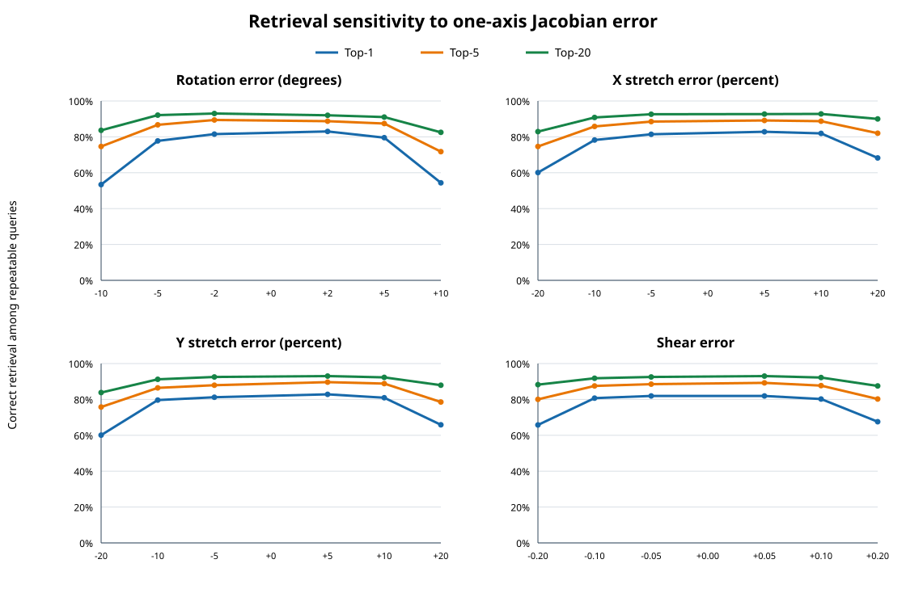

# Translation-free affine-patch retrieval sensitivity

## Result

On three independent 3840 × 2160 synthetic digital image correlation (DIC) pairs, applying the exact local Jacobian to every target candidate patch—without using the true translation to construct those patches—raised the learned compact descriptor's top-1 correct retrieval from **196/1002 to 823/1002 repeatable queries**. Its top-five retrieval rose from **366/1002 to 901/1002**. A WebGPU (the Web Graphics API for graphics processing units (GPUs)) affine consensus retained 775 correct estimates and accepted no false estimates on these globally affine fields.

This isolates geometric support mismatch as a major cause of the earlier descriptor failure. It is an oracle diagnostic: the Jacobian (the derivative of the target coordinate with respect to the reference coordinate) is supplied from synthetic truth, so the result is not an initializer for unknown images and does not establish inverse compositional Gauss–Newton convergence.

## Protocol

- Graphics processing unit (GPU) adapter: Vulkan (Intel(R) Graphics (LNL)); Intel's Lunar Lake (LNL) graphics platform.
- Image size: 3840 × 2160 pixels (ultra-high-definition (UHD), or 4K); three texture/warp seed pairs.
- Per pair: 512 source queries and target candidate budget 8192; actual candidate counts: 8192, 8192, 8192.
- Detector: WGSL structure-tensor score with deterministic spatial quotas; no learned detector weights passed.
- Repeatable denominator: 1002/1536 source queries had a detected target candidate within 5 pixels under analytic truth.
- The same detector-selected candidate coordinates were retained for every Jacobian hypothesis. Candidate selection used detector validity and image-border support only; no analytic visibility or occlusion mask was read.
- For each unknown target candidate position y, the sampled support was `I1(y + F_hat ξ)`. The true translation was absent from support construction. Analytic displacement was used only to label retrieval correctness after scoring.
- The tested descriptors were zero-normalized cross correlation (ZNCC), histogram of oriented and rotated gradients (HORG-64), and a compact convolutional neural network (CNN) descriptor trained for DIC. Their patch support was 64 × 64 pixels.
- The perturbation sweep changed one output-frame Jacobian parameter at a time: rotation, x/y stretch, or shear. Both signs were included.
- Top-1/top-5/top-20 mean that at least one repeatable candidate appears in the first 1/5/20 similarity ranks. The geometric stage fits the top-1 pairs with random sample consensus (RANSAC) on WebGPU, then counts estimates whose analytic displacement error is at most 5 pixels.

## Baseline versus exact Jacobian

Counts below use the 1,002 queries with a target candidate within 5 pixels as the retrieval denominator. The all-query population is 1,536.

| Descriptor | Baseline top-1 | Baseline top-5 | Exact-Jacobian top-1 | Exact-Jacobian top-5 | Exact-Jacobian top-20 |
|---|---:|---:|---:|---:|---:|
| ZNCC | 1/1002 (0.1%) | 1/1002 (0.1%) | 33/1002 (3.3%) | 66/1002 (6.6%) | 113/1002 (11.3%) |
| HORG-64 | 5/1002 (0.5%) | 12/1002 (1.2%) | 0/1002 (0.0%) | 1/1002 (0.1%) | 6/1002 (0.6%) |
| DIC-Descriptor CNN | 196/1002 (19.6%) | 366/1002 (36.5%) | 823/1002 (82.1%) | 901/1002 (89.9%) | 931/1002 (92.9%) |

For the exact-Jacobian CNN arm, WebGPU RANSAC accepted 775/775 points within 5 pixels, including 0 false acceptances. This is a global-affine synthetic case and should not be extrapolated to heterogeneous fields.

## Sensitivity to Jacobian error



The table reports pooled CNN retrieval among the same repeatable queries (n=1,002). Candidate support validity can vary slightly with the hypothesized Jacobian because transformed patches near the image border are invalidated; candidate coordinates themselves do not change.

| Perturbed parameter | Error | Top-1 | Top-5 | Top-20 | RANSAC correct / accepted | False accepted |
|---|---:|---:|---:|---:|---:|---:|
| angle deg | -10° | 535/1002 (53.4%) | 748/1002 (74.7%) | 838/1002 (83.6%) | 499/499 | 0 |
| angle deg | -5° | 779/1002 (77.7%) | 869/1002 (86.7%) | 923/1002 (92.1%) | 732/732 | 0 |
| angle deg | -2° | 817/1002 (81.5%) | 896/1002 (89.4%) | 932/1002 (93.0%) | 759/759 | 0 |
| angle deg | +2° | 832/1002 (83.0%) | 889/1002 (88.7%) | 922/1002 (92.0%) | 783/783 | 0 |
| angle deg | +5° | 797/1002 (79.5%) | 876/1002 (87.4%) | 912/1002 (91.0%) | 747/749 | 2 |
| angle deg | +10° | 545/1002 (54.4%) | 719/1002 (71.8%) | 827/1002 (82.5%) | 515/516 | 1 |
| stretch x percent | -20% | 602/1002 (60.1%) | 748/1002 (74.7%) | 831/1002 (82.9%) | 579/580 | 1 |
| stretch x percent | -10% | 784/1002 (78.2%) | 860/1002 (85.8%) | 910/1002 (90.8%) | 738/738 | 0 |
| stretch x percent | -5% | 816/1002 (81.4%) | 887/1002 (88.5%) | 928/1002 (92.6%) | 764/764 | 0 |
| stretch x percent | +5% | 830/1002 (82.8%) | 893/1002 (89.1%) | 929/1002 (92.7%) | 782/783 | 1 |
| stretch x percent | +10% | 821/1002 (81.9%) | 889/1002 (88.7%) | 930/1002 (92.8%) | 771/772 | 1 |
| stretch x percent | +20% | 684/1002 (68.3%) | 822/1002 (82.0%) | 902/1002 (90.0%) | 649/649 | 0 |
| stretch y percent | -20% | 602/1002 (60.1%) | 759/1002 (75.7%) | 840/1002 (83.8%) | 571/572 | 1 |
| stretch y percent | -10% | 798/1002 (79.6%) | 866/1002 (86.4%) | 914/1002 (91.2%) | 756/757 | 1 |
| stretch y percent | -5% | 814/1002 (81.2%) | 881/1002 (87.9%) | 927/1002 (92.5%) | 771/771 | 0 |
| stretch y percent | +5% | 830/1002 (82.8%) | 898/1002 (89.6%) | 932/1002 (93.0%) | 779/779 | 0 |
| stretch y percent | +10% | 811/1002 (80.9%) | 890/1002 (88.8%) | 925/1002 (92.3%) | 757/759 | 2 |
| stretch y percent | +20% | 660/1002 (65.9%) | 787/1002 (78.5%) | 881/1002 (87.9%) | 618/620 | 2 |
| shear | -0.20 | 659/1002 (65.8%) | 802/1002 (80.0%) | 884/1002 (88.2%) | 630/630 | 0 |
| shear | -0.10 | 809/1002 (80.7%) | 877/1002 (87.5%) | 920/1002 (91.8%) | 759/760 | 1 |
| shear | -0.05 | 821/1002 (81.9%) | 887/1002 (88.5%) | 927/1002 (92.5%) | 774/774 | 0 |
| shear | +0.05 | 821/1002 (81.9%) | 894/1002 (89.2%) | 932/1002 (93.0%) | 765/765 | 0 |
| shear | +0.10 | 804/1002 (80.2%) | 879/1002 (87.7%) | 924/1002 (92.2%) | 757/757 | 0 |
| shear | +0.20 | 677/1002 (67.6%) | 804/1002 (80.2%) | 877/1002 (87.5%) | 645/645 | 0 |

Interpretation: one-axis errors up to 5° rotation, 10% axial stretch, or 0.10 shear retain about 80% top-1 retrieval. At ±10° rotation, ±20% stretch, or ±0.20 shear, top-1 falls to roughly 55–68%, while top-5 remains higher. This supports testing a coarse-to-fine hypothesis strategy, but it does not set a bank spacing: simultaneous errors, non-affine variation, and image-derived hypothesis quality have not been tested.

### Per-texture exact-Jacobian result

| Texture seed | Queries | Target candidates | Repeatable | Baseline CNN top-1 | Exact-Jacobian CNN top-1 | Top-5 | RANSAC correct / accepted | False accepted |
|---:|---:|---:|---:|---:|---:|---:|---:|---:|
| 20261109 | 512 | 8192 | 325 | 146 | 276 | 307 | 246/246 | 0 |
| 20271116 | 512 | 8192 | 244 | 0 | 130 | 170 | 126/126 | 0 |
| 20281123 | 512 | 8192 | 433 | 50 | 417 | 424 | 403/403 | 0 |

## Runtime and implementation limits

| Stage | Median per texture | What is included |
|---|---:|---|
| Paired-image DIC detection | 0.476 s | Both native 4K images; WebGPU detector |
| Affine patch sampling | 0.320 s | Candidate patch resampling; currently CPU-side |
| Descriptor atlas | 1.868 s | Atlas build plus target ZNCC/HORG/CNN descriptor computation |
| Affine RANSAC | 0.022 s | CNN top-1 pairs; WebGPU fit and readback |

These are stage timings, not an end-to-end production latency. Similarity-matrix multiplication and ranking run in NumPy on the central processing unit (CPU) and are not separately timed. Each affine hypothesis currently requires candidate patch resampling and descriptor recomputation; the measured descriptor-atlas stage alone is about 1.87 seconds per hypothesis for this workload. A dense bank is therefore not practical with this prototype. The atlas is a diagnostic batching device and is larger than the input image; it is not the intended production data path. DeDoDe (Detect, Don’t Describe — Describe, Don’t Detect)-B is omitted from this support-level sweep because its current descriptor API consumes a fixed-shape dense image map; the previous full-image oracle report retains that descriptor comparison.

## Conclusion

The translation-free oracle test confirms that explicit affine support compensation can restore the learned descriptor's global retrieval ranking. Moderate Jacobian error is tolerated in these synthetic global-affine cases, but performance degrades at larger one-axis errors. The next implementation should not be a dense all-image bank using this atlas path. The evidence favors a small set of image-derived coarse hypotheses followed by local refinement, or a learned/analytic transformation of compact descriptors. Before selecting a bank spacing, test combined parameter errors and heterogeneous fields, then profile a candidate-centred WebGPU sampler that avoids image-sized atlases.

## Reproduction

Run from the repository root after installing the recorded descriptor weights:

```console
PYTHONPATH=python/benchmarks:python/src python3 \
  python/benchmarks/benchmark_affine_candidate_patch_sensitivity.py \
  --cnn-weights results/descriptors/dic_descriptor_hardneg_training_20261108/dic_patch_cnn_descriptor.npz \
  --output results/descriptors/affine_candidate_sensitivity_20261108/oracle_sensitivity_4k_8192.json \
  --width 3840 --height 2160 --candidate-budget 8192 \
  --global-queries 512 --textures 3 --families affine --sensitivity
```

The raw JavaScript Object Notation (JSON) records per-texture candidate counts, timing stages, all signed perturbations, the WebGPU adapter, model-weight 256-bit Secure Hash Algorithm (SHA-256) fingerprint `63c94446f979af642158ce2242a818ad90aaaefba5b6628739c43f4f5826197d`, and every retrieval and consensus count. The diagnostic uses synthetic truth by design; the query and target candidates are not filtered using analytical visibility masks.
