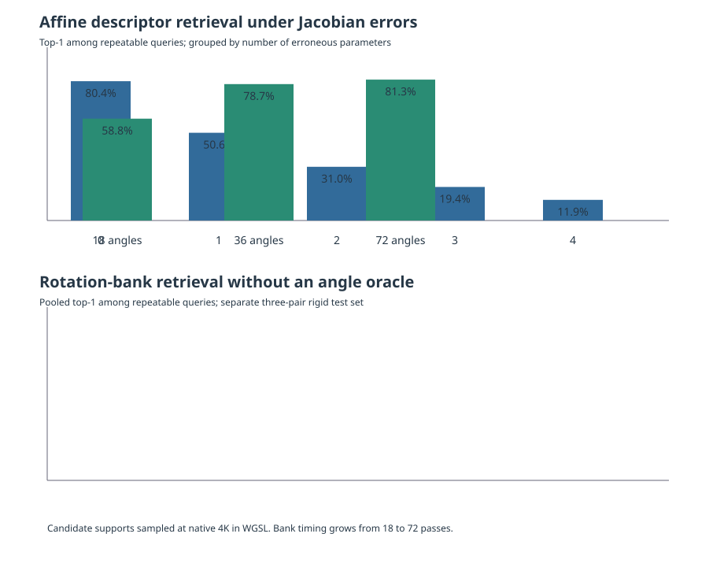

# Affine support compensation: combined-error grid and rotation search

## Scope and protocol

This report evaluates affine-conditioned support sampling for the compact DIC descriptor. The experiment used three independent 3840 × 2160 synthetic speckle pairs per motion family, 512 fixed source queries, and 8,192 detector-selected target candidates per pair. The affine grid has 81 combinations per pair. A second experiment searched rotation using image-derived hypotheses only.

The detector is the WebGPU structure-tensor detector. The descriptor is the existing learned compact convolutional neural network (CNN), sampled with the supplied support Jacobian directly from native target pixels by WebGPU. The Jacobian grid uses `F_hat = R(delta_theta) @ [[1+delta_x, delta_shear], [0, 1+delta_y]] @ F_true`. No analytic visibility mask filters the target candidate set. The repeatable-query denominator is fixed for every support hypothesis. The analytic field is used only to score outcomes and to form the labelled oracle ceiling.

Adapter: Vulkan (Intel(R) Graphics (LNL)). CNN weights SHA-256: `63c94446f979af642158ce2242a818ad90aaaefba5b6628739c43f4f5826197d`.



## Combined affine-parameter errors

Rows are grouped by the number of nonzero parameter errors. Each group pools every grid point and all three textures. Top-1 and top-5 are counted only for source points with a target candidate within 5 pixels under the analytic mapping; the repeatable denominator does not change across hypotheses. All-query coverage uses all 512 queries per texture. The last two columns report consensus-retained direct pairs; those are measured correspondences, while the preceding prediction coverage is reconstructed from a fitted global affine model.

| Nonzero errors | Grid rows | Repeatable queries | Top-1 correct | Top-5 contains correct | Top-1 / repeatable | Direct retained correct / total | False retained | Fitted field correct / all queries |
|---:|---:|---:|---:|---:|---:|---:|---:|---:|
| 0 | 3 | 751 | 604 | 661 | 80.4% | 545 / 551 | 6 | 1,536 / 1,536 (100.0%) |
| 1 | 24 | 6,008 | 3,042 | 4,028 | 50.6% | 2,654 / 2,683 | 29 | 11,602 / 12,288 (94.4%) |
| 2 | 72 | 18,024 | 5,590 | 8,654 | 31.0% | 4,249 / 4,312 | 63 | 21,595 / 36,864 (58.6%) |
| 3 | 96 | 24,032 | 4,651 | 8,284 | 19.4% | 2,846 / 2,893 | 47 | 15,869 / 49,152 (32.3%) |
| 4 | 48 | 12,016 | 1,431 | 2,907 | 11.9% | 742 / 763 | 21 | 5,578 / 24,576 (22.7%) |

Uncompensated baseline across the three affine pairs: top-1 7/751 (0.9%), top-5 25/751 (3.3%).

### One-parameter sensitivity

This isolates one error family at a time, pooling positive and negative perturbations at the same magnitude across all three textures. The query denominator is fixed to the repeatable queries in each source set.

| Parameter varied alone | Absolute error | Top-1 correct / repeatable | Top-5 contains correct / repeatable |
|---|---:|---:|---:|
| Rotation | ±10° | 624/1502 (41.5%) | 898/1502 (59.8%) |
| Axial stretch x | ±20% | 820/1502 (54.6%) | 1069/1502 (71.2%) |
| Axial stretch y | ±20% | 755/1502 (50.3%) | 991/1502 (66.0%) |
| Shear | ±0.2 | 843/1502 (56.1%) | 1070/1502 (71.2%) |

### Rotation interaction with the other affine errors

Each cell pools both signs of the other active parameter errors and all three textures. This exposes whether rotation error compounds with stretch and shear errors; it does not imply that the parameter errors have equal physical severity.

| Rotation error | Other parameters wrong | Top-1 correct / repeatable | Top-5 contains correct / repeatable |
|---:|---:|---:|---:|
| -10° | 0 | 298/751 (39.7%) | 447/751 (59.5%) |
| -10° | 1 | 1304/4506 (28.9%) | 2069/4506 (45.9%) |
| -10° | 2 | 1727/9012 (19.2%) | 3061/9012 (34.0%) |
| -10° | 3 | 670/6008 (11.2%) | 1412/6008 (23.5%) |
| +0° | 0 | 604/751 (80.4%) | 661/751 (88.0%) |
| +0° | 1 | 2418/4506 (53.7%) | 3130/4506 (69.5%) |
| +0° | 2 | 2928/9012 (32.5%) | 4443/9012 (49.3%) |
| +0° | 3 | 1083/6008 (18.0%) | 2043/6008 (34.0%) |
| +10° | 0 | 326/751 (43.4%) | 451/751 (60.1%) |
| +10° | 1 | 1358/4506 (30.1%) | 2142/4506 (47.5%) |
| +10° | 2 | 1841/9012 (20.4%) | 3180/9012 (35.3%) |
| +10° | 3 | 761/6008 (12.7%) | 1495/6008 (24.9%) |

The exact-Jacobian row is the zero-error group. A fitted global affine predicts all 1,536 query centres within 5 pixels in this synthetic globally affine set, but the direct consensus retains some false pairs (reported above). Therefore the fitted-field result must not be read as a direct-match rate or as evidence for heterogeneous deformation.

### Per-texture capture

| Texture seed | Repeatable / 512 | Uncompensated top-1 | Exact-J top-1 | Exact-J direct retained (false) | Exact-J fitted field correct / 512 |
|---:|---:|---:|---:|---:|---:|
| 20261110 | 299 | 1 | 278 | 263 / 264 (1 false) | 512 / 512 |
| 20271117 | 142 | 1 | 133 | 92 / 97 (5 false) | 512 / 512 |
| 20281124 | 310 | 5 | 193 | 190 / 190 (0 false) | 512 / 512 |

## Rotation bank without an angle oracle

The bank covers 360 degrees with nested, uniformly spaced subsets of 18, 36, and 72 hypotheses (20, 10, and 5 degree spacing). For each angle, the target support is sampled with that rotation. The per-query max-bank retrieval metric keeps each query's best score across all angles, so different queries can implicitly use different angles; it is an upper-bound diagnostic, not one selected-bank output. The usable WebGPU affine-RANSAC consensus selects a single angle using the largest inlier count, then lowest residual. Its selected-angle top-1 column reports descriptor retrieval at that one angle. Neither the true angle nor true translation participates in this selection. The exact-Jacobian figures below are an oracle ceiling only.

| Bank | Spacing | Per-query max-bank top-1 / repeatable | Per-query max-bank top-5 / repeatable | Selected-angle top-1 / repeatable | Selected direct matches correct / retained | False retained | Fitted rigid field correct / all 1,536 | Median bank time per pair |
|---:|---:|---:|---:|---:|---:|---:|---:|---:|
| 18 | 20° | 553 / 941 (58.8%) | 699 / 941 (74.3%) | 687 / 941 (73.0%) | 654 / 654 | 0 | 1,536 / 1,536 (100.0%) | 2.08 s |
| 36 | 10° | 741 / 941 (78.7%) | 808 / 941 (85.9%) | 818 / 941 (86.9%) | 788 / 788 | 0 | 1,536 / 1,536 (100.0%) | 4.16 s |
| 72 | 5° | 765 / 941 (81.3%) | 823 / 941 (87.5%) | 829 / 941 (88.1%) | 800 / 800 | 0 | 1,536 / 1,536 (100.0%) | 8.08 s |

Uncompensated rotation baseline: 0/941 top-1 (0.0%). Exact-Jacobian oracle ceiling: 829/941 top-1 (88.1%) and 866/941 top-5 (92.0%).

The affine consensus reconstructs the rigid field at all query centres in these three globally rigid synthetic cases. This is extrapolated field coverage, not direct correspondence coverage. No spatially heterogeneous or discontinuous field was used to validate this global consensus strategy.

### Per-texture rotation results

| Texture seed | True angle | Repeatable | Oracle top-1 | 18-bin top-1 / fitted field | 36-bin top-1 / fitted field | 72-bin top-1 / fitted field |
|---:|---:|---:|---:|---:|---:|---:|
| 20361113 | 152.37° | 276 | 267 | 222/276 · 512/512 | 256/276 · 512/512 | 257/276 · 512/512 |
| 20371120 | 54.08° | 276 | 185 | 77/276 · 512/512 | 129/276 · 512/512 | 149/276 · 512/512 |
| 20381127 | -168.96° | 389 | 377 | 254/389 · 512/512 | 356/389 · 512/512 | 359/389 · 512/512 |

## Coarse-to-fine rotation search

This pipeline selects geometry at three stages: 18 coarse angles on 128 spatially distributed source queries and 2,048 spatially distributed target candidates; local 5-degree refinement around the two strongest coarse consensuses; then full verification of the two strongest remaining angles on 512 queries and 8,192 candidates. Each native image and the CNN weights are uploaded once; point-set sessions reuse them and reuse their convolution workspaces across Jacobian hypotheses. Descriptor vectors remain on the device through WGSL reciprocal matching; only compact reciprocal indices and scores are read before geometric consensus. Selection uses observed image matches and geometric consensus; analytic motion is consulted only for scoring and reported errors.

| Texture seed | Repeatable / queries | Selected angle | Angle error | Direct correct / retained | False retained | Fitted field correct / 512 | Search only | Pipeline including detection and source description |
|---:|---:|---:|---:|---:|---:|---:|---:|---:|
| 20361113 | 276 / 512 | 150.0° | -2.37° | 253 / 253 | 0 | 512 / 512 | 1.077 s | 1.773 s |
| 20371120 | 276 / 512 | 55.0° | +0.92° | 180 / 180 | 0 | 512 / 512 | 1.086 s | 1.606 s |
| 20381127 | 389 / 512 | -170.0° | -1.04° | 367 / 367 | 0 | 512 / 512 | 1.058 s | 1.558 s |

Pooled coarse-to-fine direct recovery is 800/941 repeatable queries (85.0%), with 800/800 retained matches correct and 0 false acceptances. A global rigid consensus predicts 1536/1536 query centres within 5 pixels in these globally rigid cases; this is extrapolated field output, not direct coverage. Median search-only time is 1.077 s and median total time including both-image detection and source descriptor preparation is 1.606 s.

The comparison uses the same three textures and candidate/query budgets as the full rotation bank. Search-only timing includes target image/model preparation, coarse/refinement sessions, descriptor extraction, matching, and consensus, but excludes feature detection and source description. Total time adds both-image detection and source-description stages. Neither time includes synthetic-image generation or external file decoding.

## Visibility and detector ceiling

For the affine pairs, analytic target-centre visibility is recorded after the fact and never used to filter candidates. Across the three 512-query sets, the table separates target centres outside the image from centres inside the image but lacking any detected target candidate within 5 pixels. The nearby-candidate count is the repeatability ceiling for this candidate budget, distinct from descriptor retrieval quality.

| Motion family | Queries | Target centre outside image | Centre visible, no target candidate within 5 px | Repeatable with a target candidate |
|---|---:|---:|---:|---:|
| Global affine | 1536 | 603 | 182 | 751 |

## Timing and implementation boundary

Each target descriptor extraction for one affine hypothesis reads the native image and samples the affine support in a WGSL shader; the experiment does not build a rectified full-frame atlas. On this Intel Graphics (LNL) Vulkan adapter, each support-conditioned descriptor extraction took about 50–70 ms for 8,192 target points at 4K. The full rotation-bank times include descriptor extraction, the existing mutual matcher, and affine-consensus fitting for each hypothesis; median pair times are shown above. Detection cost was roughly 0.5–0.6 s per pair and source-description cost roughly 17–25 ms per pair.

In the exhaustive rotation-bank diagnostic, descriptor arrays are still read back to NumPy for its per-query max-bank ranking, and the ordinary matcher path uploads them again. The separate coarse-to-fine path avoids that round trip: native images, model weights, convolution workspaces and descriptor vectors remain on WebGPU through reciprocal matching. Compact indices and scores still cross to the host for geometric consensus selection. This is device-resident image/descriptor extraction and reciprocal matching, not an end-to-end device-only pipeline.

## Interpretation and next step

The experiment supports a useful progression: modest errors in a single Jacobian parameter do not immediately destroy retrieval, but errors combined across parameters sharply reduce top-1 retrieval as more components depart from the true Jacobian. On rigid cases, an image-only rotation bank recovers a substantial fraction of the exact-Jacobian retrieval ceiling, while the 18-to-72 hypothesis cost grows nearly linearly. Increasing from 36 to 72 angles yields only a modest pooled top-1 increment in this small three-pair sample.

The rotation result is promising but does not establish performance on general affine or heterogeneous deformation, and it does not measure IC-GN convergence. The coarse-to-fine run selects the rigid rotation without an angle oracle, but its final global affine model is tested only on globally rigid synthetic fields. The next step is to replace one global model with competing local models on heterogeneous fields and report direct observations separately from local interpolation and extrapolation. Do not propagate a model across a physical discontinuity without independent evidence.

## Reproduction

```bash
PYTHONPATH=python/benchmarks:python/src .venv/bin/python \
  python/benchmarks/benchmark_affine_hypothesis_search.py \
  --mode both \
  --cnn-weights results/descriptors/dic_descriptor_hardneg_training_20261108/dic_patch_cnn_descriptor.npz \
  --output results/descriptors/affine_hypothesis_wgpu_20261108/combined_and_rotation_4k.json \
  --width 3840 --height 2160 --candidate-budget 8192 --query-budget 512 --textures 3
```

Raw measurements: [`affine_search_4k_optimized.json`](./affine_search_4k_optimized.json).

Supplemental raw measurements are `rotation_bank_reuse_4k.json` and `coarse_to_fine_4k.json`.
