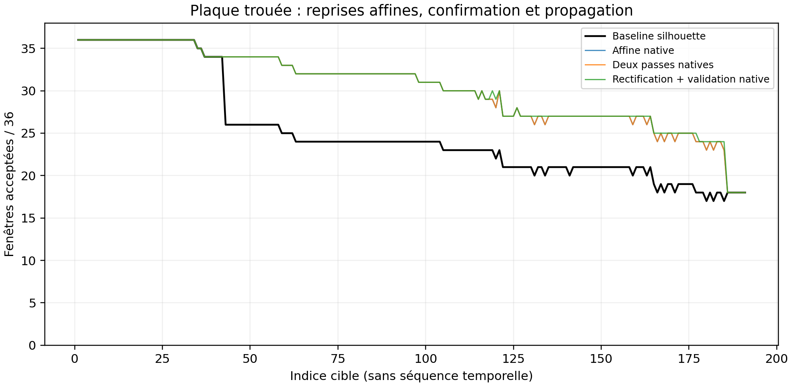
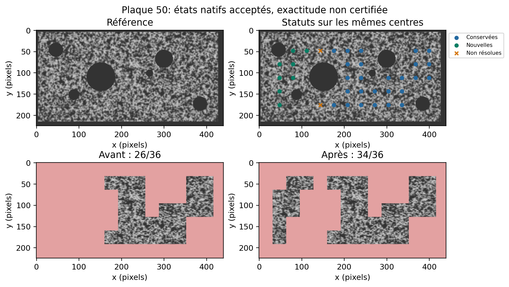
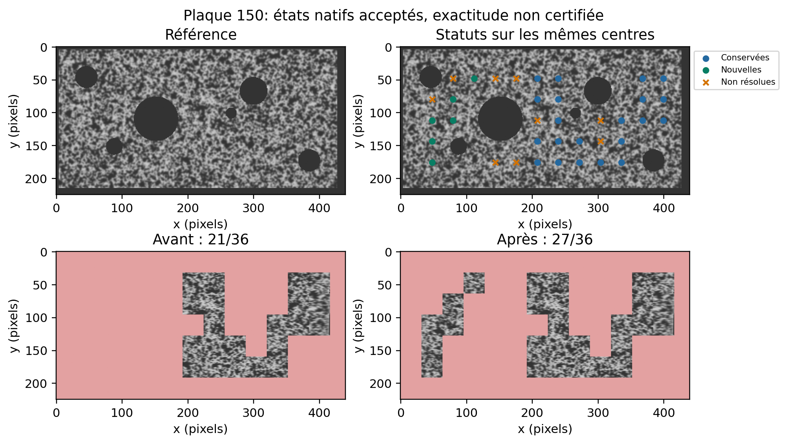
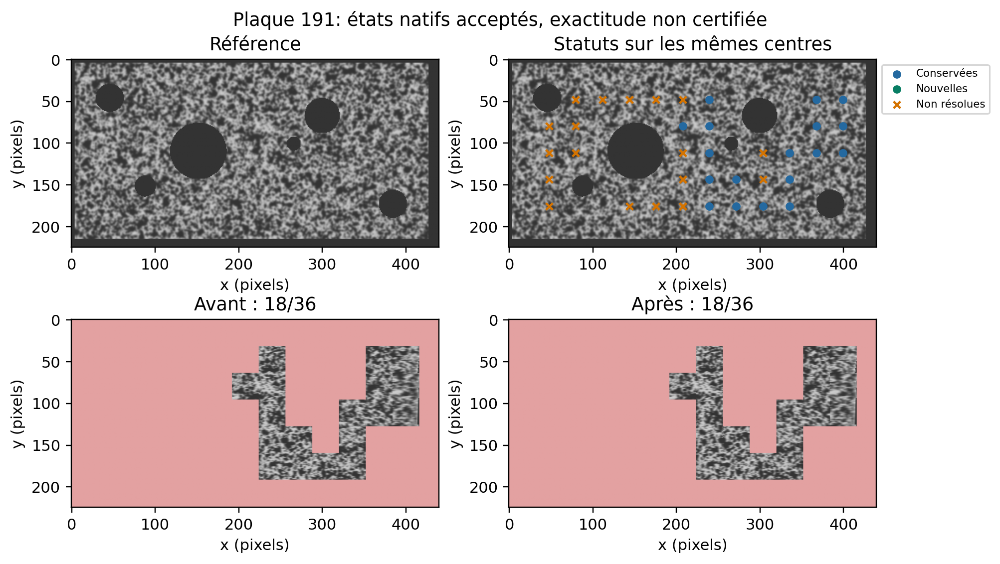

# Reprise affine itérative de la plaque trouée

Chaque cible est comparée directement à Img_F, sans état d'une autre cible. Les 191 niveaux sont évalués avec les mêmes 36 fenêtres de support/pas 32 pixels. Les états acceptés du contrôle silhouette du 14 novembre sont le départ commun et restent inchangés. Ce sont des acceptations numériques, pas des déplacements certifiés : la vérité associée manque toujours.

## Méthode exécutée

À chaque tour, on ajuste y=A x+t aux correspondances centrales déjà acceptées. L'ajustement est robuste : coordonnées centrées/réduites, dix résolutions de moindres carrés pondérés, poids de Huber min(1,c/r) avec c=max(1 pixel,2,5 fois le résidu médian). Les gradients locaux ne sont pas utilisés dans cet ajustement. Moins de trois centres non colinéaires, un déterminant non positif ou un conditionnement supérieur à 100 arrêtent la reprise.

Trois variantes sont comparées : affine réestimée et résolution native; deux résolutions natives successives (contrôle du travail supplémentaire); rectification puis résolution et validation native. La dernière construit J(z)=I₁(Az+t), par interpolation bilinéaire et arrondi uint8, à partir de la cible originale à chaque tour. Aucune image déjà rectifiée n'est rééchantillonnée à nouveau.

Pour une solution résiduelle ψ(x)=x+r(x), le retour natif est φ(x)=Aψ(x)+t. Le déplacement vaut u=A(x+r)+t−x et le gradient de transformation vaut F=A(I+∇r). Ces règles sont testées sur les positions et les dérivées, notamment par différences finies. Les états sont ensuite résolus de nouveau sur les pixels natifs; une acceptation dans l'image rectifiée seule ne suffit pas.

La sélection éparse, confirmation et propagation existantes utilisent toujours les coordonnées natives et les seuils 8 pixels / 0,25 en gradient. Solveur de Gauss–Newton à composition inverse (IC-GN) : affine, interpolation bilinéaire, 30 itérations par appel, tolérance 10⁻³, corrélation normalisée à moyenne nulle (ZNCC) minimale 0,65. Les anciennes fenêtres sont conservées; les nouvelles sont réunies puis la propagation native est relancée. Arrêt après un tour sans nouvelle fenêtre, ou au maximum cinq tours. Aucun seuil n'est ajusté par niveau.

L'ajustement et la rectification sont sur le processeur central; les résolutions utilisent WebGPU. Ce prototype n'est pas une chaîne entièrement résidente sur le processeur graphique.

## Résultats

| Variante | Total avant | Total après | Paires améliorées /191 | Dernier indice à 100 % | Dernier indice ≥90 % | Surcoût médian (s) |
|---|---:|---:|---:|---:|---:|---:|
| Affine native | 4802 | 5791 | 143 | 34 | 62 | 0.126 |
| Deux passes natives | 4802 | 5791 | 143 | 34 | 62 | 0.191 |
| Rectification + validation native | 4802 | 5804 | 143 | 34 | 62 | 0.343 |

Les totaux additionnent des cibles de la même texture : ce ne sont pas des observations indépendantes. Les maxima ne garantissent pas un succès monotone aux niveaux inférieurs. Les temps sont des surcoûts de reprise, hors initialisation historique et préparation de référence.

Comparaison fenêtre par fenêtre : 0 acceptations exclusives à la reprise native et 13 exclusives à la rectification. Les comptes identiques ne sont donc pas supposés impliquer des états identiques.

La rectification récupère 1002 acceptations de plus que le départ; la reprise native en récupère déjà 989. Sur ce jeu, conserver la reprise affine native comme premier essai est donc justifié par le coût; la rectification reste une reprise supplémentaire, sans promesse de couverture complète. Les comparaisons portent sur une seule série de texture, pas une validation générale.

Contrôles finaux : 0 acceptations avec corrélation recalculée <0,65 et 0 supports acceptés hors image. Aucun cas n'atteint la limite de cinq tours dans cette campagne; les reprises s'arrêtent au plateau.

### Niveau 50

[Animation référence/corrigée](figures/plate_050.gif)

### Niveau 100

[Animation référence/corrigée](figures/plate_100.gif)

### Niveau 150

[Animation référence/corrigée](figures/plate_150.gif)

### Niveau 191

[Animation référence/corrigée](figures/plate_191.gif)

## Limites et décision

La reprise peut enrichir les graines sans changer les seuils, mais ne garantit pas la résolution de toutes les fenêtres. Au niveau 191, examiner les diagnostics de l'affine et la distribution spatiale des graines avant de conclure à un manque d'itérations : une affine globale ne décrit pas nécessairement les zones encore non résolues. Les anciennes solutions restent immuables; une fausse acceptation initiale éventuelle n'est donc pas corrigée par cette expérience.

Les contrôles photométriques finaux sont enregistrés par variante; ils ne remplacent pas une vérité de déplacement. `protocol.json`, `comparison.json`, `all_levels/` et les tests de composition rendent l'expérience reproductible. Aucun dépôt externe, poids appris ou seuil de production n'a été modifié.
