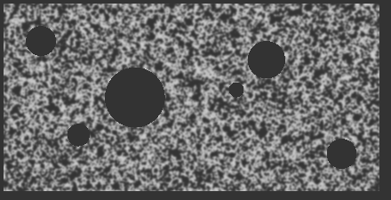
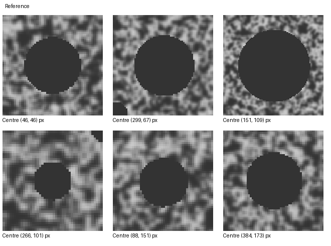
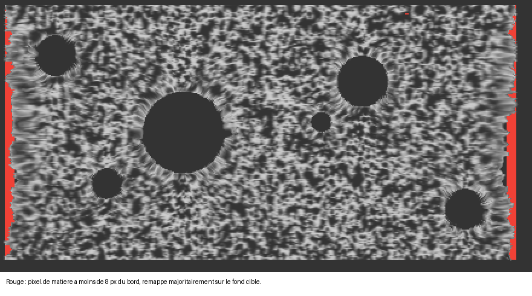
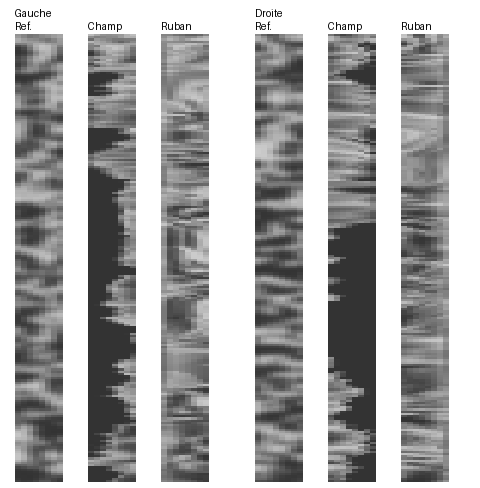

# Plate 191 edge failure

Full report with animations and quantitative limitations is in [the documentation source](../../docs/explanation/plate191-edge-failure.rst).

The lateral failure remains unresolved. Of 86 added outer-edge windows, 85 lie on the top or bottom. More than half the left/right edge-strip material is mapped to target background. Whole-plate acceptance is not a displacement-accuracy measure.

