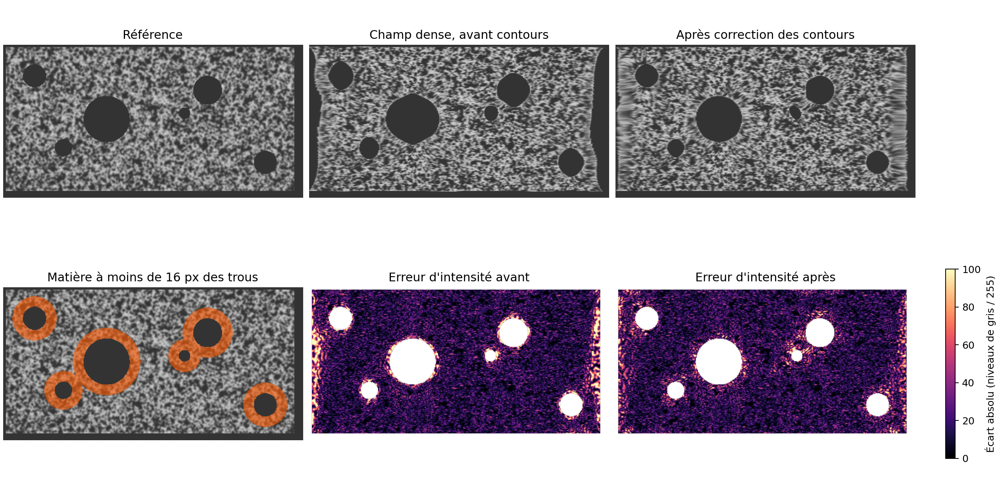

# Correction du diagnostic : le contour ne valide pas la texture

La recommandation précédente du champ corrigé comme initialisation près des trous est retirée.

Le champ déplace les contours vers la référence mais détériore le mouchetis dans une partie de la couronne matérielle.

| Distance aux trous | Pixels | Corrélation avant | Après | Supports validés couvrant la zone |
|---|---:|---:|---:|---:|
| 0–4 px | 2844 | 0.168 | 0.384 | 15.7% |
| 4–8 px | 3637 | 0.700 | 0.614 | 58.2% |
| 8–16 px | 8718 | 0.864 | 0.774 | 94.5% |
| 16–32 px | 20628 | 0.841 | 0.852 | 91.3% |
| >32 px | 45908 | 0.838 | 0.868 | 83.8% |

Aucun des 825 centres de qualification n'est situé à moins de 8 pixels d'un trou. Seuls 30 sont situés entre 8 et 16 pixels, avec 29 retenus aussi bien avant qu'après contours. Les scores globaux ne permettent donc pas de qualifier la couronne proche des trous.

Les corrélations de ce tableau regroupent les intensités de toute une bande, avec un masque de matière de référence fixe. Ce ne sont pas des scores de fenêtres IC-GN ni des erreurs de déplacement.

Il faut réutiliser les observations photométriques validées sur les images originales, et ne pas propager une correction de contour comme si elle était une mesure matérielle. Les zones sans observation doivent rester explicitement non initialisées. L'absence de centres de contrôle dans la couronne ne prouve ni la convergence ni l'impossibilité de convergence d'un autre support.
