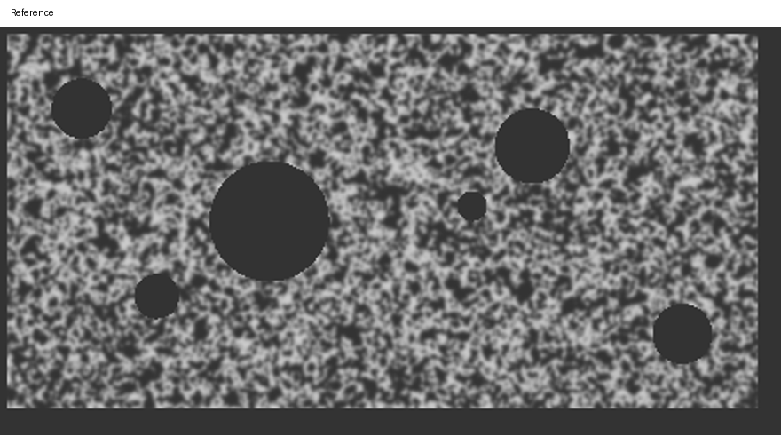
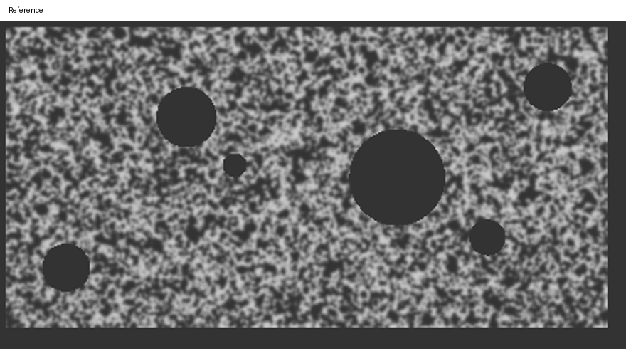

# Oracle control for lateral edge thinning

This diagnostic tests whether exact local affine initialization can overcome a strongly compressed speckle band. It uses the existing WebGPU inverse-compositional Gauss–Newton (IC-GN) solver with 12 × 12 subsets, four-pixel spacing, B-spline interpolation, 0.001 tolerance, and 0.65 minimum normalized cross-correlation. The verifier permits up to four 30-iteration blocks and does not change solver thresholds.

## Synthetic pair

The target is rendered from the same reference with an invertible horizontal map. Its local lateral stretch is

\[
\lambda_x(x)=\lambda_c-(\lambda_c-0.05)\left(e^{-d_L/38}+e^{-d_R/38}\right),
\]

where \(d_L\) and \(d_R\) are distances to the left and right material edges in reference pixels. The central stretch is chosen so the integral preserves the specimen width. For this plate, \(\lambda_c=1.2081\), while the stretch tends to 0.05 at either edge. The first eight reference pixels map to roughly 1.2 target pixels. The vertical stretch is 4.8294. Rendering uses inverse mapping, cubic interpolation, and 8-bit quantization, without added random noise.

The known local Jacobian supplies all six affine seed parameters. The solver receives these oracle seeds. Two textures are scored, the source speckle and the same speckle mirrored within the specimen width. The spatially varying map is not affine over an entire subset, so exact centre parameters do not remove within-subset curvature.

## Results

The fixed edge population contains 212 lateral windows per texture, with 106 on each side. “Accurate” means the final accepted centre displacement is within two pixels of the known synthetic displacement.

| Texture | Side | IC-GN accepted | Accepted and accurate |
|---|---|---:|---:|
| Original | Left | 19 / 106 | 16 / 106 |
| Original | Right | 73 / 106 | 65 / 106 |
| Mirrored | Left | 14 / 106 | 12 / 106 |
| Mirrored | Right | 60 / 106 | 50 / 106 |
| Combined | Both | 166 / 424 (39.2%) | 143 / 424 (33.7%) |

The asymmetry changes with the texture but remains substantial after mirroring. The pooled result is below 60% for the full lateral population, while the pooled right-side acceptance is 62.7%. This supports a resolution-related limit for this particular rendering profile and solver setup. It does not establish a universal bound or identify the unknown renderer of the experimental plate.

A coarse target-material mask classified at least 75% of all tested lateral supports as material. It therefore did not detect the loss of lateral image detail. The mask measures where material was rendered, while sampling resolution determines how much independent speckle information survives.

## Figures and data





The original map, seeds, solver outputs, and distance-stratified counts are in `../hudge_flank_twin_20261118_v2/`. The mirrored case is in `../hudge_flank_twin_20261118_mirrored_v2/`.

## Reproduction

From the repository root, with the HudgeStrains reference and external Live-DIC checkout available:

```bash
PYTHONPATH=python/src .venv/bin/python python/benchmarks/flank_twin.py --output results/hudge_flank_twin_20261118_v2
PYTHONPATH=python/src .venv/bin/python python/benchmarks/verify_hudge_composed_seeds.py results/hudge_hole_rbf_20261117/composition_v2 --seed-archive results/hudge_flank_twin_20261118_v2/oracle_seeds.npz --output results/hudge_flank_twin_20261118_v2/oracle --images results/hudge_flank_twin_20261118_v2/reference.png results/hudge_flank_twin_20261118_v2/target.png --prior-archive results/hudge_boundary_frontier_20261115/partial12/seeds.npz
PYTHONPATH=python/benchmarks .venv/bin/python python/benchmarks/qualify_flank_twin.py results/hudge_flank_twin_20261118_v2
```

Add `--mirror` to the rendering command and use a separate output folder to reproduce the mirrored texture. The verifier currently resolves the external Live-DIC source through a workstation path. A clone needs that dependency configured before the solver run. The control does not modify Live-DIC.
