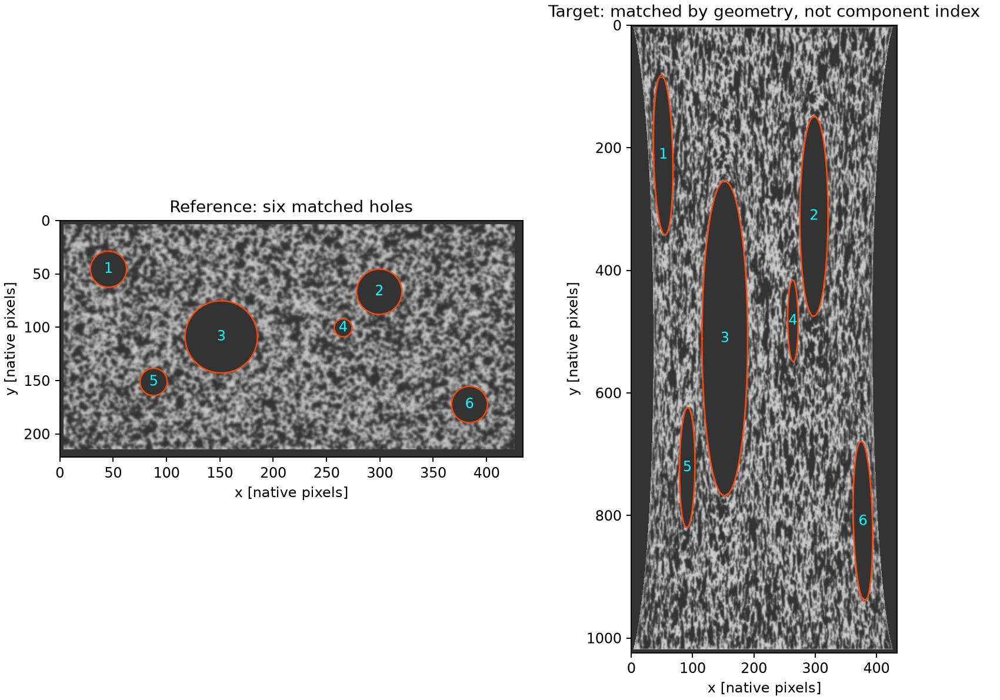
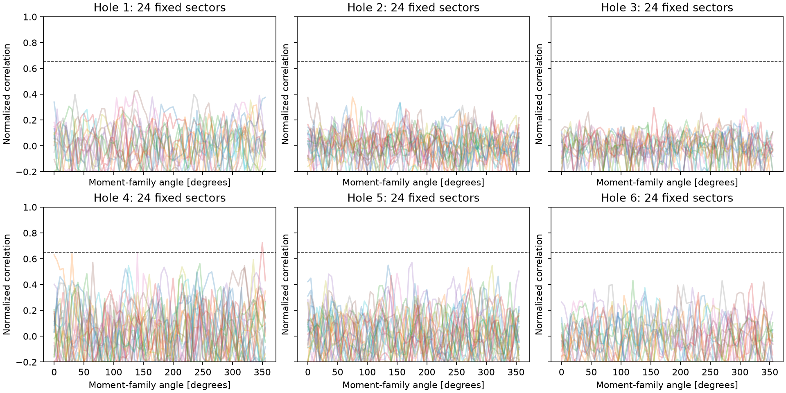
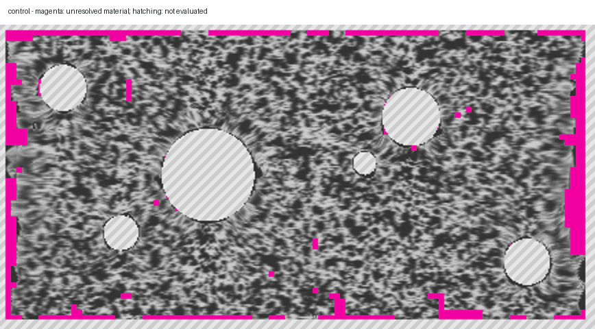
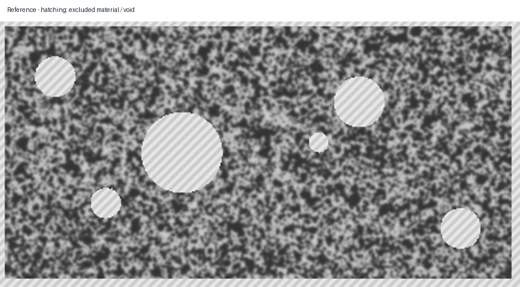
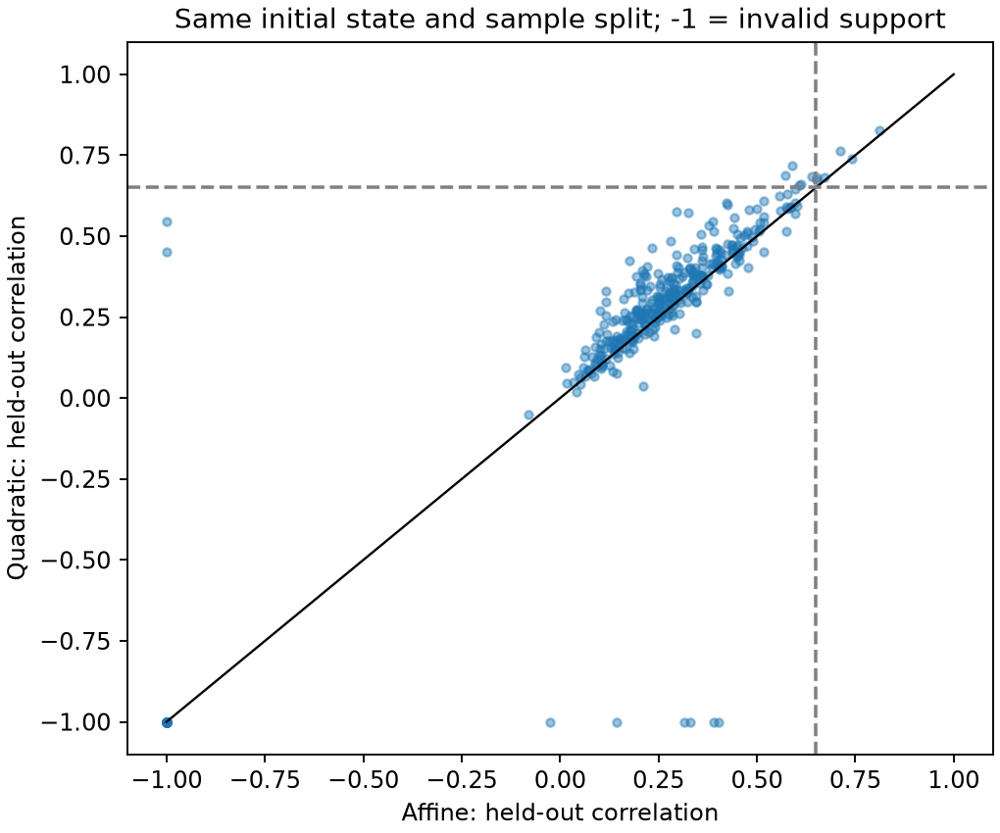

# Trous comme générateurs d’ancres : essai du 17 novembre 2026

**Résultat : mécanisme fonctionnel, mais aucune amélioration qualifiée de la plaque au niveau 191.** Les moments des trous et la texture de secteurs annulaires permettent de proposer des transformations. Sur deux rendus à transformation connue, leurs ancres contrôlées améliorent nettement la couverture correcte par rapport à la boîte silhouette. Sur la plaque fournie au niveau 191, elles ne récupèrent aucune fenêtre supplémentaire de façon suffisamment cohérente. La solution précédente est conservée.

La corrélation d’images numériques (**DIC**, *digital image correlation*) utilise ici un solveur de Gauss–Newton inverse compositionnel (**IC-GN**, *inverse-compositional Gauss–Newton*). Il exécute ses résolutions locales sur le processeur graphique (**GPU**, *graphics processing unit*) via WebGPU. L’analyse des trous, le balayage angulaire, l’ajustement des secteurs et les figures utilisent le processeur central (**CPU**, *central processing unit*). Ce prototype **n’est pas une chaîne entièrement résidente sur GPU**.

## Images, appariement et portée

Paire principale : `FEA/Img_F.tif` et `FEA/Img_wa_g191.tif`, images natives 1024 × 1024. La matière de référence ne mesure qu’environ 423 × 211 pixels. Aucun déplacement du répertoire `DEPL` n’est utilisé : son association à cette plaque n’est pas établie. Les empreintes des deux images figurent dans [le journal des propositions](proposals/summary.json).



Les numéros désignent les associations obtenues, pas les indices des composantes connexes. La cible contient aussi de petites composantes uniformes dues au mouchetis. L’affectation minimise une distance de centroïdes après transformation de la boîte silhouette, plus une pénalité logarithmique d’aire. Une association trop éloignée ou ambiguë est rejetée. Les six trous sont retrouvés. **Ce procédé suppose des silhouettes complètes de même orientation générale ; il ne constitue pas un appariement universel sous rotation ou occultation.**

Les ellipses représentent les moments des surfaces vides, avec correction de covariance d’un pixel carré (1/12 sur chaque diagonale). Le résidu de bord est calculé sur les centres des pixels du contour : il inclut une erreur de discrétisation, particulièrement importante pour le petit trou. Les trous de la cible sont proches d’ellipses ; cela ne prouve pas que le mouvement du mouchetis voisin est affine.

## Méthode effectivement exécutée

1. Pour chaque trou apparié, construire la famille `F(theta) = sqrt(S1) R(theta) invsqrt(S0)`, avec translation imposée par les centroïdes. Les matrices `S` sont les covariances surfaciques. L’angle paramètre les coordonnées normalisées, pas nécessairement la rotation physique.
2. Évaluer 72 angles espacés de 5°. Les secteurs ont une ouverture de 50°, des centres espacés de 45° et trois intervalles de rayon relatif : [1,02 ; 1,5[, [1,5 ; 2[ et [2 ; 3[. Le rayon de référence est celui du disque de même aire. Les échantillons hors matière sont exclus **avant** la recherche, de façon identique pour toutes les hypothèses.
3. Conserver au plus trois pics séparés de 15°. Affiner leurs six paramètres sur les intensités, sans pénalité de contour. Chaque ajustement est limité à 60 évaluations de la fonction de résidu.
4. Transmettre au plus six hypothèses par centre non résolu au solveur WebGPU existant : support 12 × 12, pas 4, interpolation par splines cubiques, 30 itérations par appel, au plus quatre continuations, tolérance 0,001, corrélation minimale 0,65. Les six coefficients locaux sont transmis.
5. Après acceptation, propager avec les permissions de voisinage matériel existantes, au plus trois parents distincts par fenêtre, au plus quarante anneaux. Aucun masque analytique ni déplacement vrai n’intervient dans cette boucle.

La corrélation est une corrélation croisée normalisée à moyenne nulle (**ZNCC**, *zero-mean normalized cross-correlation*). Les hypothèses ne peuvent pas augmenter leur score en supprimant les pixels cibles difficiles : les échantillons de référence sont fixes. Un secteur sortant de l’image ou conservant moins de 90 % de support matériel bilinéaire dans la cible est rejeté. Les autres échantillons restent dans le score, même s’ils tombent sur le fond. Au moins 32 échantillons sont nécessaires.



## Plaque 191 : pourquoi le premier gain était trompeur

L’archive de départ contient 3 163 fenêtres acceptées. Un contrôle reprenant exactement ces états et relançant la propagation en obtient 3 164 : cette fenêtre supplémentaire ne doit pas être attribuée aux moments.

| Variante | Fenêtres acceptées après propagation | Nouveaux points de graine issus des trous | Pixels à déterminant non positif dans le champ assemblé |
|---|---:|---:|---:|
| Contrôle, sans nouvelle hypothèse | 3 164 | 0 | 127 |
| Moments, sans contrôle du secteur final | 3 381 | 180 | 8 299 |
| Moments et contrôle du secteur final | 3 164 | 0 | 127 |
| Initialisation quadratique et contrôle du secteur final | 3 164 | 0 | 127 |

Le premier essai ajoute 217 acceptations par rapport au contrôle, mais **dégrade le remapping**. Un déterminant local positif dans chaque fenêtre ne garantit pas un champ assemblé sans repli. Les déterminants ci-dessus sont calculés par différences finies dans les pixels dont le voisinage est couvert ; ce sont des diagnostics, pas des erreurs connues de déplacement.



### Contrôle élargi après ce résultat négatif

Le second protocole, exploratoire et construit après cet échec, sépare les pixels de chaque secteur en deux damiers. La recherche et l’ajustement utilisent le premier ; le deuxième contrôle la corrélation. Le seuil 0,65 est conservé. Ces échantillons sont spatialement corrélés : **ce n’est pas un test statistiquement indépendant**.

Le contrôle est répété sur le secteur avec les paramètres effectivement retournés par le solveur. Sur les 33 centres proposés, trois passent le statut et la photométrie de leur petite fenêtre, mais échouent sur le secteur : corrélations 0,289 et 0,236, et un support devenu invalide. Aucun ne devient une nouvelle ancre. Les états finaux sont identiques au contrôle, paramètres compris. Voir [les rejets détaillés](anchor_rejections.json).



**Hachures : trous ou extérieur non évalués. Magenta : matière non couverte. Les cercles hachurés ne sont pas des trous corrigés par le calcul.** La texture matérielle autour doit être examinée. Les images natives pour défilement sont [image1_ref](validated/image1_ref.png), [image1_def_cor](validated/image1_def_cor.png) et [le masque de couverture](validated/image1_valid.png).

Cette comparaison reprend la grille `partial12` pour isoler l’apport des trous. Elle ne remplace pas la reprise antérieure des bords extérieurs, dont [les résultats sont conservés](../hudge_boundary_frontier_20261115/outer_completed/README.md).

## Affine ou quadratique sur le même secteur ?

Une ablation reprend 384 hypothèses issues du premier ajustement et prolonge soit une affine, soit un polynôme quadratique à douze paramètres. Même état initial, mêmes échantillons d’apprentissage et de contrôle, même limite de 60 évaluations supplémentaires. Aucun terme de contour.



Sur les ajustements dont les deux supports restent valides, la médiane de corrélation de contrôle passe de **0,266 à 0,313**. Six ajustements affines et onze quadratiques dépassent 0,65 sur les pixels de contrôle. Les conditions supplémentaires de validité du support et de positivité du déterminant restent appliquées.

Le quadratique propose 38 centres non résolus. Trois passent les contrôles de leur petite fenêtre après résolution locale, mais aucun ne reste cohérent avec son secteur. Résultat final : aucun gain sur la plaque 191.

**Limite d’implémentation :** le quadratique est un ajustement CPU de secteur. Sa tangente affine au centre initialise le solveur GPU ; sa courbure reste fixe pendant la vérification du secteur. Le solveur externe n’accepte pas actuellement de masque pour son modèle quadratique. Nous n’avons donc pas réalisé une résolution IC-GN quadratique masquée complète et ne prétendons pas l’avoir invalidée. Aucun fichier de Live-DIC n’a été modifié.

## Rendus jumeaux avec vérité séparée

La même image de référence est transportée par une transformation connue. Le premier rendu utilise `F = [[1, 0.08], [0.15, 3.9]]`, `t = [2, 10]`. Le second ajoute au déplacement `[4 sin(2 pi y / 140), 8 sin(2 pi x / 140)]`. L’inverse est résolu par Newton ; l’image est rééchantillonnée par interpolation cubique, puis arrondie en niveaux de gris sur huit bits. Le générateur vérifie le résidu inverse et le signe du déterminant.

Les algorithmes ne lisent que les images et leur segmentation. Les archives `truth_scoring_only.npz` ne sont utilisées que pour le score, sauf dans les contrôles explicitement nommés `oracle`.

Les dénominateurs sont les mêmes **5 126 centres matériels sélectionnés**. « Correct » signifie une erreur de déplacement au centre strictement inférieure à deux pixels ; les erreurs de gradient sont enregistrées séparément. Tous les centres sélectionnés ont une interpolation du masque de référence égale à un.

| Rendu | Initialisation puis propagation | Acceptées | Correctes <2 px | Fausses acceptées ≥2 px |
|---|---|---:|---:|---:|
| Affine | Boîte silhouette | 4 629 | 3 867 | 762 |
| Affine | Moments sans contrôle élargi | 3 963 | 2 469 | 1 494 |
| Affine | Moments avec contrôle élargi | 4 889 | 4 862 | 27 |
| Affine | Paramètres analytiques locaux — oracle | 4 891 | 4 891 | 0 |
| Non affine | Boîte silhouette | 4 541 | 3 684 | 857 |
| Non affine | Moments avec contrôle élargi | 4 869 | 4 801 | 68 |
| Non affine | Paramètres analytiques locaux — oracle | 4 889 | 4 889 | 0 |


Le contrôle des secteurs réduit fortement les faux acceptés, mais ne les élimine pas. Sur le rendu affine, 14 faux acceptés sont déjà des ancres, puis 27 sont présents après propagation. Sur le rendu non affine, les nombres sont 16 puis 68. Les taux finaux de faux acceptés, environ **0,55 % et 1,40 %**, dépassent le critère historique de 0,1 %. **Il n’y a donc pas de qualification de production.**

Les listes exhaustives permettent de localiser chaque erreur : [affine contrôlé](twin_affine/validated/false_accepted.csv), [non affine contrôlé](twin_nonlinear/validated/false_accepted.csv), [affine non contrôlé](twin_affine/moments/false_accepted.csv). Les deux rendus réutilisent une seule texture déjà étudiée ; ils valident un mécanisme et un diagnostic, pas la généralisation à d’autres images.

## Sensibilité, mesures et limites

Les initialisations sont perturbées séparément de ±5° et ±0,5 pixel sur chaque composante du centroïde cible, puis réajustées. Sur les secteurs du protocole contrôlé, le changement quadratique moyen des positions échantillonnées a une médiane de 1,25 pixel et un percentile 95 de 30,38 pixels. Cela montre des bassins multiples ou instables ; ce test ne démontre pas une invariance à l’initialisation. Les échecs sont inclus et toutes les lignes sont conservées dans [le journal de sensibilité](validated_proposals/summary.json).

Le [tableau stratifié](annular_sectors.csv) utilise le rayon relatif et des secteurs de 45°, avec dénominateurs fixes entre méthodes. Si plusieurs trous couvrent une zone, elle est attribuée au trou de plus petit rayon normalisé. Les corrélations sont regroupées sur les pixels couverts, pas assimilées à des erreurs de déplacement. Les tailles de population et la couverture accompagnent chaque valeur.

Matériel observé : Intel Graphics LNL, Vulkan, Mesa 25.2.8. Recherche et sensibilité CPU de la plaque : environ 81 s pour le premier protocole et 63 s pour le protocole contrôlé. L’ablation de courbure demande environ 70 s supplémentaires. Les exécutions de résolution/propagation/export demandent environ 7 s, avec création du contexte. Ces temps sont des observations de recherche, parfois avec un autre diagnostic CPU en cours, **pas un benchmark de latence de production**. Les temps par étape sont dans [la comparaison brute](comparison.json).

Les contrôles automatiques couvrent la congruence des moments, l’ambiguïté affine des ellipses, les coordonnées sous-pixel, l’exclusion des trous recadrés, l’indépendance à l’ordre des composantes, la recherche de rotation sur texture, les supports invalides et la dérivée analytique du quadratique. Dix tests ciblés passent, ainsi que le contrôle Ruff des scripts concernés. Les paramètres des 3 163 anciens états acceptés sont vérifiés inchangés lors de la production du rapport.

## Décision

Conserver ce générateur d’hypothèses comme expérience optionnelle. Ne pas injecter les acceptations non contrôlées dans le résultat publié précédemment. Sur la plaque 191, le mécanisme actuel n’apporte pas de nouvelles graines suffisamment validées. L’ajustement quadratique de secteur améliore certaines photométries mais sa conversion vers une résolution affine locale ne lève pas le blocage. Une résolution véritablement quadratique sur support matériel partiel reste une expérience distincte à implémenter et qualifier.

Les contours ne participent à aucune perte de recalage après la génération des hypothèses. Ils fournissent néanmoins l’initialisation et les supports : leur recouvrement final ne serait donc pas un contrôle statistiquement indépendant.

## Reproduction et données

Les commandes complètes figurent dans [le script de campagne](../../python/benchmarks/run_hudge_hole_experiment.py). Les scripts enregistrent les hypothèses, les scores de secteur, les sorties de chaque tentative GPU, les parents de propagation et les résultats finaux. Les sorties existantes ne sont pas écrasées ; utiliser un nouveau dossier.

```bash
.venv/bin/python python/benchmarks/run_hudge_hole_experiment.py --output results/hudge_hole_moments_reproduction
.venv/bin/python -m pytest python/benchmarks/tests/test_hudge_hole_moments.py python/benchmarks/tests/test_hudge_boundary_frontier.py -q
```

Les chemins locaux des images et du solveur externe peuvent être adaptés. La campagne ne télécharge aucun modèle et n’entraîne aucun réseau. Les résultats historiques restent intacts.
