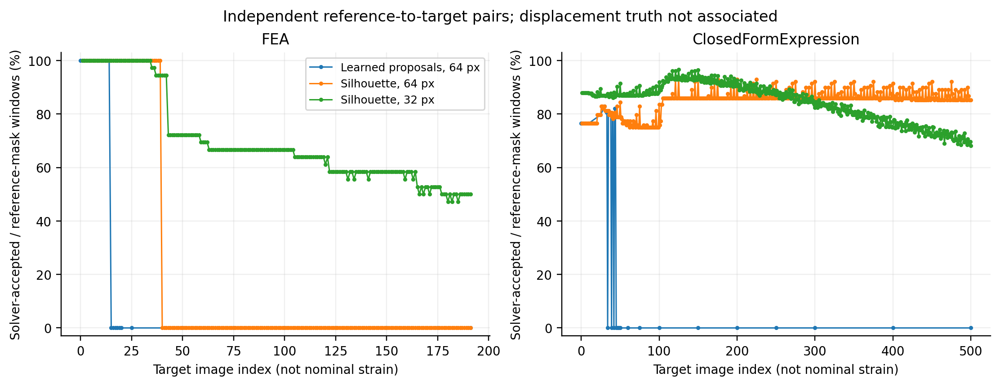
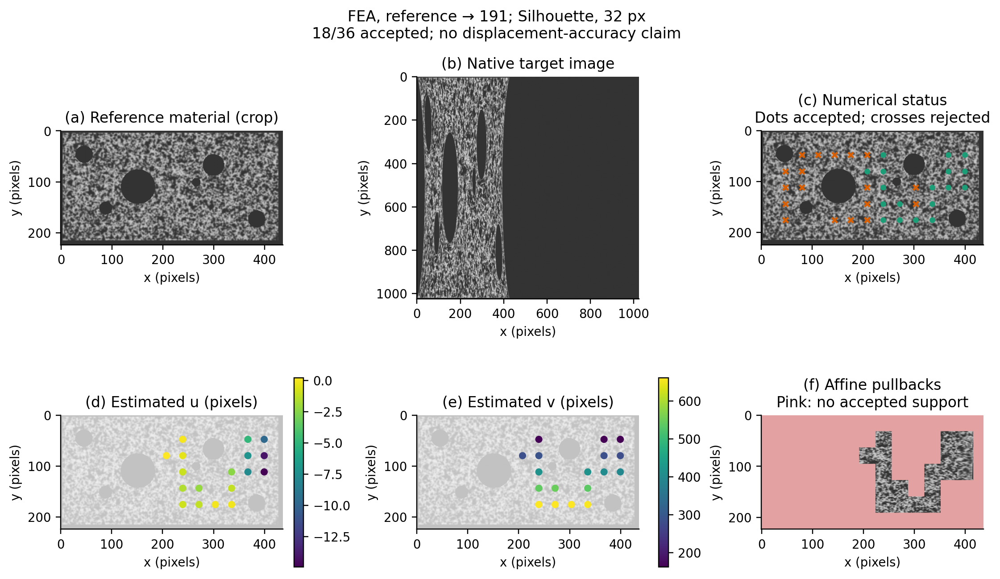
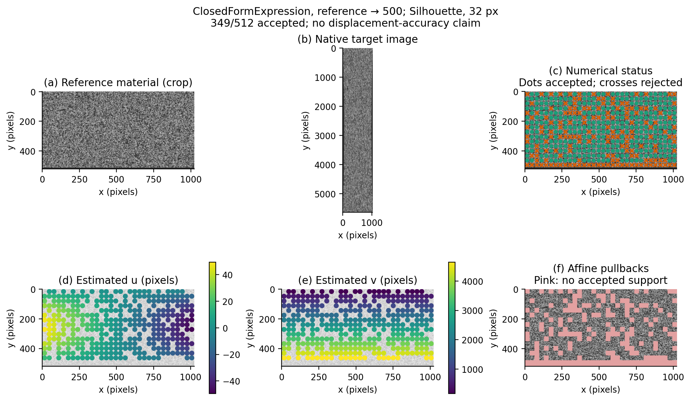

# HudgeStrains — initialisation directe sans séquence

## Conclusion et portée

Les images sont traitées en paires indépendantes `Img_F → cible`. Aucun état calculé sur une cible antérieure n’est réutilisé. Le cache de référence est autorisé; ce n’est pas un suivi temporel.

Le pipeline appris actuel perd les graines précocement sur ces images. Un comparateur non appris, fondé sur les étendues de la silhouette, conserve des états acceptés beaucoup plus loin. **Aucun niveau maximal de déplacement correctement retrouvé ne peut encore être certifié** : les fichiers de déplacements fournis n’ont pas d’association documentée aux deux séries d’images. Les résultats ci-dessous mesurent une acceptation numérique et un recalage photométrique, pas une erreur de déplacement.

La [méthodologie détaillée de la proposition par silhouette](SILHOUETTE_METHOD.md) décrit la segmentation, les six paramètres, la sélection, la confirmation et la propagation réellement exécutées.

## Niveaux atteints

| Série | Méthode | Paires | Fenêtres admissibles | Dernier état | Acceptées à cet état | Max ≥50 % | Max ≥90 % | Max ≥95 % |
|---|---|---:|---:|---:|---:|---:|---:|---:|
| FEA | learned | 28 | 3 | 191 | 0 | 14 | 14 | 14 |
| FEA | silhouette_64 | 191 | 3 | 191 | 0 | 39 | 39 | 39 |
| FEA | silhouette_32 | 191 | 36 | 191 | 18 | 191 | 42 | 36 |
| ClosedFormExpression | learned | 33 | 128 | 500 | 0 | 44 | — | — |
| ClosedFormExpression | silhouette_64 | 500 | 128 | 500 | 109 | 500 | 475 | — |
| ClosedFormExpression | silhouette_32 | 500 | 512 | 500 | 349 | 500 | 242 | 150 |

Les maxima correspondent au plus grand indice **testé** satisfaisant le seuil de couverture, pas à une déformation nominale. La couverture n’est pas monotone. Le fichier `limits.json` donne aussi le préfixe continu entièrement testé à 90 %. Tous les 191 et 500 états sont testés pour chaque support du comparateur; le pipeline appris est sondé grossièrement puis plus finement autour de sa perte de graines. Les cibles d’une série partagent une seule texture et ne sont pas des échantillons statistiques indépendants.

Le rapport d’étendue verticale observable vaut 1015/211 ≈ 4,81 au dernier état `FEA`, et 5632/512 = 11 à l’état 500 de `ClosedFormExpression`. Ces rapports décrivent le contour dans les images; ils ne remplacent ni une jacobienne locale vraie ni une déformation mécanique connue.

## Pourquoi le pipeline courant échoue

La matière ne couvre qu’une petite fraction de la référence. Sur la grille du réseau, 2125/2304 requêtes `FEA` et 5120/5632 requêtes de la bande sont dans le fond uniforme. Le garde-fou de l’affine exige quatre cases occupées dans une grille 3 × 3 portant sur le raster entier. Les requêtes matérielles ne peuvent en occuper que deux et trois respectivement. Une affine soutenue seulement par la matière ne peut donc satisfaire ce garde-fou. Ce diagnostic ne justifie pas de conclure à l’incapacité intrinsèque du descripteur : le domaine spatial de la validation est inadapté à ces images.

Le comparateur estime uniquement les translations et étirements diagonaux de la boîte englobante, à partir des deux images. Cette proposition est soumise au même solveur, à la confirmation des graines et à la propagation. Il n’utilise ni le numéro de niveau, ni le maillage, ni les déplacements vrais. Il ne comprend pas le classement angulaire, la corrélation locale ni les reprises affines du pipeline appris. Il suppose des contours complets identifiables et n’est pas une méthode générale de grande rotation ou d’occultation.

## Fenêtres et contrôles

- Référence historique : supports 64 × 64 et pas 64. Sur la plaque trouée, le masque de support complet ne laisse que trois centres admissibles.
- Contrôle séparé : supports 32 × 32 et pas 32, soit 36 centres admissibles sur la plaque et 512 sur la bande. Support **et** population changent; ce n’est pas une comparaison à centres identiques.
- Solveur de corrélation d’images numériques par Gauss–Newton à composition inverse (IC-GN) : affine, interpolation bilinéaire, 30 itérations, tolérance 10⁻³, seuil de corrélation normalisée à moyenne nulle (ZNCC) 0,65.
- Confirmation : espacement épars 2, tolérances de transport 8 pixels et 0,25 en gradient, indicateur de trois ancres par composante (non bloquant ici), confirmation par lots. Aucun seuil n’est réglé en fonction du niveau ou d’une vérité.
- Diagnostic final indépendant : 0 états acceptés avec ZNCC recalculée <0,65; 0 supports acceptés sortant de l’image cible. Ce contrôle ne mesure pas l’exactitude du déplacement et ne modifie pas l’acceptation.
- Contrôle identité : niveau 0 = référence contre elle-même; il est séparé des maxima et seul possède ici une vérité de déplacement incontestable.

Le contrôle identité de la bande accepte 98/128 fenêtres à 64 pixels, avec des paramètres quasi nuls (maximum absolu < 6 × 10⁻⁸). Les 30 rejets sont exactement la première ligne et les colonnes de bord restantes. Le shader impose une marge cible de deux pixels aux supports transformés. Ce résultat explique une perte de couverture même sans mouvement; il n’est pas un plafond pour d’autres transformations, qui déplacent les supports différemment. Le dénominateur masqué n’a pas été rétréci après coup pour améliorer les pourcentages.

## Figures et images corrigées

Les images remappées utilisent uniquement les états finaux acceptés sur leurs supports. Les zones non résolues sont roses; aucune interpolation ne leur fabrique une solution. Les cartes de déplacement ne montrent que les centres acceptés. Les GIF alternent la référence et ces remappages dans le même repère.

### FEA, dernier état

[Animation référence / corrigée](figures/silhouette_32_FEA_191.gif)

### ClosedFormExpression, dernier état

[Animation référence / corrigée](figures/silhouette_32_ClosedFormExpression_500.gif)

## Vérité, reproductibilité et revue Claude

`DATA_AUDIT.md` explique le verrou de provenance : 51 états d’un maillage en croix, 191 images d’une plaque trouée et 500 images d’une bande sans expression jointe. Ni les unités, ni l’origine, ni l’orientation des axes, ni la correspondance des états ne sont inférées pour améliorer un score. Le lecteur de champs triangulaires et la conversion aux centres exacts ont été testés, mais aucun champ incompatible n’est appliqué aux images.

Les commandes et états sont conservés par paire. `summary.csv`, `limits.json`, `diagnostics/` et `figures/sources.json` donnent les résultats et leur provenance. `runtime_source_manifest.json` épingle les sources du solveur et des scripts; le code est dans `reproducibility_sources/`. `reproduce.sh` reprend les calculs déjà achevés. Pour une réplication propre, choisir un nouveau répertoire de sortie. SciPy est une dépendance de ces outils d’expérience, pas de l’inférence de production.

Les durées du pipeline appris incluent des processus séparés et des contrôles; le comparateur réutilise la préparation de référence. Les colonnes de temps ne doivent donc pas être transformées en facteur d’accélération. Aucune performance temps réel n’est revendiquée.

Cette campagne apporte des cas externes, un comparateur sans réseau et des champs/remappages utiles à la revue Claude. Elle ne clôt ni la validation expérimentale, ni la comparaison aux méthodes publiées, ni la précision sur vérité connue. Aucun entraînement, seuil de production ou résultat historique n’a été modifié. Les données originales restent externes au dépôt.
