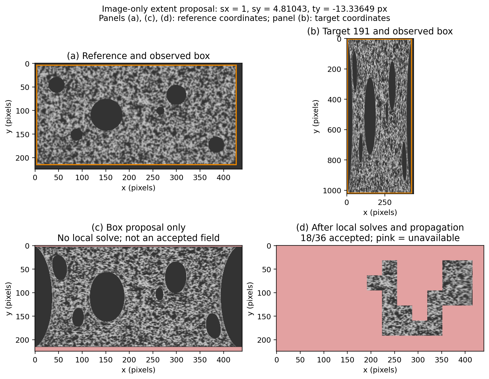
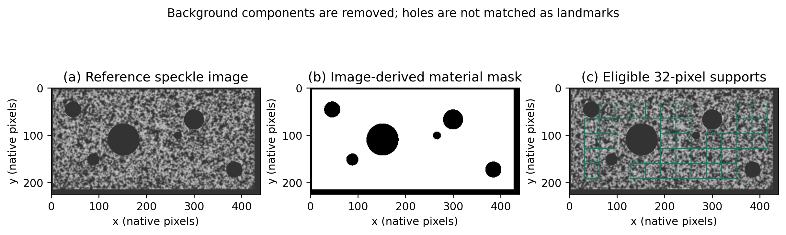
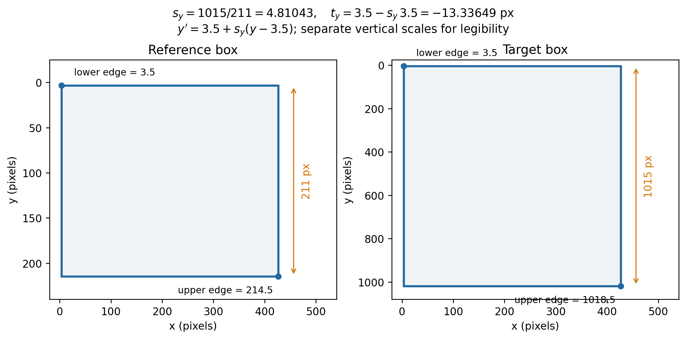
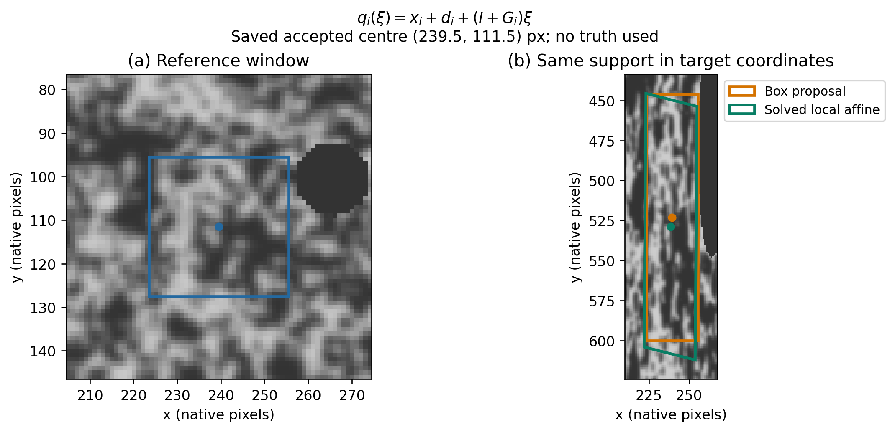
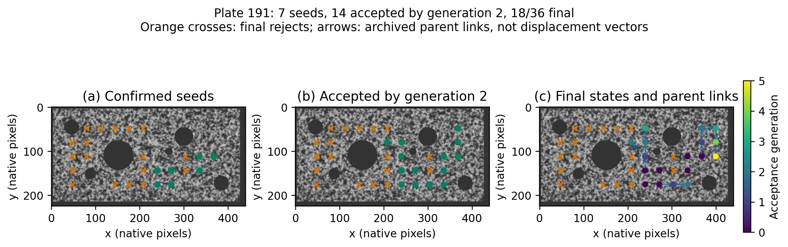

# Initialisation par les étendues de la silhouette

Cette note décrit **l'algorithme réellement exécuté**, et non une méthode générale de recalage de contours. La proposition estime quatre paramètres globaux depuis les deux images : deux étirements suivant les axes de l'image et deux translations. Le solveur de corrélation d'images numériques (DIC) corrige ensuite six paramètres affines par fenêtre. Aucun déplacement analytique ni état d'une cible précédente n'est utilisé.

La formulation anglaise complète, destinée au travail d'article, est intégrée à la section 3 du [PDF](../../paper/hudge_strains_addendum.pdf), avec les équations et le schéma ci-dessous.

## 1. Pourquoi introduire cette proposition ?

La recherche de correspondances sur mouchetis doit retrouver simultanément le déplacement et la forte modification de forme des motifs. Les images fournies contiennent une autre information observable : un objet entièrement visible sur un fond constant, dont l'étendue change fortement. La boîte englobante peut fournir l'ordre de grandeur de l'étirement et de la translation sans reconnaître chaque motif.

L'hypothèse testée est limitée : **si cette géométrie grossière fournit quelques initialisations dans le domaine de convergence du solveur, la résolution locale et la propagation peuvent-elles prendre le relais ?** La boîte n'impose pas la déformation finale à l'intérieur du matériau. Deux champs très différents peuvent avoir la même boîte : elle n'identifie donc pas le champ intérieur.

## 2. Extraction des masques depuis les pixels

Pour chaque image, indépendamment :

1. Prendre comme intensité de fond celle du pixel inférieur droit.
2. Construire l'ensemble des pixels exactement égaux à cette intensité.
3. Identifier ses composantes connexes à quatre voisins.
4. Exclure les composantes d'au moins 128 pixels; conserver les autres.

Les petites îles sont conservées car la quantification du mouchetis peut produire ponctuellement la même valeur que le fond. Il n'y a ni fermeture morphologique ni tolérance radiométrique. Le seuil 128 est une aire en pixels natifs. Cette règle est spécifique aux rendus à fond constant; un fond photographique bruité ou un coin occupé par l'objet nécessiterait une autre segmentation, à qualifier séparément.

Le masque de référence définit la région d'intérêt : seuls les supports entièrement contenus dans la matière sont admissibles. Le masque cible sert à calculer sa boîte; **il n'est pas fourni au solveur comme masque matériel cible**. Les bornes de l'image cible sont contrôlées, mais une occultation matérielle n'est pas certifiée par ce mécanisme.

## 3. Boîtes et conventions de coordonnées

Les centres des pixels sont entiers, x vers la droite, y vers le bas. Pour l'image j, les bords de boîte sont :

\[
\ell_j=(x_{\min}-1/2,y_{\min}-1/2)^T,\qquad
h_j=(x_{\max}+1/2,y_{\max}+1/2)^T,\quad L_j=h_j-\ell_j.
\]

Une rangée de n pixels a donc une longueur n, pas n−1. La transformation proposée est :

\[
S=\operatorname{diag}(L_{1x}/L_{0x},L_{1y}/L_{0y}),\quad
t=\ell_1-S\ell_0,\quad \varphi_0(x)=Sx+t.
\]

Elle envoie exactement les deux coins extrêmes de la boîte initiale sur ceux de la boîte cible. Cela ne prouve pas que les pixels extrêmes soient des points matériels homologues. Les trous influencent l'admissibilité des fenêtres mais ne sont pas appariés comme des repères. Aucune rotation ni aucun cisaillement n'est estimé à ce stade.

**Exemple bande, cible 500.** Les bords verticaux passent de [−0,5; 511,5] à [−0,5; 5631,5]. On obtient sᵧ=11, tᵧ=5 pixels, donc v₀(y)=10y+5. Omettre les demi-pixels et utiliser 10y créerait ici cinq pixels d'erreur dans la proposition.

**Exemple plaque, cible 191.** Les bords passent de [3,5; 214,5] à [3,5; 1018,5]. On obtient sᵧ=1015/211≈4,81043 et tᵧ≈−13,33649 pixels. Dans les deux exemples sₓ=1 et tₓ=0. Ces rapports décrivent une enveloppe observable, pas un étirement local vrai.

## 4. Les six paramètres effectivement transmis

Au centre (xᵢ,yᵢ), l'ordre du solveur de Gauss–Newton à composition inverse (IC-GN) est :

\[
p_i=(u_i,u_{x,i},u_{y,i},v_i,v_{x,i},v_{y,i}).
\]

La proposition fournit :

\[
p_i^0=((s_x-1)x_i+t_x,\ s_x-1,\ 0,\ (s_y-1)y_i+t_y,\ 0,\ s_y-1).
\]

Les gradients diagonaux ne sont donc **pas remis à zéro**. Le solveur échantillonne les pixels natifs avec le support affine correspondant, puis peut modifier les six coefficients, y compris les dérivées croisées initialement nulles. Il n'est pas contraint de conserver une déformation diagonale globale. Le remappage de la proposition seule, montré dans la figure, est une illustration; ce n'est pas une étape de préredimensionnement de l'image utilisée par le solveur.

## 5. Sélection des hypothèses et confirmation

On teste, dans cet ordre, l'hypothèse nulle puis la proposition de silhouette. Les deux utilisent les mêmes fenêtres admissibles, prises une ligne sur deux et une colonne sur deux de la grille. L'hypothèse ayant le plus de résultats finis acceptés par le solveur est retenue. En cas d'égalité, la première, donc l'hypothèse nulle, gagne. Aucun score analytique ne participe au classement.

Pour transporter une solution du centre i vers j, on utilise :

\[
\widehat d_{j|i}=d_i+G_i(x_j-x_i),\qquad \widehat G_{j|i}=G_i,
\]

où d est le déplacement et G son gradient. La cohérence demande une différence de déplacement de norme euclidienne ≤8 pixels et une différence de gradient de norme de Frobenius ≤0,25.

Deux routes sont présentes dans le code de confirmation :

- un candidat et un voisin déjà vérifié sont confirmés si leurs états respectent ces deux critères;
- sinon, des voisins non encore vérifiés sont résolus à partir du transport. Au moins deux voisins résolus, finis, acceptés et cohérents confirment le parent et les voisins correspondants.

La confirmation par lots est activée lorsqu'il y a plus de huit candidats; son résultat est rejoué dans l'ordre de confirmation original.

**Précision importante :** `minimum_anchors=3` calcule un indicateur par composante de la grille admissible. Ce n'est pas une porte bloquante dans ce comparateur : le résultat ne refuse pas automatiquement une paire ayant moins de trois ancres. Les formulations antérieures « trois ancres demandées » étaient trop imprécises.

## 6. Propagation réellement utilisée

Chaque passe fige les fenêtres déjà acceptées. Pour chaque fenêtre admissible non résolue, on prend au plus les deux premiers parents acceptés dans l'ordre haut, gauche, droite, bas, puis diagonales. On transporte l'état du premier parent et on résout sur les images. Le deuxième parent est essayé si le premier n'a pas produit de résultat accepté. Statut du solveur, finitude et critères de cohérence restent exigés.

Les nouvelles solutions deviennent des parents à la passe suivante. Les solutions déjà acceptées restent inchangées. L'algorithme s'arrête si la frontière est vide ou si une passe entière n'ajoute aucune fenêtre.

Cette politique ne fait ni moyenne pondérée ni médiane des voisins. Elle n'est pas la politique historique limitée à trois tentatives : ici il n'y a pas de plafond de trois tentatives par fenêtre sur toute sa durée de vie.

Le voisinage porte sur la grille des fenêtres. Aucun test explicite de traversée du masque matériel n'est appliqué à chaque lien. Un support plein évite de résoudre une fenêtre sur un trou, mais ne garantit pas qu'un lien diagonal ne traverse jamais une fissure étroite. Cette expérience ne démontre pas la préservation des discontinuités.

## 7. Réglages et comptages intermédiaires

Solveur affine, pixels natifs, interpolation bilinéaire, 30 itérations au maximum, tolérance 10⁻³, seuil de corrélation normalisée à moyenne nulle (ZNCC) 0,65. La politique séparée de rejet des valeurs aberrantes du solveur est désactivée; les contrôles de cohérence décrits ci-dessus restent actifs. Deux expériences distinctes : support/pas 64/64 et 32/32. Ni banque angulaire, ni recherche de corrélation séparée, ni résidu appris, ni reprise régionale, ni transfert entre les deux tailles de support.

| Paire et support | Acceptés au test nul | Acceptés au test silhouette | Graines confirmées | Acceptés finaux |
|---|---:|---:|---:|---:|
| Plaque 191, 32 pixels | 0 | 4 | 7 | 18/36 |
| Bande 500, 64 pixels | 0 | 8 | 35 | 109/128 |

Chaque exemple comporte six passes de propagation, en comptant la passe d'arrêt lorsqu'elle existe. Le nombre de graines peut dépasser le nombre d'acceptations éparses, car la confirmation résout des voisins supplémentaires. Ces comptes sont archivés dans `silhouette_32/FEA/level_191.json` et `silhouette_64/ClosedFormExpression/level_500.json`.

## 8. Pourquoi cela peut fonctionner, et où cela échoue

La boîte peut lever une ambiguïté de grande amplitude avant la recherche photométrique locale. Les gradients réellement résolus permettent ensuite de suivre une cinématique différente de la proposition globale. C'est ce relais, et non une connaissance du déplacement intérieur par la silhouette, que les résultats rendent plausible.

En revanche, les extrema sont sensibles aux erreurs de segmentation, aux composantes détachées, aux occultations et au recadrage. Rotation et cisaillement modifient les boîtes sans être représentés par la proposition. Pour s=L₁/L₀, une perturbation donne δs≈δL₁/L₀−L₁δL₀/L₀² : un petit objet de référence fortement étiré amplifie l'incertitude des bords. Une même enveloppe peut aussi cacher des mouvements intérieurs incompatibles avec l'initialisation.

L'extraction des masques et des boîtes s'effectue sur le processeur central. Python orchestre sélection, confirmation et propagation; les résolutions locales utilisent l'interface graphique WebGPU et ses shaders écrits en WebGPU Shading Language (WGSL). Des tableaux de paramètres et de statuts reviennent sur le processeur central entre appels. Ce comparateur n'est pas une chaîne entièrement résidente sur le processeur graphique.

La piste mérite d'être conservée comme **hypothèse optionnelle lorsque la silhouette complète est disponible**. Les résultats actuels ne démontrent ni nouveauté, ni supériorité générale, ni précision métrologique. Il reste à associer la vérité de déplacement, à perturber les masques de manière contrôlée et à comparer, à fenêtres identiques, proposition seule, confirmation et propagation. Aucune nouvelle mesure n'est inventée par cette documentation.

## 9. Lecture visuelle et équations associées

### Du masque au support admissible

Pour un centre xᵢ et les offsets ξ de sa fenêtre Ξᵢ, l'admissibilité complète s'écrit :

\[
V_i=\prod_{\xi\in\Xi_i}\mathbf1_{M_0}(x_i+\xi).
\]

L'indicatrice vaut 1 dans le masque matériel de référence M₀, 0 ailleurs. Un seul pixel hors masque suffit donc à exclure le support. Cette règle ne dit rien sur la visibilité dans la cible.

### Du contour à la transformation globale

La forme la plus lisible de la transformation est :

\[
\boxed{\varphi_0(x)=\ell_1+S(x-\ell_0).}
\]

On soustrait l'origine de la boîte de référence ℓ₀, on étire par S, puis on ajoute l'origine cible ℓ₁. Les deux contraintes de bord, dans chaque direction α, sont :

\[
s_\alpha\ell_{0\alpha}+t_\alpha=\ell_{1\alpha},\qquad
s_\alpha h_{0\alpha}+t_\alpha=h_{1\alpha}.
\]

Elles déterminent le rapport d'étendue et la translation. Elles ne constituent pas un ajustement des motifs intérieurs.

### De la proposition au support réellement résolu

Avec dᵢ le déplacement du centre, Gᵢ son gradient et I la matrice identité, le point du support est échantillonné en :

\[
q_i(\xi)=x_i+d_i+(I+G_i)\xi.
\]

À l'initialisation, dᵢ⁰=(S−I)xᵢ+t et Gᵢ⁰=S−I donnent exactement qᵢ(ξ)=S(xᵢ+ξ)+t. Le support orange est donc la transformation globale appliquée à la fenêtre. Le support vert provient des six coefficients finaux archivés; il peut avoir une forme et un centre différents. Les coordonnées et l'état sélectionnés sont enregistrés dans `figures/silhouette_explanation_sources.json`.

Les patches comparés sont P₀(ξ)=I₀(xᵢ+ξ) et P₁(ξ)=I₁(qᵢ(ξ)). Leur corrélation normalisée est :

\[
\rho=\frac{\sum_\xi(P_0-\bar P_0)(P_1-\bar P_1)}
{\sqrt{\sum_\xi(P_0-\bar P_0)^2}\sqrt{\sum_\xi(P_1-\bar P_1)^2}}.
\]

Les barres désignent les moyennes sur la fenêtre. Ce diagnostic concerne les patches non constants; il ne remplace pas le statut numérique complet du solveur ni une vérité de déplacement.

### Des graines à la couverture finale

La figure utilise les générations et parents sauvegardés, sans simuler de nouveaux déplacements : 7 graines, 14 fenêtres acceptées jusqu'à la génération 2, puis 18 acceptées. Les flèches sont des liens parent-enfant, **pas des vecteurs de déplacement**.

Si Aᵏ désigne les centres acceptés au début d'une passe et N(i) les huit voisins de i, la frontière est :

\[
\mathcal F^k=\{i:V_i=1,\ i\notin A^k,\ N(i)\cap A^k\ne\varnothing\}.
\]

Chaque état transporté reste une hypothèse jusqu'à sa résolution et aux contrôles de cohérence détaillés plus haut. Un centre non accepté n'est jamais déclaré mesuré par simple propagation géométrique.

## 10. Sources et reproduction

- Masque et proposition : `python/benchmarks/hudge_strains_data.py`, fonctions `material_mask` et `silhouette_proposal`.
- Paramètres de l'expérience : `python/benchmarks/qualify_hudge_silhouette.py`.
- Sélection et confirmation : `python/src/wgpu_matching/seed_initialization.py`.
- Transport et propagation : `python/src/wgpu_matching/seed_propagation.py`.
- Figure : `paper/make_silhouette_method_figure.py`; provenance dans `figures/silhouette_method_sources.json`.
- Les quatre tests de `python/benchmarks/tests/test_hudge_benchmark.py` contrôlent les helpers, dont le masque et la géométrie des bords. Ils ne constituent pas une validation de précision sur les images sans vérité associée.

Régénérer la figure avec `rtk proxy python3 paper/make_silhouette_method_figure.py`, puis compiler depuis `paper` avec `rtk proxy latexmk -pdf -interaction=nonstopmode -halt-on-error hudge_strains_addendum.tex`. Les mesures archivées ne sont pas recalculées ni modifiées par ces commandes.

Les quatre figures explicatives sont régénérées par `rtk proxy python3 paper/make_silhouette_explanation_figures.py`. Elles ne lisent aucun fichier DEPL et n’exécutent aucun nouveau solveur.
