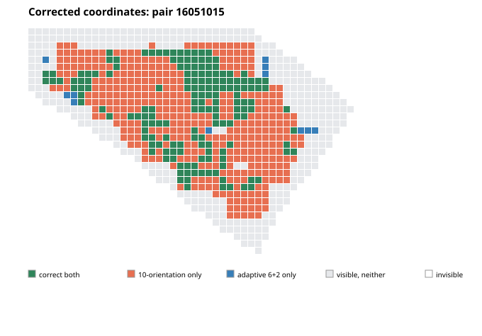

# NDF coordinate audit and corrected projection ablation

Date: 2026-11-09. This report supersedes the pre-correction projection counts in `ndf_field_vs_interpolation_and_adaptive_pairwise_20261109.md` and the corresponding section of `webgpu_local_ncc_and_field_qualification.md`. The image-derived angle choices and coarse correspondences are unaffected, but **all pre-correction IC-GN convergence counts and spatial maps from `qualify_ndf_pair_icgn.py`, including the adaptive-rotation comparison, required requalification** because the initial fields changed.

## Coordinate finding

`NDFPairMatcher` emits a displacement at each feature-cell center. For an input raster of width `W` and a feature grid of width `Nx`, the x coordinate is

```text
x_i = (i + 0.5) * W / Nx - 0.5
```

The y coordinate follows the same rule. Thus for a 192×108 input and a 48×27 output, the nodes are x=1.5+4i and y=1.5+4j. This follows the `align_corners=False` convention used by the model's candidate coordinates.

The qualification previously attached those values to points from `uniform_points(..., 4)`, which are (4i,4j), and evaluated the direct grid as if its first and last nodes sat on image borders. It also mapped native pixel centers to model coordinates as `x_native / scale`; the matching resize convention is `(x_native + 0.5) / scale - 0.5`. The first two errors misregistered each displacement sample by 1.5 model pixels (30 native pixels at this scale); the native-center coordinate correction is an additional, distinct offset.

The qualification now uses the exact feature-cell centers both as sample positions for spline/affine fits and as the origin and spacing of the bilinear grid. Native coordinates are mapped with the pixel-center resize transform. The generic dense-grid class retains its prior edge-aligned default for existing representation studies; the NDF qualification explicitly supplies the model's feature-grid geometry.

## Analytic validation

I sampled the known affine displacement

```text
u(x,y) = 7 + 0.12 x - 0.04 y
v(x,y) = -3 + 0.06 x + 0.08 y
```

at the exact 48×27 feature-cell centers, then reconstructed and evaluated it at interior subpixel coordinates. Both direct bilinear evaluation and a fitted cubic B-spline recover displacement and the full Jacobian to `1e-8` absolute tolerance. The resize-coordinate helper is also checked against explicit pixel-center values. The relevant tests are in `python/tests/test_ndf_field.py`.

The rotation-bank helpers were moved into the NumPy-only `ndf_rotation_search.py`. Their unit tests no longer import `qualify_ndf_pair_icgn.py`, which imports optional PyTorch. This resolves the CI collection failure without adding PyTorch to the base test job or skipping these tests. Validation: the full local suite passes (117 passed, 1 skipped); the six rotation-search tests also pass under system Python without PyTorch; Ruff passes across the CI lint targets.

## Repeated ablation on the same 20 pairs

All four projections were rerun after the coordinate correction with the same checkpoint, seed group, 192×108 model input, native 3840×2160 images, local correlation, and IC-GN settings. The 20 pairs comprise ten translations and ten heterogeneous fields.

| Projection | Translation correct / visible | Heterogeneous correct / visible | Heterogeneous mean pair initial displacement RMSE (px) | Heterogeneous mean pair four-gradient RMSE |
| --- | ---: | ---: | ---: | ---: |
| Direct bilinear | 10,485 / 13,444 (77.99%) | 85 / 11,141 (0.76%) | 985.61 | 3.863 |
| One-level cubic B-spline | 8,197 / 13,444 (60.97%) | 46 / 11,141 (0.41%) | 985.47 | 2.872 |
| Three-level cubic B-spline | 8,219 / 13,444 (61.14%) | 46 / 11,141 (0.41%) | 985.49 | 2.879 |
| Local affine consensus, then spline | 9,361 / 13,444 (69.63%) | 99 / 11,141 (0.89%) | 962.29 | 4.499 |

The four-gradient measure is the RMS over `du/dx`, `du/dy`, `dv/dx`, and `dv/dy`, averaged across the ten image pairs. The per-pair field errors and convergence outcomes are in each `coordfix_*.json` file.

Pair-clustered paired-bootstrap differences in coverage (candidate minus direct bilinear), based on 50,000 resamples of ten image pairs, seed 20261109:

| Projection | Heterogeneous mean pair delta (percentage points), 95% interval | Translation mean pair delta (percentage points), 95% interval |
| --- | ---: | ---: |
| One-level spline | −0.304 [−0.766, +0.028] | −17.034 [−18.108, −15.787] |
| Three-level spline | −0.304 [−0.766, +0.028] | −16.877 [−17.937, −15.665] |
| Local consensus + spline | +0.144 [−0.028, +0.397] | −8.416 [−10.514, −6.339] |

The corrected counts preserve the main conclusion but change its magnitude: simple spline smoothing still loses many translation successes and modestly reduces heterogeneous coverage; local consensus plus spline has a small heterogeneous aggregate gain, with an interval spanning zero, and still loses translation coverage. Heterogeneous coverage remains below 1% for every projection. This is not a successful non-affine initializer.

The smoothed fields have lower combined gradient RMSE than direct bilinear evaluation, but this does not translate into more successful DIC windows for the two global spline fits. As before, displacement error and local IC-GN convergence must be considered alongside derivative error.

## Corrected adaptive-rotation comparison

The two rotation strategies were rerun on the same 40 pairs (20 translation and 20 heterogeneous) from seed groups 16,000,000 and 17,000,000, after applying the corrected field-grid mapping. Each method uses the same checkpoint, 256 spatial probes, image-derived affine prefit, raw bilinear field evaluation on the exact feature centers, local correlation, and IC-GN. Only the rotation bank differs: the reference tests nine uniform steps plus identity (ten effective orientations); the adaptive strategy tests six coarse orientations and refines one peak with two half-step hypotheses (eight effective evaluations).

| Motion family | 10-orientation reference | Adaptive 6+2 | Paired result |
| --- | ---: | ---: | ---: |
| Heterogeneous | 13,172 / 22,416 (58.76%) | 13,015 / 22,416 (58.06%) | −157 windows (−0.70 pooled points) |
| Translation | 23,017 / 28,514 (80.72%) | 23,017 / 28,514 (80.72%) | 0 windows |

For heterogeneous motion, the adaptive-minus-reference mean pair-specific coverage difference is −1.13 percentage points, with a 95% paired bootstrap interval [−5.91, +1.79] points. The interval resamples the 20 image pairs (200,000 resamples, seed 20261109), not the 22,416 windows. Six pairs improve, thirteen tie, and one regresses. Improvements sum to +205 windows; the single loss is −362. All 20 translation pairs tie in coverage. Median correct-window throughput is 7,025 versus 7,429 per second for heterogeneous motion and 11,956 versus 13,120 for translation, reference then adaptive.

The corrected pair-wise differences for heterogeneous seeds are `16051001:+19, 16051003:0, 16051005:+3, 16051007:0, 16051009:+92, 16051011:0, 16051013:+26, 16051015:−362, 16051017:0, 16051019:+34, 17051001:0, 17051003:0, 17051005:0, 17051007:0, 17051009:0, 17051011:0, 17051013:0, 17051015:0, 17051017:0, 17051019:+31`.

The regressing pair 16051015 was rerun with window-level exports. On its 863 visible windows, the reference yields 536 correct convergences and adaptive 174; 373 windows are correct only with the reference and 11 only with adaptive. In the central ROI x=[1280,2560), y=[864,1728), the counts are 174/231 versus 43/231. The reference's median initial displacement error is 5.36 px versus 98.20 px for adaptive. The selected image-derived angles remain −20° and −30° respectively; the synthetic angle is only a post-run diagnostic. The corrected map and NPZ data are under `window_diagnostics_rotation_coordinate_corrected/`.



This correction changes the pooled rates substantially from the pre-correction report (the reference heterogeneous coverage rises from 39.28% to 58.76%), while preserving the qualitative result that translation coverage ties and adaptive search has a speed advantage with a localized heterogeneous failure. The earlier pair-level interval and spatial map must not be used as current evidence.

## Focused corrected window-level check

The earlier per-window raw-versus-spline artifacts for pair 11051015 and the adaptive-rotation spatial map were generated before the coordinate correction and are retained only as historical diagnostics. They should not be used to interpret the corrected pipeline. I reran the same projection pair with the corrected mapping and saved per-window fields. Among 1,035 visible windows, both bilinear and spline initializations produce 3 correct IC-GN convergences; the analytic IC-GN control produces 975. The adaptive-rotation pair comparison is being rerun with the corrected mapping; its prior pair-level coverage statistics are not current results.

| Initial component | Bilinear | Cubic B-spline |
| --- | ---: | ---: |
| `u` (px) | 343.01 | 340.65 |
| `du/dx` | 1.966 | 1.413 |
| `du/dy` | 2.036 | 1.283 |
| `v` (px) | 194.57 | 191.15 |
| `dv/dx` | 1.682 | 0.953 |
| `dv/dy` | 1.721 | 1.021 |

On this pair, both initial displacement and all four gradient RMSEs are slightly lower with the spline, yet IC-GN convergence is unchanged. This case shows that coordinate correction can change individual comparisons and that lower field error at sampled centers still does not guarantee crossing the nonlinear solver's capture threshold. It is a single illustrative pair, not a significance result. Corrected per-window arrays are under `window_diagnostics_projection_pair11051015_corrected/{bilinear,spline}/`.

## Reproduction

The four outputs are:

* `coordfix_raw_bilinear_20pairs_seed11000000.json`
* `coordfix_single_spline_20pairs_seed11000000.json`
* `coordfix_multilevel_spline_20pairs_seed11000000.json`
* `coordfix_local_consensus_20pairs_seed11000000.json`

Corrected rotation-bank qualification outputs are `coordfix_rotation9_affine_prefit_seed{16000000,17000000}.json` and `coordfix_rotation6_refine1_affine_prefit_seed{16000000,17000000}.json`.

They were produced by `python/benchmarks/qualify_ndf_pair_icgn.py` with `--native-scale 20 --model-width 192 --model-height 108 --speckle-size 0.35 --local-ncc-radius 8 --local-ncc-backend wgpu --local-ncc-patch-radius 5 --local-consensus-radius 40 --local-consensus-threshold 5 --cases-per-family 10 --seed-offset 11000000 --contextual-features`, changing only `--projection`.
