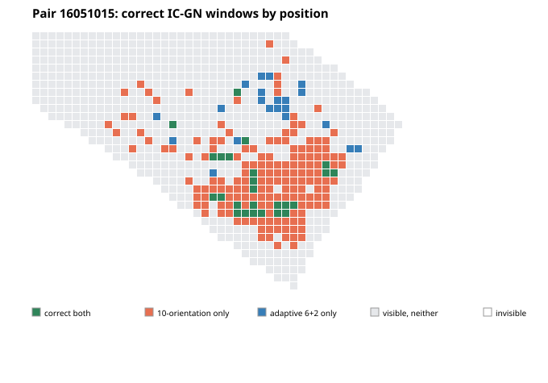

# NDF field versus interpolation, and paired analysis of adaptive rotation search

Date: 2026-11-09. This note uses the committed NDF qualification outputs plus a focused rerun of the one heterogeneous pair that regressed in the adaptive rotation ablation. Analytic synthetic motion is used only for scoring after inference.

## Findings

1. The available evidence does **not** show that the current NDF output field is better than classical interpolation of the same predicted displacement samples. In the controlled projection ablation, the checkpoint, image pair, predicted coarse displacement samples, local correlation, and IC-GN settings are held fixed; only evaluation of that same lattice changes. Direct bilinear evaluation gives 80/11,141 correct heterogeneous windows, compared with 35/11,141 for one- and three-level cubic B-spline fits, and 68/11,141 for local affine consensus followed by spline fitting. The network is presently a learned coarse correspondence/flow predictor followed by conventional field evaluation. This is not yet evidence for a learned nonlinear spatial decoder outperforming interpolation.
2. The adaptive 6+2 orientation search's net loss of 40 windows is statistically uncertain at the *pair* level: a paired bootstrap over 20 heterogeneous image pairs gives a mean difference of −0.35 percentage points, 95% percentile interval [−2.23, +0.79] points. The aggregate loss is concentrated: one pair loses 141 windows, while six other pairs gain 101 in total.
3. On the regressing pair, the lost windows are spatially concentrated. Of 162 windows correct only with the 10-orientation reference, 122 (75%) lie in the central ROI x=[1280,2560), y=[864,1728). Within that ROI, correct convergence falls from 144/231 to 24/231. This is a meaningful localized regression hidden by the small global mean difference.

## 1. What the field-projection experiment does and does not establish

The paired projection experiment uses the same trained checkpoint and the same coarse displacement lattice for the competing projections. It is therefore a valid comparison of field conversion from identical predicted samples. It is not a comparison against an independently computed classical feature-matching field, and it does not isolate an explicit neural spline-coefficient decoder: the current NDF predicts a coarse displacement lattice.

| Projection of the same NDF samples | Heterogeneous IC-GN correct / visible | Translation correct / visible | Mean pair initial translation RMSE, heterogeneous (px) | Mean pair combined four-gradient RMSE, heterogeneous |
| --- | ---: | ---: | ---: | ---: |
| Direct bilinear | 80 / 11,141 (0.72%) | 11,033 / 13,444 (82.07%) | 976.4 | 3.849 |
| One-level cubic B-spline | 35 / 11,141 (0.31%) | 8,380 / 13,444 (62.33%) | 992.9 | 2.860 |
| Three-level cubic B-spline | 35 / 11,141 (0.31%) | 8,385 / 13,444 (62.37%) | 992.9 | 2.864 |
| Local affine consensus then spline | 68 / 11,141 (0.61%) | 9,439 / 13,444 (70.21%) | 972.0 | 4.366 |

The four-gradient error is the per-pair root mean square over the four affine displacement derivatives, then averaged across ten pairs. The aggregate file does not retain component-wise derivative errors or per-window field errors for these 20 projection cases. It therefore cannot answer whether, for example, `du/dx` improves while `dv/dy` worsens. The paired raw JSON remains available for the reported per-pair values.

Interpretation: a smoother interpolant reduces the aggregate gradient error in this heterogeneous set, but worsens displacement error and, more importantly, IC-GN convergence. A lower gradient RMSE alone is not a better initializer. The current predictor's difficult heterogeneous cases still fail overwhelmingly, so this ablation does not establish useful non-affine field recovery. It does show that smoothing the same noisy/biased samples is not the cure.

To expose the individual components, I reran one pre-existing projection-ablation pair (`texture_seed=11051015`, `warp_seed=11091015`) with the same checkpoint, resolution, local correlation and IC-GN settings, changing only direct bilinear evaluation versus one-level cubic B-spline fitting. On 1,035 visible windows, both projections produce 1 correct IC-GN convergence; the analytic IC-GN control produces 975. Initial parameter RMSEs are:

| Initial component | Bilinear | Cubic B-spline |
| --- | ---: | ---: |
| `u` (px) | 340.88 | 359.08 |
| `du/dx` | 1.893 | 1.328 |
| `du/dy` | 1.933 | 1.349 |
| `v` (px) | 193.25 | 193.71 |
| `dv/dx` | 1.630 | 0.957 |
| `dv/dy` | 1.643 | 1.006 |

Combined two-component displacement RMSE is 391.84 px for bilinear and 407.99 px for the spline; median displacement error is 244.76 versus 254.51 px. Combined four-gradient RMSE falls from 3.560 to 2.348 with the spline, yet IC-GN coverage is unchanged at 1/1,035. This single pair is illustrative, not an independent significance test; it confirms that derivative smoothing does not repair the large displacement error. Per-window inputs/results are retained under `window_diagnostics_projection_pair11051015/`.

The relevant reports and raw data are `webgpu_local_ncc_and_field_qualification.md`, `p3_multiscale_weight002_raw_bilinear_10pairs_seed11000000.json`, `p3_multiscale_weight002_single_spline_10pairs_seed11000000.json`, `p3_multiscale_weight002_multilevel_spline_10pairs_seed11000000.json`, and `p3_multiscale_weight002_local_consensus_10pairs_seed11000000.json`.

### What is still needed to prove a neural-field contribution

The next controlled experiment needs three distinct estimators fed by the same image pair and, where applicable, exactly the same correspondence observations:

* classical sparse correspondences plus fixed, predeclared interpolation (for example, affine, thin-plate spline, and local B-spline);
* NDF's predicted correspondence/displacement samples with those same interpolants;
* an explicitly learned spatial decoder that predicts multi-resolution field coefficients from the image pair.

Score displacement and each of the four derivatives on the same visible DIC centers before IC-GN, then convergence with the same solver settings. Preserve pair IDs and report pair-clustered intervals. Until this is done, the name “neural deformation field” describes the research direction, not a demonstrated advantage over classical interpolation.

## 2. Pair-level uncertainty for adaptive 6+2 search

The comparison contains 20 paired heterogeneous cases and 20 paired translations over seed groups 16,000,000 and 17,000,000. The denominator for heterogeneous movement is 22,416 visible windows. Resampling unit is the image pair, not an individual window.

| Heterogeneous paired statistic | Result |
| --- | ---: |
| 10-orientation reference | 8,806 / 22,416 (39.28%) |
| Adaptive 6+2 | 8,766 / 22,416 (39.11%) |
| Net difference | −40 windows (−0.18 pooled percentage points) |
| Mean paired difference per pair | −2.0 windows |
| Mean of pair-specific coverage differences | −0.35 percentage points |
| 95% paired bootstrap interval for mean pair-specific coverage difference | [−2.23, +0.79] percentage points |
| Pairs improved / tied / regressed | 6 / 13 / 1 |
| Sum of gains / magnitude of the single loss | +101 / −141 windows |

The bootstrap used 200,000 resamples of 20 paired cases with replacement, seed 20261109, and percentile endpoints. This interval includes zero. Thus the data do not establish a mean coverage regression across pairs; they also do not rule out a practically meaningful loss on some pairs. The single regressing case warrants a spatial inspection irrespective of the aggregate interval.

For reproducibility, per-pair adaptive-minus-reference correct-window differences in the JSON order are `+31, 0, +7, 0, +1, 0, +17, −141, +22, 0, 0, 0, 0, 0, 0, 0, 0, 0, 0, +23`.

All 20 translation pairs tied in coverage. Their correct-window throughput rose from 12,995 to 13,953 per second; heterogeneous throughput rose from 4,298 to 4,504. These throughput medians are descriptive and do not turn the uncertain coverage difference into a quality improvement.

## 3. Window-wise inspection of the regression

The paired aggregate had no window-level data. I added optional per-window export to `qualify_ndf_pair_icgn.py` and reran the exact regressing heterogeneous case (`texture_seed=16051015`, `warp_seed=16091015`) with each rotation strategy. The runs used the same checkpoint, 192×108 model input, 3840×2160 native images, 256 probe queries, image-derived global affine prefit, native-pixel WebGPU local NCC, and WebGPU IC-GN.

| Metric for the regressing pair | 10 orientations | Adaptive 6+2 |
| --- | ---: | ---: |
| Visible windows | 863 | 863 |
| Correct IC-GN convergence (<2 native px) | 187 (21.7%) | 46 (5.3%) |
| Correct in both | 25 | 25 |
| Correct only in 10-orientation result | 162 | — |
| Correct only in adaptive result | — | 21 |
| IC-GN accepted visible windows | 187 | 46 |
| Median initial displacement error over visible windows | 19.5 px | 84.6 px |
| Median final displacement error over visible windows | 20.0 px | 87.4 px |
| Initial displacement RMSE over visible windows | 396.3 px | 357.5 px |
| Affine-consensus support | 267 | 153 |
| Affine median residual | 2.55 px | 2.98 px |
| Median local-NCC score | 0.692 | 0.489 |

Of the 162 reference-only correct windows, 122 fall in x=[1280,2560), y=[864,1728). In this central region, the reference converges correctly on 144/231 visible windows, compared with 24/231 for adaptive search. So the regression is concentrated in a difficult central area, not spread uniformly across the image. The adaptive run also gains 21 windows elsewhere; it does not simply remove a superset of the reference's successes.

The selected angle changes from −20° to −30°; the synthetic true global angle (−37.4°) is shown only as a post-run diagnostic. The affine consensus then has substantially fewer inliers, and local NCC confidence and endpoint accuracy both deteriorate. This points to an upstream hypothesis-selection/consensus change, rather than a failure of IC-GN itself. The analytic initialization converges on 800/863 windows in both runs.

Initial field-component RMSE on the same 863 visible window centers, before IC-GN:

| Parameter | 10 orientations | Adaptive 6+2 |
| --- | ---: | ---: |
| Horizontal displacement `u` (px) | 323.36 | 298.60 |
| `du/dx` | 1.749 | 1.910 |
| `du/dy` | 1.569 | 1.829 |
| Vertical displacement `v` (px) | 229.19 | 196.57 |
| `dv/dx` | 1.549 | 1.704 |
| `dv/dy` | 1.533 | 1.850 |

The adaptive method has lower displacement RMSE but much worse median displacement error and worse errors in all four gradients. Its displacement RMSE is dominated by extreme outliers; the robust median and the subsequent convergence counts expose the practical regression. A scalar displacement RMSE would have hidden this failure mode.

Red means correct only for the 10-orientation reference; blue means correct only for adaptive 6+2; green means correct for both; gray means visible but neither is correct; white means the center is invisible.

Diagnostic archives with coordinates, initial and true affine parameters, IC-GN output/status, and per-window correctness are under `window_diagnostics_adaptive_case16051015/{baseline,adaptive}/`. The synthetic truth is present only to score predictions.

## 4. Decision

Keep adaptive 6+2 as an optional speed mode, as already concluded, but do not promote it as the default on the strength of throughput alone. Its average pair-level coverage effect is uncertain, while the inspected loss is severe and spatially coherent. A future selection rule should be validated against difficult-region coverage, not just aggregate support or confidence.

More fundamentally, current experiments still do not show that NDF learns a spatially varying field better than interpolation of its predicted samples. The decisive NDF test is an explicitly learned multi-resolution coefficient decoder versus fixed classical interpolants from identical image-derived observations, with pre-IC-GN displacement and all four derivative errors plus post-IC-GN outcomes, evaluated pair-wise on new heterogeneous fields. Current heterogeneous coverage (0.72% in this projection seed group) is far below what would justify WebGPU porting of a more elaborate field decoder.
