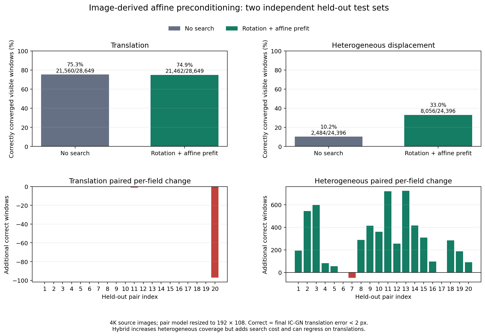
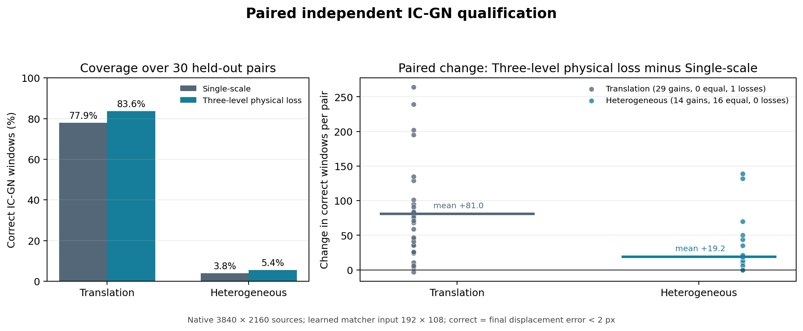

# Neural deformation field: WebGPU local correlation and qualification

Date: 2026-11-09. This report records the local refinement implementation and independent test results. It is a research result, not a production qualification.

## Terms

Digital image correlation (DIC) estimates material displacement from image texture. Neural Deformation Field (NDF) is the experimental pair-to-displacement predictor described in the project log. Inverse-compositional Gauss-Newton (IC-GN) is the iterative photometric solver used for final local refinement. Normalized cross-correlation (NCC) compares local patches after subtracting their means and dividing by their norms. Root mean square error (RMSE) is the square root of the mean squared error. A central processing unit (CPU) is used for model inference; a graphics processing unit (GPU) executes the WebGPU compute kernels. WebGPU is the cross-platform graphics and compute application programming interface (API); WebGPU Shading Language (WGSL) is the language used for its compute shaders. A convolutional neural network (CNN) extracts learned image features. JavaScript Object Notation (JSON) is the text format used for raw benchmark files. Secure Hash Algorithm 256-bit (SHA-256) is the checksum used to verify model-weight files. A B-spline is a piecewise polynomial basis function used for smooth field representation. Intel Lunar Lake (LNL) is the integrated graphics platform used for the hardware measurements. Here, 4K means the ultra-high-definition (UHD) raster of 3840 x 2160 pixels. In the research log, Phase 1 (P1) is the analytic field-representation capacity gate.

## Implementation

The pair-conditioned neural model and its coarse global feature matching still run in CPU PyTorch. Its predicted displacement is refined by a bounded NCC search on the downsampled model images. The new parallel WGSL implementation splits this computation into three dispatches:

1. Prepare and store each reference patch and its statistics.
2. Score each point and candidate offset independently.
3. Reduce the score plane to best and second-best candidates and fit a one-dimensional parabolic offset around the peak.

The shader runs through the package's canonical shader loader and public `WGPUMatching.refine_ndf_local_ncc` application programming interface. A serial WGSL implementation remains available as a control. Python and WGSL results are compared by deterministic unit tests. The test suite for this feature passes on the software WebGPU adapter.

This does **not** form a GPU-resident neural field pipeline. Each call currently uploads the two model-resolution images and the initial displacement grid, allocates working buffers, and reads back the compact refined field, scores, margins, and validity flags. The learned feature encoder, global correlation, and field conversion remain on CPU. NCC is not run on native 4K pixels. IC-GN consumes the original 3840 x 2160 images on WebGPU.

## Paired CPU/WebGPU timing

On one synthetic 3840 x 2160 translation pair, local NCC used 192 x 108 model inputs, an eight-pixel search radius, five-pixel patch radius, and 1,980 query windows.

| Backend | NCC wall time | Correct IC-GN windows / visible |
|---|---:|---:|
| CPU PyTorch | 0.802 s | 559 / 1,224 |
| Intel LNL Vulkan WebGPU | 0.092 s | 558 / 1,224 |

The selected results differ by one correctly converged window. This timing is a single paired sample and includes first-use WebGPU costs. In the later warmed four-pair campaign, median NCC wall time was 8.9 ms per pair. Do not treat the first-use and warmed timings as a controlled multi-run speedup estimate.

The paired qualification files are `p4_cpu_refinement_smoke.json` and `p4_uhd_wgpu_parallel_smoke.json`. A separate seven-repeat warmed microbenchmark used a deterministic 192 x 108 random grayscale image pair with a known (3, 2) pixel translation and a 48 x 27 query grid. It included uploads and compact readback. CPU PyTorch local NCC took a median 0.937 s (90th percentile 1.035 s), serial WGSL took 19.24 ms (20.83 ms), and parallel WGSL took 7.36 ms (8.33 ms). The parallel kernel was 127 times faster than the CPU reference and 2.61 times faster than serial WGSL. Validity masks agreed exactly; on common valid points, 98.8% of the endpoint displacements were within 0.1 pixels of the CPU result, and the 99th-percentile difference was 0.94 pixels. This is a compute microbenchmark, not a speckle-matching accuracy result.

## Independent 4K qualification

The 256-pair learned model trained at native model scale was evaluated on four unseen texture/motion pairs per family. A second run substituted the hard top-one coarse correspondence for the model's soft correspondence expectation; all other settings, seeds, and solver criteria remained fixed. Inference did not receive analytic displacement or visibility masks. Analytic truth was used after the run for scoring and to provide an IC-GN oracle control.

| Coarse field | Family | Correctly converged / visible | Correct coverage | Median correct windows per second |
|---|---|---:|---:|---:|
| Soft expectation | Translation | 2,641 / 5,670 | 46.58% | 4,972 |
| Soft expectation | Heterogeneous | 9 / 4,173 | 0.22% | 0 |
| Hard top-one | Translation | 1,479 / 5,670 | 26.08% | 4,455 |
| Hard top-one | Heterogeneous | 10 / 4,173 | 0.24% | 0 |

The coarse estimate affects translation substantially: hard top-one performs worse, so the soft expectation remains the baseline. Neither variant solves heterogeneous motion. Some failed nodes retain high NCC scores even when their selected locations are far from the physical correspondence. The score and margin are not calibrated confidence measures. The analytic IC-GN controls converge on most visible windows, establishing that the dominant issue is the initializer in these tests.

The synthetic pattern has seven-pixel characteristic speckles at model resolution, corresponding to 140 pixels in the native image. This scale-consistency stress test is not representative of typical physical speckle diameters. The neural network and NCC operate at 192 x 108; only the final IC-GN step uses the native image pixels.

The full raw results are `p4_uhd_independent_wgpu_parallel_4pairs.json` and `p4_uhd_independent_wgpu_parallel_hard_4pairs.json`.

## Rasterization-aware model and learned-feature local search

To check whether direct low-resolution training caused the heterogeneous gap, a second model was trained on 256 training and 64 validation pairs synthesized at eight times the model dimensions and then area-downsampled. Training ran for 60 epochs. The selected validation model has a heterogeneous median flow error of 19.18 px in the eight-times coordinate system (2.40 model-input pixels), 90th-percentile error of 126.65 px (15.83 model-input pixels), raw-grid field root mean square error of 85.44 px (10.68 model-input pixels), and Jacobian error of 1.72. Independent test textures have different seeds. This synthesis scale is still below the 20-fold scale of the 3840 x 2160 evaluation.

On four additional independent pairs per family, that checkpoint converged correctly on 2,830/6,129 translation windows (46.2%) and 0/5,012 heterogeneous windows. Scale-aware rasterization training did not solve the failure.

A learned-feature local search was then inserted between the global coarse prediction and WGSL NCC. It searches within eight cells of each coarse target estimate on the model feature grid. A paired comparison used exactly the same four textures and motions (seed offset 500000):

| Pipeline | Translation correct / visible | Heterogeneous correct / visible |
|---|---:|---:|
| Global coarse field + WGSL NCC | 2,464 / 5,819 (42.3%) | 0 / 5,193 |
| Local learned-feature search + WGSL NCC | 3,155 / 5,819 (54.2%) | 0 / 5,193 |

The local learned-feature search improves the translation result by 691 windows (11.9 percentage points) on this paired sample, but does not recover any heterogeneous windows. The learned-feature step executes on CPU and adds work. Its raw feature matches can be hundreds of pixels wrong in native coordinates despite finite similarity margins; NCC usually determines the final result on translation cases. This is a limited paired ablation, not a general speed or robustness claim.

Raw results: `p2_native_scale8_256pairs/training.json`, `p4_uhd_rasteraware_wgpu_parallel_4pairs.json`, `p4_uhd_rasteraware_wgpu_parallel_4pairs_seed500000.json`, and `p4_uhd_rasteraware_feature_local_ncc_4pairs.json`.

## Robust affine and local-consensus projection controls

The same pair-model predictions from seed offset 500000 were also passed through two alternatives to the predicted non-linear field. The global-affine control fits one affine transformation to all predicted node positions using deterministic random sample consensus (RANSAC) followed by Huber iteratively reweighted least squares. It is suitable as a global-motion control; it cannot represent heterogeneous motion. The local-consensus control estimates local models with a 20-cell neighborhood radius and a 5-pixel inlier threshold. Analytic truth was not used to select either model, and all visible windows remain in the score denominator.

| Projection | Family | Correct IC-GN / visible | Coverage | Median correct windows/s |
|---|---|---:|---:|---:|
| Robust global affine | Translation | 5,426 / 5,819 | 93.25% | 27,170 |
| Robust global affine | Heterogeneous | 0 / 5,193 | 0% | 0 |
| Local consensus | Translation | 2,022 / 5,819 | 34.75% | 713 |
| Local consensus | Heterogeneous | 0 / 5,193 | 0% | 0 |

For global-affine projection, translation initial-displacement root mean square error across the four cases was approximately 1.23–1.99 native pixels, and affine-gradient error was 0.0014–0.0028. The affine fit turns the pair model into a strong initializer for translation, but erases the spatially varying component needed for heterogeneous fields. Its heterogeneous initial-translation root mean square error ranged from 58 to 1,636 pixels, and no visible window converged correctly. This is a negative result for the proposed non-linear predictor, not a failure of the IC-GN solver: the analytic controls converged on 882–1,503 windows in the corresponding cases.

Local consensus did not repair the heterogeneous field either. It produced zero correct convergences in all four heterogeneous cases, with local-NCC node median errors from 24.7 to 79.6 native pixels. It also underperformed the robust global-affine control for translation and required roughly 0.46–0.56 seconds of local refinement per case, versus about 0.01–0.06 seconds for the global-affine cases in this run. The current local consensus is therefore not a useful default projection.

These results clarify the next research decision: the pair model can estimate global translation well enough that a robust affine projection captures it, but it does not yet recover spatially varying displacement. Changing the projection alone is not supported by these measurements. A better heterogeneous correspondence mechanism or pair-conditioned field architecture is still required. Raw outputs are `p4_uhd_global_affine_ransac_4pairs_seed500000.json` and `p4_uhd_local_consensus_projection_4pairs_seed500000.json`.

## Exact-raster training ablation

The previous rasterization-aware model was generated at eight times the 192 x 108 input dimensions, although the ultra-high-definition (UHD) evaluation pair is reduced by a factor of twenty. To test whether that mismatch explained the heterogeneous failure, a new model was trained from 128 independent 3840 x 2160 synthetic pairs area-downsampled to 192 x 108, with 32 separate validation pairs and 60 epochs. Training ran on the CPU. The reported 274-second training duration excludes pair generation, which occurs before the script's timer starts.

On its held-out validation set, the selected checkpoint reached a heterogeneous median displacement error of 85.43 native pixels, a 90th-percentile error of 464.80 pixels, a 57.73% correct coarse target-cell rate, and a raw-grid field root mean square error of 286.32 pixels. This is better than the 16-pair pilot (median error 408.68 pixels and 41.28% correct target cells), but still leaves gross field errors.

The checkpoint was tested on four unseen texture/motion pairs per family, with seed offset 600000, native 3840 x 2160 pixels, 192 x 108 model inputs, soft correspondence expectation, radius-eight parallel WebGPU NCC, raw bilinear field evaluation, and the same WebGPU IC-GN solver:

| Training data scale | Family | Correct IC-GN / visible | Coverage | Median correct windows/s |
|---|---|---:|---:|---:|
| 8x, prior raster-aware checkpoint | Translation | 2,830 / 6,129 | 46.2% | 5,719 |
| 20x, exact-raster checkpoint | Translation | 3,204 / 6,811 | 47.0% | 12,761 |
| 8x, prior raster-aware checkpoint | Heterogeneous | 0 / 5,012 | 0% | 0 |
| 20x, exact-raster checkpoint | Heterogeneous | 0 / 5,665 | 0% | 0 |

Analytic truth and visibility were unavailable to inference and used only for scoring. The analytic solver control converged correctly on 5,431/5,665 visible heterogeneous windows. Thus, exact-raster training leaves translation coverage essentially unchanged and does not recover a single heterogeneous window. The scale mismatch was not the dominant cause of the heterogeneous failure.

As a paired ablation, the same exact-raster checkpoint and test seeds were evaluated with a hard top-one target cell instead of the soft correspondence expectation. Translation coverage fell to 2,352/6,811 (34.5%), and heterogeneous matching produced 1/5,665 correct convergence (0.02%). That single success is not a robust gain. The soft expectation remains clearly better for translation, while neither formulation solves the heterogeneous family.

A top-eight probability-weighted target estimate was also tested to keep several plausible candidates while removing the global low-probability tail. It achieved 2,697/6,811 translation windows (39.6%) and 1/5,665 heterogeneous windows (0.02%). It therefore underperformed the soft estimate on translation and did not materially change heterogeneous recovery. The extra top-eight reduction is optional in code and is only computed for this experimental mode.

Raw outputs: `p2_native_scale20_128pairs/training.json`, `p2_native_scale20_pilot/training.json`, `p4_uhd_scale20_train_4pairs_seed600000.json`, `p4_uhd_scale20_train_hard_4pairs_seed600000.json`, and `p4_uhd_scale20_train_topk8_4pairs_seed600000.json`.

## Contextual feature receptive-field ablation

The pair matcher was extended with an optional residual context branch in its feature encoder. The baseline encoder has a theoretical receptive field of about 17 input pixels; the contextual version increases this to about 41 pixels while retaining stride-four feature maps. This tests whether the previous feature support was too local for heterogeneous motion; it does not add a nonlinear spatial field representation.

The contextual model was trained on 128 texture-disjoint pairs synthesized at eight times the model raster, with 32 independent validation pairs, 60 epochs, and seed 20261111. Its selected validation checkpoint reduced heterogeneous median flow error to 11.03 native pixels (90th percentile 73.73 pixels), versus 19.18 pixels for the earlier non-contextual scale-eight model. Validation top-one target-cell accuracy was 64.06%. This improvement did not transfer to the held-out 4K IC-GN test: with four pairs per family and seed offset 700000, translation reached 3,135/6,398 correct windows (49.0%), while heterogeneous motion remained 0/3,686. The analytic IC-GN control converged on 3,460/3,686 heterogeneous windows, so the zero result is still an initializer failure.

The model, feature matcher, and field projection ran in CPU PyTorch; bounded local normalized cross-correlation and IC-GN ran through WebGPU. This is not a GPU-resident learned pipeline. The contextual receptive field improves one held-out coarse-field metric but does not establish useful heterogeneous DIC initialization. Raw outputs are `p2_context41_scale8_128pairs/training.json` and `p4_uhd_context41_4pairs_seed700000.json`.

The same contextual architecture was also trained at the exact twenty-fold raster scale, using 128 training pairs, 32 validation pairs, and 60 epochs. The best checkpoint had 64.74% heterogeneous top-one cell accuracy, but its heterogeneous median displacement error was 26.85 native pixels, its 90th percentile was 177.22 pixels, and only 3.33% of valid cells were within 5 pixels. Translation median error was 19.64 pixels and translation top-one cell accuracy was 84.88%. Training proper took 306 seconds on the CPU, excluding data synthesis. This validation result is weaker than the scale-eight contextual checkpoint on the heterogeneous within-5-pixel and median-error measures; the corresponding independent 4K IC-GN qualification is reported next. Raw training output: `p2_context41_scale20_128pairs/training.json`.

The exact-scale contextual checkpoint was then tested on four independent pairs per family, with seed offset 800000 and the same 3840 × 2160 IC-GN protocol. It converged correctly on 2,649/6,080 visible translation windows (43.57%), with a median of 10,092 correctly converged windows per second across the four cases. Heterogeneous motion remained at 0/4,547, while the analytic IC-GN control converged on 4,305/4,547 (94.68%). Local normalized cross-correlation node median endpoint errors on the four heterogeneous pairs ranged from 79.46 to 174.23 native pixels. Despite 64.74% validation top-one cell accuracy, the coarse estimate does not provide locally useful target positions on independent heterogeneous fields. The exact-scale contextual variant is therefore rejected as a solution to that failure; its translation result also falls below the earlier scale-eight contextual model's 49.0% on a separate test set, so this is not a paired comparison. Raw test output: `p4_uhd_context41_scale20_4pairs_seed800000.json`.

## Exact-scale physical-loss ablation

To check whether the advected intensity and gradient residual helps at the evaluation scale, a second contextual model was trained from the same random initialization, using exactly the same cached 128 training pairs and 32 validation pairs, for 24 epochs. Only the single-scale physical-loss weight changed, from 0 to 0.02. At the final epoch, heterogeneous median displacement error changed from 47.38 to 48.20 native pixels, the fraction within 5 pixels from 1.58% to 1.45%, and raw-grid displacement root mean square error from 279.78 to 283.32 pixels. Translation median error changed from 19.08 to 19.71 pixels. The Jacobian error changed only slightly and in opposite directions across families. The physical term therefore did not improve validation and slightly worsened the principal heterogeneous measures. In accordance with the validation gate, this checkpoint was not promoted to a costly 4K solver qualification. The earlier 48-pair ablation also showed no benefit. These negative results do not test the full multi-level pyramid loss proposed in the research brief; this implementation uses one input scale and a sampled single-scale physical residual.

The deterministic cache stored low-resolution tensors and the configuration manifest under `p2_context41_scale20_shared_cache/`; the two training protocols otherwise match. The physical-loss checkpoint reports `physical_loss_weight=0.02`. Raw results are `p2_context41_scale20_128pairs/training.json` and `p2_context41_scale20_physics002_128pairs/training.json`. Since validation did not improve, no independent IC-GN test was run for this variant.

## Large-scale synthetic blur implementation

The exact-scale image generator previously evaluated broad Gaussian kernels by repeatedly streaming the complete raster once per kernel tap. For kernel radii of at least 32 pixels, it now uses blocked one-dimensional fast Fourier transform convolution with the same truncated normalized kernel and reflection boundary condition. On a 512 × 512 random image with a 56-pixel Gaussian standard deviation, the fast path took 23 ms versus 93 ms for the prior direct implementation; maximum absolute output difference was 2.42×10⁻⁸. On a 3840 × 2160 random image, the fast path took 0.317 s at standard deviation 56 pixels and 0.294 s at 25.2 pixels. A paired 4K measurement at standard deviation 56 pixels took 4.863 s for the original direct convolution and 0.332 s for the fast path (14.7× faster), with maximum absolute difference 2.98×10⁻⁸. The current exact-scale contextual training process was started before this implementation and therefore does not use it; subsequent data generation will.

The training script now optionally caches deterministic training and validation pair tensors separately using `--dataset-cache-dir`. Cache manifests include the pair count, seed offset, input dimensions, native scale, and speckle size; a configuration mismatch is rejected. This supports controlled ablations without regenerating the expensive 4K synthetic images. A temporary-directory smoke check confirmed cache creation, reload, and shape preservation.

## Local feature search after contextual global matching

The exact-scale context checkpoint was also tested with a local learned-feature search of radius 8 feature cells before local normalized cross-correlation. This was paired on the same four translation and four heterogeneous test pairs at seed offset 800000. Translation convergence decreased from 2,649/6,080 to 2,398/6,080. Heterogeneous convergence remained 0/4,547. The local feature-stage median heterogeneous endpoint error was 38.66 pixels, but applying the subsequent local photometric refinement increased it to 144.48 pixels, with no nodes within 2 pixels. Thus, this feature stage moves some candidates closer but does not bring them into a consistently useful photometric basin; it also reduces translation coverage and adds CPU time. It is not retained as a default. Raw paired result: `p4_uhd_context41_scale20_feature8_4pairs_seed800000.json`.

## Affine-compensated local NCC ablation

The local NCC sampler now optionally warps the target patch by the spatial Jacobian predicted by the pair model. This changes the sampled support geometry; it does not use analytical ground truth. A hybrid mode evaluates both the unwarped and Jacobian-warped patch and keeps the higher NCC score. The experiment reused the same exact-scale checkpoint, four translation and four heterogeneous 3840 × 2160 pairs (seed offset 800000), solver settings, and a search radius of 8 model pixels. Only patch geometry and, in the feature-search variants, the already-tested radius-8 feature stage differed.

| Paired variant | Translation correct / visible | Heterogeneous correct / visible | Heterogeneous median final-node error |
| --- | ---: | ---: | ---: |
| Fixed translation patches | 2,649 / 6,080 (43.6%) | 0 / 4,547 | 152.6 px |
| Full predicted-Jacobian patches | 1,331 / 6,080 (21.9%) | 7 / 4,547 (0.15%) | 31.5 px |
| Jacobian damped to 25% | 2,462 / 6,080 (40.5%) | 0 / 4,547 | 130.0 px |
| Jacobian damped to 50% | 2,077 / 6,080 (34.2%) | 0 / 4,547 | 81.6 px |
| Best of fixed and full-Jacobian NCC | 2,383 / 6,080 (39.2%) | 7 / 4,547 (0.15%) | 49.4 px |
| Feature search + best of fixed/full Jacobian | 2,181 / 6,080 (35.9%) | 13 / 4,547 (0.29%) | 38.8 px |
| Feature search + best of fixed/50%-damped Jacobian | 2,124 / 6,080 (34.9%) | 0 / 4,547 | 98.3 px |

All seven successful heterogeneous windows in the full-Jacobian/hybrid family were in the same one of four test pairs; all thirteen in the feature-plus-hybrid row were likewise in one pair. No heterogeneous windows converged correctly in the new 50%-damped feature variant. Thus, patch rectification gives a useful case-specific reduction in endpoint error but does not yet provide repeatable heterogeneous IC-GN coverage. The geometry prior is also imperfect enough to harm translation performance, even when a hybrid mode can choose the better photometric score. The local feature search adds little: its thirteen-window gain over the hybrid result is concentrated in one pair and comes with lower translation coverage and more work.

Median measured local-refinement wall time across these eight pairs was 8.8 ms for fixed patches, 8.7 ms for affine-only patches, 13.4 ms for the two-geometry hybrid, and 22.6–22.8 ms when the CPU feature search was included. These medians exclude neither required synchronization nor compact output readback, but the local timings do not include the entire pair pipeline. One first-use sample per run was substantially slower and is retained in the raw JSON.

These results reject a single fixed amount of Jacobian compensation as a general solution. A future method needs a per-location uncertainty or competing geometric hypotheses validated by independent image evidence, rather than globally applying the predicted Jacobian. The benchmark reports total visible windows, so the percentages retain the same denominator within each paired family; they are not conditional precision among accepted solver outputs. The analytic solver control remained 5,867/6,080 translation and 4,305/4,547 heterogeneous windows across all rows.

Raw paired results: `p4_uhd_context41_scale20_affine_ncc_4pairs_seed800000.json`, `p4_uhd_context41_scale20_affine_d025_4pairs_seed800000.json`, `p4_uhd_context41_scale20_affine_d05_4pairs_seed800000.json`, `p4_uhd_context41_scale20_hybrid_ncc_4pairs_seed800000.json`, `p4_uhd_context41_scale20_feature8_hybrid_4pairs_seed800000.json`, and `p4_uhd_context41_scale20_feature8_hybrid_d05_4pairs_seed800000.json`.

## P1 representation-capacity gate

To separate field representation from image matching, the analytic capacity benchmark was rerun on a 512 × 384 domain, fitting samples every 8 pixels and evaluating every 3 pixels. This is an oracle fitting experiment: it supplies exact displacement samples to the representation and says nothing about recovering them from an image pair. The additive cubic B-spline model uses three control lattices with nominal spacings 128, 64, and 32 pixels (852 scalar coefficients total). A directly predicted bilinear grid at the same scales has 608 coefficients.

| Analytic field | Global affine displacement RMSE | Cubic B-spline displacement RMSE | B-spline gradient RMSE | Direct bilinear displacement RMSE |
| --- | ---: | ---: | ---: | ---: |
| Translation by 230, −125 px | < 0.001 px | < 0.001 px | < 0.001 | < 0.001 px |
| 120° rotation plus translation | < 0.001 px | < 0.001 px | < 0.001 | < 0.001 px |
| Large global affine | < 0.001 px | < 0.001 px | < 0.001 | < 0.001 px |
| Smooth heterogeneous, 256 px wavelength | 15.41 px | 0.022 px | 0.0043 | 0.545 px |
| Smooth heterogeneous, 128 px wavelength | 7.50 px | 0.163 px | 0.0288 | 1.271 px |
| 24 px localized shear band | 13.01 px | 0.273 px | 0.0316 | 0.650 px |
| 36 px displacement jump | 9.01 px | 3.423 px | 0.266 | 3.759 px |

The affine-preserving spline fit reproduces the tested continuous nonlinear fields closely at this sample density, including the localized band. The direct bilinear grid is less accurate at the same nominal scales. Both globally continuous representations smooth the displacement jump and cannot represent it exactly. Interpolation-gradient checks were within 3.5×10⁻¹¹ maximum absolute error; analytic spline Jacobians agreed with autodifferentiation to 1.1×10⁻¹⁶ and with finite differences to 6.3×10⁻¹². The known-affine advection control also had lower intensity and transported-gradient residuals at the true transform than after a perturbed translation or Jacobian.

This closes only the representation-capacity portion of P1 for the tested synthetic families. It does not validate a learned coefficient predictor, image-based global search, 4K inference, WebGPU field decoding, or a discontinuous/multi-domain representation. Since the independent image-pair qualification still fails on most heterogeneous cases while the oracle spline can represent their continuous fields, the dominant demonstrated blocker is currently finding the correspondence field, not the continuous spline basis. Raw output: `p1_field_capacity_512x384.json`.

## Native speckle scale versus the network input raster

The independent NDF qualification reduces a 3840 × 2160 image to 192 × 108 before feature extraction, a factor of 20 in each direction. To check whether this preserves the texture found in the available experimental data, `analyze_ndf_texture_scale.py` measured the radial half-correlation length after box filtering. It used a central 3840 × 2160 crop from the 7920 × 6004 reference image `img_000000_0.09422.tiff` and two synthetic controls.

| Texture | Half-correlation at native raster | After reduction to 192 × 108 |
| --- | ---: | ---: |
| Experimental speckle image | 6.44 px | 0.56 px |
| Synthetic physical-scale control, 7 px characteristic size | 4.48 px | 0.53 px |
| Synthetic training-like control, 140 px characteristic size | 93.25 px | 4.48 px |

Half-correlation length is a spectral texture diagnostic, not the physical speckle diameter. Nevertheless, it shows that the current training raster preserves roughly eight times the post-resize correlation length of the experimental image. The current convolutional encoder then samples its feature map every four input pixels, equivalent to 80 native pixels at this scale. The local normalized cross-correlation refinement also operates on the reduced images, so it cannot recover the native speckle detail after that information has been averaged away. The model currently relies on training and test images with very large synthetic speckles to make the 192 × 108 input informative.

This is a serious data and architecture mismatch that can explain why results on internally consistent synthetic textures should not be extrapolated to experimental imagery. It also means the earlier heterogeneous failures cannot be attributed solely to the learning objective or the continuous field basis. A useful next design must preserve an image branch at least near quarter scale (and likely at full/native scale for local texture), while bounding global matching through sparse proposals or hierarchical candidate search. The current all-pairs stride-four matcher cannot simply be moved to that resolution: the number of pairwise feature comparisons would increase quadratically. The measurement does not yet validate a new high-resolution design; it identifies a necessary condition for one. Raw diagnostic: `texture_scale_adrien_reference.json`; source image dimensions and crop, resizing factors, contrast, and correlation profiles are recorded there.

### Paired physical-scale training pilot

To test whether this scale mismatch matters in the existing model, a contextual pair matcher was trained from scratch with 48 texture-disjoint training pairs and 16 validation pairs, for 20 epochs. The synthetic speckle characteristic size was 7 pixels on the 3840 × 2160 raster; the same imagery was then reduced to the 192 × 108 model input. The checkpoint was selected only on validation. It was compared against the 128-pair, 60-epoch checkpoint trained on 140-pixel native speckles, on exactly the same four translation and four heterogeneous held-out pairs (seed offset 900000), with identical input dimensions, search radius, NCC patches, and IC-GN settings.

| Model trained on | Translation correct / visible | Heterogeneous correct / visible | Per-pair heterogeneous successes |
| --- | ---: | ---: | ---: |
| 140 px characteristic speckles | 190 / 5,010 (3.8%) | 42 / 5,465 (0.8%) | 0, 0, 34, 8 |
| 7 px characteristic speckles | 2,802 / 5,010 (55.9%) | 820 / 5,465 (15.0%) | 0, 0, 748, 72 |

On these paired test seeds, training with physically scaled texture greatly improved the useful initializations, including a large increase on one heterogeneous case. Two of the four heterogeneous cases still had zero correct windows; this pilot does not demonstrate robust generalization. It is also not a matched training-budget comparison: the physical-scale model used fewer pairs and epochs, and its best validation checkpoint was determined without using the test pairs. The independent test result therefore supports texture-scale matching as a necessary training correction, while leaving the failure on difficult heterogeneous fields unresolved. Its coarse validation top-one statistics were weak and did not predict the large difference in the final solver outcome, which is another reason to use the IC-GN test as the final criterion. Raw outputs: `p2_context41_scale20_physical_texture_pilot/training.json`, `p4_uhd_physical_texture_pilot_4pairs_seed900000.json`, and `p4_uhd_training_texture_on_physical_test_4pairs_seed900000.json`.

### Matched 128-pair texture-scale ablation

The pilot was followed by two full 128-training-pair, 32-validation-pair, 60-epoch runs. The controlled run used the same initialization seed (20261112), the same texture and motion seeds, the same architecture, and the same data-generation procedure as the existing 140-pixel-speckle model; only the characteristic speckle size changed from 140 to 7 native pixels. The physical-scale training and validation tensors were cached so they could be reused. Both selected checkpoints were evaluated on the same held-out 4K pairs at seed offset 900000, with no analytical truth passed to either model.

| Training speckle characteristic size | Translation correct / visible | Heterogeneous correct / visible | Per-pair heterogeneous successes | Analytic heterogeneous control |
| --- | ---: | ---: | ---: | ---: |
| 140 native px | 190 / 5,010 (3.8%) | 42 / 5,465 (0.8%) | 0, 0, 34, 8 | 5,252 / 5,465 |
| 7 native px | 3,766 / 5,010 (75.2%) | 1,264 / 5,465 (23.1%) | 0, 0, 1,053, 211 | 5,252 / 5,465 |

This is a controlled and large improvement: changing the training speckle scale, while fixing the initialization seed and the generated pair seeds, increased correct heterogeneous windows about thirty-fold on this test set. It still fails completely on two of the four heterogeneous pairs, so it is not a robust result. The absolute heterogeneous coverage is 23.1% of visible windows, or 24.1% of the analytic IC-GN control. Translation coverage is 75.2% of visible windows (77.7% of its analytic control). The second physical-scale run with a different initialization seed obtained 1,409/5,465 heterogeneous windows, showing a similar overall range but also sensitivity to model initialization.

The models continue to receive 192 × 108 inputs and perform global matching at a four-pixel feature stride; this experiment fixes the training texture distribution, not the information loss from input reduction. It establishes that the prior training scale was a major cause of failure, but does not prove that 192 × 108 is adequate for real-image correspondence. The ten-pair-per-family result is reported below; the four-pair table above is an interim result. Raw outputs: `p4_uhd_training_texture_on_physical_test_4pairs_seed900000.json`, `p4_uhd_physical_texture_128pairs_seed20261112_4pairs_seed900000.json`, and `p4_uhd_physical_texture_128pairs_4pairs_seed900000.json`. Training configuration and checkpoint hashes are stored in their corresponding `training.json` files.

### Ten-pair-per-family independent test

The seed-20261112 physical-scale checkpoint was evaluated on ten new texture/motion pairs in each family. The previous checkpoint was run on the exact same twenty pairs. No test pair or test truth was used for training or checkpoint selection.

| Checkpoint | Translation correct / visible | Heterogeneous correct / visible | Heterogeneous pairs with any correct window | Analytic heterogeneous control |
| --- | ---: | ---: | ---: | ---: |
| Trained on 140 px speckles | 411 / 14,891 (2.8%) | 14 / 10,643 (0.13%) | 1 / 10 | 10,071 / 10,643 (94.6%) |
| Trained on 7 px speckles | 11,316 / 14,891 (76.0%) | 897 / 10,643 (8.4%) | 2 / 10 | 10,071 / 10,643 (94.6%) |

The physical-scale training produces a large paired gain (about 64 times as many correctly initialized heterogeneous windows), but the result still falls far short of the analytic solver control. Its per-pair heterogeneous successes are `[0, 0, 0, 0, 18, 0, 877, 0, 0, 2]`; one field supplies nearly all of the successes. Thus the descriptor-scale correction is necessary and demonstrably useful, but is not sufficient for a general initializer. Translation results are also much better than the mismatched-scale baseline, although they remain below the analytic control.

An exploratory comparison of the generated motion parameters shows that the dominant successful heterogeneous case had a small global rotation (about 7°), while most zero-success cases combined rotations around 40–60° with large translations or strong spatial modulation. This association is not a causal ablation: several parameters vary together. It motivates a controlled rotation/affine-hypothesis study before claiming that the learned pair matcher handles arbitrary orientation. The low-resolution input and four-cell feature stride remain unchanged in this test.

### Oracle rotation-rectification diagnostic

To test whether global orientation is one contributor to those failures, the ten paired held-out cases were rerun after rotating each target raster back by its known synthetic global angle before pair matching. The predicted displacement was then mapped back to the original target coordinates before spline projection and WebGPU IC-GN. Translation was not supplied. The inference used the analytic angle, so this is an **oracle diagnostic**, not a deployable or no-oracle result; it does not test whether an image-only procedure can select that angle. A corrected implementation fills newly exposed pixels with the generator's neutral gray value (0.5), rather than zero.

| Run | Translation correct / visible | Heterogeneous correct / visible | Heterogeneous pairs with any correct window |
| --- | ---: | ---: | ---: |
| Physical-scale model, no rectification | 11,316 / 14,891 (76.0%) | 897 / 10,643 (8.4%) | 3 / 10 |
| Same model, oracle global rotation removed | 11,316 / 14,891 (76.0%) | 1,447 / 10,643 (13.6%) | 10 / 10 |

The paired heterogeneous change is +550 correctly converged windows (+5.2 percentage points of all visible windows). Per-case counts change from `[0, 0, 0, 0, 18, 0, 877, 0, 0, 2]` to `[213, 47, 131, 35, 20, 3, 800, 87, 3, 108]`: nine cases improve, one loses 77 correct windows, and the result remains far below the analytic IC-GN control (10,071/10,643). Translation counts are unchanged, as expected for this paired setup. The result supports global rotation as a material nuisance for this model, but does not establish that it is the only or dominant cause of failure: the oracle removes only the global rotation while leaving translation, strain, and spatial heterogeneity, and it can also change interpolation and boundary conditions. In particular, the absolute 13.6% coverage shows that rotation removal alone is insufficient.

Raw paired outputs: `p4_uhd_physical_texture_128pairs_seed20261112_10pairs_seed1000000.json` and `p4_uhd_physical_texture_oracle_rotation_filled_10pairs_seed1000000.json`. The earlier zero-filled diagnostic (`p4_uhd_physical_texture_oracle_rotation_10pairs_seed1000000.json`) is superseded because its border fill did not match the synthetic image generator and is not used in these conclusions.

### No-oracle sparse global-rotation search

The next experiment estimates a single global image rotation from the image pair, without using the generated angle during selection. For each of 36 equally spaced hypotheses over a full turn, the target is rotated, a compact convolutional neural network (CNN) feature map is extracted, and 256 spatially distributed reference queries are matched reciprocally against all target feature locations. A deterministic global affine Random Sample Consensus (RANSAC) fit ranks each rotation by consensus support and mean match confidence. The best hypothesis is accepted only with at least 24 inliers, at least a 10% score gain over identity, and an angle magnitude of at least 15 degrees; otherwise identity is used. The selected rotation is then used for one full pair-model inference, followed by the same local normalized cross-correlation (NCC), raw bilinear field projection, and WebGPU inverse-compositional Gauss-Newton (IC-GN) qualification. No temporal state, analytic displacement, visibility mask, or true angle enters inference. The true angle is retained only for post-run diagnostics.

The first comparison accidentally used a 20-pixel local-consensus radius for the no-search baseline and 40 pixels for the rotation-bank run. The following paired comparison corrects that mismatch: both use a 40-pixel radius and identical held-out synthetic pairs (ten translations and ten heterogeneous fields, seed offset 5,000,000), the same trained checkpoint, 3840 x 2160 source rasters, 192 x 108 model inputs, an eight-pixel NCC search radius, and the same solver. The rotation-bank settings above were frozen before this paired rerun.

| Family | Pipeline | Correctly converged / visible | Pairs with any correct window | Total timed pipeline (s) | Correct windows / timed second |
| --- | --- | ---: | ---: | ---: | ---: |
| Translation | No rotation search, consensus radius 40 | 10,129 / 14,309 (70.79%) | 10 / 10 | 0.492 | 20,580 |
| Translation | 18-angle sparse rotation bank | 10,130 / 14,309 (70.79%) | 10 / 10 | 1.205 | 8,404 |
| Translation | 36-angle sparse rotation bank | 10,130 / 14,309 (70.79%) | 10 / 10 | 1.889 | 5,363 |
| Heterogeneous | No rotation search, consensus radius 40 | 1,089 / 12,100 (9.00%) | 6 / 10 | 0.595 | 1,831 |
| Heterogeneous | 18-angle sparse rotation bank | 1,594 / 12,100 (13.17%) | 8 / 10 | 1.288 | 1,238 |
| Heterogeneous | 36-angle sparse rotation bank | 1,751 / 12,100 (14.47%) | 9 / 10 | 1.929 | 908 |

Timed pipeline seconds are summed per pair from model/refinement inference, field projection, and IC-GN. The throughput column is the total correctly converged windows divided by that summed time; it is not a median per-case rate. Times include CPU PyTorch feature encoding and hypothesis scoring, WebGPU local NCC and WebGPU IC-GN, but exclude synthetic image generation and file output. Both methods use a 4K source raster; the learned pair model and NCC still operate on a 192 x 108 raster. The field projection runs on CPU. Thus this is not native-resolution network inference or a GPU-resident pipeline.

The 36-angle heterogeneous gain is +662 windows, or +5.47 percentage points of all visible windows, and the number of pairs with any correct result rises from six to nine. Per-pair changes are `[+514, 0, +101, 0, +41, +39, -161, +127, 0, +1]`: six improve, three are unchanged, and one regresses substantially. The 18-angle bank gains 505 windows (+4.17 percentage points), recovers 76% of the 36-angle bank's net gain, and finds correct windows in eight pairs; its per-pair changes are `[+392, 0, +112, 0, 0, +43, -161, +118, 0, +1]`. Going from 18 to 36 angles adds 157 correct heterogeneous windows and one successful pair, while increasing summed time by 0.641 seconds. Translation coverage is effectively unchanged (+1 window) for either bank. Both banks raise heterogeneous coverage but lower aggregate correctly converged windows per timed second: 1,831 without search, 1,238 at 18 angles, and 908 at 36 angles. This is a quality-throughput trade-off, not an unqualified acceleration. The result supports global orientation as one useful nuisance hypothesis, but the best observed heterogeneous coverage (14.47%) remains low and a single global rotation cannot model local rotation or strain. It does not validate reliable nonlinear field recovery or establish a production-ready initializer.

The baseline and bank raw outputs are `p4_physical_texture_baseline_consensus40_10pairs_seed5000000.json`, `p4_rotation_bank18_global_probe_10pairs_seed5000000.json`, and `p4_rotation_bank_global_probe_product_gated_min15_10pairs_seed5000000.json`. The separate oracle-angle file uses a different consensus radius and is not a matched comparison to this table.

### Image-derived global affine preconditioning with a nonlinear residual field

The rotation-bank experiments exposed a more general route than extending the bank to a Cartesian grid of affine hypotheses. The selected sparse image correspondences can first estimate one global affine map with deterministic RANSAC; the original target image is then resampled into the reference frame, and the pair-conditioned model estimates a residual field on that rectified pair. The final map composes the fitted affine transform and the residual field. The analytic synthetic map is not used by this inference path. This is geometric preconditioning followed by nonlinear residual prediction: it does not make the neural model itself a multi-resolution spline predictor, and a single global affine fit cannot represent arbitrary spatially varying motion.

The affine fit is accepted only when it has at least 24 RANSAC inliers, support in at least four of nine spatial bins, positive determinant between 0.05 and 20, linear condition ratio below 20, and a Frobenius distance of at least 0.03 between its linear part and identity. The last gate was selected on the development set (seed offset 5,000,000) because rectifying nearly pure translations degraded their results. It was frozen before the independent set below. The inlier threshold is 5 model pixels. If any gate rejects the fit, the pipeline falls back to the non-prefit route. The affine estimate and the residual network both use only image-derived matches and image values.

The independent comparison uses ten translation and ten heterogeneous pairs with new texture and warp seeds (seed offset 6,000,000). The checkpoint, 18-orientation bank, 256 probes, consensus radius, affine gates, and IC-GN settings were fixed from the development work. All methods use the same 3840 x 2160 source rasters and the same 192 x 108 model input. “Bank” means sparse rotation search without affine preconditioning; “hybrid” means the same search followed by the gated affine fit and residual-field inference.

| Family | Pipeline | Correctly converged / visible | Pairs with any correct window | Timed pipeline (s) | Correct windows / timed second |
| --- | --- | ---: | ---: | ---: | ---: |
| Translation | No search, matched consensus 40 | 11,547 / 14,979 (77.09%) | 10 / 10 | 0.476 | 24,254 |
| Translation | 18-orientation bank | 11,547 / 14,979 (77.09%) | 10 / 10 | 1.299 | 8,892 |
| Translation | 18-orientation bank + affine prefit gate | 11,547 / 14,979 (77.09%) | 10 / 10 | 1.275 | 9,054 |
| Heterogeneous | No search, matched consensus 40 | 1,886 / 12,195 (15.47%) | 5 / 10 | 1.481 | 1,273 |
| Heterogeneous | 18-orientation bank | 2,543 / 12,195 (20.85%) | 7 / 10 | 1.230 | 2,068 |
| Heterogeneous | 18-orientation bank + affine prefit gate | 4,375 / 12,195 (35.88%) | 9 / 10 | 1.367 | 3,200 |

The held-out affine prefit was accepted on all ten heterogeneous pairs and on no translation pair. Against the matched no-search baseline, it adds 2,489 correctly converged heterogeneous windows (+20.41 percentage points) and four pairs with at least one correct window. Against the rotation bank alone, it adds 1,832 windows (+15.03 percentage points) and two such pairs. The total correct-windows-per-second rate rises from 1,273 to 3,200 versus baseline and from 2,068 to 3,200 versus the bank. The no-search baseline remains substantially faster for translations; neither rotation search nor affine preconditioning benefits that family here.

Per-pair changes versus the no-search heterogeneous baseline are `[+193, +544, +597, +82, +56, 0, -47, +288, +415, +361]`: eight improve, one is unchanged, and one regresses by 47 windows. Thus the result is not universal, and the absolute coverage is still only 35.88%, far below the analytic local IC-GN ceiling. The affine fit can remove a dominant global component, but the remaining heterogeneous field is still difficult for the pair model. A single affine must not be interpreted as the final physical field.

The timed pipeline is the sum of model/probe inference (including the rotation bank where enabled), field projection, and IC-GN for all ten pairs. It includes CPU PyTorch feature extraction and RANSAC/rectification, WebGPU local NCC and WebGPU IC-GN; it excludes data generation and serialization. The first pair is included in aggregate times. Warmed per-pair medians are 0.040 s (baseline), 0.108 s (rotation bank), and 0.119 s (hybrid) for translations; for heterogeneous pairs they are 0.059 s, 0.123 s, and 0.138 s. Those medians are not substitutes for the aggregate throughput, which uses summed correct windows divided by summed time. Source images are 4K, but learned matching and rotation probes use 192 x 108 inputs. Affine estimation, image rectification, pair-model inference, and field projection are CPU operations. The result is neither native-4K neural inference nor GPU-resident processing.

On the separate development set (seed offset 5,000,000), the frozen 0.03 gate retained translation coverage at 10,130/14,309 and increased heterogeneous coverage from 1,089/12,100 to 3,702/12,100. Since that set informed the gate, it is not independent evidence; the seed-6,000,000 comparison above is the held-out result. Raw outputs: `p4_physical_texture_baseline_consensus40_10pairs_seed6000000.json`, `p4_rotation_bank18_global_probe_10pairs_seed6000000.json`, and `p4_rotation18_affine_prefit_gated003_10pairs_seed6000000.json`.

A second independent set (seed offset 7,000,000) was run without changing weights or gates. Across both held-out sets (20 pairs per family), the heterogeneous baseline produced 2,484/24,396 correct windows (10.18%) and the hybrid produced 8,056/24,396 (33.02%). Correct results appeared in 7/20 versus 19/20 pairs. The paired changes over all twenty heterogeneous cases are positive in 18, unchanged in one, and negative in one; the sole regression is the -47-window case from the first set. The second set alone improved in all ten cases, from 598/12,201 (4.90%) to 3,681/12,201 (30.17%). The corresponding aggregate rate is 2,927 correctly converged windows per timed second for the hybrid versus 1,187 for the baseline, while summed time increases from 2.092 s to 2.752 s across the twenty cases. This independent replication makes the heterogeneous gain substantially more credible, though the absolute coverage is still only one third of visible windows.

Translation remains a counterexample to general benefit. Across both sets the baseline has 21,560/28,649 correct windows (75.26%), versus 21,462/28,649 (74.91%) for the hybrid. The affine gate accepted one translation case in the second set and that case lost 97 windows; all other translation counts were unchanged. The hybrid uses 2.585 s summed time versus 0.986 s for the baseline, and its aggregate throughput falls from 21,866 to 8,302 correct windows per timed second. The gate is therefore useful for the tested heterogeneous fields but is not yet a reliable motion-family classifier.

| Family, both held-out sets | Pipeline | Correct / visible | Pairs with any correct result | Summed time (s) | Correct windows / timed second |
| --- | --- | ---: | ---: | ---: | ---: |
| Translation | Matched no-search baseline | 21,560 / 28,649 (75.26%) | 20 / 20 | 0.986 | 21,866 |
| Translation | Rotation bank + gated affine prefit | 21,462 / 28,649 (74.91%) | 20 / 20 | 2.585 | 8,302 |
| Heterogeneous | Matched no-search baseline | 2,484 / 24,396 (10.18%) | 7 / 20 | 2.092 | 1,187 |
| Heterogeneous | Rotation bank + gated affine prefit | 8,056 / 24,396 (33.02%) | 19 / 20 | 2.752 | 2,927 |

The second held-out set raw outputs are `p4_physical_texture_baseline_consensus40_10pairs_seed7000000.json` and `p4_rotation18_affine_prefit_gated003_10pairs_seed7000000.json`.

### Multi-scale physical-loss training pilot

The pair matcher was trained twice from the same random initialization and the same cached 48 training pairs and 16 validation pairs at 192 x 108 model resolution. Both runs used the same physical speckle scale, contextual encoder, batch size, optimizer, and 20 epochs. The control used only correspondence and flow supervision. The second run added the advection-aware intensity and transported-gradient residual at three image-pyramid levels, with weight 0.02. Averages over the three levels use the same displacement and transformation Jacobian, converted to each level's pixel coordinates; the validity mask is conservatively downsampled so a physical sample is retained only when its whole pooling cell is valid.

| Validation measure (16 pairs) | Single-scale control | Three-level physical loss |
| --- | ---: | ---: |
| Translation median flow error | 66.24 px | 64.75 px |
| Translation spline-projected field RMSE | 303.61 px | 297.18 px |
| Translation spline Jacobian RMSE | 2.298 | 2.268 |
| Heterogeneous median flow error | 406.81 px | 421.29 px |
| Heterogeneous spline-projected field RMSE | 565.39 px | 575.07 px |
| Heterogeneous spline Jacobian RMSE | 2.798 | 2.983 |

The checkpoints were selected at epoch 18 by the same validation score (mean family median flow error). The multi-scale residual gives small improvements on translation but regresses the held-out validation field on heterogeneous motion. This does not support the claim that the physical loss improves general field recovery.

Both checkpoints were then run through the same 4K-source, 192 x 108-model pipeline, with WebGPU local NCC and WebGPU IC-GN, on four new pairs per family (seed offset 7,000,000). This is a small paired pilot, not the final independent qualification.

| Family | Model | Correctly converged / visible | Pairs with any success | Timed pipeline (s) | Correct windows / timed second |
| --- | --- | ---: | ---: | ---: | ---: |
| Translation | Single-scale control | 3,294 / 5,530 (59.57%) | 4 / 4 | 0.272 | 12,093 |
| Translation | Three-level physical loss | 3,327 / 5,530 (60.16%) | 4 / 4 | 0.288 | 11,565 |
| Heterogeneous | Single-scale control | 218 / 5,717 (3.81%) | 2 / 4 | 0.243 | 897 |
| Heterogeneous | Three-level physical loss | 191 / 5,717 (3.34%) | 2 / 4 | 0.253 | 756 |

The multi-scale model adds 33 correct translation windows but loses 27 heterogeneous windows and is slower in both families. Four pairs per family are too few for a robust estimate, but the direction agrees with its validation regression on heterogeneous motion. The multi-scale loss is implemented and differentiable; it is not accepted as a performance or robustness improvement. Raw training and qualification files are `p3_matched_single_scale_control_seed20261113/training.json`, `p3_multiscale_physics_weight002_levels3_seed20261113/training.json`, `p3_matched_single_scale_control_icgn_4pairs_seed7000000.json`, and `p3_multiscale_physics_icgn_4pairs_seed7000000.json`.

### Matched 128-pair multi-scale physical-loss follow-up

The small pilot above was not the final comparison. I reran the single-scale control and the three-level physical-loss model from the same initialization seed and the same cached 128 training pairs plus 32 validation pairs. The training images, architecture, optimizer, physical-loss weight (0.02), and 60-epoch budget were held fixed; only the physical-loss pyramid depth changed. Checkpoints were selected independently with the same validation criterion. This is a controlled comparison of the current pair-matching network, not evidence that the complete nonlinear-field architecture in the research specification is finished.

On the 32-pair validation split, the multi-scale checkpoint improved the median displacement error and the projected spline errors in both families:

| Validation metric | Family | Single-scale | Three-level physical loss |
| --- | --- | ---: | ---: |
| Median displacement error (model pixels) | Translation | 27.93 | 25.25 |
| Projected spline field RMSE (native px) | Translation | 149.95 | 104.63 |
| Spline Jacobian RMSE | Translation | 1.401 | 0.990 |
| Median displacement error (model pixels) | Heterogeneous | 150.45 | 91.59 |
| Projected spline field RMSE (native px) | Heterogeneous | 305.27 | 273.20 |
| Spline Jacobian RMSE | Heterogeneous | 2.042 | 1.785 |
| Local-consensus displacement RMSE (native px) | Heterogeneous | 244.59 | 208.60 |

The checkpoints were then evaluated on two independent groups of ten generated pairs per family, with held-out seed offsets 8,000,000 and 9,000,000. The groups have different generated textures and motions from training and validation; all model and solver parameters were frozen before these runs. Correctness means final IC-GN displacement error below 2 native pixels. The denominator is the same visible-window count within each paired group.

| Family, 20 paired cases | Model | Correct / visible | Coverage | Timed seconds summed | Correct windows / second |
| --- | --- | ---: | ---: | ---: | ---: |
| Translation | Single-scale | 22,167 / 28,397 | 78.06% | 0.978 | 22,670 |
| Translation | Three-level physical loss | 23,736 / 28,397 | 83.59% | 0.947 | 25,070 |
| Heterogeneous | Single-scale | 893 / 22,682 | 3.94% | 1.173 | 761 |
| Heterogeneous | Three-level physical loss | 1,241 / 22,682 | 5.47% | 1.170 | 1,061 |

For heterogeneous motion the paired change is positive in 10 cases, unchanged in 10, and negative in none: +348 correctly converged windows overall. The mean change is +17.4 windows per pair, but the median is only +0.5 because half the cases tie; one case contributes +132 windows. The two seed groups contribute +210 and +138, respectively. The translation model improves in all 20 cases (+1,569 windows overall; median +80.5 per pair). Summed time is CPU pair-model inference plus WebGPU IC-GN; the source rasters are 3840 × 2160, but the learned matcher still receives 192 × 108 images. Feature matching and field inference remain CPU PyTorch. Thus this is not a fully GPU-resident pipeline or a native-resolution learned matcher.

This larger matched test changes the conclusion of the four-pair pilot: the multi-scale physical term now shows a reproducible positive effect on this synthetic test distribution, including heterogeneous motion. It still does not establish a robust DIC initializer: heterogeneous coverage is only 5.47%, compared with 83.59% on translations, and no real experimental images were included. The gain warrants further work on preserving native speckle information and predicting the non-linear field from the pair, but does not justify a WebGPU port of the learned network yet. The current prototype predicts a coarse flow lattice and projects it to a spline field; it is not yet a learned multi-resolution spline-coefficient predictor with a global large-displacement matching module.

Raw results are `p3_scale20_128pair_control_icgn_10pairs_seed8000000.json`, `p3_multiscale_physics_icgn_10pairs_seed8000000.json`, `p3_scale20_128pair_control_icgn_10pairs_seed9000000.json`, and `p3_multiscale_physics_icgn_10pairs_seed9000000.json`. The paired aggregation is `p3_multiscale_physics_icgn_paired_20pairs_seed8000000_9000000.json`, reproduced by `python/benchmarks/summarize_ndf_physics_ablation.py`. The plot below shows both the coverage changes and each paired case.

### Third held-out seed group and physical-loss weight check

A third group of ten pairs per family (seed offset 10,000,000) was kept aside while testing the stronger physical-loss weight. In this third group, the 0.02 model improved over the matched single-scale control in four of ten heterogeneous cases, tied in six, and regressed in none. Across all three seed groups (30 pairs per family), it improves 14 cases, ties 16, and regresses in none. The paired totals are:

| Family, 30 paired cases | Model | Correct / visible | Coverage | Timed seconds summed | Correct windows / second |
| --- | --- | ---: | ---: | ---: | ---: |
| Translation | Single-scale | 33,248 / 42,683 | 77.90% | 1.465 | 22,687 |
| Translation | Three-level loss, weight 0.02 | 35,679 / 42,683 | 83.59% | 1.408 | 25,337 |
| Heterogeneous | Single-scale | 1,376 / 35,893 | 3.83% | 1.771 | 777 |
| Heterogeneous | Three-level loss, weight 0.02 | 1,953 / 35,893 | 5.44% | 1.752 | 1,115 |

The aggregate heterogeneous gain is +577 windows, but its median per-pair change is zero: 16/30 cases tie and one case accounts for +139. Thus the evidence supports a modest, repeatable gain in the generated heterogeneous family, not a broad per-case improvement. Translation improves in 29 cases, is unchanged in none, and loses 3 windows in one case. The held-out textures and motion parameters come from independent random seeds, but all are still generated by the same synthetic procedure; there is no real-image test here.

The weight 0.05 was selected only from the separate validation split and then compared with weight 0.02 on the same third held-out group. It produced 736/13,211 heterogeneous successes (5.57%) versus 712/13,211 (5.39%) for weight 0.02, with two gains, six ties, and two losses; its summed time was slightly higher (0.598 s versus 0.582 s). On translations, it lost 111 windows (11,832/14,286 versus 11,943/14,286) and was slower (0.477 s versus 0.461 s). This small one-seed comparison does not justify increasing the loss weight; weight 0.02 remains the more balanced setting. The 60-epoch 0.02 and 0.05 checkpoints took 339.64 s and 336.54 s to train, with SHA-256 hashes `150acb9437463034ff879750d2ea8b2d675667ea533a22633a4b56e3dc15cfaf` and `269cf74bcbb2c8779265a1cb67bedac326e5358d5046f287bac89df6044e2e96`, respectively. Raw weight-check output is `p3_multiscale_physics_weight002_icgn_10pairs_seed10000000.json`, `p3_multiscale_physics_weight005_icgn_10pairs_seed10000000.json`, and `p3_multiscale_physics_weight002_vs_weight005_seed10000000.json`.

The 30-case aggregation is `p3_multiscale_physics_weight002_icgn_paired_30pairs_seed8000000_10000000.json`. The plotting and paired aggregation script accepts any matched JSON case groups and rejects mismatched seed sets.

### Image-derived rotation and affine prefit with the nonlinear residual model

The previous NDF experiments showed that an image-derived coarse geometric correction can make a nonlinear residual field observable to the pair matcher. I reran that combination with the selected multi-scale checkpoint, using a sparse 18-angle image-only rotation search (256 spatial probes), a frozen robust affine gate, one nonlinear residual prediction, raw bilinear field evaluation, native-pixel local correlation, and the same WebGPU inverse-compositional solver. Neither the selected rotation nor the affine fit uses analytic truth; the synthetic motion is read only after inference for scoring. The affine fit is a coarse preconditioner, not the final field model: its transformed target is passed through the pair network, whose spatially varying residual is composed with it.

On two additional seed groups (20 pairs per family total), the paired results are:

| Family | Method | Correct / visible | Coverage | Timed seconds summed | Correct windows / second |
| --- | --- | ---: | ---: | ---: | ---: |
| Translation | Pair network, direct field | 23,608 / 28,526 | 82.76% | 1.089 | 21,687 |
| Translation | 18-angle search + gated affine prefit + nonlinear residual | 23,583 / 28,526 | 82.67% | 2.769 | 8,516 |
| Heterogeneous | Pair network, direct field | 1,874 / 23,752 | 7.89% | 1.378 | 1,360 |
| Heterogeneous | 18-angle search + gated affine prefit + nonlinear residual | 8,480 / 23,752 | 35.70% | 3.125 | 2,714 |

For heterogeneous fields, 19 of 20 cases gain correctly converged windows and one ties; none regresses. The gain is +6,606 windows. The coarse search and prefit more than double total time, but the number of correctly converged heterogeneous windows per timed second also doubles. For translations, coverage is effectively unchanged and the extra search lowers throughput; one of the twenty translation cases passed the affine gate, so the false-positive risk is not zero. This is the strongest current image-only result for the NDF pair predictor, but 35.70% coverage still leaves most visible heterogeneous windows without a correct initialization.

These runs use original 3840 × 2160 images for local correlation and final inverse-compositional Gauss-Newton (IC-GN), while pair-model features and global matching use 192 × 108 tensors on the central processing unit (CPU). WebGPU executes local normalized cross-correlation (NCC) and IC-GN. The pipeline is not GPU-resident and the learned matching is not native-resolution. The important result is scientific rather than a completed deployment: the nonlinear residual predictor works much better after image-derived coarse geometry, without needing the analytic warp. The next engineering question is whether the 18-angle probe can be made conditional or cheaper without harming the heterogeneous gain.

The paired summary is `p3_multiscale_rotation18_affine_prefit_paired_20pairs_seed11000000_12000000.json`; raw direct-field and hybrid files use the `seed11000000` and `seed12000000` suffixes with names `p3_multiscale_weight002_raw_bilinear_10pairs_...` and `p3_multiscale_weight002_rotation18_affine_prefit_10pairs_...`.

### Rotation-bank density ablation

The command-line parameter is named `rotation-bank-steps`, but its implementation also inserts the identity angle when the uniform grid does not contain zero. Consequently, the 18-step grid tests 18 orientations, the 9-step grid tests 10 orientations, and the 6-step grid tests 6 orientations. The 9-step case is therefore not a uniformly spaced nine-orientation bank: it has a uniform 40° grid plus identity, giving a 20° gap around zero. I retain the historical file names and describe the actual tested orientations below.

To lower the cost of the image-only preconditioner, I compared the 9-step-plus-identity and 18-step settings on two matched groups (20 pairs per family). Both use the same 256 spatial probes and affine prefit gate:

| Family | 18-step grid (18 orientations): correct / visible | 9-step grid + identity (10 orientations): correct / visible | Change | Correct per second, 18 → 10 |
| --- | ---: | ---: | ---: | ---: |
| Translation | 23,709 / 28,460 (83.31%) | 23,709 / 28,460 (83.31%) | 0 | 8,479 → 10,497 |
| Heterogeneous | 10,542 / 24,595 (42.86%) | 10,513 / 24,595 (42.74%) | −29 (−0.12 points) | 3,457 → 4,101 |

The 10-orientation setting is faster by about 24% in translation and 19% in heterogeneous correct-window throughput. It ties in 13 of 20 heterogeneous cases and loses 29 windows across the other seven, with no gains; the quality difference is small but consistently non-positive in this sample. A further test of 6 versus 10 orientations on ten pairs per family found that six orientations lost 448 heterogeneous windows (−3.66 points) for only a 7% increase in heterogeneous throughput, while translation counts were identical. Six uniform orientations are not an attractive trade. The 10-orientation setting is a plausible speed-quality point, but remains synthetic evidence; the 18-orientation setting is safer when coverage is prioritized.

Raw outputs are `p3_multiscale_weight002_rotation18_affine_prefit_10pairs_seed13000000.json`, `p3_multiscale_weight002_rotation9_affine_prefit_10pairs_seed13000000.json`, and the corresponding `seed14000000` pair. The paired result is `p3_rotation9_vs18_affine_prefit_paired_20pairs_seed13000000_14000000.json`. The 6-angle comparison is in `p3_multiscale_weight002_rotation9_affine_prefit_10pairs_seed15000000.json`, `p3_multiscale_weight002_rotation6_affine_prefit_10pairs_seed15000000.json`, and `p3_rotation6_vs9_affine_prefit_seed15000000.json`.

### Adaptive coarse-to-fine rotation probes

I added an image-only refinement option to the sparse probe path. It scores six uniformly spaced coarse angles, ranks them by the existing confidence-times-affine-consensus criterion, then evaluates the two half-step angles around the best coarse angle. This gives eight probe evaluations rather than the ten evaluations in the historical 9-step-plus-identity setting. The chosen angle still has to pass the same identity-gain and minimum-support gates; after selection, the full pair model runs once. No synthetic angle, displacement, or visibility mask participates in inference. Unit tests cover score ordering, angle wrapping, duplicate removal, and the disabled mode.

The comparison uses two independent seed groups (16,000,000 and 17,000,000), each containing ten translation and ten heterogeneous pairs. The checkpoint, 256 probe queries, global affine consensus, prefit gates, model resolution, local normalized cross-correlation, and WebGPU IC-GN solver are identical. The seed groups were not used to train the model or choose the six-versus-nine evaluation logic.

| Family | Uniform 9-step + identity (10 orientations): correct / visible | Adaptive 6-step + 2 refinement (8 orientations): correct / visible | Coverage change | Summed time, 10 → 8 | Correct windows/s, 10 → 8 |
| --- | ---: | ---: | ---: | ---: | ---: |
| Translation | 24,053 / 28,514 (84.36%) | 24,053 / 28,514 (84.36%) | 0 | 1.851 → 1.724 s | 12,995 → 13,953 |
| Heterogeneous | 8,806 / 22,416 (39.28%) | 8,766 / 22,416 (39.11%) | −40 (−0.18 points) | 2.049 → 1.946 s | 4,298 → 4,504 |

The adaptive search ties all 20 translation cases. On heterogeneous fields, it improves six pairs, ties thirteen, and loses one; the total difference is only −40 windows across 22,416 visible windows. It raises correct-window throughput by 7.4% for translation and 4.8% for heterogeneous motion. This is a modest speed-quality trade, not evidence that fewer angles improve matching. An earlier comparison found a larger coverage loss for six uniform orientations versus the historical 10-orientation bank, but it used a different seed group; there is no direct six-uniform-versus-six-plus-refinement comparison on these new seeds. The 10-orientation setting remains the simpler reference and broader validation is needed before changing defaults.

As a post-run diagnostic only, the selected coarse angle had a median absolute error of 13.5° for the 9-step-plus-identity bank and 13.8° for the adaptive bank, relative to the synthetic global rotation; 14/20 versus 12/20 heterogeneous pairs were within 20°. All forty heterogeneous pairs passed the separate image-derived affine-prefit gate, so these angle errors are not equivalent to final field errors: the affine fit can absorb part of the residual rotation and strain. The synthetic angle was not used for scoring hypotheses or accepting the affine fit.

The single heterogeneous regression is informative. On texture/warp seeds 16,051,015/16,091,015, the selected angle changed from −20° to −30°; the synthetic angle was −50.8° (diagnostic only). The image-derived affine fit then had 153 rather than 267 inliers and a 2.98 rather than 2.55 pixel median residual. Median local-correlation score fell from 0.692 to 0.489, and correctly converged windows fell from 187 to 46. Both fits passed the frozen gate. This shows that half-step refinement can move a hypothesis closer to the global rotation yet still produce worse image-derived affine support and final DIC coverage. The thresholds were not adjusted on this held-out case; nine-step-plus-identity remains the safer default when coverage is more important than the modest throughput gain.

### Refining more than one coarse peak

On a third seed group (ten pairs per family), I compared refining the best coarse peak with refining the best two. The six-angle coarse grid plus the best peak's two half-step neighbors tests eight orientations; refining two peaks tests nine or ten after duplicate removal. The second refinement added no correctly converged windows in any of the twenty pairs. Translation remained 11,783/13,916 and heterogeneous remained 3,897/11,589 for both settings. Correct-window throughput fell from 13,709 to 13,293 per second in translation and from 4,048 to 3,978 per second in heterogeneous motion. This is a negative result: the second coarse peak does not justify its additional probes under this selection rule. Raw data and aggregation are `p3_rotation6_refine1_affine_prefit_seed18000000.json`, `p3_rotation6_refine2_affine_prefit_seed18000000.json`, and `p3_rotation_refine_top2_vs_top1_seed18000000.json`.

The inference path remains CPU PyTorch for the coarse feature encoder, angle scoring, affine fit, target rectification, and learned field prediction. WebGPU runs local correlation and IC-GN on the original 3840 × 2160 rasters. These results do not establish GPU-resident or native-resolution learned inference. Raw files are `p3_rotation9_affine_prefit_seed16000000.json`, `p3_rotation6_refine1_affine_prefit_seed16000000.json`, `p3_rotation9_affine_prefit_seed17000000.json`, and `p3_rotation6_refine1_affine_prefit_seed17000000.json`; the paired aggregation is `p3_rotation_adaptive6_vs9_affine_prefit_paired_20pairs_seed16000000_17000000.json`, with `rotation_adaptive_heldout_comparison.png` as the figure.

### Field projection ablation on a fourth seed group

I also tested whether smoothing the predicted displacement lattice before sampling the DIC windows improves the difficult cases. The 0.02 checkpoint, local correlation, and IC-GN settings were held fixed; only the field conversion changed. This fourth seed group was used for this projection ablation, so it is an exploratory comparison rather than a final test after selecting the projection.

| Projection on 10 translation + 10 heterogeneous pairs | Translation correct / visible | Heterogeneous correct / visible | Correct per second, translation | Correct per second, heterogeneous |
| --- | ---: | ---: | ---: | ---: |
| Direct bilinear evaluation of predicted grid | 11,033 / 13,444 (82.07%) | 80 / 11,141 (0.72%) | 21,845 | 130 |
| One fitted cubic B-spline level | 8,380 / 13,444 (62.33%) | 35 / 11,141 (0.31%) | 14,220 | 48 |
| Three fitted cubic B-spline levels | 8,385 / 13,444 (62.37%) | 35 / 11,141 (0.31%) | 15,103 | 53 |
| Local affine consensus, then spline fit | 9,439 / 13,444 (70.21%) | 68 / 11,141 (0.61%) | 1,542 | 11 |

Both global spline fits lose translation and heterogeneous coverage relative to direct grid evaluation. The local affine consensus recovers some of the spline losses, but remains worse in both families and is about 20 times slower for translation and 12 times slower for heterogeneous motion on the summed end-to-end timings. Smoothing the current network output therefore does not fix its field errors; the raw bilinear evaluation remains the appropriate projection for this checkpoint. The poor absolute heterogeneous result on this seed group (80/11,141 even before smoothing) also illustrates substantial seed-to-seed variability. Raw paired outputs are `p3_multiscale_weight002_raw_bilinear_10pairs_seed11000000.json`, `p3_multiscale_weight002_single_spline_10pairs_seed11000000.json`, `p3_multiscale_weight002_multilevel_spline_10pairs_seed11000000.json`, and `p3_multiscale_weight002_local_consensus_10pairs_seed11000000.json`; paired summaries are the corresponding `p3_projection_raw_vs_*_seed11000000.json` files.

### Rejected local spline prefit pilot

I also tested whether a spatially varying prefit could be formed from local affine fits of the coarse image-derived correspondences. The candidate field was fitted with two cubic B-spline levels and used to resample the target before rerunning the pair matcher. This would have been a nonlinear coarse-to-fine preconditioner, not a learned field prediction. On the initial two development pairs, all local models had nominal support, but the fitted field folded: only 86–93% of a coarse Jacobian check grid had determinant between 0.05 and 20, and some determinants were negative. Increasing the bending penalty from 0.01 to 1.0 did not make the field admissible. The validity gate therefore rejected the prefit, so it did not change those benchmark outputs. This small failed experiment is not evidence that local splines cannot work; it shows that smoothing local affine fits generated from the current noisy matches is not a safe estimator. Its raw diagnostic files are `p4_local_bspline_prefit_smoke_seed5000000.json`, `p4_local_bspline_prefit_smoke_bending01_seed5000000.json`, and `p4_local_bspline_prefit_smoke_bending1_seed5000000.json`.

Raw paired outputs: `p4_uhd_training_texture_on_physical_10pairs_seed1000000.json` and `p4_uhd_physical_texture_128pairs_seed20261112_10pairs_seed1000000.json`. All twenty held-out motion definitions can be reproduced from the recorded seed offset, dimensions, and generator configuration.

### Search-radius ablation on the same test pairs

The local NCC search radius was then increased from 8 to 24 model pixels, keeping the checkpoint, 4K images, seed offset 600000, patch radius, projection, and solver fixed. The wider range increased local NCC work from approximately 8–10 ms to 37–41 ms per pair in this qualification. Translation changed from 3,204/6,811 (47.0%) to 3,239/6,811 (47.6%), only 35 additional correct windows. Heterogeneous coverage stayed at 0/5,665; its median local endpoint error worsened in every case (from 22.5–453.2 pixels at radius 8 to 40.0–580.2 pixels at radius 24). The larger search introduces more competing speckle maxima and does not address the initialization error.

Raw output: `p4_uhd_scale20_train_radius24_4pairs_seed600000.json`.

## Decision

The WGSL parallelization is useful: it lowers the measured local NCC wall time while preserving the paired solver outcome. Rasterization-aware training and learned-feature local search did not fix heterogeneous recovery. The current model should not be described as a robust DIC initializer, a full-GPU implementation, or a native-pixel 4K matcher. The remaining scientific blocker is the pair-to-field estimator; it needs a better geometric search or pair-conditioned architecture before a neural inference port is justified.
