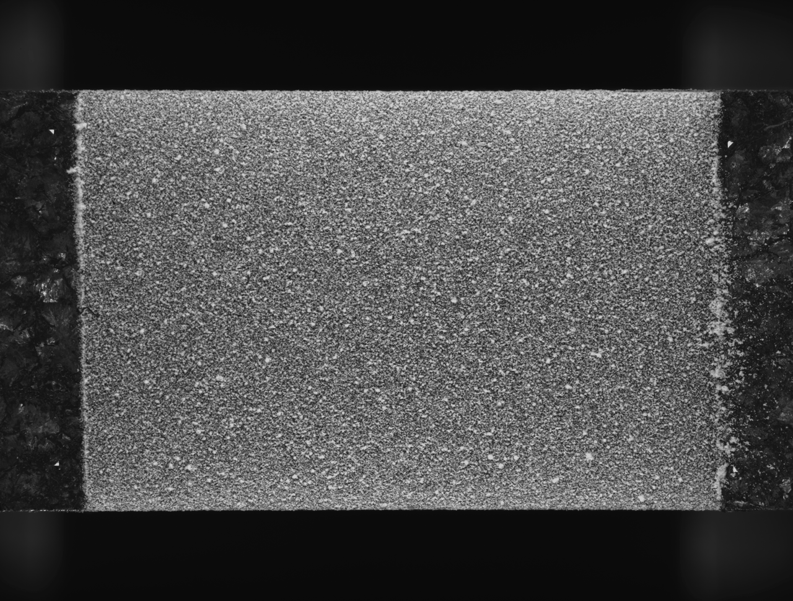
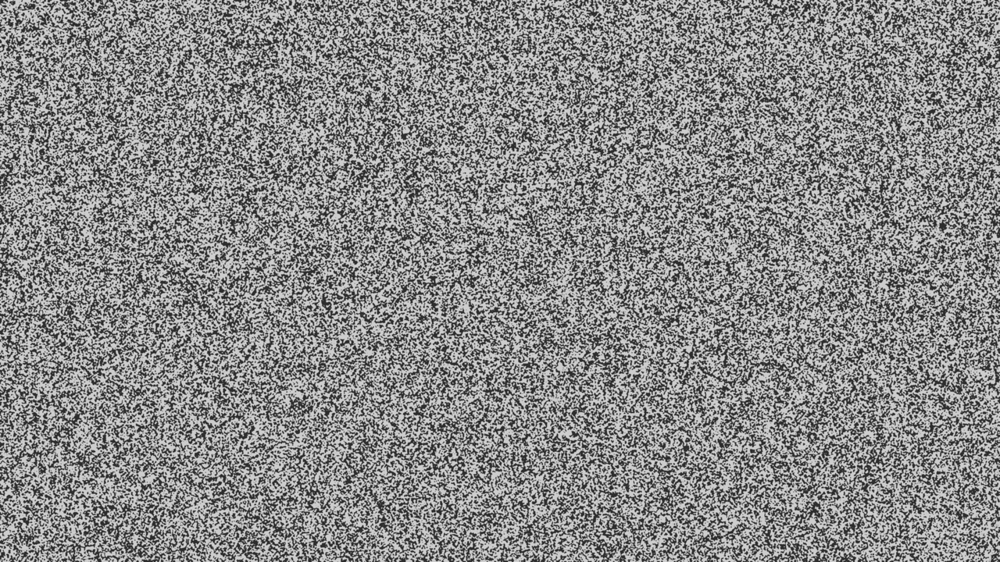

# Affine and RBF projection of learned matches

**Experiment date:** 2026-11-07. This page reports the projection experiment on analytic tensile images and the Adrien experimental pair. GIFs are qualitative; tables retain the measured quality and timing quantities. Machine-readable summaries and per-match CSV files are linked at the end.

## Main conclusion for tensile initialization

For the tested analytic traction series, **affine projection is the most reliable initialization choice**. RaCo affine stays below 5 px for every visible seed from 10% through 60% strain (136/136 overall; 16/16 at 60%, RMSE 2.03 px), and automatic selection chooses affine in all six RaCo cases. EfficientLoFTR affine stays below 5 px through 40%, reaches 18/20 at 50%, then fails at 60% (0/16). Automatic RBF selection recovers only one 60% seed below 5 px, with 78.05 px RMSE; this is still a failed initialization. RBF gives no consistent coverage gain at lower strains.

This conclusion is specific to these traction images and seeds. The Adrien pair has no analytic displacement truth; its RBF residuals and appearance cannot establish which field is physically more accurate.

## Flicker GIFs

Each GIF alternates between the reference and the deformed image sampled through the projected displacement field (850 ms per frame). PNG source previews are capped at 1920 px wide; GIFs are 1280 px wide. Matching and field fitting used native image coordinates.

### Adrien experimental pair: frames 000000 → 000075

**Affine projection.**

**Automatic Gaussian-RBF request.**

On Adrien, EfficientLoFTR yields more mask-valid matches (2,675/3,272 versus 680/701 for RaCo). Its match-field residuals are also lower: affine median/P95 are 6.76/15.95 px versus 7.50/20.47 px; RBF values are 4.93/10.85 px versus 5.51/15.71 px. These are residuals to the fitted match field, not errors against ground truth. Both RBF IRLS fits are flagged as non-converged.

### Analytic traction: successful and failed large-strain cases

RaCo affine provides a successful 60% initialization; EfficientLoFTR with automatically selected Gaussian RBF diverges at the same strain.

At low strain, EfficientLoFTR affine is also successful (28/28 seeds below 5 px at 10%, RMSE 0.08 px).

## Experimental protocol

- **Analytic traction:** reference and targets are 3840 × 2160 px; the matching networks receive 640 × 360 px content. Cases are 10%, 20%, 30%, 40%, 50%, and 60% strain. Seeds are kept only when their analytically transformed points remain inside the target. Projection error is measured against the exact analytic image displacement at native reference coordinates.
- **Adrien:** frames `img_000000_0.09422.tiff` → `img_000075_1608.88508.tiff`, each 7920 × 6004 px; network content is 640 × 485 px. `Mask.tiff` restricts correspondences and seed windows. No analytic displacement field is available.
- **Models:** RaCo-ALIKED-LightGlue+ and EfficientLoFTR, using the ONNX weights and SHA-256 digests recorded in the summary JSON. The configured provider is Microsoft `WebGpuExecutionProvider`.
- **Projection:** affine or spatial-CV selection between affine and Gaussian-RBF; WGSL via `wgpu-py` on Intel Graphics LNL, Mesa 25.2.8, Vulkan. ONNX match outputs pass through host arrays before projection, so this is not GPU-resident end to end.
- **Timing:** one measured inference after warmup per model/dataset, one fit per requested basis. CPU selection/scale pilot, GPU final fit, GPU patch projection, and total fit wall time are reported separately. These are single-run measurements, not repeated-run medians.
- **Runtime:** Python 3.12.3, NumPy 2.5.4, `wgpu-py` 0.32.0.
- All 28 summary records completed with `status = ok`; the separate IRLS convergence flag and final weight delta are shown in the result tables.

## WGPU port coverage: native kernels versus hybrid inference

There is no defensible single percentage for WGPU coverage: an operator count ignores operator cost, synchronization, and tensor copies. The stage-level status is:

| Component | WGPU coverage | Work still on host/CPU |
|---|---|---|
| DeepMatching | Descriptor/pyramid kernels, correlation, hierarchy aggregation and descent execute as WGSL through `wgpu-py` (and the browser frontend). | Image upload, root/hierarchy metadata construction, command orchestration, and final result readback. This is a native WGSL matcher, not zero-copy end to end. |
| HORG-DIC | Gaussian/DoG pyramid, detection, descriptors, exact k=2 search, Lowe ratio, seed candidates, local RANSAC and leave-one-out diagnostics are WGSL kernels. | Host orchestration and selected counters/feature data readback remain; they introduce synchronization points. |
| CPM-HOG | Experimental pyramid and PatchMatch search passes execute as WGSL. | Host builds settings/dispatch sequence and reads back final diagnostics. This method remains experimentally qualified only on limited cases. |
| Affine/RBF projection | Final coefficient solve, field evaluation and per-patch projection execute in WGSL. | Automatic spatial cross-validation and robust-scale pilot use CPU float64; ONNX correspondences enter via host arrays. |
| EfficientLoFTR / RaCo-ALIKED-LightGlue+ | Inference is delegated to ONNX Runtime's native `WebGpuExecutionProvider`; these neural networks are **not ports to this repository's WGSL shaders**. | The measured graph includes CPU fallback operators and substantial host transfers. |
| RANSAC/ECC affine preconditioning | Dedicated RANSAC, affine warp and ECC accumulation/solve kernels exist in WGSL. | Python drives the ECC iterations and updates parameters from small readbacks; this is a separate affine-synthetic preconditioning experiment, not a learned-matcher 4K pipeline. |

### Measured ONNX placement on Intel Graphics LNL

The following are ONNX Runtime diagnostic trace event counts and cumulative event durations, not hardware GPU timestamps. Copy event time can include queue waits/synchronization, so it is not a clean percentage of compute:

| Graph/profile | WebGPU nodes / event time | CPU nodes / event time | Host-transfer evidence |
|---|---:|---:|---|
| EfficientLoFTR baseline | 1,296 / 1,389 ms | 1,256 / 110 ms | 12 `MemcpyToHost` events; 33.5 MB estimated summed tensors, 1,102 ms event duration. CPU `ScatterND` runs 8 times; CPU `Expand`/`Concat` also appear. |
| RaCo baseline | 2,314 / 2,956 ms | 544 / 285 ms | About 1.37 GB estimated summed tensors to host and 1.23 GB back to device; largest single host-bound tensor 251.7 MB. CPU `Selu` and `GridSample` appear. |
| RaCo with SELU decomposed to WebGPU-supported primitives | 2,648 / 1,263 ms | 459 / 86 ms | Transfer estimates fall to 0.262 GB to host and 0.118 GB to device, but all 39 `GridSample` nodes still execute on CPU. |

The SELU graph transform preserved accepted-seed counts and changed accepted seed positions by less than 0.00075 px on four test cases. Unprofiled pair time fell from 2.35–2.44 s to 1.42–1.62 s (about 31–40%), still above the 0.8 s target. The EfficientLoFTR `ScatterND` rewrite was rejected: its CPU nodes remained and the trace had more host copies. IOBinding and the ORT buffer-cache option showed no measured speed gain; no shared allocation between ONNX Runtime's Dawn device and `wgpu-py`'s wgpu-native device has been demonstrated.

### Native 4K status

The images are 4K (or larger in Adrien's case), but learned matcher inference is reduced to 640 × 360 content (640 × 485 for Adrien). There is **no implemented native-4K tiled/local refinement stage yet**. At 1/8 feature stride, a global EfficientLoFTR all-pairs FP32 matrix for a 3840 × 2160 pair would be 67.2 GB, so simply increasing the model input is not viable. The next missing stage is a bounded coarse-to-local pipeline, after eliminating or containing the costly ONNX CPU/copy paths.

## Direct matcher results on analytic traction

Raw errors compare retained direct matches with analytic displacement. Counts are relative to all retained matches.

| Strain | Frame | Matcher | Raw matches | Mask-valid | Median error (px) | RMSE (px) | ≤2 px | <5 px | Inference (ms) |
|---:|---:|---|---:|---:|---:|---:|---:|---:|---:|
| 10% | 66 | RaCo-ALIKED-LightGlue+ | 681 | 681 | 1.06 | 2.03 | 567/681 | 667/681 | 2414.4 |
| 10% | 66 | EfficientLoFTR | 2828 | 2828 | 1.71 | 62.00 | 1754/2828 | 2790/2828 | 1232.8 |
| 20% | 93 | RaCo-ALIKED-LightGlue+ | 605 | 605 | 1.46 | 2.58 | 418/605 | 585/605 | 2452.1 |
| 20% | 93 | EfficientLoFTR | 2495 | 2495 | 1.84 | 114.13 | 1393/2495 | 2447/2495 | 1237.4 |
| 30% | 119 | RaCo-ALIKED-LightGlue+ | 532 | 532 | 1.88 | 4.18 | 287/532 | 492/532 | 2431.2 |
| 30% | 119 | EfficientLoFTR | 2180 | 2180 | 2.10 | 146.43 | 1018/2180 | 2073/2180 | 1297.3 |
| 40% | 146 | RaCo-ALIKED-LightGlue+ | 471 | 471 | 2.15 | 4.28 | 214/471 | 425/471 | 2362.1 |
| 40% | 146 | EfficientLoFTR | 1992 | 1992 | 2.51 | 209.08 | 707/1992 | 1764/1992 | 1397.3 |
| 50% | 172 | RaCo-ALIKED-LightGlue+ | 426 | 426 | 2.49 | 5.66 | 168/426 | 354/426 | 2484.5 |
| 50% | 172 | EfficientLoFTR | 1697 | 1697 | 2.93 | 305.32 | 470/1697 | 1364/1697 | 1173.5 |
| 60% | 199 | RaCo-ALIKED-LightGlue+ | 389 | 389 | 3.06 | 6.66 | 105/389 | 295/389 | 2531.0 |
| 60% | 199 | EfficientLoFTR | 1434 | 1434 | 4.06 | 461.52 | 297/1434 | 876/1434 | 1222.2 |

## Projected seed accuracy against analytic truth

`Affine` rows force the affine basis. `Auto` rows request automatic selection and report the basis actually used after selection/fallback. Seed error is Euclidean displacement error at the requested DIC center. Field residual is the residual of observed matcher points to the fitted field; patch support RMS is a support residual. These are diagnostics, not analytic accuracy metrics.

| Strain | Matcher | Request → effective | Seeds projected | Seed median (px) | Seed RMSE (px) | Seed P95 (px) | ≤2 px | <5 px | Field residual median/P95 (px) | Patch support RMS median/P95 (px) | IRLS converged | IRLS max Δw |
|---:|---|---|---:|---:|---:|---:|---:|---:|---:|---:|---|---:|
| 10% | RaCo-ALIKED-LightGlue+ | Affine → affine | 28/28 | 0.43 | 0.46 | 0.66 | 28/28 | 28/28 | 1.04/3.13 | 0.0000/0.0000 | True | 0.000073 |
| 10% | RaCo-ALIKED-LightGlue+ | Auto → affine | 28/28 | 0.43 | 0.46 | 0.66 | 28/28 | 28/28 | 1.04/3.13 | 0.0000/0.0000 | True | 0.000073 |
| 10% | EfficientLoFTR | Affine → affine | 28/28 | 0.07 | 0.08 | 0.12 | 28/28 | 28/28 | 1.71/3.63 | 0.0000/0.0000 | True | 0.000073 |
| 10% | EfficientLoFTR | Auto → affine | 28/28 | 0.07 | 0.08 | 0.12 | 28/28 | 28/28 | 1.71/3.63 | 0.0000/0.0000 | True | 0.000073 |
| 20% | RaCo-ALIKED-LightGlue+ | Affine → affine | 24/24 | 0.61 | 0.62 | 0.70 | 24/24 | 24/24 | 1.36/4.16 | 0.0000/0.0000 | True | 0.000036 |
| 20% | RaCo-ALIKED-LightGlue+ | Auto → affine | 24/24 | 0.61 | 0.62 | 0.70 | 24/24 | 24/24 | 1.36/4.16 | 0.0000/0.0000 | True | 0.000036 |
| 20% | EfficientLoFTR | Affine → affine | 24/24 | 0.18 | 0.21 | 0.33 | 24/24 | 24/24 | 1.85/3.90 | 0.0000/0.0000 | False | 0.000262 |
| 20% | EfficientLoFTR | Auto → gaussian_rbf | 24/24 | 0.21 | 0.25 | 0.44 | 24/24 | 24/24 | 1.84/3.86 | 0.0010/0.0021 | False | 0.021733 |
| 30% | RaCo-ALIKED-LightGlue+ | Affine → affine | 24/24 | 1.04 | 1.05 | 1.20 | 24/24 | 24/24 | 1.58/6.00 | 0.0000/0.0000 | True | 0.000093 |
| 30% | RaCo-ALIKED-LightGlue+ | Auto → affine | 24/24 | 1.04 | 1.05 | 1.20 | 24/24 | 24/24 | 1.58/6.00 | 0.0000/0.0000 | True | 0.000093 |
| 30% | EfficientLoFTR | Affine → affine | 24/24 | 0.48 | 0.52 | 0.85 | 24/24 | 24/24 | 2.12/5.13 | 0.0000/0.0000 | True | 0.000049 |
| 30% | EfficientLoFTR | Auto → gaussian_rbf | 24/24 | 0.46 | 0.52 | 0.80 | 24/24 | 24/24 | 2.12/5.11 | 0.0008/0.0009 | False | 0.002895 |
| 40% | RaCo-ALIKED-LightGlue+ | Affine → affine | 24/24 | 1.30 | 1.30 | 1.40 | 24/24 | 24/24 | 1.74/7.22 | 0.0000/0.0001 | True | 0.000083 |
| 40% | RaCo-ALIKED-LightGlue+ | Auto → affine | 24/24 | 1.30 | 1.30 | 1.40 | 24/24 | 24/24 | 1.74/7.22 | 0.0000/0.0001 | True | 0.000083 |
| 40% | EfficientLoFTR | Affine → affine | 24/24 | 0.79 | 0.97 | 1.68 | 24/24 | 24/24 | 2.55/6.95 | 0.0000/0.0000 | False | 0.000115 |
| 40% | EfficientLoFTR | Auto → affine | 24/24 | 0.79 | 0.97 | 1.68 | 24/24 | 24/24 | 2.55/6.95 | 0.0000/0.0000 | False | 0.000115 |
| 50% | RaCo-ALIKED-LightGlue+ | Affine → affine | 20/20 | 1.68 | 1.70 | 1.80 | 20/20 | 20/20 | 2.10/9.08 | 0.0000/0.0001 | True | 0.000088 |
| 50% | RaCo-ALIKED-LightGlue+ | Auto → affine | 20/20 | 1.68 | 1.70 | 1.80 | 20/20 | 20/20 | 2.10/9.08 | 0.0000/0.0001 | True | 0.000088 |
| 50% | EfficientLoFTR | Affine → affine | 20/20 | 2.62 | 3.29 | 5.01 | 6/20 | 18/20 | 3.89/351.28 | 0.0000/0.0000 | False | 0.001706 |
| 50% | EfficientLoFTR | Auto → affine | 20/20 | 2.62 | 3.29 | 5.01 | 6/20 | 18/20 | 3.89/351.28 | 0.0000/0.0000 | False | 0.001706 |
| 60% | RaCo-ALIKED-LightGlue+ | Affine → affine | 16/16 | 2.02 | 2.03 | 2.22 | 8/16 | 16/16 | 2.40/12.95 | 0.0000/0.0000 | True | 0.000061 |
| 60% | RaCo-ALIKED-LightGlue+ | Auto → affine | 16/16 | 2.02 | 2.03 | 2.22 | 8/16 | 16/16 | 2.40/12.95 | 0.0000/0.0000 | True | 0.000061 |
| 60% | EfficientLoFTR | Affine → affine | 16/16 | 98.26 | 111.88 | 167.87 | 0/16 | 0/16 | 120.73/856.17 | 0.0000/0.0000 | False | 0.012011 |
| 60% | EfficientLoFTR | Auto → gaussian_rbf | 16/16 | 29.80 | 78.05 | 184.76 | 0/16 | 1/16 | 39.09/728.93 | 1.2465/1.6588 | False | 0.004891 |

## Traction model selection and timing

Automatic selection uses spatial cross-validation with a one-standard-error preference for affine. Candidate folds, scale and ridge sweeps are retained in the linked JSON summaries.

| Strain | Matcher | Request → effective | Selection reason | RBF centers | ℓ normalized | Ridge | CPU select/scale (ms) | GPU fit (ms) | GPU patch projection (ms) | Patch API (ms) | Total fit wall (ms) |
|---:|---|---|---|---:|---:|---:|---:|---:|---:|---:|---:|
| 10% | RaCo-ALIKED-LightGlue+ | Affine → affine | `affine_requested` | 0 | — | 0.000000 | 1.7 | 280.8 | 2.8 | 2.6 | 284.2 |
| 10% | RaCo-ALIKED-LightGlue+ | Auto → affine | `affine_within_one_standard_error_of_best_rbf` | 0 | — | 0.000000 | 480.0 | 17.1 | 2.1 | 1.5 | 498.8 |
| 10% | EfficientLoFTR | Affine → affine | `affine_requested` | 0 | — | 0.000000 | 4.6 | 23.2 | 2.4 | 1.9 | 35.2 |
| 10% | EfficientLoFTR | Auto → affine | `affine_within_one_standard_error_of_best_rbf` | 0 | — | 0.000000 | 1237.3 | 35.2 | 2.4 | 1.6 | 1279.3 |
| 20% | RaCo-ALIKED-LightGlue+ | Affine → affine | `affine_requested` | 0 | — | 0.000000 | 1.2 | 34.9 | 2.8 | 3.7 | 40.7 |
| 20% | RaCo-ALIKED-LightGlue+ | Auto → affine | `affine_within_one_standard_error_of_best_rbf` | 0 | — | 0.000000 | 273.7 | 14.0 | 2.3 | 1.5 | 289.4 |
| 20% | EfficientLoFTR | Affine → affine | `affine_requested` | 0 | — | 0.000000 | 5.0 | 33.2 | 2.5 | 1.6 | 47.7 |
| 20% | EfficientLoFTR | Auto → gaussian_rbf | `gaussian_rbf_lowest_spatial_cv_error` | 16 | 0.928 | 0.000100 | 2120.8 | 48.8 | 2.5 | 1.6 | 2178.2 |
| 30% | RaCo-ALIKED-LightGlue+ | Affine → affine | `affine_requested` | 0 | — | 0.000000 | 1.6 | 11.8 | 2.5 | 1.4 | 15.7 |
| 30% | RaCo-ALIKED-LightGlue+ | Auto → affine | `affine_within_one_standard_error_of_best_rbf` | 0 | — | 0.000000 | 252.5 | 9.8 | 2.4 | 1.8 | 263.9 |
| 30% | EfficientLoFTR | Affine → affine | `affine_requested` | 0 | — | 0.000000 | 6.8 | 27.2 | 2.2 | 1.0 | 39.0 |
| 30% | EfficientLoFTR | Auto → gaussian_rbf | `gaussian_rbf_lowest_spatial_cv_error` | 16 | 0.881 | 0.010000 | 1477.5 | 52.3 | 3.3 | 7.2 | 1539.4 |
| 40% | RaCo-ALIKED-LightGlue+ | Affine → affine | `affine_requested` | 0 | — | 0.000000 | 8.1 | 13.4 | 2.6 | 5.9 | 23.6 |
| 40% | RaCo-ALIKED-LightGlue+ | Auto → affine | `affine_within_one_standard_error_of_best_rbf` | 0 | — | 0.000000 | 224.9 | 11.3 | 2.4 | 1.4 | 237.8 |
| 40% | EfficientLoFTR | Affine → affine | `affine_requested` | 0 | — | 0.000000 | 3.0 | 24.0 | 2.4 | 1.3 | 32.8 |
| 40% | EfficientLoFTR | Auto → affine | `affine_within_one_standard_error_of_best_rbf` | 0 | — | 0.000000 | 1128.8 | 31.1 | 2.5 | 4.5 | 1163.9 |
| 50% | RaCo-ALIKED-LightGlue+ | Affine → affine | `affine_requested` | 0 | — | 0.000000 | 1.3 | 20.2 | 2.6 | 2.4 | 23.3 |
| 50% | RaCo-ALIKED-LightGlue+ | Auto → affine | `affine_within_one_standard_error_of_best_rbf` | 0 | — | 0.000000 | 257.6 | 11.3 | 2.2 | 1.5 | 270.7 |
| 50% | EfficientLoFTR | Affine → affine | `affine_requested` | 0 | — | 0.000000 | 5.5 | 20.9 | 2.2 | 1.4 | 30.3 |
| 50% | EfficientLoFTR | Auto → affine | `affine_within_one_standard_error_of_best_rbf` | 0 | — | 0.000000 | 1018.1 | 30.8 | 3.5 | 1.9 | 1053.7 |
| 60% | RaCo-ALIKED-LightGlue+ | Affine → affine | `affine_requested` | 0 | — | 0.000000 | 2.2 | 26.2 | 2.3 | 10.7 | 30.2 |
| 60% | RaCo-ALIKED-LightGlue+ | Auto → affine | `affine_within_one_standard_error_of_best_rbf` | 0 | — | 0.000000 | 212.8 | 11.8 | 3.8 | 1.1 | 225.6 |
| 60% | EfficientLoFTR | Affine → affine | `affine_requested` | 0 | — | 0.000000 | 11.6 | 28.1 | 2.3 | 2.8 | 42.7 |
| 60% | EfficientLoFTR | Auto → gaussian_rbf | `gpu_solver_fallback_to_next_spatial_cv_candidate` | 32 | 0.850 | 0.000100 | 920.5 | 47.2 | 2.5 | 2.2 | 971.8 |

## Adrien experimental-image statistics without ground truth

All 112 requested seeds were projected. `Input pairs` is raw matcher output; `mask-valid` is retained after requiring both endpoints to satisfy the mask ROI. Residuals do not give an analytic displacement error.

| Matcher | Request → effective | Status | Input pairs | Mask-valid | Seeds | Field residual median/P95 (px) | Patch support RMS median/P95 (px) | IRLS converged | IRLS max Δw | Inference (ms) | CPU select (ms) | GPU fit (ms) | GPU patch projection (ms) | Patch API (ms) | Total fit (ms) |
|---|---|---|---:|---:|---:|---:|---:|---|---:|---:|---:|---:|---:|---:|---:|
| RaCo-ALIKED-LightGlue+ | Affine → affine | ok | 701 | 680 | 112/112 | 7.50/20.47 | 0.0000/0.0000 | True | 0.000063 | 2696.0 | 7.7 | 413.8 | 4.3 | 2.8 | 423.9 |
| RaCo-ALIKED-LightGlue+ | Auto → gaussian_rbf | ok | 701 | 680 | 112/112 | 5.51/15.71 | 0.0102/0.0169 | False | 0.001222 | 2696.0 | 328.6 | 91.2 | 4.3 | 3.1 | 426.0 |
| EfficientLoFTR | Affine → affine | ok | 3272 | 2675 | 112/112 | 6.76/15.95 | 0.0000/0.0000 | True | 0.000056 | 1899.4 | 3.0 | 19.3 | 4.0 | 4.4 | 30.6 |
| EfficientLoFTR | Auto → gaussian_rbf | ok | 3272 | 2675 | 112/112 | 4.93/10.85 | 0.0114/0.0170 | False | 0.005768 | 1899.4 | 1800.6 | 136.3 | 4.5 | 2.6 | 1947.1 |

## Interpretation and limits

- **Affine is the recommended projection for these tensile initializations.** It gives the most stable coverage over the tested 10–60% series. RBF does not provide a dependable gain in seed accuracy or coverage; EfficientLoFTR RBF at 60% visibly diverges and its IRLS fit did not converge.
- **EfficientLoFTR looks better on Adrien**, with more retained mask-valid matches and slightly smaller fitted-field residuals. The affine-corrected views are very close. RBF views look plausible, but both RBF fits have `irls_converged = false`; without analytic truth this is qualitative, not validation of physical accuracy.
- **Do not transfer the synthetic 60% result to Adrien.** The traction dataset has exact analytic truth and a homogeneous imposed map; the experimental pair has no independent displacement truth.
- **Not GPU-resident end to end.** Projection fits use WGSL on WebGPU, but ONNX outputs cross host arrays, and automatic spatial-CV/scale selection is CPU work. Timings are specific to the recorded setup.

## Full results and reproducibility

- [Traction summary JSON — includes all fields and candidate scores](dataset_run_traction_visual_20261107/summary.json)
- [Traction raw correspondences](dataset_run_traction_visual_20261107/raw_correspondences.csv) · [per-seed projection predictions](dataset_run_traction_visual_20261107/patch_predictions.csv)
- [Adrien summary JSON — includes all fields and candidate scores](dataset_run_adrien_visual_20261107/summary.json)
- [Adrien raw correspondences](dataset_run_adrien_visual_20261107/raw_correspondences.csv) · [per-seed projection predictions](dataset_run_adrien_visual_20261107/patch_predictions.csv)
- [ONNX operator-placement and transfer audit](../features/gpu_performance_audit_20261106.md) · [RaCo SELU-to-WebGPU optimization study](../features/raco_selu_webgpu_optimization_20261106.md)
- [Combined EOG PNG sequence](eog_sequence_traction_adrien_20261107/README.md)
- GIF generator: [render_projection_gifs.py](../../python/benchmarks/render_projection_gifs.py). Re-run with `python python/benchmarks/render_projection_gifs.py`.
