# Homogeneous traction: 50 percent: all methods and both projection requests

[Return to the complete qualification report](index.md).

The GIF alternates between the unchanged reference and the target sampled through the estimated forward displacement. No analytic warp is used to create the corrected image. The exact same viewport and shared palette are used for both frames; out-of-image samples remain black. In tensile corrections, side bands can be physically outside the target field of view even for a correct estimate; black alone is not a failure verdict. The numeric population includes only analytically visible requested centres. Unlabelled PNG previews are retained for external image viewers.

Native reference and target: 3840 × 2160 pixels. Case identifier: `tensile_50pct`.

Prescribed stretch factors: x = 1.498303340865625, y = 0.8174204251753675. Axial engineering strain is 49.830334 percent. The analytical map uses centre (1920, 1080) and target = centre + diag(stretch_x, stretch_y) × (source − centre).

Error metrics use original-image pixels: RMSE, median error, P95 and maximum error are conditional on estimated centres. Correct coverage retains every visible request in its denominator. IRLS convergence is reported independently.

| Method | Requested basis → effective | Verdict | Estimated / visible | Correct ≤2 px | Correct <5 px | RMSE / P95 / max (px) | Verified / upstream / raw pairs | IRLS converged |
|---|---|---|---:|---:|---:|---:|---:|---|
| DeepMatching INRIA hierarchy | affine → affine | Pass | 20 / 20 | 20 | 20 | 1.20 / 1.94 / 1.98 | 9765 / 17816 / 30720 | True |
| DeepMatching INRIA hierarchy | gaussian_rbf → affine | Pass | 20 / 20 | 20 | 20 | 1.20 / 1.94 / 1.98 | 9765 / 17816 / 30720 | True |
| HORG | affine → none | Fail | 0 / 20 | 0 | 0 | — / — / — | 0 / 22 / 693 | — |
| HORG | gaussian_rbf → none | Fail | 0 / 20 | 0 | 0 | — / — / — | 0 / 22 / 693 | — |
| CPM-HOG | affine → none | Fail | 0 / 20 | 0 | 0 | — / — / — | 0 / 73 / 32026 | — |
| CPM-HOG | gaussian_rbf → none | Fail | 0 / 20 | 0 | 0 | — / — / — | 0 / 73 / 32026 | — |
| XFeat | affine → affine | Pass | 20 / 20 | 0 | 20 | 3.73 / 4.36 / 4.45 | 205 / 981 / 981 | True |
| XFeat | gaussian_rbf → affine | Pass | 20 / 20 | 0 | 20 | 3.73 / 4.36 / 4.45 | 205 / 981 / 981 | True |
| EfficientLoFTR | affine → affine | Pass | 20 / 20 | 20 | 20 | 1.00 / 1.54 / 1.74 | 595 / 1696 / 1697 | True |
| EfficientLoFTR | gaussian_rbf → affine | Pass | 20 / 20 | 20 | 20 | 1.00 / 1.54 / 1.74 | 595 / 1696 / 1697 | True |
| RaCo-ALIKED-LightGlue+ | affine → affine | Pass | 20 / 20 | 20 | 20 | 0.56 / 0.85 / 0.93 | 208 / 426 / 426 | True |
| RaCo-ALIKED-LightGlue+ | gaussian_rbf → affine | Pass | 20 / 20 | 20 | 20 | 0.56 / 0.85 / 0.93 | 208 / 426 / 426 | True |
| DaD + DeDoDe-B | affine → affine | Pass | 20 / 20 | 20 | 20 | 0.35 / 0.59 / 0.72 | 1223 / 4502 / 4502 | False |
| DaD + DeDoDe-B | gaussian_rbf → affine | Pass | 20 / 20 | 20 | 20 | 0.35 / 0.59 / 0.72 | 1223 / 4502 / 4502 | False |
| DeDoDe v2-L + DeDoDe-B | affine → affine | Pass | 20 / 20 | 20 | 20 | 0.42 / 0.67 / 0.85 | 745 / 3674 / 3674 | True |
| DeDoDe v2-L + DeDoDe-B | gaussian_rbf → gaussian_rbf | Pass | 20 / 20 | 20 | 20 | 0.57 / 0.93 / 1.40 | 745 / 3674 / 3674 | False |
| DIC tensor + DeDoDe-B | affine → affine | Pass | 20 / 20 | 20 | 20 | 0.70 / 1.04 / 1.21 | 341 / 3495 / 3495 | True |
| DIC tensor + DeDoDe-B | gaussian_rbf → gaussian_rbf | Pass | 20 / 20 | 15 | 20 | 1.63 / 2.82 / 3.74 | 341 / 3495 / 3495 | False |
| Learned DIC + DeDoDe-B | affine → affine | Pass | 20 / 20 | 20 | 20 | 0.13 / 0.18 / 0.19 | 1874 / 4622 / 4622 | False |
| Learned DIC + DeDoDe-B | gaussian_rbf → affine | Pass | 20 / 20 | 20 | 20 | 0.13 / 0.18 / 0.19 | 1874 / 4622 / 4622 | False |
| HORG/SIFT detector + DeDoDe-B | affine → affine | Pass | 20 / 20 | 12 | 20 | 2.21 / 3.90 / 4.63 | 21 / 307 / 307 | True |
| HORG/SIFT detector + DeDoDe-B | gaussian_rbf → affine | Pass | 20 / 20 | 12 | 20 | 2.21 / 3.90 / 4.63 | 21 / 307 / 307 | True |

## DeepMatching INRIA hierarchy

60% synthetic status — affine: Pass; gaussian_rbf: Pass.

### Requested affine; effective affine

**Pass.** 20 of 20 requested centres have an estimated field.

Correct coverage (<5 px / all requested): 1.000. Conditional precision (<5 px / estimated): 1.000. False estimates at ≥5 px: 0. Median analytic error: 1.098 px.

| Timed component | Median / min / max (s) |
|---|---:|
| Complete affine call | 17.1141 / 16.7258 / 17.7233 |
| geometric_verification_s | 0.0769 / 0.0716 / 0.1071 |
| matching_pipeline_s | 17.0438 / 16.6557 / 17.6568 |
| field_fit_s | 0.0651 / 0.0616 / 0.0652 |
| patch_projection_s | 0.0016 / 0.0014 / 0.0016 |

Components are nested: matching_pipeline_s includes extraction sub-stages and geometric verification. Do not sum this table. These repeated complete-call times measure the affine path; the automatic-RBF request reuses its last pair set.

Execution/input details are preserved verbatim in the downloadable per-seed result under extraction: detector dimensions and point counts, descriptor backend, selected ONNX graph, preprocessing and stage times. The shared run manifest records native image dimensions and model hashes.

Selection reason: affine_requested. IRLS converged: True. Final weight change: 0.000090.

Projection capacity selection: {'input': 9765, 'selected': 8192, 'applied': True, 'tiles': [16, 9], 'criterion': 'balanced source-space quotas; uniform within each cell'}.

Valid target-sampling fraction of the reference ROI: 0.667. Preview absolute intensity difference median/P95: 9.00/47.00. These are photometric diagnostics, not displacement error.

[Reference PNG](tensile_50pct/deepmatching/affine/image1_ref.png) · [Target PNG](tensile_50pct/deepmatching/affine/image1_def_cor.png)

- [Every observed pair and rejection](tensile_50pct/deepmatching/correspondences.csv.gz)
- [Per-seed errors, estimates and timings](tensile_50pct/deepmatching/affine/result.json)
- [Full fitted field and provenance](tensile_50pct/deepmatching/affine/model.json.gz)

### Requested gaussian_rbf; effective affine

**Pass.** 20 of 20 requested centres have an estimated field.

Correct coverage (<5 px / all requested): 1.000. Conditional precision (<5 px / estimated): 1.000. False estimates at ≥5 px: 0. Median analytic error: 1.098 px.

| Timed component | Median / min / max (s) |
|---|---:|
| Complete affine call | 17.1141 / 16.7258 / 17.7233 |
| geometric_verification_s | 0.0769 / 0.0716 / 0.1071 |
| matching_pipeline_s | 17.0438 / 16.6557 / 17.6568 |
| field_fit_s | 0.0651 / 0.0616 / 0.0652 |
| patch_projection_s | 0.0016 / 0.0014 / 0.0016 |

Components are nested: matching_pipeline_s includes extraction sub-stages and geometric verification. Do not sum this table. These repeated complete-call times measure the affine path; the automatic-RBF request reuses its last pair set.

Execution/input details are preserved verbatim in the downloadable per-seed result under extraction: detector dimensions and point counts, descriptor backend, selected ONNX graph, preprocessing and stage times. The shared run manifest records native image dimensions and model hashes.

Automatic-basis single fit/patch times (seconds): {'field_fit_s': 2.1561481039971113, 'patch_projection_s': 0.0016897289315238595, 'fit_and_patch_s': 2.1578379049897194}.

Selection reason: affine_within_one_standard_error_of_best_rbf. IRLS converged: True. Final weight change: 0.000090.

Projection capacity selection: {'input': 9765, 'selected': 8192, 'applied': True, 'tiles': [16, 9], 'criterion': 'balanced source-space quotas; uniform within each cell'}.

Valid target-sampling fraction of the reference ROI: 0.667. Preview absolute intensity difference median/P95: 9.00/47.00. These are photometric diagnostics, not displacement error.

[Reference PNG](tensile_50pct/deepmatching/gaussian_rbf/image1_ref.png) · [Target PNG](tensile_50pct/deepmatching/gaussian_rbf/image1_def_cor.png)

- [Every observed pair and rejection](tensile_50pct/deepmatching/correspondences.csv.gz)
- [Per-seed errors, estimates and timings](tensile_50pct/deepmatching/gaussian_rbf/result.json)
- [Full fitted field and provenance](tensile_50pct/deepmatching/gaussian_rbf/model.json.gz)

## HORG

60% synthetic status — affine: Fail; gaussian_rbf: Fail.

### Requested affine; effective none

**Fail.** 0 of 20 requested centres have an estimated field.

Failure reason: at least three finite in-image correspondences are required

**Diagnostic only:** accepted pairs did not produce a field. The GIF shows a fit to rejected proposals to make the failure visible. This fit contributes no usable estimates and cannot pass.

Correct coverage (<5 px / all requested): 0.000. Conditional precision (<5 px / estimated): —. False estimates at ≥5 px: 0. Median analytic error: — px.

| Timed component | Median / min / max (s) |
|---|---:|
| Complete affine call | 0.0859 / 0.0841 / 0.0881 |
| geometric_verification_s | 0.0039 / 0.0039 / 0.0040 |
| matching_pipeline_s | 0.0856 / 0.0838 / 0.0878 |

Components are nested: matching_pipeline_s includes extraction sub-stages and geometric verification. Do not sum this table. These repeated complete-call times measure the affine path; the automatic-RBF request reuses its last pair set.

Execution/input details are preserved verbatim in the downloadable per-seed result under extraction: detector dimensions and point counts, descriptor backend, selected ONNX graph, preprocessing and stage times. The shared run manifest records native image dimensions and model hashes.

Selection reason: unavailable. IRLS converged: unavailable. Final weight change: —.

Projection capacity selection: unavailable.

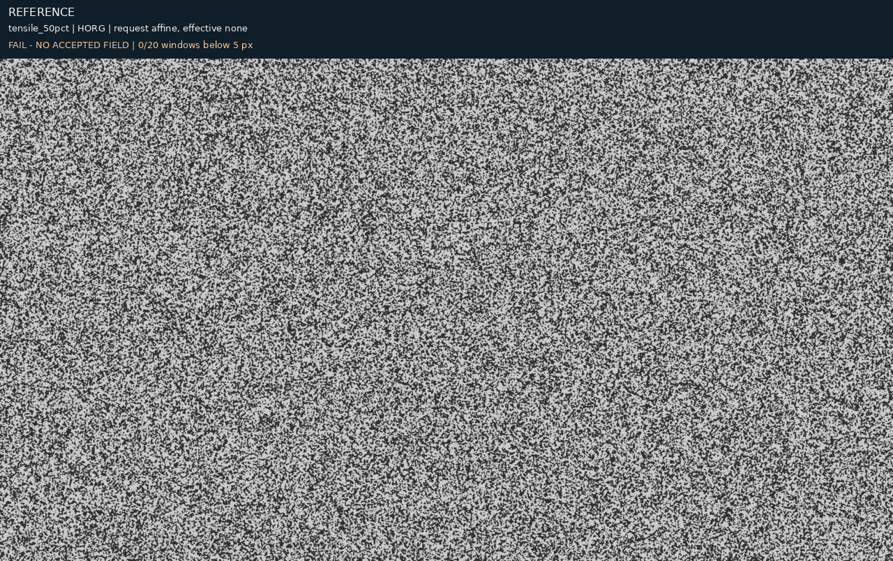

Valid target-sampling fraction of the reference ROI: 1.000. Preview absolute intensity difference median/P95: 61.00/156.00. These are photometric diagnostics, not displacement error.

[Reference PNG](tensile_50pct/horg/affine/image1_ref.png) · [Target PNG](tensile_50pct/horg/affine/image1_def_cor.png)

- [Every observed pair and rejection](tensile_50pct/horg/correspondences.csv.gz)
- [Per-seed errors, estimates and timings](tensile_50pct/horg/affine/result.json)
- [Rejected-proposal diagnostic field](tensile_50pct/horg/affine/rejected_diagnostic_model.json.gz)

### Requested gaussian_rbf; effective none

**Fail.** 0 of 20 requested centres have an estimated field.

Failure reason: at least three finite in-image correspondences are required

**Diagnostic only:** accepted pairs did not produce a field. The GIF shows a fit to rejected proposals to make the failure visible. This fit contributes no usable estimates and cannot pass.

Correct coverage (<5 px / all requested): 0.000. Conditional precision (<5 px / estimated): —. False estimates at ≥5 px: 0. Median analytic error: — px.

| Timed component | Median / min / max (s) |
|---|---:|
| Complete affine call | 0.0859 / 0.0841 / 0.0881 |
| geometric_verification_s | 0.0039 / 0.0039 / 0.0040 |
| matching_pipeline_s | 0.0856 / 0.0838 / 0.0878 |

Components are nested: matching_pipeline_s includes extraction sub-stages and geometric verification. Do not sum this table. These repeated complete-call times measure the affine path; the automatic-RBF request reuses its last pair set.

Execution/input details are preserved verbatim in the downloadable per-seed result under extraction: detector dimensions and point counts, descriptor backend, selected ONNX graph, preprocessing and stage times. The shared run manifest records native image dimensions and model hashes.

Selection reason: unavailable. IRLS converged: unavailable. Final weight change: —.

Projection capacity selection: unavailable.

Valid target-sampling fraction of the reference ROI: 1.000. Preview absolute intensity difference median/P95: 61.00/156.00. These are photometric diagnostics, not displacement error.

[Reference PNG](tensile_50pct/horg/gaussian_rbf/image1_ref.png) · [Target PNG](tensile_50pct/horg/gaussian_rbf/image1_def_cor.png)

- [Every observed pair and rejection](tensile_50pct/horg/correspondences.csv.gz)
- [Per-seed errors, estimates and timings](tensile_50pct/horg/gaussian_rbf/result.json)
- [Rejected-proposal diagnostic field](tensile_50pct/horg/gaussian_rbf/rejected_diagnostic_model.json.gz)

## CPM-HOG

60% synthetic status — affine: Fail; gaussian_rbf: Fail.

### Requested affine; effective none

**Fail.** 0 of 20 requested centres have an estimated field.

Failure reason: at least three finite in-image correspondences are required

**Diagnostic only:** accepted pairs did not produce a field. The GIF shows a fit to rejected proposals to make the failure visible. This fit contributes no usable estimates and cannot pass.

Correct coverage (<5 px / all requested): 0.000. Conditional precision (<5 px / estimated): —. False estimates at ≥5 px: 0. Median analytic error: — px.

| Timed component | Median / min / max (s) |
|---|---:|
| Complete affine call | 0.3772 / 0.3756 / 0.4424 |
| geometric_verification_s | 0.0059 / 0.0059 / 0.0065 |
| matching_pipeline_s | 0.3726 / 0.3708 / 0.4381 |

Components are nested: matching_pipeline_s includes extraction sub-stages and geometric verification. Do not sum this table. These repeated complete-call times measure the affine path; the automatic-RBF request reuses its last pair set.

Execution/input details are preserved verbatim in the downloadable per-seed result under extraction: detector dimensions and point counts, descriptor backend, selected ONNX graph, preprocessing and stage times. The shared run manifest records native image dimensions and model hashes.

Selection reason: unavailable. IRLS converged: unavailable. Final weight change: —.

Projection capacity selection: unavailable.

Valid target-sampling fraction of the reference ROI: 1.000. Preview absolute intensity difference median/P95: 61.00/156.00. These are photometric diagnostics, not displacement error.

[Reference PNG](tensile_50pct/cpm/affine/image1_ref.png) · [Target PNG](tensile_50pct/cpm/affine/image1_def_cor.png)

- [Every observed pair and rejection](tensile_50pct/cpm/correspondences.csv.gz)
- [Per-seed errors, estimates and timings](tensile_50pct/cpm/affine/result.json)
- [Rejected-proposal diagnostic field](tensile_50pct/cpm/affine/rejected_diagnostic_model.json.gz)

### Requested gaussian_rbf; effective none

**Fail.** 0 of 20 requested centres have an estimated field.

Failure reason: at least three finite in-image correspondences are required

**Diagnostic only:** accepted pairs did not produce a field. The GIF shows a fit to rejected proposals to make the failure visible. This fit contributes no usable estimates and cannot pass.

Correct coverage (<5 px / all requested): 0.000. Conditional precision (<5 px / estimated): —. False estimates at ≥5 px: 0. Median analytic error: — px.

| Timed component | Median / min / max (s) |
|---|---:|
| Complete affine call | 0.3772 / 0.3756 / 0.4424 |
| geometric_verification_s | 0.0059 / 0.0059 / 0.0065 |
| matching_pipeline_s | 0.3726 / 0.3708 / 0.4381 |

Components are nested: matching_pipeline_s includes extraction sub-stages and geometric verification. Do not sum this table. These repeated complete-call times measure the affine path; the automatic-RBF request reuses its last pair set.

Execution/input details are preserved verbatim in the downloadable per-seed result under extraction: detector dimensions and point counts, descriptor backend, selected ONNX graph, preprocessing and stage times. The shared run manifest records native image dimensions and model hashes.

Selection reason: unavailable. IRLS converged: unavailable. Final weight change: —.

Projection capacity selection: unavailable.

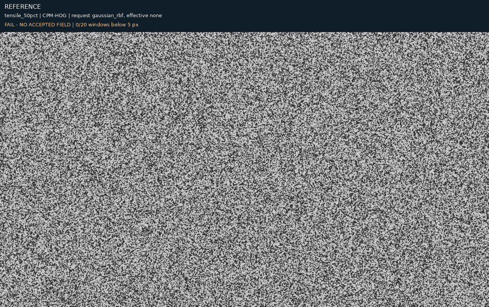

Valid target-sampling fraction of the reference ROI: 1.000. Preview absolute intensity difference median/P95: 61.00/156.00. These are photometric diagnostics, not displacement error.

[Reference PNG](tensile_50pct/cpm/gaussian_rbf/image1_ref.png) · [Target PNG](tensile_50pct/cpm/gaussian_rbf/image1_def_cor.png)

- [Every observed pair and rejection](tensile_50pct/cpm/correspondences.csv.gz)
- [Per-seed errors, estimates and timings](tensile_50pct/cpm/gaussian_rbf/result.json)
- [Rejected-proposal diagnostic field](tensile_50pct/cpm/gaussian_rbf/rejected_diagnostic_model.json.gz)

## XFeat

60% synthetic status — affine: Pass; gaussian_rbf: Pass.

### Requested affine; effective affine

**Pass.** 20 of 20 requested centres have an estimated field.

Correct coverage (<5 px / all requested): 1.000. Conditional precision (<5 px / estimated): 1.000. False estimates at ≥5 px: 0. Median analytic error: 3.705 px.

| Timed component | Median / min / max (s) |
|---|---:|
| Complete affine call | 0.6738 / 0.6287 / 0.7107 |
| geometric_verification_s | 0.0132 / 0.0129 / 0.0218 |
| matching_pipeline_s | 0.6397 / 0.6073 / 0.6597 |
| field_fit_s | 0.0143 / 0.0099 / 0.0499 |
| patch_projection_s | 0.0013 / 0.0010 / 0.0026 |

Components are nested: matching_pipeline_s includes extraction sub-stages and geometric verification. Do not sum this table. These repeated complete-call times measure the affine path; the automatic-RBF request reuses its last pair set.

Execution/input details are preserved verbatim in the downloadable per-seed result under extraction: detector dimensions and point counts, descriptor backend, selected ONNX graph, preprocessing and stage times. The shared run manifest records native image dimensions and model hashes.

Selection reason: affine_requested. IRLS converged: True. Final weight change: 0.000060.

Projection capacity selection: {'input': 205, 'selected': 205, 'applied': False}.

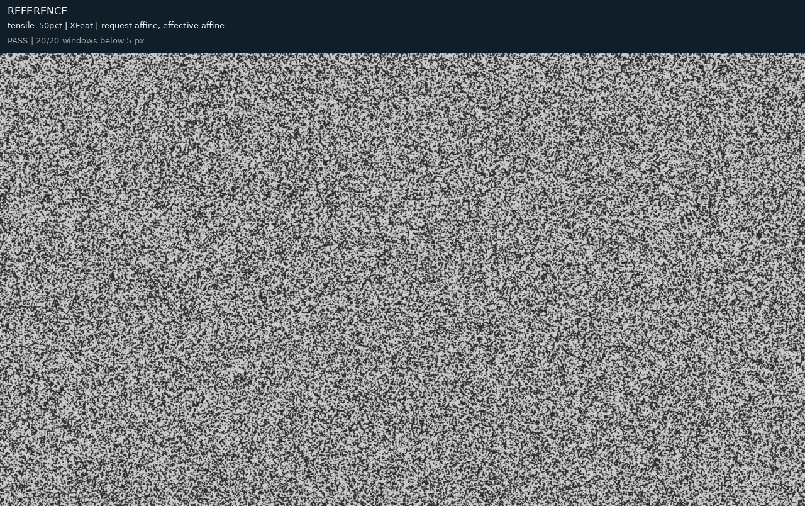

Valid target-sampling fraction of the reference ROI: 0.667. Preview absolute intensity difference median/P95: 24.00/107.00. These are photometric diagnostics, not displacement error.

[Reference PNG](tensile_50pct/xfeat/affine/image1_ref.png) · [Target PNG](tensile_50pct/xfeat/affine/image1_def_cor.png)

- [Every observed pair and rejection](tensile_50pct/xfeat/correspondences.csv.gz)
- [Per-seed errors, estimates and timings](tensile_50pct/xfeat/affine/result.json)
- [Full fitted field and provenance](tensile_50pct/xfeat/affine/model.json.gz)

### Requested gaussian_rbf; effective affine

**Pass.** 20 of 20 requested centres have an estimated field.

Correct coverage (<5 px / all requested): 1.000. Conditional precision (<5 px / estimated): 1.000. False estimates at ≥5 px: 0. Median analytic error: 3.705 px.

| Timed component | Median / min / max (s) |
|---|---:|
| Complete affine call | 0.6738 / 0.6287 / 0.7107 |
| geometric_verification_s | 0.0132 / 0.0129 / 0.0218 |
| matching_pipeline_s | 0.6397 / 0.6073 / 0.6597 |
| field_fit_s | 0.0143 / 0.0099 / 0.0499 |
| patch_projection_s | 0.0013 / 0.0010 / 0.0026 |

Components are nested: matching_pipeline_s includes extraction sub-stages and geometric verification. Do not sum this table. These repeated complete-call times measure the affine path; the automatic-RBF request reuses its last pair set.

Execution/input details are preserved verbatim in the downloadable per-seed result under extraction: detector dimensions and point counts, descriptor backend, selected ONNX graph, preprocessing and stage times. The shared run manifest records native image dimensions and model hashes.

Automatic-basis single fit/patch times (seconds): {'field_fit_s': 0.18516991997603327, 'patch_projection_s': 0.001102323061786592, 'fit_and_patch_s': 0.1862723110243678}.

Selection reason: affine_within_one_standard_error_of_best_rbf. IRLS converged: True. Final weight change: 0.000060.

Projection capacity selection: {'input': 205, 'selected': 205, 'applied': False}.

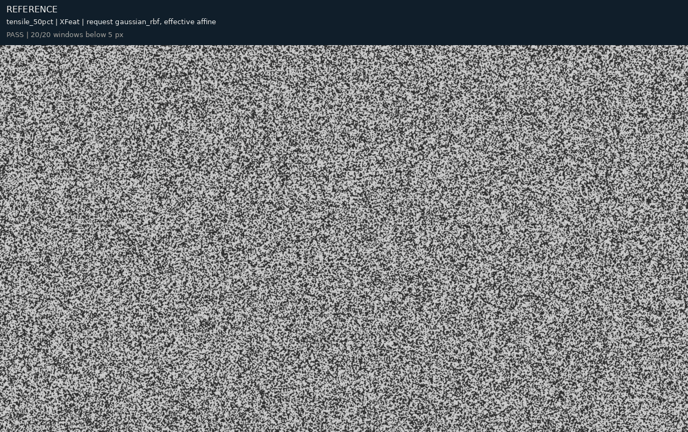

Valid target-sampling fraction of the reference ROI: 0.667. Preview absolute intensity difference median/P95: 24.00/107.00. These are photometric diagnostics, not displacement error.

[Reference PNG](tensile_50pct/xfeat/gaussian_rbf/image1_ref.png) · [Target PNG](tensile_50pct/xfeat/gaussian_rbf/image1_def_cor.png)

- [Every observed pair and rejection](tensile_50pct/xfeat/correspondences.csv.gz)
- [Per-seed errors, estimates and timings](tensile_50pct/xfeat/gaussian_rbf/result.json)
- [Full fitted field and provenance](tensile_50pct/xfeat/gaussian_rbf/model.json.gz)

## EfficientLoFTR

60% synthetic status — affine: Pass; gaussian_rbf: Pass.

### Requested affine; effective affine

**Pass.** 20 of 20 requested centres have an estimated field.

Correct coverage (<5 px / all requested): 1.000. Conditional precision (<5 px / estimated): 1.000. False estimates at ≥5 px: 0. Median analytic error: 0.887 px.

| Timed component | Median / min / max (s) |
|---|---:|
| Complete affine call | 0.8758 / 0.8752 / 0.9121 |
| geometric_verification_s | 0.0165 / 0.0146 / 0.0167 |
| matching_pipeline_s | 0.8636 / 0.8598 / 0.8970 |
| field_fit_s | 0.0141 / 0.0106 / 0.0148 |
| patch_projection_s | 0.0010 / 0.0009 / 0.0012 |

Components are nested: matching_pipeline_s includes extraction sub-stages and geometric verification. Do not sum this table. These repeated complete-call times measure the affine path; the automatic-RBF request reuses its last pair set.

Execution/input details are preserved verbatim in the downloadable per-seed result under extraction: detector dimensions and point counts, descriptor backend, selected ONNX graph, preprocessing and stage times. The shared run manifest records native image dimensions and model hashes.

Selection reason: affine_requested. IRLS converged: True. Final weight change: 0.000073.

Projection capacity selection: {'input': 595, 'selected': 595, 'applied': False}.

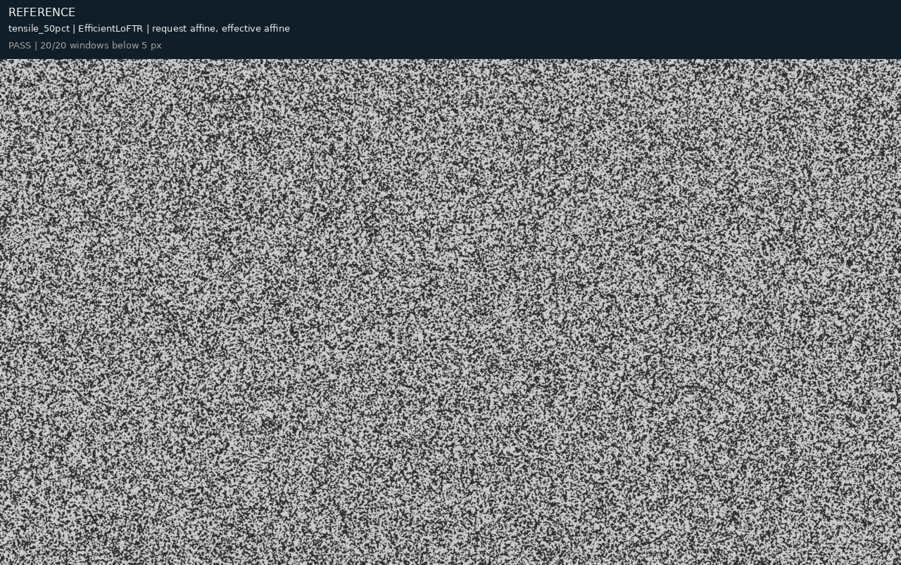

Valid target-sampling fraction of the reference ROI: 0.667. Preview absolute intensity difference median/P95: 10.00/54.00. These are photometric diagnostics, not displacement error.

[Reference PNG](tensile_50pct/efficientloftr/affine/image1_ref.png) · [Target PNG](tensile_50pct/efficientloftr/affine/image1_def_cor.png)

- [Every observed pair and rejection](tensile_50pct/efficientloftr/correspondences.csv.gz)
- [Per-seed errors, estimates and timings](tensile_50pct/efficientloftr/affine/result.json)
- [Full fitted field and provenance](tensile_50pct/efficientloftr/affine/model.json.gz)

### Requested gaussian_rbf; effective affine

**Pass.** 20 of 20 requested centres have an estimated field.

Correct coverage (<5 px / all requested): 1.000. Conditional precision (<5 px / estimated): 1.000. False estimates at ≥5 px: 0. Median analytic error: 0.887 px.

| Timed component | Median / min / max (s) |
|---|---:|
| Complete affine call | 0.8758 / 0.8752 / 0.9121 |
| geometric_verification_s | 0.0165 / 0.0146 / 0.0167 |
| matching_pipeline_s | 0.8636 / 0.8598 / 0.8970 |
| field_fit_s | 0.0141 / 0.0106 / 0.0148 |
| patch_projection_s | 0.0010 / 0.0009 / 0.0012 |

Components are nested: matching_pipeline_s includes extraction sub-stages and geometric verification. Do not sum this table. These repeated complete-call times measure the affine path; the automatic-RBF request reuses its last pair set.

Execution/input details are preserved verbatim in the downloadable per-seed result under extraction: detector dimensions and point counts, descriptor backend, selected ONNX graph, preprocessing and stage times. The shared run manifest records native image dimensions and model hashes.

Automatic-basis single fit/patch times (seconds): {'field_fit_s': 0.32651586399879307, 'patch_projection_s': 0.001584037090651691, 'fit_and_patch_s': 0.32809998909942806}.

Selection reason: affine_within_one_standard_error_of_best_rbf. IRLS converged: True. Final weight change: 0.000073.

Projection capacity selection: {'input': 595, 'selected': 595, 'applied': False}.

Valid target-sampling fraction of the reference ROI: 0.667. Preview absolute intensity difference median/P95: 10.00/54.00. These are photometric diagnostics, not displacement error.

[Reference PNG](tensile_50pct/efficientloftr/gaussian_rbf/image1_ref.png) · [Target PNG](tensile_50pct/efficientloftr/gaussian_rbf/image1_def_cor.png)

- [Every observed pair and rejection](tensile_50pct/efficientloftr/correspondences.csv.gz)
- [Per-seed errors, estimates and timings](tensile_50pct/efficientloftr/gaussian_rbf/result.json)
- [Full fitted field and provenance](tensile_50pct/efficientloftr/gaussian_rbf/model.json.gz)

## RaCo-ALIKED-LightGlue+

60% synthetic status — affine: Pass; gaussian_rbf: Pass.

### Requested affine; effective affine

**Pass.** 20 of 20 requested centres have an estimated field.

Correct coverage (<5 px / all requested): 1.000. Conditional precision (<5 px / estimated): 1.000. False estimates at ≥5 px: 0. Median analytic error: 0.492 px.

| Timed component | Median / min / max (s) |
|---|---:|
| Complete affine call | 1.1192 / 1.1142 / 1.1989 |
| geometric_verification_s | 0.0109 / 0.0075 / 0.0123 |
| matching_pipeline_s | 1.1033 / 1.1003 / 1.1755 |
| field_fit_s | 0.0145 / 0.0120 / 0.0196 |
| patch_projection_s | 0.0019 / 0.0013 / 0.0038 |

Components are nested: matching_pipeline_s includes extraction sub-stages and geometric verification. Do not sum this table. These repeated complete-call times measure the affine path; the automatic-RBF request reuses its last pair set.

Execution/input details are preserved verbatim in the downloadable per-seed result under extraction: detector dimensions and point counts, descriptor backend, selected ONNX graph, preprocessing and stage times. The shared run manifest records native image dimensions and model hashes.

Selection reason: affine_requested. IRLS converged: True. Final weight change: 0.000047.

Projection capacity selection: {'input': 208, 'selected': 208, 'applied': False}.

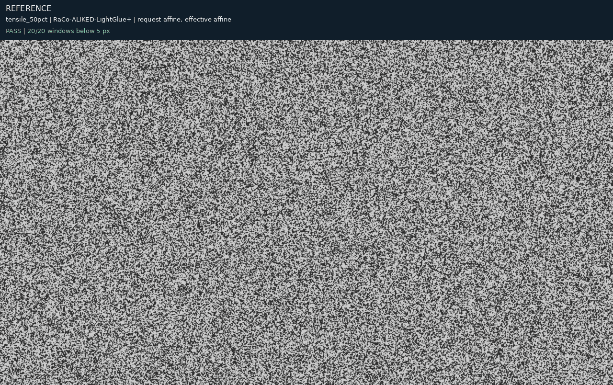

Valid target-sampling fraction of the reference ROI: 0.667. Preview absolute intensity difference median/P95: 9.00/34.00. These are photometric diagnostics, not displacement error.

[Reference PNG](tensile_50pct/raco/affine/image1_ref.png) · [Target PNG](tensile_50pct/raco/affine/image1_def_cor.png)

- [Every observed pair and rejection](tensile_50pct/raco/correspondences.csv.gz)
- [Per-seed errors, estimates and timings](tensile_50pct/raco/affine/result.json)
- [Full fitted field and provenance](tensile_50pct/raco/affine/model.json.gz)

### Requested gaussian_rbf; effective affine

**Pass.** 20 of 20 requested centres have an estimated field.

Correct coverage (<5 px / all requested): 1.000. Conditional precision (<5 px / estimated): 1.000. False estimates at ≥5 px: 0. Median analytic error: 0.492 px.

| Timed component | Median / min / max (s) |
|---|---:|
| Complete affine call | 1.1192 / 1.1142 / 1.1989 |
| geometric_verification_s | 0.0109 / 0.0075 / 0.0123 |
| matching_pipeline_s | 1.1033 / 1.1003 / 1.1755 |
| field_fit_s | 0.0145 / 0.0120 / 0.0196 |
| patch_projection_s | 0.0019 / 0.0013 / 0.0038 |

Components are nested: matching_pipeline_s includes extraction sub-stages and geometric verification. Do not sum this table. These repeated complete-call times measure the affine path; the automatic-RBF request reuses its last pair set.

Execution/input details are preserved verbatim in the downloadable per-seed result under extraction: detector dimensions and point counts, descriptor backend, selected ONNX graph, preprocessing and stage times. The shared run manifest records native image dimensions and model hashes.

Automatic-basis single fit/patch times (seconds): {'field_fit_s': 0.19496062002144754, 'patch_projection_s': 0.0011100400006398559, 'fit_and_patch_s': 0.1960707299876958}.

Selection reason: affine_within_one_standard_error_of_best_rbf. IRLS converged: True. Final weight change: 0.000047.

Projection capacity selection: {'input': 208, 'selected': 208, 'applied': False}.

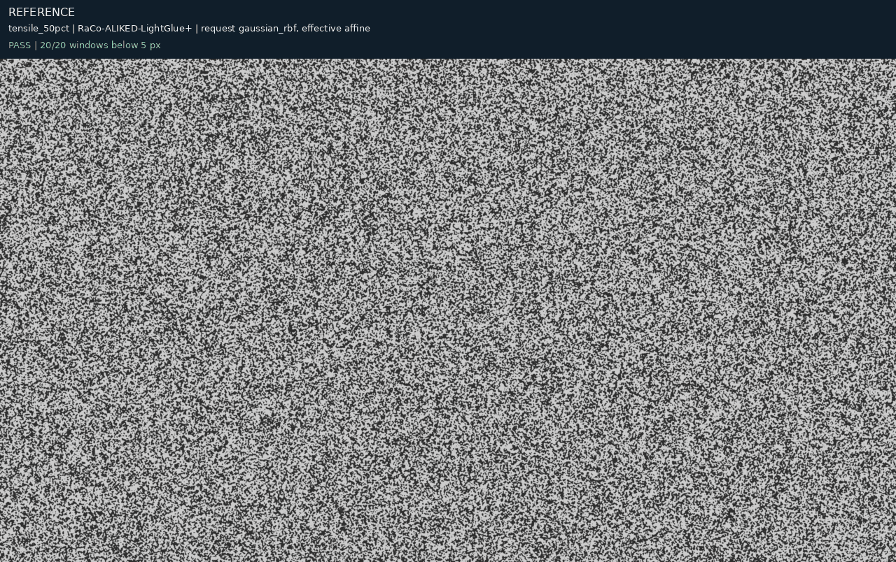

Valid target-sampling fraction of the reference ROI: 0.667. Preview absolute intensity difference median/P95: 9.00/34.00. These are photometric diagnostics, not displacement error.

[Reference PNG](tensile_50pct/raco/gaussian_rbf/image1_ref.png) · [Target PNG](tensile_50pct/raco/gaussian_rbf/image1_def_cor.png)

- [Every observed pair and rejection](tensile_50pct/raco/correspondences.csv.gz)
- [Per-seed errors, estimates and timings](tensile_50pct/raco/gaussian_rbf/result.json)
- [Full fitted field and provenance](tensile_50pct/raco/gaussian_rbf/model.json.gz)

## DaD + DeDoDe-B

60% synthetic status — affine: Pass; gaussian_rbf: Pass.

### Requested affine; effective affine

**Pass.** 20 of 20 requested centres have an estimated field.

Correct coverage (<5 px / all requested): 1.000. Conditional precision (<5 px / estimated): 1.000. False estimates at ≥5 px: 0. Median analytic error: 0.260 px.

| Timed component | Median / min / max (s) |
|---|---:|
| Complete affine call | 8.1208 / 8.0946 / 8.2998 |
| description_pair_s | 7.2372 / 7.2160 / 7.3297 |
| detection_pair_s | 0.4363 / 0.4342 / 0.4388 |
| geometric_verification_s | 0.0427 / 0.0425 / 0.0445 |
| matching_pipeline_s | 8.0797 / 8.0665 / 8.2692 |
| mutual_matching_s | 0.3707 / 0.3582 / 0.4593 |
| field_fit_s | 0.0264 / 0.0240 / 0.0371 |
| patch_projection_s | 0.0014 / 0.0013 / 0.0015 |

Components are nested: matching_pipeline_s includes extraction sub-stages and geometric verification. Do not sum this table. These repeated complete-call times measure the affine path; the automatic-RBF request reuses its last pair set.

Execution/input details are preserved verbatim in the downloadable per-seed result under extraction: detector dimensions and point counts, descriptor backend, selected ONNX graph, preprocessing and stage times. The shared run manifest records native image dimensions and model hashes.

Selection reason: affine_requested. IRLS converged: False. Final weight change: 0.000150.

Projection capacity selection: {'input': 1223, 'selected': 1223, 'applied': False}.

Valid target-sampling fraction of the reference ROI: 0.667. Preview absolute intensity difference median/P95: 8.00/30.00. These are photometric diagnostics, not displacement error.

[Reference PNG](tensile_50pct/dad_b/affine/image1_ref.png) · [Target PNG](tensile_50pct/dad_b/affine/image1_def_cor.png)

- [Every observed pair and rejection](tensile_50pct/dad_b/correspondences.csv.gz)
- [Per-seed errors, estimates and timings](tensile_50pct/dad_b/affine/result.json)
- [Full fitted field and provenance](tensile_50pct/dad_b/affine/model.json.gz)

### Requested gaussian_rbf; effective affine

**Pass.** 20 of 20 requested centres have an estimated field.

Correct coverage (<5 px / all requested): 1.000. Conditional precision (<5 px / estimated): 1.000. False estimates at ≥5 px: 0. Median analytic error: 0.260 px.

| Timed component | Median / min / max (s) |
|---|---:|
| Complete affine call | 8.1208 / 8.0946 / 8.2998 |
| description_pair_s | 7.2372 / 7.2160 / 7.3297 |
| detection_pair_s | 0.4363 / 0.4342 / 0.4388 |
| geometric_verification_s | 0.0427 / 0.0425 / 0.0445 |
| matching_pipeline_s | 8.0797 / 8.0665 / 8.2692 |
| mutual_matching_s | 0.3707 / 0.3582 / 0.4593 |
| field_fit_s | 0.0264 / 0.0240 / 0.0371 |
| patch_projection_s | 0.0014 / 0.0013 / 0.0015 |

Components are nested: matching_pipeline_s includes extraction sub-stages and geometric verification. Do not sum this table. These repeated complete-call times measure the affine path; the automatic-RBF request reuses its last pair set.

Execution/input details are preserved verbatim in the downloadable per-seed result under extraction: detector dimensions and point counts, descriptor backend, selected ONNX graph, preprocessing and stage times. The shared run manifest records native image dimensions and model hashes.

Automatic-basis single fit/patch times (seconds): {'field_fit_s': 0.48575236403848976, 'patch_projection_s': 0.0034388579661026597, 'fit_and_patch_s': 0.4891914089675993}.

Selection reason: affine_within_one_standard_error_of_best_rbf. IRLS converged: False. Final weight change: 0.000150.

Projection capacity selection: {'input': 1223, 'selected': 1223, 'applied': False}.

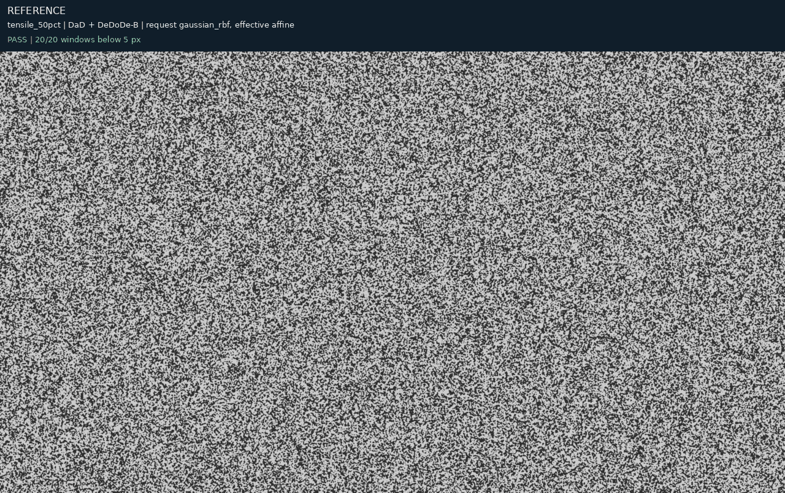

Valid target-sampling fraction of the reference ROI: 0.667. Preview absolute intensity difference median/P95: 8.00/30.00. These are photometric diagnostics, not displacement error.

[Reference PNG](tensile_50pct/dad_b/gaussian_rbf/image1_ref.png) · [Target PNG](tensile_50pct/dad_b/gaussian_rbf/image1_def_cor.png)

- [Every observed pair and rejection](tensile_50pct/dad_b/correspondences.csv.gz)
- [Per-seed errors, estimates and timings](tensile_50pct/dad_b/gaussian_rbf/result.json)
- [Full fitted field and provenance](tensile_50pct/dad_b/gaussian_rbf/model.json.gz)

## DeDoDe v2-L + DeDoDe-B

60% synthetic status — affine: Pass; gaussian_rbf: Pass.

### Requested affine; effective affine

**Pass.** 20 of 20 requested centres have an estimated field.

Correct coverage (<5 px / all requested): 1.000. Conditional precision (<5 px / estimated): 1.000. False estimates at ≥5 px: 0. Median analytic error: 0.313 px.

| Timed component | Median / min / max (s) |
|---|---:|
| Complete affine call | 8.3617 / 8.3285 / 8.4915 |
| description_pair_s | 6.8915 / 6.8090 / 6.9599 |
| detection_pair_s | 0.9864 / 0.9846 / 0.9962 |
| geometric_verification_s | 0.0398 / 0.0382 / 0.0399 |
| matching_pipeline_s | 8.3407 / 8.3048 / 8.4690 |
| mutual_matching_s | 0.4837 / 0.3881 / 0.4948 |
| field_fit_s | 0.0175 / 0.0157 / 0.0183 |
| patch_projection_s | 0.0023 / 0.0014 / 0.0047 |

Components are nested: matching_pipeline_s includes extraction sub-stages and geometric verification. Do not sum this table. These repeated complete-call times measure the affine path; the automatic-RBF request reuses its last pair set.

Execution/input details are preserved verbatim in the downloadable per-seed result under extraction: detector dimensions and point counts, descriptor backend, selected ONNX graph, preprocessing and stage times. The shared run manifest records native image dimensions and model hashes.

Selection reason: affine_requested. IRLS converged: True. Final weight change: 0.000100.

Projection capacity selection: {'input': 745, 'selected': 745, 'applied': False}.

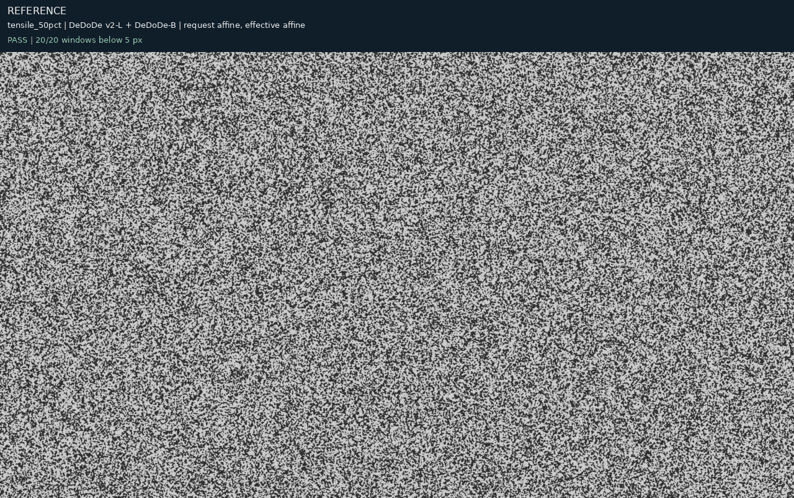

Valid target-sampling fraction of the reference ROI: 0.667. Preview absolute intensity difference median/P95: 8.00/31.00. These are photometric diagnostics, not displacement error.

[Reference PNG](tensile_50pct/dedode_b/affine/image1_ref.png) · [Target PNG](tensile_50pct/dedode_b/affine/image1_def_cor.png)

- [Every observed pair and rejection](tensile_50pct/dedode_b/correspondences.csv.gz)
- [Per-seed errors, estimates and timings](tensile_50pct/dedode_b/affine/result.json)
- [Full fitted field and provenance](tensile_50pct/dedode_b/affine/model.json.gz)

### Requested gaussian_rbf; effective gaussian_rbf

**Pass.** 20 of 20 requested centres have an estimated field.

Correct coverage (<5 px / all requested): 1.000. Conditional precision (<5 px / estimated): 1.000. False estimates at ≥5 px: 0. Median analytic error: 0.396 px.

| Timed component | Median / min / max (s) |
|---|---:|
| Complete affine call | 8.3617 / 8.3285 / 8.4915 |
| description_pair_s | 6.8915 / 6.8090 / 6.9599 |
| detection_pair_s | 0.9864 / 0.9846 / 0.9962 |
| geometric_verification_s | 0.0398 / 0.0382 / 0.0399 |
| matching_pipeline_s | 8.3407 / 8.3048 / 8.4690 |
| mutual_matching_s | 0.4837 / 0.3881 / 0.4948 |
| field_fit_s | 0.0175 / 0.0157 / 0.0183 |
| patch_projection_s | 0.0023 / 0.0014 / 0.0047 |

Components are nested: matching_pipeline_s includes extraction sub-stages and geometric verification. Do not sum this table. These repeated complete-call times measure the affine path; the automatic-RBF request reuses its last pair set.

Execution/input details are preserved verbatim in the downloadable per-seed result under extraction: detector dimensions and point counts, descriptor backend, selected ONNX graph, preprocessing and stage times. The shared run manifest records native image dimensions and model hashes.

Automatic-basis single fit/patch times (seconds): {'field_fit_s': 0.4528488739160821, 'patch_projection_s': 0.004219700000248849, 'fit_and_patch_s': 0.4570687059313059}.

Selection reason: gaussian_rbf_lowest_spatial_cv_error. IRLS converged: False. Final weight change: 0.017224.

Projection capacity selection: {'input': 745, 'selected': 745, 'applied': False}.

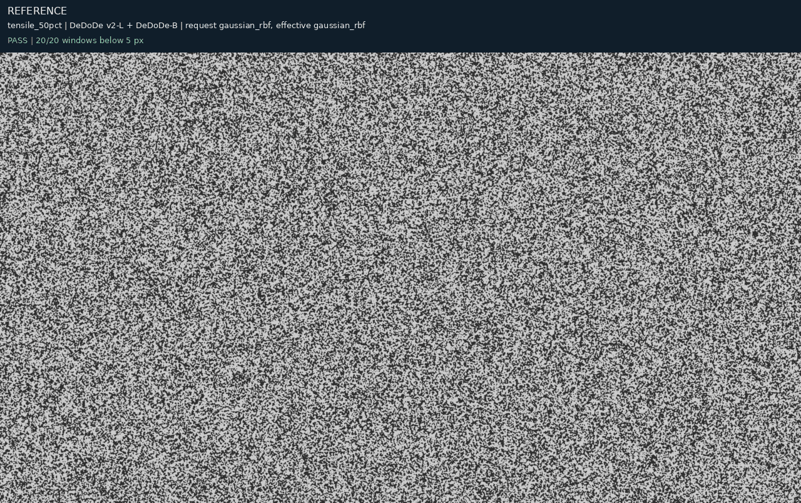

Valid target-sampling fraction of the reference ROI: 0.667. Preview absolute intensity difference median/P95: 9.00/39.00. These are photometric diagnostics, not displacement error.

[Reference PNG](tensile_50pct/dedode_b/gaussian_rbf/image1_ref.png) · [Target PNG](tensile_50pct/dedode_b/gaussian_rbf/image1_def_cor.png)

- [Every observed pair and rejection](tensile_50pct/dedode_b/correspondences.csv.gz)
- [Per-seed errors, estimates and timings](tensile_50pct/dedode_b/gaussian_rbf/result.json)
- [Full fitted field and provenance](tensile_50pct/dedode_b/gaussian_rbf/model.json.gz)

## DIC tensor + DeDoDe-B

60% synthetic status — affine: Pass; gaussian_rbf: Pass.

### Requested affine; effective affine

**Pass.** 20 of 20 requested centres have an estimated field.

Correct coverage (<5 px / all requested): 1.000. Conditional precision (<5 px / estimated): 1.000. False estimates at ≥5 px: 0. Median analytic error: 0.669 px.

| Timed component | Median / min / max (s) |
|---|---:|
| Complete affine call | 7.5374 / 7.4794 / 7.6191 |
| description_pair_s | 6.9678 / 6.8753 / 7.0551 |
| detection_pair_s | 0.1308 / 0.1287 / 0.1315 |
| geometric_verification_s | 0.0380 / 0.0378 / 0.0392 |
| matching_pipeline_s | 7.5194 / 7.4589 / 7.5937 |
| mutual_matching_s | 0.3812 / 0.3713 / 0.4127 |
| field_fit_s | 0.0161 / 0.0143 / 0.0182 |
| patch_projection_s | 0.0018 / 0.0016 / 0.0025 |

Components are nested: matching_pipeline_s includes extraction sub-stages and geometric verification. Do not sum this table. These repeated complete-call times measure the affine path; the automatic-RBF request reuses its last pair set.

Execution/input details are preserved verbatim in the downloadable per-seed result under extraction: detector dimensions and point counts, descriptor backend, selected ONNX graph, preprocessing and stage times. The shared run manifest records native image dimensions and model hashes.

Selection reason: affine_requested. IRLS converged: True. Final weight change: 0.000089.

Projection capacity selection: {'input': 341, 'selected': 341, 'applied': False}.

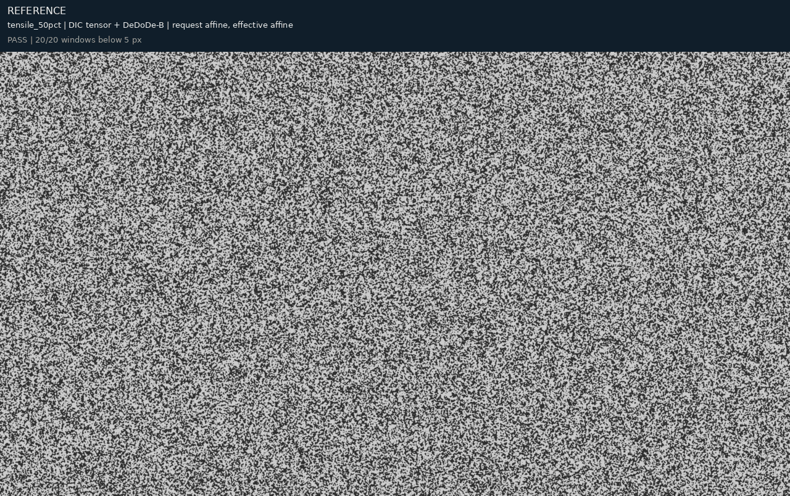

Valid target-sampling fraction of the reference ROI: 0.667. Preview absolute intensity difference median/P95: 9.00/45.00. These are photometric diagnostics, not displacement error.

[Reference PNG](tensile_50pct/dic_tensor_b/affine/image1_ref.png) · [Target PNG](tensile_50pct/dic_tensor_b/affine/image1_def_cor.png)

- [Every observed pair and rejection](tensile_50pct/dic_tensor_b/correspondences.csv.gz)
- [Per-seed errors, estimates and timings](tensile_50pct/dic_tensor_b/affine/result.json)
- [Full fitted field and provenance](tensile_50pct/dic_tensor_b/affine/model.json.gz)

### Requested gaussian_rbf; effective gaussian_rbf

**Pass.** 20 of 20 requested centres have an estimated field.

Correct coverage (<5 px / all requested): 1.000. Conditional precision (<5 px / estimated): 1.000. False estimates at ≥5 px: 0. Median analytic error: 1.160 px.

| Timed component | Median / min / max (s) |
|---|---:|
| Complete affine call | 7.5374 / 7.4794 / 7.6191 |
| description_pair_s | 6.9678 / 6.8753 / 7.0551 |
| detection_pair_s | 0.1308 / 0.1287 / 0.1315 |
| geometric_verification_s | 0.0380 / 0.0378 / 0.0392 |
| matching_pipeline_s | 7.5194 / 7.4589 / 7.5937 |
| mutual_matching_s | 0.3812 / 0.3713 / 0.4127 |
| field_fit_s | 0.0161 / 0.0143 / 0.0182 |
| patch_projection_s | 0.0018 / 0.0016 / 0.0025 |

Components are nested: matching_pipeline_s includes extraction sub-stages and geometric verification. Do not sum this table. These repeated complete-call times measure the affine path; the automatic-RBF request reuses its last pair set.

Execution/input details are preserved verbatim in the downloadable per-seed result under extraction: detector dimensions and point counts, descriptor backend, selected ONNX graph, preprocessing and stage times. The shared run manifest records native image dimensions and model hashes.

Automatic-basis single fit/patch times (seconds): {'field_fit_s': 0.33876579895149916, 'patch_projection_s': 0.0024168420350179076, 'fit_and_patch_s': 0.3411829329561442}.

Selection reason: gpu_solver_fallback_to_next_spatial_cv_candidate. IRLS converged: False. Final weight change: 0.004193.

Projection capacity selection: {'input': 341, 'selected': 341, 'applied': False}.

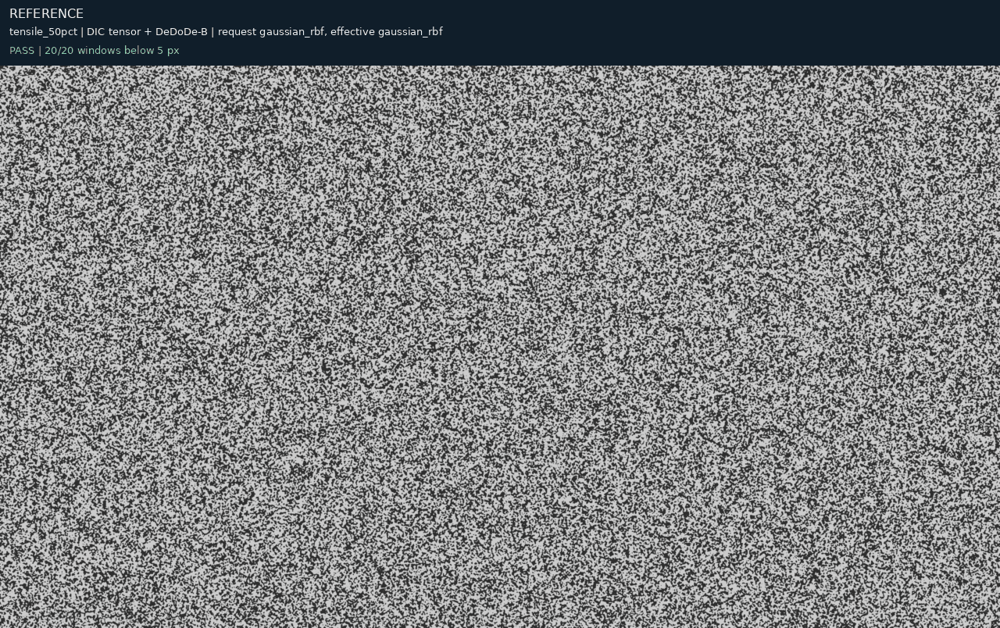

Valid target-sampling fraction of the reference ROI: 0.668. Preview absolute intensity difference median/P95: 12.00/84.00. These are photometric diagnostics, not displacement error.

[Reference PNG](tensile_50pct/dic_tensor_b/gaussian_rbf/image1_ref.png) · [Target PNG](tensile_50pct/dic_tensor_b/gaussian_rbf/image1_def_cor.png)

- [Every observed pair and rejection](tensile_50pct/dic_tensor_b/correspondences.csv.gz)
- [Per-seed errors, estimates and timings](tensile_50pct/dic_tensor_b/gaussian_rbf/result.json)
- [Full fitted field and provenance](tensile_50pct/dic_tensor_b/gaussian_rbf/model.json.gz)

## Learned DIC + DeDoDe-B

60% synthetic status — affine: Pass; gaussian_rbf: Pass.

### Requested affine; effective affine

**Pass.** 20 of 20 requested centres have an estimated field.

Correct coverage (<5 px / all requested): 1.000. Conditional precision (<5 px / estimated): 1.000. False estimates at ≥5 px: 0. Median analytic error: 0.123 px.

| Timed component | Median / min / max (s) |
|---|---:|
| Complete affine call | 7.6358 / 7.5433 / 7.6683 |
| description_pair_s | 6.9112 / 6.8866 / 7.0317 |
| detection_pair_s | 0.1547 / 0.1490 / 0.2495 |
| geometric_verification_s | 0.0438 / 0.0427 / 0.0461 |
| matching_pipeline_s | 7.5931 / 7.5009 / 7.6142 |
| mutual_matching_s | 0.3902 / 0.3864 / 0.4126 |
| field_fit_s | 0.0385 / 0.0384 / 0.0462 |
| patch_projection_s | 0.0016 / 0.0016 / 0.0017 |

Components are nested: matching_pipeline_s includes extraction sub-stages and geometric verification. Do not sum this table. These repeated complete-call times measure the affine path; the automatic-RBF request reuses its last pair set.

Execution/input details are preserved verbatim in the downloadable per-seed result under extraction: detector dimensions and point counts, descriptor backend, selected ONNX graph, preprocessing and stage times. The shared run manifest records native image dimensions and model hashes.

Selection reason: affine_requested. IRLS converged: False. Final weight change: 0.000255.

Projection capacity selection: {'input': 1874, 'selected': 1874, 'applied': False}.

Valid target-sampling fraction of the reference ROI: 0.667. Preview absolute intensity difference median/P95: 9.00/28.00. These are photometric diagnostics, not displacement error.

[Reference PNG](tensile_50pct/dic_learned_b/affine/image1_ref.png) · [Target PNG](tensile_50pct/dic_learned_b/affine/image1_def_cor.png)

- [Every observed pair and rejection](tensile_50pct/dic_learned_b/correspondences.csv.gz)
- [Per-seed errors, estimates and timings](tensile_50pct/dic_learned_b/affine/result.json)
- [Full fitted field and provenance](tensile_50pct/dic_learned_b/affine/model.json.gz)

### Requested gaussian_rbf; effective affine

**Pass.** 20 of 20 requested centres have an estimated field.

Correct coverage (<5 px / all requested): 1.000. Conditional precision (<5 px / estimated): 1.000. False estimates at ≥5 px: 0. Median analytic error: 0.123 px.

| Timed component | Median / min / max (s) |
|---|---:|
| Complete affine call | 7.6358 / 7.5433 / 7.6683 |
| description_pair_s | 6.9112 / 6.8866 / 7.0317 |
| detection_pair_s | 0.1547 / 0.1490 / 0.2495 |
| geometric_verification_s | 0.0438 / 0.0427 / 0.0461 |
| matching_pipeline_s | 7.5931 / 7.5009 / 7.6142 |
| mutual_matching_s | 0.3902 / 0.3864 / 0.4126 |
| field_fit_s | 0.0385 / 0.0384 / 0.0462 |
| patch_projection_s | 0.0016 / 0.0016 / 0.0017 |

Components are nested: matching_pipeline_s includes extraction sub-stages and geometric verification. Do not sum this table. These repeated complete-call times measure the affine path; the automatic-RBF request reuses its last pair set.

Execution/input details are preserved verbatim in the downloadable per-seed result under extraction: detector dimensions and point counts, descriptor backend, selected ONNX graph, preprocessing and stage times. The shared run manifest records native image dimensions and model hashes.

Automatic-basis single fit/patch times (seconds): {'field_fit_s': 0.6469158239196986, 'patch_projection_s': 0.0017306300578638911, 'fit_and_patch_s': 0.6486466060159728}.

Selection reason: affine_within_one_standard_error_of_best_rbf. IRLS converged: False. Final weight change: 0.000255.

Projection capacity selection: {'input': 1874, 'selected': 1874, 'applied': False}.

Valid target-sampling fraction of the reference ROI: 0.667. Preview absolute intensity difference median/P95: 9.00/28.00. These are photometric diagnostics, not displacement error.

[Reference PNG](tensile_50pct/dic_learned_b/gaussian_rbf/image1_ref.png) · [Target PNG](tensile_50pct/dic_learned_b/gaussian_rbf/image1_def_cor.png)

- [Every observed pair and rejection](tensile_50pct/dic_learned_b/correspondences.csv.gz)
- [Per-seed errors, estimates and timings](tensile_50pct/dic_learned_b/gaussian_rbf/result.json)
- [Full fitted field and provenance](tensile_50pct/dic_learned_b/gaussian_rbf/model.json.gz)

## HORG/SIFT detector + DeDoDe-B

60% synthetic status — affine: Fail; gaussian_rbf: Fail.

### Requested affine; effective affine

**Pass.** 20 of 20 requested centres have an estimated field.

Correct coverage (<5 px / all requested): 1.000. Conditional precision (<5 px / estimated): 1.000. False estimates at ≥5 px: 0. Median analytic error: 1.652 px.

| Timed component | Median / min / max (s) |
|---|---:|
| Complete affine call | 6.9296 / 6.9258 / 7.1344 |
| description_pair_s | 6.7912 / 6.7763 / 6.9829 |
| detection_pair_s | 0.1105 / 0.1086 / 0.1117 |
| geometric_verification_s | 0.0097 / 0.0082 / 0.0100 |
| matching_pipeline_s | 6.9127 / 6.9086 / 7.1156 |
| mutual_matching_s | 0.0107 / 0.0045 / 0.0119 |
| field_fit_s | 0.0159 / 0.0109 / 0.0181 |
| patch_projection_s | 0.0028 / 0.0021 / 0.0029 |

Components are nested: matching_pipeline_s includes extraction sub-stages and geometric verification. Do not sum this table. These repeated complete-call times measure the affine path; the automatic-RBF request reuses its last pair set.

Execution/input details are preserved verbatim in the downloadable per-seed result under extraction: detector dimensions and point counts, descriptor backend, selected ONNX graph, preprocessing and stage times. The shared run manifest records native image dimensions and model hashes.

Selection reason: affine_requested. IRLS converged: True. Final weight change: 0.000046.

Projection capacity selection: {'input': 21, 'selected': 21, 'applied': False}.

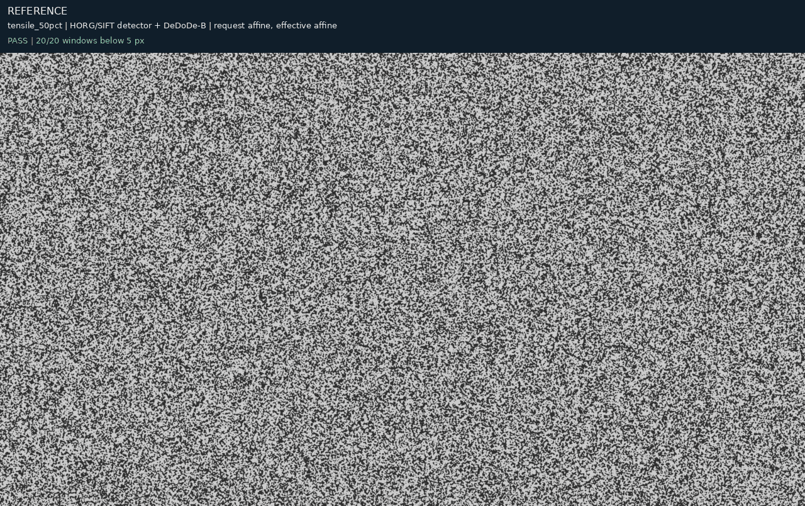

Valid target-sampling fraction of the reference ROI: 0.667. Preview absolute intensity difference median/P95: 14.00/87.00. These are photometric diagnostics, not displacement error.

[Reference PNG](tensile_50pct/horg_b/affine/image1_ref.png) · [Target PNG](tensile_50pct/horg_b/affine/image1_def_cor.png)

- [Every observed pair and rejection](tensile_50pct/horg_b/correspondences.csv.gz)
- [Per-seed errors, estimates and timings](tensile_50pct/horg_b/affine/result.json)
- [Full fitted field and provenance](tensile_50pct/horg_b/affine/model.json.gz)

### Requested gaussian_rbf; effective affine

**Pass.** 20 of 20 requested centres have an estimated field.

Correct coverage (<5 px / all requested): 1.000. Conditional precision (<5 px / estimated): 1.000. False estimates at ≥5 px: 0. Median analytic error: 1.652 px.

| Timed component | Median / min / max (s) |
|---|---:|
| Complete affine call | 6.9296 / 6.9258 / 7.1344 |
| description_pair_s | 6.7912 / 6.7763 / 6.9829 |
| detection_pair_s | 0.1105 / 0.1086 / 0.1117 |
| geometric_verification_s | 0.0097 / 0.0082 / 0.0100 |
| matching_pipeline_s | 6.9127 / 6.9086 / 7.1156 |
| mutual_matching_s | 0.0107 / 0.0045 / 0.0119 |
| field_fit_s | 0.0159 / 0.0109 / 0.0181 |
| patch_projection_s | 0.0028 / 0.0021 / 0.0029 |

Components are nested: matching_pipeline_s includes extraction sub-stages and geometric verification. Do not sum this table. These repeated complete-call times measure the affine path; the automatic-RBF request reuses its last pair set.

Execution/input details are preserved verbatim in the downloadable per-seed result under extraction: detector dimensions and point counts, descriptor backend, selected ONNX graph, preprocessing and stage times. The shared run manifest records native image dimensions and model hashes.

Automatic-basis single fit/patch times (seconds): {'field_fit_s': 0.08884826302528381, 'patch_projection_s': 0.0012392299249768257, 'fit_and_patch_s': 0.09008760703727603}.

Selection reason: affine_within_one_standard_error_of_best_rbf. IRLS converged: True. Final weight change: 0.000046.

Projection capacity selection: {'input': 21, 'selected': 21, 'applied': False}.

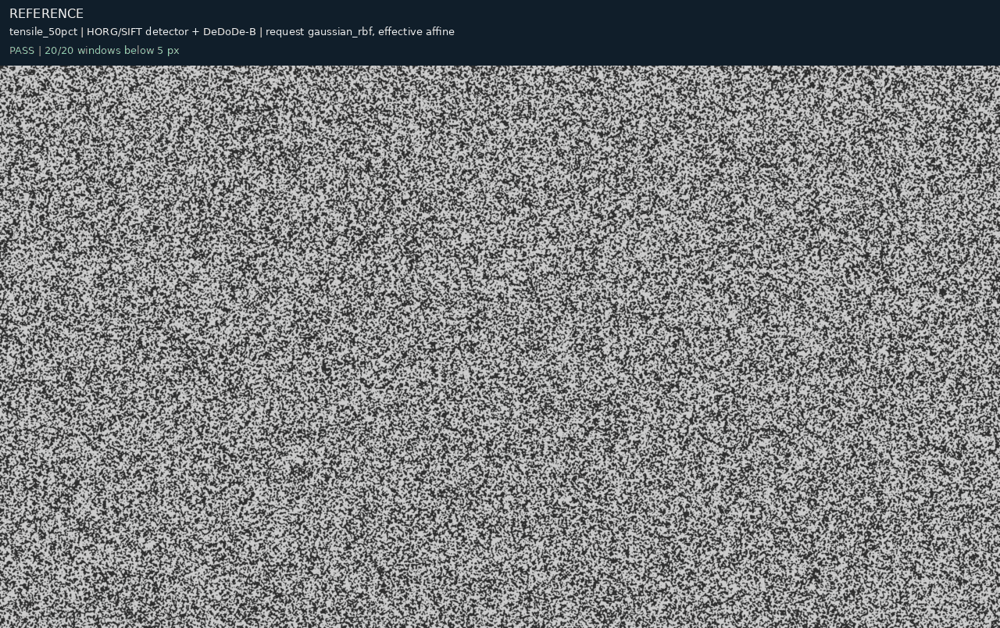

Valid target-sampling fraction of the reference ROI: 0.667. Preview absolute intensity difference median/P95: 14.00/87.00. These are photometric diagnostics, not displacement error.

[Reference PNG](tensile_50pct/horg_b/gaussian_rbf/image1_ref.png) · [Target PNG](tensile_50pct/horg_b/gaussian_rbf/image1_def_cor.png)

- [Every observed pair and rejection](tensile_50pct/horg_b/correspondences.csv.gz)
- [Per-seed errors, estimates and timings](tensile_50pct/horg_b/gaussian_rbf/result.json)
- [Full fitted field and provenance](tensile_50pct/horg_b/gaussian_rbf/model.json.gz)
