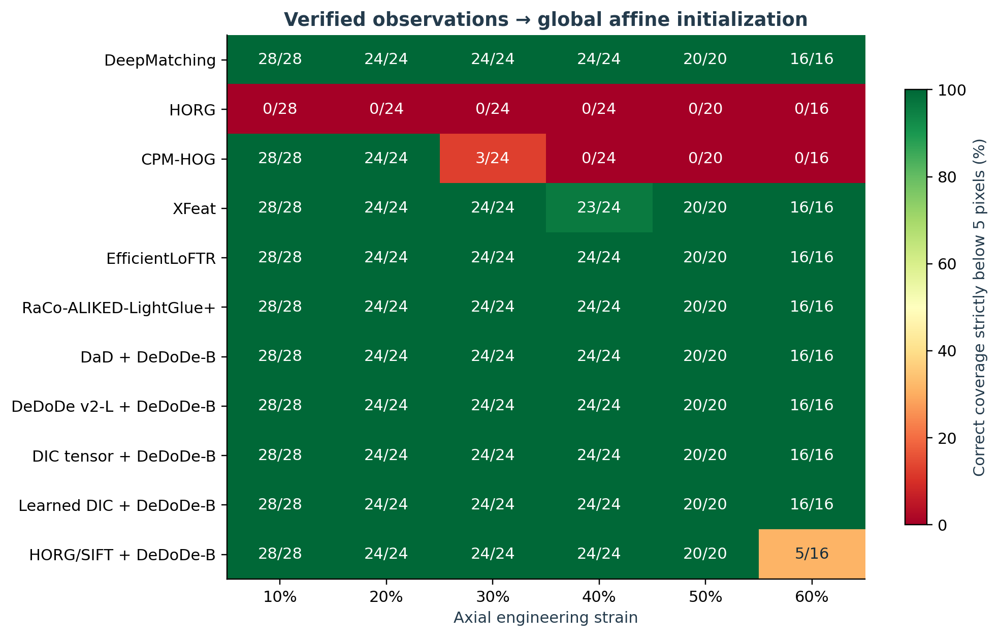
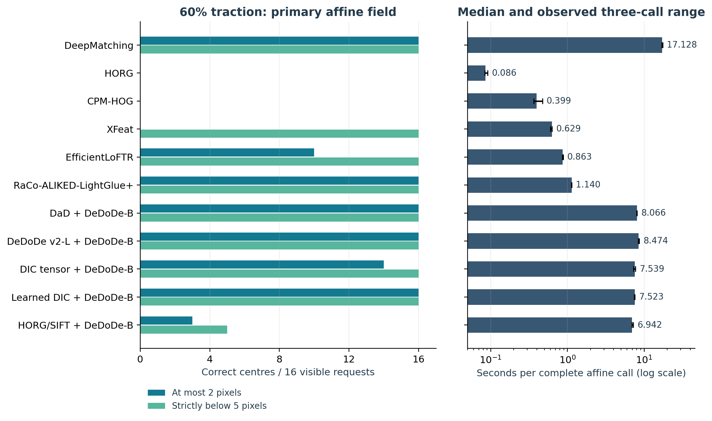

# Current initializer qualification and complete visual benchmark

Run created: 2026-11-07T19:09:34.069773+00:00. This report is generated from measured results. Historical studies remain available separately and do not supply missing current measurements.

Jump to the [60-percent table](#qualification-results-60) or the [complete case galleries](#qualification-case-galleries).

Read the [scientific interpretation and failure analysis](interpretation.md) alongside the tables. It explains detector cost, geometric filtering, the affine prior and the cases where automatic radial bases reduce correct coverage.

## What counts as passing 60%?

A projection passes only when every analytically visible requested DIC centre has a finite estimated displacement with Euclidean error strictly below 5 pixels. Correct counts at ≤2 pixels, conditional error and false estimates are reported independently. A failed row can still recover some windows; its coverage remains in the table. Numerical IRLS convergence is a separate flag, not substituted for analytic accuracy. The pass threshold concerns centre translation; the six patch parameters are exported, but it is not a gradient-accuracy or downstream IC-GN convergence criterion.

The primary tensile basis is affine, as chosen before this run. The secondary request selects between affine and Gaussian RBF using spatial cross-validation of observed pairs. Analytic truth never selects a fit, a basis or correspondences.

## Pipeline labels and metric terminology

- Native baselines: DeepMatching with the INRIA hierarchy, HORG and CPM-HOG.
- Learned matching pipelines: XFeat, EfficientLoFTR and RaCo-ALIKED-LightGlue+.
- Common-descriptor experiments: DaD and DeDoDe v2-L detectors, plus tensor and learned DIC detectors, all paired with DeDoDe-B. The HORG/SIFT detector control uses that same descriptor.

GPU computations use WGSL or ONNX/WebGPU as recorded below; the common descriptor and its mutual matcher remain CPU reference stages. These labels identify different pipelines, not interchangeable detector-only experiments.

Errors are in original-image pixels. RMSE, median error, P95 and maximum error summarize estimated centres only; correct coverage uses all visible requested centres. Definitions are given here before their short table labels so they do not expand inside narrow cells.

(qualification-results-60)=

## All methods at 60% traction

| Method | Requested basis → effective | Verdict | Estimated / visible | Correct ≤2 px | Correct <5 px | RMSE / P95 / max (px) | Verified / upstream / raw pairs | IRLS converged |
|---|---|---|---:|---:|---:|---:|---:|---|
| DeepMatching INRIA hierarchy | affine → affine | Pass | 16 / 16 | 16 | 16 | 0.18 / 0.27 / 0.30 | 5014 / 15266 / 30720 | False |
| DeepMatching INRIA hierarchy | gaussian_rbf → affine | Pass | 16 / 16 | 16 | 16 | 0.18 / 0.27 / 0.30 | 5014 / 15266 / 30720 | False |
| HORG | affine → none | Fail | 0 / 16 | 0 | 0 | — / — / — | 0 / 20 / 693 | — |
| HORG | gaussian_rbf → none | Fail | 0 / 16 | 0 | 0 | — / — / — | 0 / 20 / 693 | — |
| CPM-HOG | affine → none | Fail | 0 / 16 | 0 | 0 | — / — / — | 0 / 45 / 32026 | — |
| CPM-HOG | gaussian_rbf → none | Fail | 0 / 16 | 0 | 0 | — / — / — | 0 / 45 / 32026 | — |
| XFeat | affine → affine | Pass | 16 / 16 | 0 | 16 | 3.05 / 3.22 / 3.23 | 143 / 893 / 893 | True |
| XFeat | gaussian_rbf → affine | Pass | 16 / 16 | 0 | 16 | 3.05 / 3.22 / 3.23 | 143 / 893 / 893 | True |
| EfficientLoFTR | affine → affine | Pass | 16 / 16 | 10 | 16 | 1.95 / 2.23 / 2.29 | 379 / 1431 / 1434 | True |
| EfficientLoFTR | gaussian_rbf → affine | Pass | 16 / 16 | 10 | 16 | 1.95 / 2.23 / 2.29 | 379 / 1431 / 1434 | True |
| RaCo-ALIKED-LightGlue+ | affine → affine | Pass | 16 / 16 | 16 | 16 | 0.71 / 1.01 / 1.15 | 148 / 389 / 389 | True |
| RaCo-ALIKED-LightGlue+ | gaussian_rbf → affine | Pass | 16 / 16 | 16 | 16 | 0.71 / 1.01 / 1.15 | 148 / 389 / 389 | True |
| DaD + DeDoDe-B | affine → affine | Pass | 16 / 16 | 16 | 16 | 0.44 / 0.68 / 0.70 | 856 / 4186 / 4186 | True |
| DaD + DeDoDe-B | gaussian_rbf → affine | Pass | 16 / 16 | 16 | 16 | 0.44 / 0.68 / 0.70 | 856 / 4186 / 4186 | True |
| DeDoDe v2-L + DeDoDe-B | affine → affine | Pass | 16 / 16 | 16 | 16 | 0.49 / 0.71 / 0.81 | 563 / 3513 / 3513 | True |
| DeDoDe v2-L + DeDoDe-B | gaussian_rbf → affine | Pass | 16 / 16 | 16 | 16 | 0.49 / 0.71 / 0.81 | 563 / 3513 / 3513 | True |
| DIC tensor + DeDoDe-B | affine → affine | Pass | 16 / 16 | 14 | 16 | 1.40 / 2.16 / 2.56 | 194 / 3289 / 3289 | True |
| DIC tensor + DeDoDe-B | gaussian_rbf → affine | Pass | 16 / 16 | 14 | 16 | 1.40 / 2.16 / 2.56 | 194 / 3289 / 3289 | True |
| Learned DIC + DeDoDe-B | affine → affine | Pass | 16 / 16 | 16 | 16 | 0.22 / 0.34 / 0.38 | 1496 / 4311 / 4311 | False |
| Learned DIC + DeDoDe-B | gaussian_rbf → affine | Pass | 16 / 16 | 16 | 16 | 0.22 / 0.34 / 0.38 | 1496 / 4311 / 4311 | False |
| HORG/SIFT detector + DeDoDe-B | affine → affine | Fail | 16 / 16 | 3 | 5 | 9.13 / 15.54 / 18.66 | 15 / 310 / 310 | True |
| HORG/SIFT detector + DeDoDe-B | gaussian_rbf → affine | Fail | 16 / 16 | 3 | 5 | 9.13 / 15.54 / 18.66 | 15 / 310 / 310 | True |

## Numerical convergence is a separate result

Among 198 returned fields (counting both requests), 48 did not meet the IRLS weight-change criterion within the configured iteration budget. Their accuracy counts are retained, but an accuracy pass must not be read as a numerically converged or production-qualified fit. No iteration budget or threshold was adjusted from analytic test errors. See each case's final weight change and full convergence diagnostics.

Every method and requested basis has a reference/corrected-image GIF, including failed initializations. Open the 60% gallery below. If no accepted field exists, a reconstruction from rejected proposals is explicitly labelled diagnostic only; otherwise the uncorrected target is shown. Neither fallback enters the pass count.

## Complete measured affine-pipeline timing

Each timed trial includes preprocessing of already decoded grayscale images, detector/descriptor or native matching, observed-pair export, affine field fitting, and patch initialization. Initialization of the device/models, image decoding, warm-up, data serialization and visualization are excluded. These are actual whole-call wall times, not sums of independently measured medians. The final measured pair set supplies the accuracy and figures. Models are not reference-cached.

| Case | Method | Repeats | Median / min / max (s) | Pair calls/s | Correct affine windows <5 px | Correct windows per second |
|---|---|---:|---:|---:|---:|---:|
| progressive_040 | DeepMatching INRIA hierarchy | 3 | 16.277 / 16.171 / 16.300 | 0.06 | 32 | 1.97 |
| progressive_040 | HORG | 3 | 0.129 / 0.121 / 0.133 | 7.73 | 32 | 247.23 |
| progressive_040 | CPM-HOG | 3 | 0.519 / 0.515 / 0.596 | 1.93 | 32 | 61.63 |
| progressive_040 | XFeat | 3 | 0.685 / 0.635 / 0.704 | 1.46 | 32 | 46.73 |
| progressive_040 | EfficientLoFTR | 3 | 0.969 / 0.963 / 0.970 | 1.03 | 32 | 33.01 |
| progressive_040 | RaCo-ALIKED-LightGlue+ | 3 | 1.201 / 1.126 / 1.212 | 0.83 | 32 | 26.65 |
| progressive_040 | DaD + DeDoDe-B | 3 | 8.317 / 8.222 / 8.381 | 0.12 | 32 | 3.85 |
| progressive_040 | DeDoDe v2-L + DeDoDe-B | 3 | 8.651 / 8.277 / 8.755 | 0.12 | 32 | 3.70 |
| progressive_040 | DIC tensor + DeDoDe-B | 3 | 7.760 / 7.335 / 7.819 | 0.13 | 32 | 4.12 |
| progressive_040 | Learned DIC + DeDoDe-B | 3 | 7.558 / 7.421 / 7.690 | 0.13 | 32 | 4.23 |
| progressive_040 | HORG/SIFT detector + DeDoDe-B | 3 | 7.197 / 7.121 / 7.203 | 0.14 | 32 | 4.45 |
| progressive_100 | DeepMatching INRIA hierarchy | 3 | 17.785 / 17.085 / 17.874 | 0.06 | 28 | 1.57 |
| progressive_100 | HORG | 3 | 0.128 / 0.119 / 0.129 | 7.78 | 28 | 217.90 |
| progressive_100 | CPM-HOG | 3 | 0.417 / 0.411 / 0.484 | 2.40 | 28 | 67.17 |
| progressive_100 | XFeat | 3 | 0.632 / 0.623 / 0.639 | 1.58 | 28 | 44.33 |
| progressive_100 | EfficientLoFTR | 3 | 0.967 / 0.965 / 0.974 | 1.03 | 28 | 28.96 |
| progressive_100 | RaCo-ALIKED-LightGlue+ | 3 | 1.126 / 1.122 / 1.141 | 0.89 | 28 | 24.86 |
| progressive_100 | DaD + DeDoDe-B | 3 | 8.292 / 8.281 / 8.306 | 0.12 | 28 | 3.38 |
| progressive_100 | DeDoDe v2-L + DeDoDe-B | 3 | 8.763 / 8.733 / 8.796 | 0.11 | 28 | 3.20 |
| progressive_100 | DIC tensor + DeDoDe-B | 3 | 7.729 / 7.672 / 7.843 | 0.13 | 28 | 3.62 |
| progressive_100 | Learned DIC + DeDoDe-B | 3 | 7.815 / 7.645 / 7.822 | 0.13 | 28 | 3.58 |
| progressive_100 | HORG/SIFT detector + DeDoDe-B | 3 | 7.297 / 7.125 / 7.608 | 0.14 | 28 | 3.84 |
| progressive_199 | DeepMatching INRIA hierarchy | 3 | 17.975 / 17.695 / 18.217 | 0.06 | 28 | 1.56 |
| progressive_199 | HORG | 3 | 0.086 / 0.086 / 0.088 | 11.60 | 0 | 0.00 |
| progressive_199 | CPM-HOG | 3 | 0.392 / 0.389 / 0.448 | 2.55 | 28 | 71.42 |
| progressive_199 | XFeat | 3 | 0.641 / 0.635 / 0.643 | 1.56 | 28 | 43.67 |
| progressive_199 | EfficientLoFTR | 3 | 0.941 / 0.937 / 0.946 | 1.06 | 28 | 29.76 |
| progressive_199 | RaCo-ALIKED-LightGlue+ | 3 | 1.143 / 1.139 / 1.169 | 0.87 | 28 | 24.49 |
| progressive_199 | DaD + DeDoDe-B | 3 | 8.242 / 8.075 / 8.409 | 0.12 | 28 | 3.40 |
| progressive_199 | DeDoDe v2-L + DeDoDe-B | 3 | 8.636 / 8.463 / 8.812 | 0.12 | 28 | 3.24 |
| progressive_199 | DIC tensor + DeDoDe-B | 3 | 7.874 / 7.772 / 8.148 | 0.13 | 28 | 3.56 |
| progressive_199 | Learned DIC + DeDoDe-B | 3 | 7.794 / 7.636 / 7.892 | 0.13 | 28 | 3.59 |
| progressive_199 | HORG/SIFT detector + DeDoDe-B | 3 | 7.109 / 7.041 / 7.191 | 0.14 | 28 | 3.94 |
| tensile_10pct | DeepMatching INRIA hierarchy | 3 | 17.588 / 17.112 / 17.682 | 0.06 | 28 | 1.59 |
| tensile_10pct | HORG | 3 | 0.086 / 0.084 / 0.091 | 11.65 | 0 | 0.00 |
| tensile_10pct | CPM-HOG | 3 | 0.392 / 0.390 / 0.395 | 2.55 | 28 | 71.50 |
| tensile_10pct | XFeat | 3 | 0.642 / 0.636 / 0.676 | 1.56 | 28 | 43.60 |
| tensile_10pct | EfficientLoFTR | 3 | 0.936 / 0.933 / 0.944 | 1.07 | 28 | 29.90 |
| tensile_10pct | RaCo-ALIKED-LightGlue+ | 3 | 1.126 / 1.117 / 1.149 | 0.89 | 28 | 24.87 |
| tensile_10pct | DaD + DeDoDe-B | 3 | 8.188 / 7.997 / 8.508 | 0.12 | 28 | 3.42 |
| tensile_10pct | DeDoDe v2-L + DeDoDe-B | 3 | 8.535 / 8.498 / 8.580 | 0.12 | 28 | 3.28 |
| tensile_10pct | DIC tensor + DeDoDe-B | 3 | 7.886 / 7.488 / 8.025 | 0.13 | 28 | 3.55 |
| tensile_10pct | Learned DIC + DeDoDe-B | 3 | 7.620 / 7.463 / 7.688 | 0.13 | 28 | 3.67 |
| tensile_10pct | HORG/SIFT detector + DeDoDe-B | 3 | 7.357 / 7.247 / 7.383 | 0.14 | 28 | 3.81 |
| tensile_20pct | DeepMatching INRIA hierarchy | 3 | 17.611 / 17.449 / 17.699 | 0.06 | 24 | 1.36 |
| tensile_20pct | HORG | 3 | 0.083 / 0.080 / 0.087 | 12.01 | 0 | 0.00 |
| tensile_20pct | CPM-HOG | 3 | 0.390 / 0.383 / 0.447 | 2.56 | 24 | 61.51 |
| tensile_20pct | XFeat | 3 | 0.640 / 0.623 / 0.649 | 1.56 | 24 | 37.53 |
| tensile_20pct | EfficientLoFTR | 3 | 0.906 / 0.905 / 0.919 | 1.10 | 24 | 26.48 |
| tensile_20pct | RaCo-ALIKED-LightGlue+ | 3 | 1.147 / 1.126 / 1.148 | 0.87 | 24 | 20.93 |
| tensile_20pct | DaD + DeDoDe-B | 3 | 8.305 / 8.057 / 8.546 | 0.12 | 24 | 2.89 |
| tensile_20pct | DeDoDe v2-L + DeDoDe-B | 3 | 8.552 / 8.419 / 8.641 | 0.12 | 24 | 2.81 |
| tensile_20pct | DIC tensor + DeDoDe-B | 3 | 7.627 / 7.435 / 7.930 | 0.13 | 24 | 3.15 |
| tensile_20pct | Learned DIC + DeDoDe-B | 3 | 7.775 / 7.572 / 7.810 | 0.13 | 24 | 3.09 |
| tensile_20pct | HORG/SIFT detector + DeDoDe-B | 3 | 7.014 / 6.861 / 7.248 | 0.14 | 24 | 3.42 |
| tensile_30pct | DeepMatching INRIA hierarchy | 3 | 17.314 / 17.081 / 17.465 | 0.06 | 24 | 1.39 |
| tensile_30pct | HORG | 3 | 0.096 / 0.095 / 0.096 | 10.45 | 0 | 0.00 |
| tensile_30pct | CPM-HOG | 3 | 0.386 / 0.380 / 0.442 | 2.59 | 3 | 7.78 |
| tensile_30pct | XFeat | 3 | 0.634 / 0.634 / 0.643 | 1.58 | 24 | 37.83 |
| tensile_30pct | EfficientLoFTR | 3 | 0.883 / 0.879 / 0.892 | 1.13 | 24 | 27.17 |
| tensile_30pct | RaCo-ALIKED-LightGlue+ | 3 | 1.123 / 1.119 / 1.130 | 0.89 | 24 | 21.36 |
| tensile_30pct | DaD + DeDoDe-B | 3 | 8.214 / 8.143 / 8.324 | 0.12 | 24 | 2.92 |
| tensile_30pct | DeDoDe v2-L + DeDoDe-B | 3 | 8.518 / 8.479 / 8.833 | 0.12 | 24 | 2.82 |
| tensile_30pct | DIC tensor + DeDoDe-B | 3 | 7.854 / 7.450 / 7.912 | 0.13 | 24 | 3.06 |
| tensile_30pct | Learned DIC + DeDoDe-B | 3 | 7.711 / 7.706 / 8.189 | 0.13 | 24 | 3.11 |
| tensile_30pct | HORG/SIFT detector + DeDoDe-B | 3 | 7.072 / 7.048 / 7.147 | 0.14 | 24 | 3.39 |
| tensile_40pct | DeepMatching INRIA hierarchy | 3 | 17.437 / 17.193 / 17.995 | 0.06 | 24 | 1.38 |
| tensile_40pct | HORG | 3 | 0.086 / 0.085 / 0.090 | 11.63 | 0 | 0.00 |
| tensile_40pct | CPM-HOG | 3 | 0.407 / 0.386 / 0.436 | 2.46 | 0 | 0.00 |
| tensile_40pct | XFeat | 3 | 0.635 / 0.635 / 0.639 | 1.57 | 23 | 36.22 |
| tensile_40pct | EfficientLoFTR | 3 | 0.881 / 0.874 / 0.890 | 1.14 | 24 | 27.25 |
| tensile_40pct | RaCo-ALIKED-LightGlue+ | 3 | 1.133 / 1.131 / 1.160 | 0.88 | 24 | 21.18 |
| tensile_40pct | DaD + DeDoDe-B | 3 | 7.974 / 7.968 / 8.454 | 0.13 | 24 | 3.01 |
| tensile_40pct | DeDoDe v2-L + DeDoDe-B | 3 | 8.085 / 8.079 / 8.621 | 0.12 | 24 | 2.97 |
| tensile_40pct | DIC tensor + DeDoDe-B | 3 | 7.611 / 7.461 / 7.802 | 0.13 | 24 | 3.15 |
| tensile_40pct | Learned DIC + DeDoDe-B | 3 | 7.587 / 7.469 / 7.630 | 0.13 | 24 | 3.16 |
| tensile_40pct | HORG/SIFT detector + DeDoDe-B | 3 | 7.068 / 7.055 / 7.070 | 0.14 | 24 | 3.40 |
| tensile_50pct | DeepMatching INRIA hierarchy | 3 | 17.114 / 16.726 / 17.723 | 0.06 | 20 | 1.17 |
| tensile_50pct | HORG | 3 | 0.086 / 0.084 / 0.088 | 11.64 | 0 | 0.00 |
| tensile_50pct | CPM-HOG | 3 | 0.377 / 0.376 / 0.442 | 2.65 | 0 | 0.00 |
| tensile_50pct | XFeat | 3 | 0.674 / 0.629 / 0.711 | 1.48 | 20 | 29.68 |
| tensile_50pct | EfficientLoFTR | 3 | 0.876 / 0.875 / 0.912 | 1.14 | 20 | 22.84 |
| tensile_50pct | RaCo-ALIKED-LightGlue+ | 3 | 1.119 / 1.114 / 1.199 | 0.89 | 20 | 17.87 |
| tensile_50pct | DaD + DeDoDe-B | 3 | 8.121 / 8.095 / 8.300 | 0.12 | 20 | 2.46 |
| tensile_50pct | DeDoDe v2-L + DeDoDe-B | 3 | 8.362 / 8.329 / 8.492 | 0.12 | 20 | 2.39 |
| tensile_50pct | DIC tensor + DeDoDe-B | 3 | 7.537 / 7.479 / 7.619 | 0.13 | 20 | 2.65 |
| tensile_50pct | Learned DIC + DeDoDe-B | 3 | 7.636 / 7.543 / 7.668 | 0.13 | 20 | 2.62 |
| tensile_50pct | HORG/SIFT detector + DeDoDe-B | 3 | 6.930 / 6.926 / 7.134 | 0.14 | 20 | 2.89 |
| tensile_60pct | DeepMatching INRIA hierarchy | 3 | 17.128 / 17.013 / 17.448 | 0.06 | 16 | 0.93 |
| tensile_60pct | HORG | 3 | 0.086 / 0.084 / 0.092 | 11.66 | 0 | 0.00 |
| tensile_60pct | CPM-HOG | 3 | 0.399 / 0.365 / 0.473 | 2.51 | 0 | 0.00 |
| tensile_60pct | XFeat | 3 | 0.629 / 0.598 / 0.632 | 1.59 | 16 | 25.43 |
| tensile_60pct | EfficientLoFTR | 3 | 0.863 / 0.863 / 0.880 | 1.16 | 16 | 18.53 |
| tensile_60pct | RaCo-ALIKED-LightGlue+ | 3 | 1.140 / 1.124 / 1.143 | 0.88 | 16 | 14.04 |
| tensile_60pct | DaD + DeDoDe-B | 3 | 8.066 / 7.998 / 8.084 | 0.12 | 16 | 1.98 |
| tensile_60pct | DeDoDe v2-L + DeDoDe-B | 3 | 8.474 / 8.401 / 8.638 | 0.12 | 16 | 1.89 |
| tensile_60pct | DIC tensor + DeDoDe-B | 3 | 7.539 / 7.303 / 7.729 | 0.13 | 16 | 2.12 |
| tensile_60pct | Learned DIC + DeDoDe-B | 3 | 7.523 / 7.398 / 7.586 | 0.13 | 16 | 2.13 |
| tensile_60pct | HORG/SIFT detector + DeDoDe-B | 3 | 6.942 / 6.914 / 7.187 | 0.14 | 5 | 0.72 |
| adrien_000000_to_000075 | DeepMatching INRIA hierarchy | 3 | 108.215 / 107.554 / 108.420 | 0.01 | — | — |
| adrien_000000_to_000075 | HORG | 3 | 0.218 / 0.216 / 0.224 | 4.59 | — | — |
| adrien_000000_to_000075 | CPM-HOG | 3 | 3.488 / 3.451 / 3.516 | 0.29 | — | — |
| adrien_000000_to_000075 | XFeat | 3 | 1.123 / 1.121 / 1.137 | 0.89 | — | — |
| adrien_000000_to_000075 | EfficientLoFTR | 3 | 1.753 / 1.699 / 1.776 | 0.57 | — | — |
| adrien_000000_to_000075 | RaCo-ALIKED-LightGlue+ | 3 | 1.761 / 1.753 / 1.762 | 0.57 | — | — |
| adrien_000000_to_000075 | DaD + DeDoDe-B | 3 | 11.255 / 11.131 / 11.360 | 0.09 | — | — |
| adrien_000000_to_000075 | DeDoDe v2-L + DeDoDe-B | 3 | 12.122 / 11.907 / 12.269 | 0.08 | — | — |
| adrien_000000_to_000075 | DIC tensor + DeDoDe-B | 3 | 10.691 / 10.612 / 10.962 | 0.09 | — | — |
| adrien_000000_to_000075 | Learned DIC + DeDoDe-B | 3 | 10.971 / 10.868 / 11.019 | 0.09 | — | — |
| adrien_000000_to_000075 | HORG/SIFT detector + DeDoDe-B | 3 | 9.991 / 9.884 / 10.363 | 0.10 | — | — |

DeepMatching uses a 1024-original-pixel search radius and the complete hierarchy in this campaign. Its latency must not be compared as a speed regression against the historical roughly 1.3-second default-radius run or the sparse-root studies. The requested workload and output stage differ; no default matcher setting was changed.

Automatic RBF fitting is measured once on the final correspondence set. Its fit/patch duration is shown in the individual galleries. It is not given an independently measured full-pipeline FPS. Peak graphics memory was not measured.

(qualification-case-galleries)=

## Every case, including failures

- [Live-DIC frame 040: statistics and all GIFs](case_progressive_040.md)
- [Live-DIC frame 100: statistics and all GIFs](case_progressive_100.md)
- [Live-DIC frame 199: statistics and all GIFs](case_progressive_199.md)
- [Homogeneous traction: 10 percent: statistics and all GIFs](case_tensile_10pct.md)
- [Homogeneous traction: 20 percent: statistics and all GIFs](case_tensile_20pct.md)
- [Homogeneous traction: 30 percent: statistics and all GIFs](case_tensile_30pct.md)
- [Homogeneous traction: 40 percent: statistics and all GIFs](case_tensile_40pct.md)
- [Homogeneous traction: 50 percent: statistics and all GIFs](case_tensile_50pct.md)
- [Homogeneous traction: 60 percent: statistics and all GIFs](case_tensile_60pct.md)
- [Adrien: reference 000000 and target 000075: statistics and all GIFs](case_adrien_000000_to_000075.md)

## Input resolution and backend boundaries

The source is UHD for every tensile row; the following are working resolutions, not independent claims of native-resolution detection. The common point budget is 8192; native HORG retains its existing 1024-feature setting. These are full-pipeline comparisons, not detector-only comparisons with a controlled descriptor.

| Pipeline | Tensile working input | Main execution boundary |
|---|---|---|
| DeepMatching | 960 × 540 descriptors from 3840 × 2160; search radius 1024 original pixels | Native WGSL hierarchy; host raw-pair export |
| HORG | Reduction 4, 1024 features | Native WGSL detection/description/matching |
| CPM-HOG | Reduction 4; 16-pixel work-grid stride; search radius 1024 original pixels | Native WGSL descriptor/search |
| XFeat | 3840 × 2160 | ONNX/WebGPU; output pairs return to CPU |
| EfficientLoFTR | 640 × 360 content, padded to 640 × 384 | Optimized ONNX/WebGPU; output pairs return to CPU |
| RaCo-ALIKED-LightGlue+ | 640 × 360 content, padded to 640 × 384 | Optimized ONNX/WebGPU; output pairs return to CPU |
| DaD and DeDoDe v2-L + B | 640 × 360 detector; 1024 × 576 common descriptor | ONNX/WebGPU detector; CPU description/matching |
| Tensor and learned DIC + B | 3840 × 2160 detector; 1024 × 576 common descriptor | Native WGSL scoring; CPU description/matching |
| HORG/SIFT + B | Reduction 4 detector; 1024 × 576 common descriptor | Native WGSL detector; CPU description/matching |

All rows then use the same WGSL local geometric verification and final field solver, with CPU robust-scale pilots and automatic model selection. Adrien input shapes are recorded individually; EfficientLoFTR uses its dynamic graph rather than the specialized tensile graph.

## Shared protocol and execution scope

- Tensor and learned DIC detection run on native image pixels through WGSL. DaD and DeDoDe v2 detection use ONNX/WebGPU at maximum side 640. All common-description variants use the same DeDoDe-B descriptor on CPU at the recorded maximum side and the same mutual cosine matcher, with no analytic correspondence filtering.
- Native HORG, CPM-HOG and DeepMatching run through wgpu-py. Projection uses actual HORG descriptor pairs, CPM work-grid measurements and DeepMatching atom matches, retaining native rejection masks. Fitted CPM seed endpoints are never reused as direct observations.
- Before projection, the same existing local affine RANSAC verifies observed pairs for every pipeline: 256-pixel neighbourhood, 3-pixel residual threshold, at least 6 inliers among at least 8 candidates and an inlier fraction of at least 0.2. A WGSL kernel retains original measured pairs supported by a usable local model. It never replaces them by model predictions. The complete extraction timing includes this verification. These geometric assumptions are local; they do not establish accuracy in localization bands or across discontinuities.
- The current projection solver accepts at most 8192 pairs. Larger verified sets are reduced deterministically using balanced 16 by 9 source-space quotas and uniform selection within cells. No score or analytic error enters this capacity reduction. Full pre-reduction observations remain downloadable and model provenance records the exact retained identifiers.
- EfficientLoFTR and RaCo-ALIKED-LightGlue+ use the current optimized ONNX graphs where their input shapes permit. A specialized 640 by 384 graph is not used on the differently shaped Adrien input. The selected file and SHA-256 digest are recorded.
- Tensor coordinates are restored by the inverse pixel-centre mapping (x+0.5) × native/content − 0.5. Inputs use bicubic resizing; output figures use bilinear sampling of the native target. Bottom/right zero padding does not change the coordinate origin.
- Images for tensile cases are 3840 by 2160 pixels; Adrien is 7920 by 6004. XFeat uses native tensile input, and is bounded to maximum side 3840 for Adrien. Its input dimensions are recorded.
- The same 128-pixel DIC windows and 512-pixel seed-grid spacing are used. Tensile centres must remain analytically visible in the target. The Adrien mask restricts source and target match endpoints and reference seed windows (at least 95 percent mask coverage); no analytic truth exists for its physical deformation. The mask filters endpoints after extraction and does not refill point budgets. Whole-image displays extrapolate the field outside the ROI and measured support.
- Raw-pair counts refer to each pipeline's exported proposal stage, not all possible descriptor pairs. DeepMatching exports source-best atomic hypotheses; common descriptor paths export mutual proposals. Native acceptance and added geometric rejection are separate columns. An empty score means it was not exported; in particular the current common-B benchmark path does not archive individual cosine values. No synthetic confidence is filled in.
- Reported field residuals, photometric differences and visual alignment do not establish physical displacement accuracy on Adrien. Its table links each method's separate synthetic 60% verdict rather than assigning a ground-truth verdict to the experimental image.
- All neural inference uses optional external weights. ONNX outputs return through CPU arrays before the independent wgpu-py projection context. Common description and matching are CPU reference stages. The whole benchmark is not resident on GPU.

## Artifact verification

The independent [metric and animation audit](validation.json) recomputes analytic errors, checks every expected method/case/basis row, verifies raw-pair counts, and decodes both frames of every animation. Non-converged fields and repeated-call output changes are listed explicitly.

The separate [raw-projection ablation](../raw_projection_ablation_20261107/index.md) uses the exact archived observations without the additional common local consensus; it tests whether robust fitting alone can remove false matches.

## Provenance

[Run manifest, source fingerprints, models, images and exact settings](manifest.json). [Complete measured summary](summary.json). [Hardware and software environment](environment.json). Each gallery links all observed pairs, including rejections, individual seed parameters and the full compressed field/provenance record.
