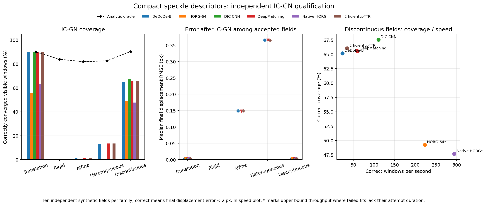

# Compact speckle descriptor: independent IC-GN qualification

Date: 8 November 2026. The qualification ran with WGPU-Matching's WebGPU
backends on Intel Graphics (Lunar Lake, LNL) using Vulkan and the graphics
processing unit (GPU). Digital image correlation (DIC) images are 1024 × 576
synthetic speckle pairs. The solver is inverse compositional Gauss–Newton
(IC-GN), from the existing external Live-DIC project, imported read-only; no
files in that project were changed.

## Scope and protocol

This report evaluates a 64-component patch convolutional descriptor after
training on synthetic speckle. The fixed DIC detector, requested DIC windows,
local consensus settings, Gaussian radial basis function (RBF) field
projection, and IC-GN
convergence criteria are shared across the descriptor comparison. A window is
counted correct when its final IC-GN displacement is within 2 pixels of the
analytical truth. Numerators are pooled over visible windows, not averaged
over fields. Direct-match correctness uses an analytical displacement error
below 5 pixels. The direct-match counts are reported separately from
field-projected window counts.



HORG-64 denotes the 64-component histogram of oriented and rotated gradients
baseline. EfficientLoFTR is the efficient local feature transformer matcher;
DeDoDe-B is the B-sized variant of Detect, Don’t Describe — Describe, Don’t
Detect. DeepMatching and native HORG are retained as established comparison
pipelines. The learned HORG projection is not in the fifty-field independent
campaign: it did not improve fixed HORG-64 in the preceding six-field study.
Its historical results remain in the [earlier HORG descriptor report](../../descriptors/baseline_failure_analysis.md).

The qualification contains six historical fixed cases and fifty new
independent cases: ten texture/warp seed pairs each for translation, rigid
rotation, affine, spatially heterogeneous, and discontinuous motion. The new
evaluation seeds are disjoint from the training and validation texture seeds.
The two previously known failures, `affine_8101_9101` and
`heterogeneous_8102_9102`, remain unchanged regression cases and were not used
for checkpoint selection, threshold tuning, or training.

## Independent cases: correctly converged windows

Each cell is `correct / visible (coverage)`. The final column reports the
number of windows the analytic local-affine oracle could correctly converge
for that family. The oracle is a solver ceiling, not a usable initializer.

| Motion family | DeDoDe-B | HORG-64 | DIC CNN | DeepMatching | Native HORG | EfficientLoFTR | Oracle |
|---|---:|---:|---:|---:|---:|---:|---:|
| Translation | 931/1034 (90.0%) | 576/1034 (55.7%) | 931/1034 (90.0%) | 931/1034 (90.0%) | 653/1034 (63.2%) | 931/1034 (90.0%) | 931/1034 (90.0%) |
| Rigid rotation | 0/881 (0%) | 0/881 (0%) | 0/881 (0%) | 0/881 (0%) | 0/881 (0%) | 0/881 (0%) | 739/881 (83.9%) |
| Affine | 10/800 (1.2%) | 0/800 (0%) | 0/800 (0%) | 9/800 (1.1%) | 0/800 (0%) | 10/800 (1.2%) | 655/800 (81.9%) |
| Heterogeneous | 119/896 (13.3%) | 0/896 (0%) | 0/896 (0%) | 121/896 (13.5%) | 0/896 (0%) | 121/896 (13.5%) | 740/896 (82.6%) |
| Discontinuous | 660/1013 (65.2%) | 499/1013 (49.3%) | 684/1013 (67.5%) | 664/1013 (65.5%) | 483/1013 (47.7%) | 669/1013 (66.0%) | 915/1013 (90.3%) |

The compact CNN is marginally best on the discontinuous family, by 15 windows
over DeDoDe-B and 20 over DeepMatching. It does not solve the core held-out
rigid, affine, or heterogeneous failures. The oracle succeeds on most windows
in those families, so these failures arise before IC-GN: feature retrieval,
geometric consensus, or field construction is inadequate. The result is not a
general robustness win.

## End-to-end cost and direct correspondence evidence

The first table reports summed measured per-case pipeline times across the
ten fields in each family, in seconds, and `correct windows / summed seconds`.
For successful fits this uses the recorded end-to-end pipeline timer. When a
field fit fails, the stored timer includes extraction, description, matching,
and reference preparation, but does not retain the duration spent attempting
and rejecting that fit. Consequently, where any fits fail, the listed time is
a lower bound and the computed throughput is an upper bound. Treat these as
diagnostic throughput estimates, not a complete comparable performance
qualification. The discontinuous family has successful field fits for all
ten cases for the four methods compared in the main text; their throughputs
are based on full recorded end-to-end timers.

| Motion family | DeDoDe-B | HORG-64 | DIC CNN | DeepMatching | Native HORG | EfficientLoFTR |
|---|---:|---:|---:|---:|---:|---:|
| Translation | 24.72 s / 37.7 s⁻¹ | 2.08 s / 277.3 s⁻¹ | 4.41 s / 211.3 s⁻¹ | 6.60 s / 141.1 s⁻¹ | 1.52 s / 430.3 s⁻¹ | 16.84 s / 55.3 s⁻¹ |
| Rigid rotation | 20.11 s / 0 | 1.04 s / 0 | 1.03 s / 0 | 3.22 s / 0 | 1.24 s / 0 | 8.77 s / 0 |
| Affine | 22.20 s / 0.5 s⁻¹ | 1.15 s / 0 | 1.13 s / 0 | 4.21 s / 2.1 s⁻¹ | 1.05 s / 0 | 10.98 s / 0.9 s⁻¹ |
| Heterogeneous | 23.35 s / 5.1 s⁻¹ | 1.11 s / 0 | 1.12 s / 0 | 5.56 s / 21.8 s⁻¹ | 1.04 s / 0 | 12.37 s / 9.8 s⁻¹ |
| Discontinuous | 28.07 s / 23.5 s⁻¹ | 2.24 s / 223.0 s⁻¹ | 6.17 s / 110.8 s⁻¹ | 11.16 s / 59.5 s⁻¹ | 1.64 s / 294.5 s⁻¹ | 19.29 s / 34.7 s⁻¹ |

Pooled raw direct-match precision under 5 pixels is shown as `correct / all`
reciprocal matches before geometric consensus. These counts are taken from
the raw analytical-error arrays, so they do not imply that matches survived
consensus or produced a valid field.

| Family | DeDoDe-B | HORG-64 | DIC CNN | DeepMatching | Native HORG | EfficientLoFTR |
|---|---:|---:|---:|---:|---:|---:|
| Translation | 11144/11773 | 1426/6570 | 7053/8083 | 14893/20480 | 195/492 | 20802/21026 |
| Rigid rotation | 404/5071 | 95/5916 | 0/2899 | 382/20480 | 91/346 | 147/1057 |
| Affine | 2397/6295 | 14/6021 | 12/2709 | 2687/20480 | 15/396 | 3685/4570 |
| Heterogeneous | 3134/6882 | 12/6452 | 27/3343 | 3507/20480 | 12/459 | 4645/5481 |
| Discontinuous | 10675/11464 | 1073/5524 | 6747/7875 | 15045/20480 | 201/579 | 15478/16000 |

These numbers illustrate why raw precision cannot stand in for initialization
quality. The CNN returns many accurate direct matches under translation and
discontinuous motion, yet has no useful field on the independent rigid,
affine, or heterogeneous families. Matching accuracy, spatial support,
consensus, field projection, and IC-GN convergence all matter.

## Six fixed regression cases

Counts below are correct IC-GN windows within 2 pixels, out of visible windows.
Both designated failure regressions remain failures for every tested method.

| Fixed case | Visible | DeDoDe-B | HORG-64 | Learned HORG | DIC CNN | DeepMatching | Native HORG | EfficientLoFTR | Oracle |
|---|---:|---:|---:|---:|---:|---:|---:|---:|---:|
| Affine `8101/9101` | 99 | 0 | 0 | 0 | 0 | 0 | 0 | 0 | 79 |
| Heterogeneous `8102/9102` | 65 | 0 | 0 | 0 | 0 | 0 | 0 | 0 | 45 |
| Heterogeneous `8103/9103` | 77 | 65 | 0 | 0 | 0 | 64 | 0 | 64 | 68 |
| Discontinuous `8104/9104` | 84 | 32 | 0 | 0 | 40 | 29 | 0 | 24 | 72 |
| Discontinuous `8105/9105` | 91 | 46 | 57 | 53 | 46 | 48 | 41 | 46 | 72 |
| Rigid `8106/9106` | 106 | 95 | 0 | 0 | 95 | 95 | 95 | 95 | 95 |

This expanded checkpoint differs from the earlier 24/8 pilot. For example,
the earlier pilot obtained 45/84 on discontinuous `8104/9104`; the expanded
checkpoint obtains 40/84. Keep both dated artifacts intact and do not combine
their results as if they came from one model.

## Training and model

The training run used seed `20261110`, 80 training and 20 validation texture
pairs, 48 sampled points per pair, 20 epochs, and CPU PyTorch 2.15.0. Texture
identities were disjoint across training and validation. The training families
were translation, rigid rotation, affine, heterogeneous, and discontinuous
motion. For each source point, the positive descriptor was sampled at the
analytically mapped target coordinate. Same-texture negatives were at least
48 source pixels away; the hardest current similarities contribute to the
symmetric information noise-contrastive estimation (InfoNCE) objective.

The selected checkpoint is epoch 7, chosen by validation top-1 retrieval only:
6.04% with 48 candidates. Training took 18.1 seconds on CPU. Model weights:
`results/descriptors/dic_descriptor_cnn_training_20261108_expanded/dic_patch_cnn_descriptor.npz`,
SHA-256 `861491fb6045678e1583622977afe909cb144d358770b68ce1e7a0593a3cdfff`.
Training history, partitions, and hashes are in that directory's
`training_report.json`.

The compact convolutional neural network (CNN) takes a 64 × 64 grayscale patch
and produces 64 components normalized to unit Euclidean (L2) length. It uses a
stride-4 3 × 3 convolution with eight output channels,
a depthwise 3 × 3 convolution, 4 × 4 spatial average pooling, and a 128-to-64
projection. Inference is implemented as two WebGPU Shading Language (WGSL)
compute passes. The feature
map remains in a WebGPU storage buffer between passes; the final descriptors
are read back to Python and uploaded again by the current reciprocal matcher.
This is not a GPU-resident end-to-end pipeline. Training took 18.1 seconds on
the central processing unit (CPU); PyTorch is optional and is not needed for
inference.

## Native 4K descriptor throughput

The separate 4K (approximately four thousand pixels wide) test used native
3840 × 2160 generated images, 4096 points per image, one warm-up and three
timed repetitions. The target was a cyclic 37-pixel
horizontal roll, so the test measures throughput rather than generalization
accuracy.
The descriptor timings used the expanded checkpoint with SHA-256
`861491fb6045678e1583622977afe909cb144d358770b68ce1e7a0593a3cdfff`.

| Stage for both images | HORG-64 | DIC CNN |
|---|---:|---:|
| Detection | 86.7 ms | 86.7 ms |
| Description | 22.7 ms | 69.1 ms |
| Mutual matching | 90.8 ms | 81.6 ms |
| Subtotal before consensus/projection/IC-GN | 197.1 ms | 237.4 ms |

The CNN descriptor runs on the original-resolution grayscale data. Its
descriptor stage is about 3.0 times slower than HORG-64, although still far
below the DeDoDe-B description latency observed in the earlier 1024 × 576
benchmark. This experiment does not establish a robust 4K matching gain.

## Reproduction

Train the expanded model from the repository root (with the optional research
dependencies installed):

```console
python python/benchmarks/train_dic_cnn_descriptor.py \
  --output results/descriptors/dic_descriptor_cnn_training_20261108_expanded \
  --train-pairs 80 --validation-pairs 20 --points-per-pair 48 \
  --epochs 20 --batch-size 4 --seed 20261110
```

Re-run the qualification with the same model artifacts used for the recorded
baseline. The Detect, Don’t Describe — Describe, Don’t Detect B (DeDoDe-B)
model export in Open Neural Network Exchange (ONNX) format and EfficientLoFTR model files are optional
external assets and are not checked into this repository:

```console
python python/benchmarks/qualify_heterogeneous_icgn.py \
  --output results/qualification/dic_descriptor_expanded_icgn_20261108 \
  --descriptor-onnx /path/to/dedode_b_descriptor_1024x576_k8192.onnx \
  --weights results/features/dic_detector_training_discontinuous_20261107/dic_detector_weights.npz \
  --compact-descriptor results/descriptors/dic_descriptor_horg_training_20261108/dic_descriptor_multiscale_mlp.npz \
  --cnn-descriptor results/descriptors/dic_descriptor_cnn_training_20261108_expanded/dic_patch_cnn_descriptor.npz \
  --independent-eval-per-family 10 --seed 970000000
```

Regenerate the figure from the stored qualification summary with:

```console
python python/benchmarks/plot_dic_descriptor_qualification.py \
  results/qualification/dic_descriptor_expanded_icgn_20261108/summary.json \
  results/qualification/dic_descriptor_expanded_icgn_20261108/descriptor_qualification.png
```

The JavaScript Object Notation (JSON) summary and per-case compressed NumPy
archive (NPZ) files beside this report preserve raw
correspondences, analytical errors, consensus decisions, projected six-
parameter initializations, and solver outputs. The test suite checks WGSL
descriptor values against both an independent NumPy reference and a PyTorch
implementation of the exported architecture. The PyTorch parity case includes
integer and fractional keypoint coordinates and uses deterministic test
weights; it runs when the optional research dependency is installed. The NumPy
shader reference remains available in the minimal inference test environment.

Each case's `analytic_truth.json` stores its texture and warp seeds, physical
warp parameters, and visibility summary. The full pixelwise displacement and
visibility arrays are regenerated from these seeds by
`generate_speckle_pair`; they are not duplicated in the published report data.
Per-window analytic parameters and raw measured-match errors are retained in
the compact case archives.

## Conclusion and remaining work

The CNN is a working compact WGSL descriptor, but this checkpoint is not a
qualified general DIC initializer. It provides a small coverage gain on
discontinuous fields at higher cost than HORG-64 and fails on independent
rigid, affine, and heterogeneous fields. It also fails both fixed regression
cases. Validation top-1 retrieval of 6.04% is weak and should motivate better
sampling and a training objective tied to descriptor ambiguity and observed
IC-GN outcomes, rather than a larger model by default.

The current model does not implement multiple support sizes, explicit affine
equivariance, a learned IC-GN reliability score, or a JavaScript/browser API.
Descriptor outputs cross the host boundary before reciprocal matching. No
memory-peak measurement or full-pipeline 4K IC-GN benchmark is claimed.

A follow-up training run used the exact same training and validation
partitions for 100 epochs. It selected epoch 39 with 5.83% validation
retrieval, below the 20-epoch checkpoint's 6.04%. The longer run therefore
does not replace the qualified candidate and was not sent through the final
IC-GN campaign. Its artifact is retained at
`results/descriptors/dic_descriptor_cnn_training_20261108_longer/`; weight
SHA-256: `ef501809149a0b1c45b30fa1f7238c9d9e1296fd2d0e7e7f329c991accc0de17`.
This negative control suggests that training longer alone does not address
the validation generalization failure.
