# Does robust projection alone reject the false matches?

This controlled ablation uses the exact cached observations from the complete qualification. Native acceptance masks are retained; only the additional common local affine consensus is omitted. No detector is rerun, no truth filters pairs and the same spatial solver-capacity reduction applies. This is a diagnostic comparison, not a replacement for the main protocol.

The affine ablation covers every case. Both basis requests are included for 60 percent and Adrien. On sparse detectors, the fixed local minimum of 8 candidates can reject otherwise useful pairs; this ablation also exposes that coverage cost rather than assuming the filter always improves the field.

A raw robust field can converge numerically while being physically wrong. Results concern smooth initialization fields; they do not evaluate IC-GN convergence. The Adrien pair has no analytic error or accuracy verdict.

| Case | Method | Requested → effective | Raw-projection correct <5 px / requested | With common verification | Raw RMSE (px) |
|---|---|---|---:|---:|---:|
| progressive_040 | DeepMatching INRIA hierarchy | affine → affine | 32/32 | 32/32 | 1.323 |
| progressive_040 | HORG | affine → affine | 32/32 | 32/32 | 0.028 |
| progressive_040 | CPM-HOG | affine → affine | 32/32 | 32/32 | 1.324 |
| progressive_040 | XFeat | affine → affine | 32/32 | 32/32 | 2.296 |
| progressive_040 | EfficientLoFTR | affine → affine | 32/32 | 32/32 | 0.596 |
| progressive_040 | RaCo-ALIKED-LightGlue+ | affine → affine | 32/32 | 32/32 | 0.114 |
| progressive_040 | DaD + DeDoDe-B | affine → affine | 32/32 | 32/32 | 0.642 |
| progressive_040 | DeDoDe v2-L + DeDoDe-B | affine → affine | 32/32 | 32/32 | 1.327 |
| progressive_040 | DIC tensor + DeDoDe-B | affine → affine | 32/32 | 32/32 | 0.252 |
| progressive_040 | Learned DIC + DeDoDe-B | affine → affine | 32/32 | 32/32 | 0.026 |
| progressive_040 | HORG/SIFT detector + DeDoDe-B | affine → affine | 32/32 | 32/32 | 0.023 |
| progressive_100 | DeepMatching INRIA hierarchy | affine → affine | 28/28 | 28/28 | 0.193 |
| progressive_100 | HORG | affine → affine | 28/28 | 28/28 | 0.107 |
| progressive_100 | CPM-HOG | affine → affine | 28/28 | 28/28 | 0.519 |
| progressive_100 | XFeat | affine → affine | 28/28 | 28/28 | 1.514 |
| progressive_100 | EfficientLoFTR | affine → affine | 28/28 | 28/28 | 0.227 |
| progressive_100 | RaCo-ALIKED-LightGlue+ | affine → affine | 28/28 | 28/28 | 0.132 |
| progressive_100 | DaD + DeDoDe-B | affine → affine | 28/28 | 28/28 | 0.102 |
| progressive_100 | DeDoDe v2-L + DeDoDe-B | affine → affine | 28/28 | 28/28 | 0.324 |
| progressive_100 | DIC tensor + DeDoDe-B | affine → affine | 28/28 | 28/28 | 0.065 |
| progressive_100 | Learned DIC + DeDoDe-B | affine → affine | 28/28 | 28/28 | 0.051 |
| progressive_100 | HORG/SIFT detector + DeDoDe-B | affine → affine | 28/28 | 28/28 | 0.086 |
| progressive_199 | DeepMatching INRIA hierarchy | affine → affine | 28/28 | 28/28 | 0.100 |
| progressive_199 | HORG | affine → affine | 0/28 | 0/28 | 236.127 |
| progressive_199 | CPM-HOG | affine → affine | 0/28 | 28/28 | 99.479 |
| progressive_199 | XFeat | affine → affine | 28/28 | 28/28 | 1.940 |
| progressive_199 | EfficientLoFTR | affine → affine | 28/28 | 28/28 | 0.360 |
| progressive_199 | RaCo-ALIKED-LightGlue+ | affine → affine | 28/28 | 28/28 | 0.217 |
| progressive_199 | DaD + DeDoDe-B | affine → affine | 28/28 | 28/28 | 0.221 |
| progressive_199 | DeDoDe v2-L + DeDoDe-B | affine → affine | 28/28 | 28/28 | 0.622 |
| progressive_199 | DIC tensor + DeDoDe-B | affine → affine | 28/28 | 28/28 | 0.286 |
| progressive_199 | Learned DIC + DeDoDe-B | affine → affine | 28/28 | 28/28 | 0.099 |
| progressive_199 | HORG/SIFT detector + DeDoDe-B | affine → affine | 28/28 | 28/28 | 0.230 |
| tensile_10pct | DeepMatching INRIA hierarchy | affine → affine | 28/28 | 28/28 | 0.111 |
| tensile_10pct | HORG | affine → affine | 0/28 | 0/28 | 361.219 |
| tensile_10pct | CPM-HOG | affine → affine | 0/28 | 28/28 | 96.367 |
| tensile_10pct | XFeat | affine → affine | 28/28 | 28/28 | 1.939 |
| tensile_10pct | EfficientLoFTR | affine → affine | 28/28 | 28/28 | 0.291 |
| tensile_10pct | RaCo-ALIKED-LightGlue+ | affine → affine | 28/28 | 28/28 | 0.247 |
| tensile_10pct | DaD + DeDoDe-B | affine → affine | 28/28 | 28/28 | 0.195 |
| tensile_10pct | DeDoDe v2-L + DeDoDe-B | affine → affine | 28/28 | 28/28 | 0.607 |
| tensile_10pct | DIC tensor + DeDoDe-B | affine → affine | 28/28 | 28/28 | 0.235 |
| tensile_10pct | Learned DIC + DeDoDe-B | affine → affine | 28/28 | 28/28 | 0.108 |
| tensile_10pct | HORG/SIFT detector + DeDoDe-B | affine → affine | 28/28 | 28/28 | 0.206 |
| tensile_20pct | DeepMatching INRIA hierarchy | affine → affine | 24/24 | 24/24 | 0.415 |
| tensile_20pct | HORG | affine → affine | 0/24 | 0/24 | 1444.842 |
| tensile_20pct | CPM-HOG | affine → affine | 0/24 | 24/24 | 156.782 |
| tensile_20pct | XFeat | affine → affine | 24/24 | 24/24 | 2.637 |
| tensile_20pct | EfficientLoFTR | affine → affine | 24/24 | 24/24 | 0.595 |
| tensile_20pct | RaCo-ALIKED-LightGlue+ | affine → affine | 24/24 | 24/24 | 0.161 |
| tensile_20pct | DaD + DeDoDe-B | affine → affine | 24/24 | 24/24 | 0.916 |
| tensile_20pct | DeDoDe v2-L + DeDoDe-B | affine → affine | 24/24 | 24/24 | 2.097 |
| tensile_20pct | DIC tensor + DeDoDe-B | affine → affine | 24/24 | 24/24 | 1.409 |
| tensile_20pct | Learned DIC + DeDoDe-B | affine → affine | 24/24 | 24/24 | 0.510 |
| tensile_20pct | HORG/SIFT detector + DeDoDe-B | affine → affine | 24/24 | 24/24 | 1.256 |
| tensile_30pct | DeepMatching INRIA hierarchy | affine → affine | 24/24 | 24/24 | 1.117 |
| tensile_30pct | HORG | affine → affine | 0/24 | 0/24 | 1052.654 |
| tensile_30pct | CPM-HOG | affine → affine | 0/24 | 3/24 | 271.955 |
| tensile_30pct | XFeat | affine → affine | 11/24 | 24/24 | 7.256 |
| tensile_30pct | EfficientLoFTR | affine → affine | 24/24 | 24/24 | 0.819 |
| tensile_30pct | RaCo-ALIKED-LightGlue+ | affine → affine | 24/24 | 24/24 | 0.325 |
| tensile_30pct | DaD + DeDoDe-B | affine → affine | 24/24 | 24/24 | 2.838 |
| tensile_30pct | DeDoDe v2-L + DeDoDe-B | affine → affine | 0/24 | 24/24 | 37.399 |
| tensile_30pct | DIC tensor + DeDoDe-B | affine → affine | 8/24 | 24/24 | 8.193 |
| tensile_30pct | Learned DIC + DeDoDe-B | affine → affine | 24/24 | 24/24 | 1.413 |
| tensile_30pct | HORG/SIFT detector + DeDoDe-B | affine → affine | 2/24 | 24/24 | 34.981 |
| tensile_40pct | DeepMatching INRIA hierarchy | affine → affine | 16/24 | 24/24 | 4.022 |
| tensile_40pct | HORG | affine → affine | 0/24 | 0/24 | 1040.970 |
| tensile_40pct | CPM-HOG | affine → affine | 0/24 | 0/24 | 364.034 |
| tensile_40pct | XFeat | affine → affine | 0/24 | 23/24 | 367.123 |
| tensile_40pct | EfficientLoFTR | affine → affine | 24/24 | 24/24 | 1.129 |
| tensile_40pct | RaCo-ALIKED-LightGlue+ | affine → affine | 24/24 | 24/24 | 0.377 |
| tensile_40pct | DaD + DeDoDe-B | affine → affine | 3/24 | 24/24 | 20.655 |
| tensile_40pct | DeDoDe v2-L + DeDoDe-B | affine → affine | 0/24 | 24/24 | 313.519 |
| tensile_40pct | DIC tensor + DeDoDe-B | affine → affine | 0/24 | 24/24 | 268.663 |
| tensile_40pct | Learned DIC + DeDoDe-B | affine → affine | 0/24 | 24/24 | 30.350 |
| tensile_40pct | HORG/SIFT detector + DeDoDe-B | affine → affine | 0/24 | 24/24 | 364.221 |
| tensile_50pct | DeepMatching INRIA hierarchy | affine → affine | 8/20 | 20/20 | 8.952 |
| tensile_50pct | HORG | affine → affine | 0/20 | 0/20 | 1279.938 |
| tensile_50pct | CPM-HOG | affine → affine | 0/20 | 0/20 | 390.220 |
| tensile_50pct | XFeat | affine → affine | 0/20 | 20/20 | 524.446 |
| tensile_50pct | EfficientLoFTR | affine → affine | 16/20 | 20/20 | 3.568 |
| tensile_50pct | RaCo-ALIKED-LightGlue+ | affine → affine | 20/20 | 20/20 | 0.541 |
| tensile_50pct | DaD + DeDoDe-B | affine → affine | 0/20 | 20/20 | 300.199 |
| tensile_50pct | DeDoDe v2-L + DeDoDe-B | affine → affine | 0/20 | 20/20 | 474.323 |
| tensile_50pct | DIC tensor + DeDoDe-B | affine → affine | 0/20 | 20/20 | 405.510 |
| tensile_50pct | Learned DIC + DeDoDe-B | affine → affine | 0/20 | 20/20 | 263.740 |
| tensile_50pct | HORG/SIFT detector + DeDoDe-B | affine → affine | 0/20 | 20/20 | 499.704 |
| tensile_60pct | DeepMatching INRIA hierarchy | affine → affine | 0/16 | 16/16 | 325.402 |
| tensile_60pct | DeepMatching INRIA hierarchy | gaussian_rbf → gaussian_rbf | 1/16 | 16/16 | 92.153 |
| tensile_60pct | HORG | affine → affine | 0/16 | 0/16 | 1090.135 |
| tensile_60pct | HORG | gaussian_rbf → affine | 0/16 | 0/16 | 1090.135 |
| tensile_60pct | CPM-HOG | affine → affine | 0/16 | 0/16 | 369.183 |
| tensile_60pct | CPM-HOG | gaussian_rbf → affine | 0/16 | 0/16 | 369.183 |
| tensile_60pct | XFeat | affine → affine | 0/16 | 16/16 | 581.498 |
| tensile_60pct | XFeat | gaussian_rbf → gaussian_rbf | 0/16 | 16/16 | 310.126 |
| tensile_60pct | EfficientLoFTR | affine → affine | 0/16 | 16/16 | 114.091 |
| tensile_60pct | EfficientLoFTR | gaussian_rbf → gaussian_rbf | 1/16 | 16/16 | 79.506 |
| tensile_60pct | RaCo-ALIKED-LightGlue+ | affine → affine | 16/16 | 16/16 | 0.623 |
| tensile_60pct | RaCo-ALIKED-LightGlue+ | gaussian_rbf → affine | 16/16 | 16/16 | 0.623 |
| tensile_60pct | DaD + DeDoDe-B | affine → affine | 0/16 | 16/16 | 384.057 |
| tensile_60pct | DaD + DeDoDe-B | gaussian_rbf → gaussian_rbf | 0/16 | 16/16 | 116.357 |
| tensile_60pct | DeDoDe v2-L + DeDoDe-B | affine → affine | 0/16 | 16/16 | 461.350 |
| tensile_60pct | DeDoDe v2-L + DeDoDe-B | gaussian_rbf → gaussian_rbf | 0/16 | 16/16 | 268.713 |
| tensile_60pct | DIC tensor + DeDoDe-B | affine → affine | 0/16 | 16/16 | 446.840 |
| tensile_60pct | DIC tensor + DeDoDe-B | gaussian_rbf → gaussian_rbf | 0/16 | 16/16 | 273.420 |
| tensile_60pct | Learned DIC + DeDoDe-B | affine → affine | 0/16 | 16/16 | 358.521 |
| tensile_60pct | Learned DIC + DeDoDe-B | gaussian_rbf → gaussian_rbf | 1/16 | 16/16 | 115.446 |
| tensile_60pct | HORG/SIFT detector + DeDoDe-B | affine → affine | 0/16 | 5/16 | 515.031 |
| tensile_60pct | HORG/SIFT detector + DeDoDe-B | gaussian_rbf → gaussian_rbf | 0/16 | 5/16 | 222.999 |
| adrien_000000_to_000075 | DeepMatching INRIA hierarchy | affine → affine | — | — | — |
| adrien_000000_to_000075 | DeepMatching INRIA hierarchy | gaussian_rbf → gaussian_rbf | — | — | — |
| adrien_000000_to_000075 | HORG | affine → affine | — | — | — |
| adrien_000000_to_000075 | HORG | gaussian_rbf → gaussian_rbf | — | — | — |
| adrien_000000_to_000075 | CPM-HOG | affine → affine | — | — | — |
| adrien_000000_to_000075 | CPM-HOG | gaussian_rbf → gaussian_rbf | — | — | — |
| adrien_000000_to_000075 | XFeat | affine → affine | — | — | — |
| adrien_000000_to_000075 | XFeat | gaussian_rbf → gaussian_rbf | — | — | — |
| adrien_000000_to_000075 | EfficientLoFTR | affine → affine | — | — | — |
| adrien_000000_to_000075 | EfficientLoFTR | gaussian_rbf → gaussian_rbf | — | — | — |
| adrien_000000_to_000075 | RaCo-ALIKED-LightGlue+ | affine → affine | — | — | — |
| adrien_000000_to_000075 | RaCo-ALIKED-LightGlue+ | gaussian_rbf → gaussian_rbf | — | — | — |
| adrien_000000_to_000075 | DaD + DeDoDe-B | affine → affine | — | — | — |
| adrien_000000_to_000075 | DaD + DeDoDe-B | gaussian_rbf → gaussian_rbf | — | — | — |
| adrien_000000_to_000075 | DeDoDe v2-L + DeDoDe-B | affine → affine | — | — | — |
| adrien_000000_to_000075 | DeDoDe v2-L + DeDoDe-B | gaussian_rbf → gaussian_rbf | — | — | — |
| adrien_000000_to_000075 | DIC tensor + DeDoDe-B | affine → affine | — | — | — |
| adrien_000000_to_000075 | DIC tensor + DeDoDe-B | gaussian_rbf → gaussian_rbf | — | — | — |
| adrien_000000_to_000075 | Learned DIC + DeDoDe-B | affine → affine | — | — | — |
| adrien_000000_to_000075 | Learned DIC + DeDoDe-B | gaussian_rbf → gaussian_rbf | — | — | — |
| adrien_000000_to_000075 | HORG/SIFT detector + DeDoDe-B | affine → affine | — | — | — |
| adrien_000000_to_000075 | HORG/SIFT detector + DeDoDe-B | gaussian_rbf → gaussian_rbf | — | — | — |

## progressive_040 / DeepMatching INRIA hierarchy / affine

**Pass.** Effective basis: affine.

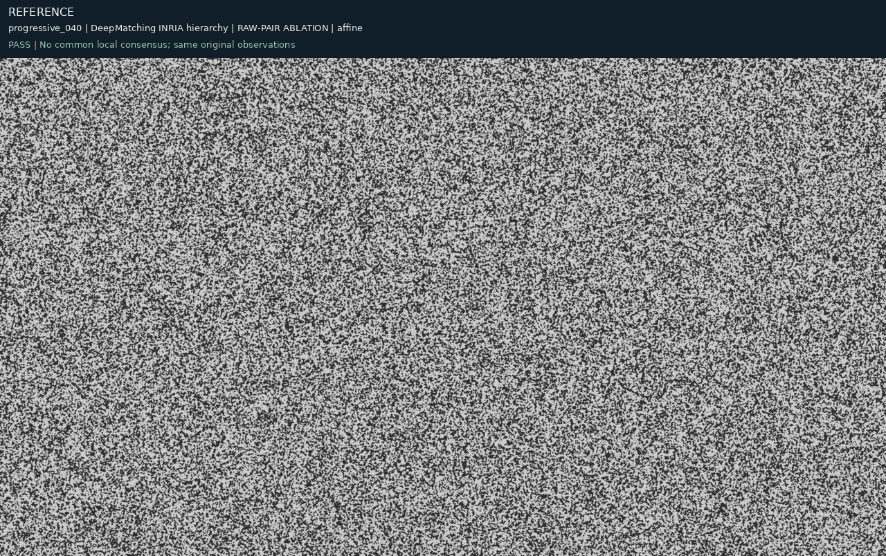

[Full metrics and provenance](progressive_040/deepmatching/affine/result.json)

## progressive_040 / HORG / affine

**Pass.** Effective basis: affine.

[Full metrics and provenance](progressive_040/horg/affine/result.json)

## progressive_040 / CPM-HOG / affine

**Pass.** Effective basis: affine.

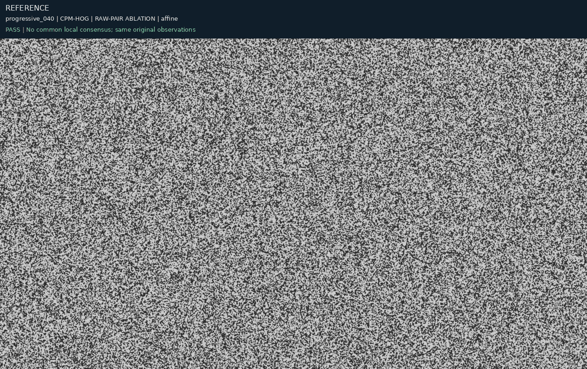

[Full metrics and provenance](progressive_040/cpm/affine/result.json)

## progressive_040 / XFeat / affine

**Pass.** Effective basis: affine.

[Full metrics and provenance](progressive_040/xfeat/affine/result.json)

## progressive_040 / EfficientLoFTR / affine

**Pass.** Effective basis: affine.

[Full metrics and provenance](progressive_040/efficientloftr/affine/result.json)

## progressive_040 / RaCo-ALIKED-LightGlue+ / affine

**Pass.** Effective basis: affine.

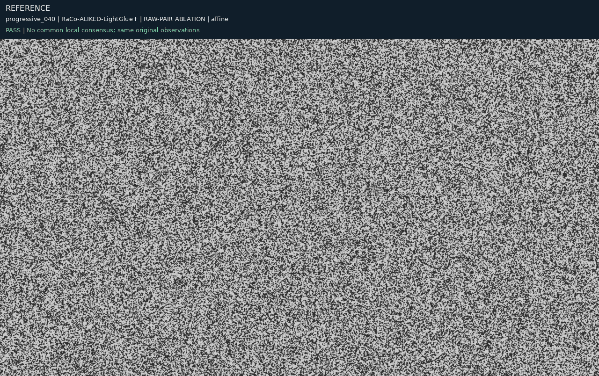

[Full metrics and provenance](progressive_040/raco/affine/result.json)

## progressive_040 / DaD + DeDoDe-B / affine

**Pass.** Effective basis: affine.

[Full metrics and provenance](progressive_040/dad_b/affine/result.json)

## progressive_040 / DeDoDe v2-L + DeDoDe-B / affine

**Pass.** Effective basis: affine.

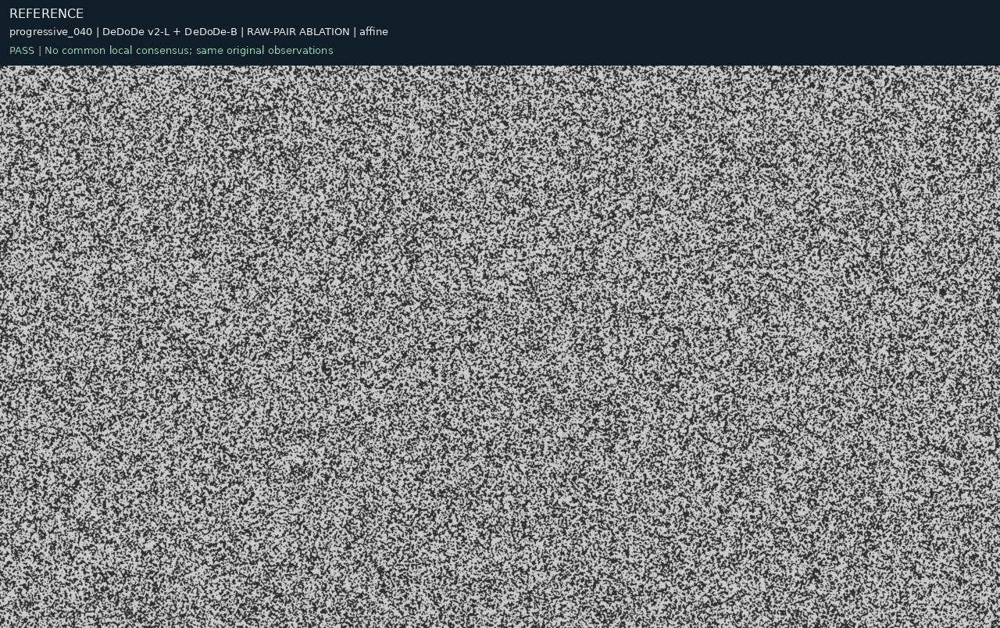

[Full metrics and provenance](progressive_040/dedode_b/affine/result.json)

## progressive_040 / DIC tensor + DeDoDe-B / affine

**Pass.** Effective basis: affine.

[Full metrics and provenance](progressive_040/dic_tensor_b/affine/result.json)

## progressive_040 / Learned DIC + DeDoDe-B / affine

**Pass.** Effective basis: affine.

[Full metrics and provenance](progressive_040/dic_learned_b/affine/result.json)

## progressive_040 / HORG/SIFT detector + DeDoDe-B / affine

**Pass.** Effective basis: affine.

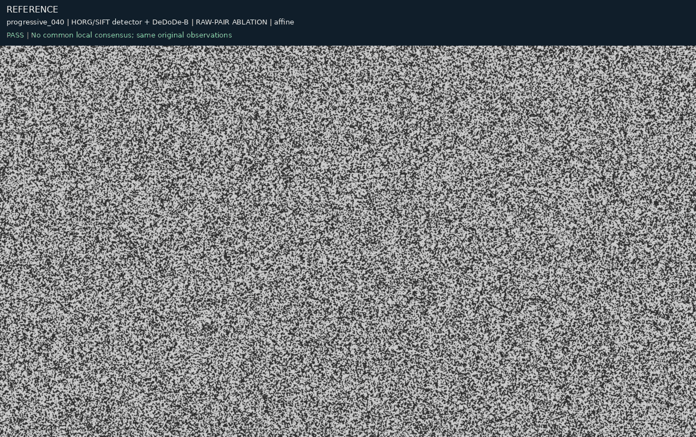

[Full metrics and provenance](progressive_040/horg_b/affine/result.json)

## progressive_100 / DeepMatching INRIA hierarchy / affine

**Pass.** Effective basis: affine.

[Full metrics and provenance](progressive_100/deepmatching/affine/result.json)

## progressive_100 / HORG / affine

**Pass.** Effective basis: affine.

[Full metrics and provenance](progressive_100/horg/affine/result.json)

## progressive_100 / CPM-HOG / affine

**Pass.** Effective basis: affine.

[Full metrics and provenance](progressive_100/cpm/affine/result.json)

## progressive_100 / XFeat / affine

**Pass.** Effective basis: affine.

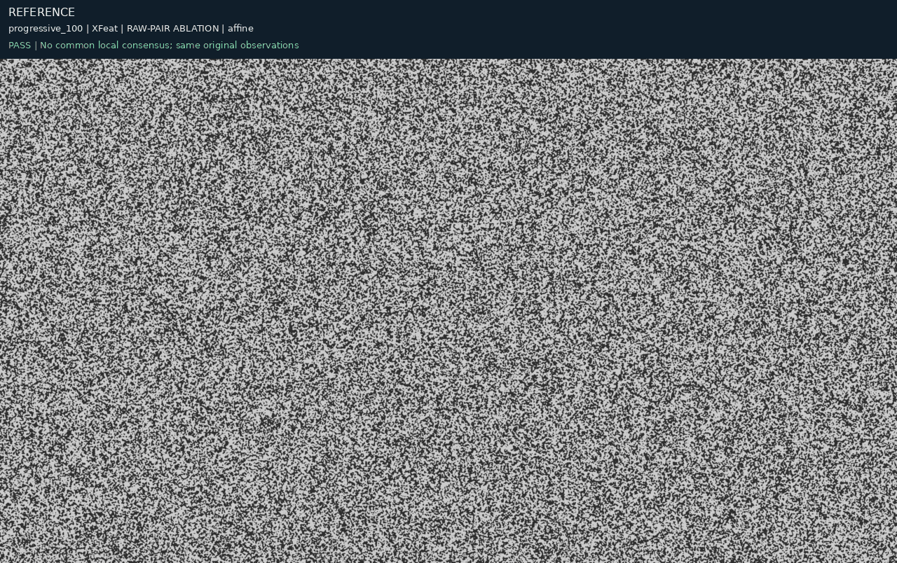

[Full metrics and provenance](progressive_100/xfeat/affine/result.json)

## progressive_100 / EfficientLoFTR / affine

**Pass.** Effective basis: affine.

[Full metrics and provenance](progressive_100/efficientloftr/affine/result.json)

## progressive_100 / RaCo-ALIKED-LightGlue+ / affine

**Pass.** Effective basis: affine.

[Full metrics and provenance](progressive_100/raco/affine/result.json)

## progressive_100 / DaD + DeDoDe-B / affine

**Pass.** Effective basis: affine.

[Full metrics and provenance](progressive_100/dad_b/affine/result.json)

## progressive_100 / DeDoDe v2-L + DeDoDe-B / affine

**Pass.** Effective basis: affine.

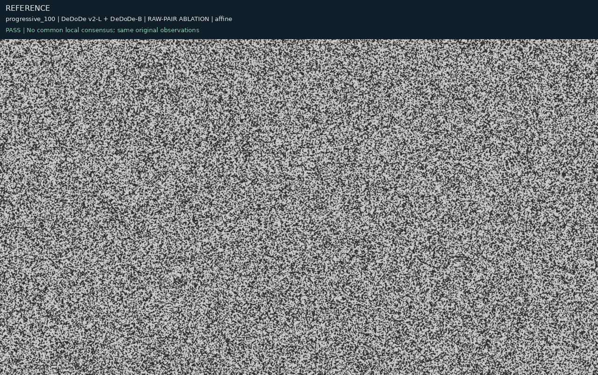

[Full metrics and provenance](progressive_100/dedode_b/affine/result.json)

## progressive_100 / DIC tensor + DeDoDe-B / affine

**Pass.** Effective basis: affine.

[Full metrics and provenance](progressive_100/dic_tensor_b/affine/result.json)

## progressive_100 / Learned DIC + DeDoDe-B / affine

**Pass.** Effective basis: affine.

[Full metrics and provenance](progressive_100/dic_learned_b/affine/result.json)

## progressive_100 / HORG/SIFT detector + DeDoDe-B / affine

**Pass.** Effective basis: affine.

[Full metrics and provenance](progressive_100/horg_b/affine/result.json)

## progressive_199 / DeepMatching INRIA hierarchy / affine

**Pass.** Effective basis: affine.

[Full metrics and provenance](progressive_199/deepmatching/affine/result.json)

## progressive_199 / HORG / affine

**Fail.** Effective basis: affine.

[Full metrics and provenance](progressive_199/horg/affine/result.json)

## progressive_199 / CPM-HOG / affine

**Fail.** Effective basis: affine.

[Full metrics and provenance](progressive_199/cpm/affine/result.json)

## progressive_199 / XFeat / affine

**Pass.** Effective basis: affine.

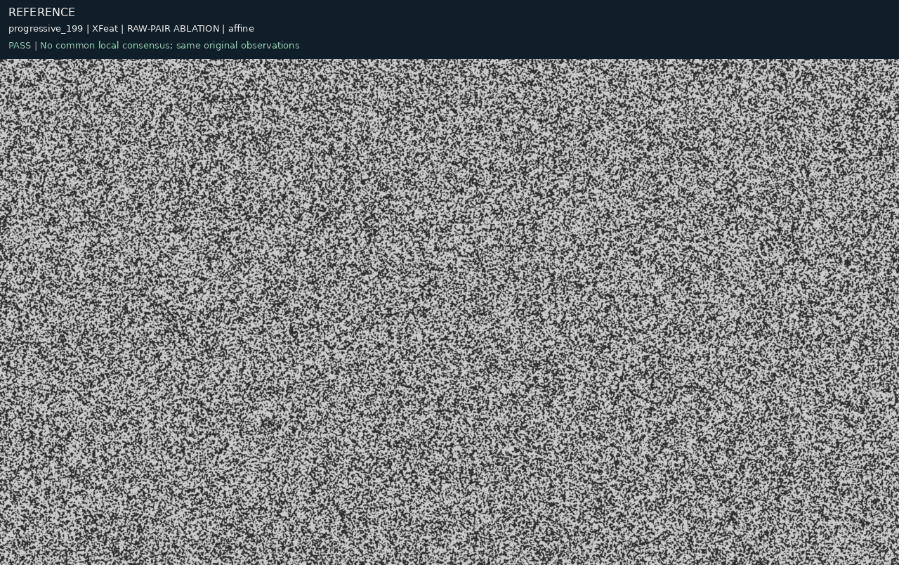

[Full metrics and provenance](progressive_199/xfeat/affine/result.json)

## progressive_199 / EfficientLoFTR / affine

**Pass.** Effective basis: affine.

[Full metrics and provenance](progressive_199/efficientloftr/affine/result.json)

## progressive_199 / RaCo-ALIKED-LightGlue+ / affine

**Pass.** Effective basis: affine.

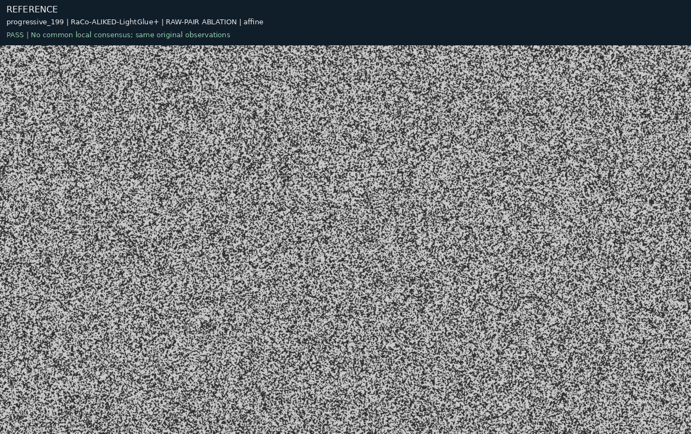

[Full metrics and provenance](progressive_199/raco/affine/result.json)

## progressive_199 / DaD + DeDoDe-B / affine

**Pass.** Effective basis: affine.

[Full metrics and provenance](progressive_199/dad_b/affine/result.json)

## progressive_199 / DeDoDe v2-L + DeDoDe-B / affine

**Pass.** Effective basis: affine.

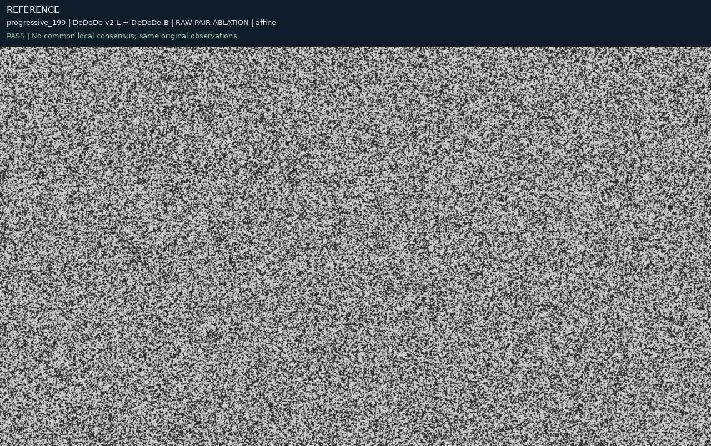

[Full metrics and provenance](progressive_199/dedode_b/affine/result.json)

## progressive_199 / DIC tensor + DeDoDe-B / affine

**Pass.** Effective basis: affine.

[Full metrics and provenance](progressive_199/dic_tensor_b/affine/result.json)

## progressive_199 / Learned DIC + DeDoDe-B / affine

**Pass.** Effective basis: affine.

[Full metrics and provenance](progressive_199/dic_learned_b/affine/result.json)

## progressive_199 / HORG/SIFT detector + DeDoDe-B / affine

**Pass.** Effective basis: affine.

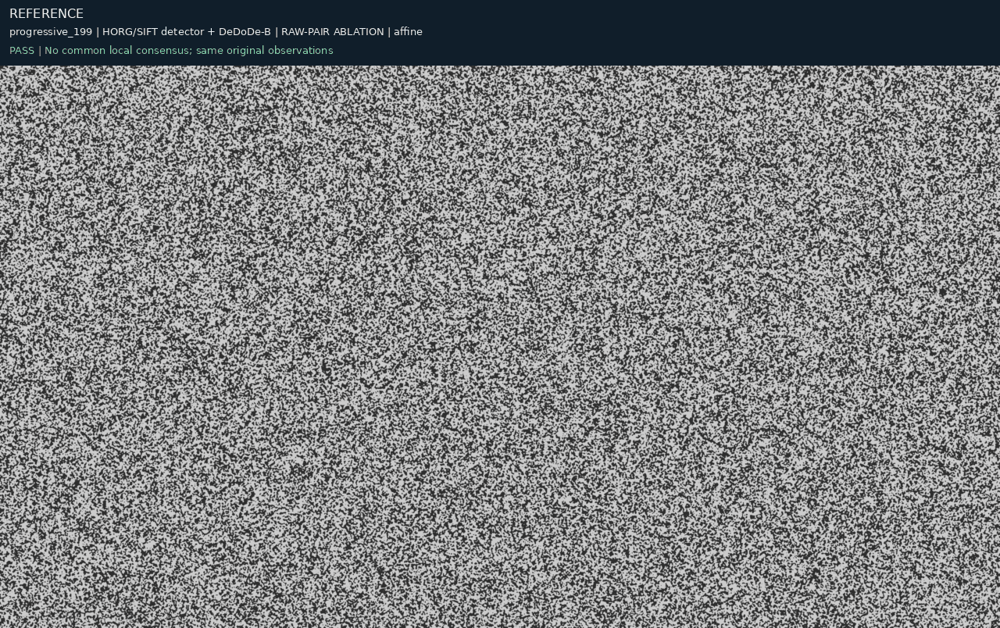

[Full metrics and provenance](progressive_199/horg_b/affine/result.json)

## tensile_10pct / DeepMatching INRIA hierarchy / affine

**Pass.** Effective basis: affine.

[Full metrics and provenance](tensile_10pct/deepmatching/affine/result.json)

## tensile_10pct / HORG / affine

**Fail.** Effective basis: affine.

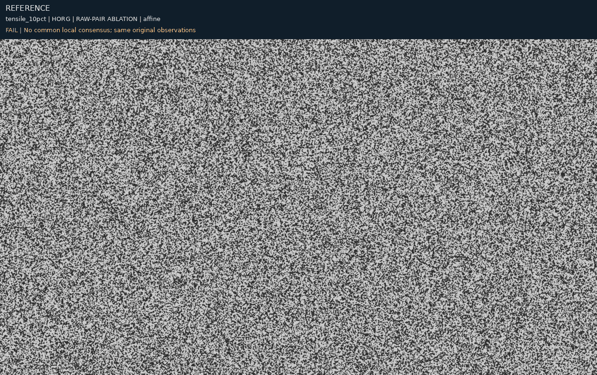

[Full metrics and provenance](tensile_10pct/horg/affine/result.json)

## tensile_10pct / CPM-HOG / affine

**Fail.** Effective basis: affine.

[Full metrics and provenance](tensile_10pct/cpm/affine/result.json)

## tensile_10pct / XFeat / affine

**Pass.** Effective basis: affine.

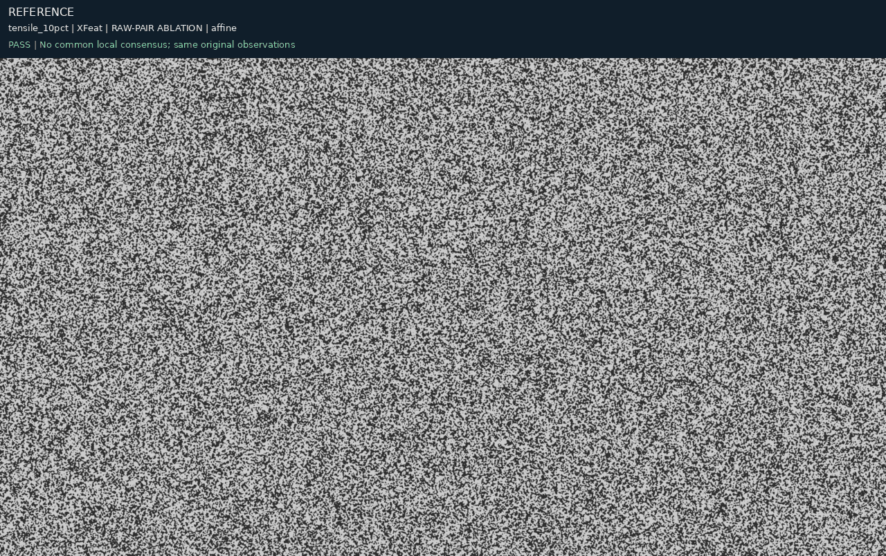

[Full metrics and provenance](tensile_10pct/xfeat/affine/result.json)

## tensile_10pct / EfficientLoFTR / affine

**Pass.** Effective basis: affine.

[Full metrics and provenance](tensile_10pct/efficientloftr/affine/result.json)

## tensile_10pct / RaCo-ALIKED-LightGlue+ / affine

**Pass.** Effective basis: affine.

[Full metrics and provenance](tensile_10pct/raco/affine/result.json)

## tensile_10pct / DaD + DeDoDe-B / affine

**Pass.** Effective basis: affine.

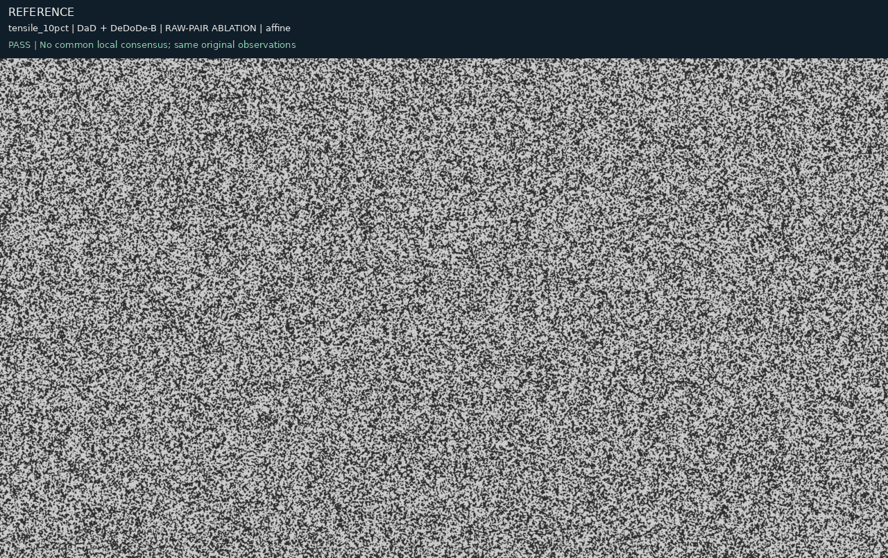

[Full metrics and provenance](tensile_10pct/dad_b/affine/result.json)

## tensile_10pct / DeDoDe v2-L + DeDoDe-B / affine

**Pass.** Effective basis: affine.

[Full metrics and provenance](tensile_10pct/dedode_b/affine/result.json)

## tensile_10pct / DIC tensor + DeDoDe-B / affine

**Pass.** Effective basis: affine.

[Full metrics and provenance](tensile_10pct/dic_tensor_b/affine/result.json)

## tensile_10pct / Learned DIC + DeDoDe-B / affine

**Pass.** Effective basis: affine.

[Full metrics and provenance](tensile_10pct/dic_learned_b/affine/result.json)

## tensile_10pct / HORG/SIFT detector + DeDoDe-B / affine

**Pass.** Effective basis: affine.

[Full metrics and provenance](tensile_10pct/horg_b/affine/result.json)

## tensile_20pct / DeepMatching INRIA hierarchy / affine

**Pass.** Effective basis: affine.

[Full metrics and provenance](tensile_20pct/deepmatching/affine/result.json)

## tensile_20pct / HORG / affine

**Fail.** Effective basis: affine.

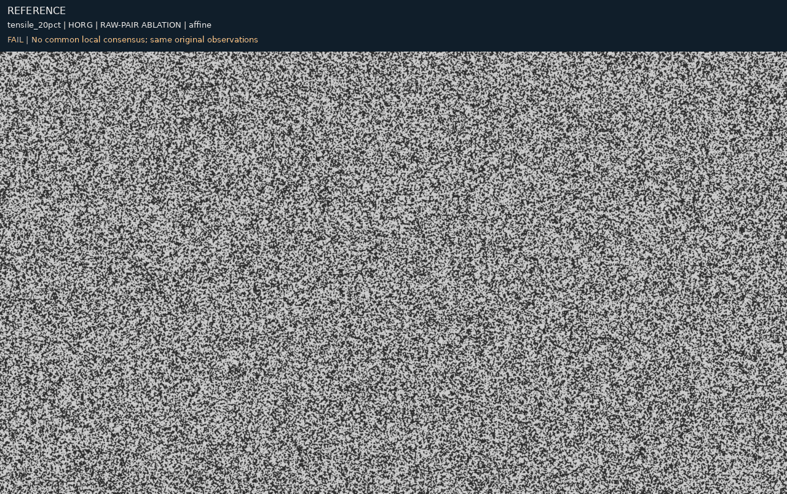

[Full metrics and provenance](tensile_20pct/horg/affine/result.json)

## tensile_20pct / CPM-HOG / affine

**Fail.** Effective basis: affine.

[Full metrics and provenance](tensile_20pct/cpm/affine/result.json)

## tensile_20pct / XFeat / affine

**Pass.** Effective basis: affine.

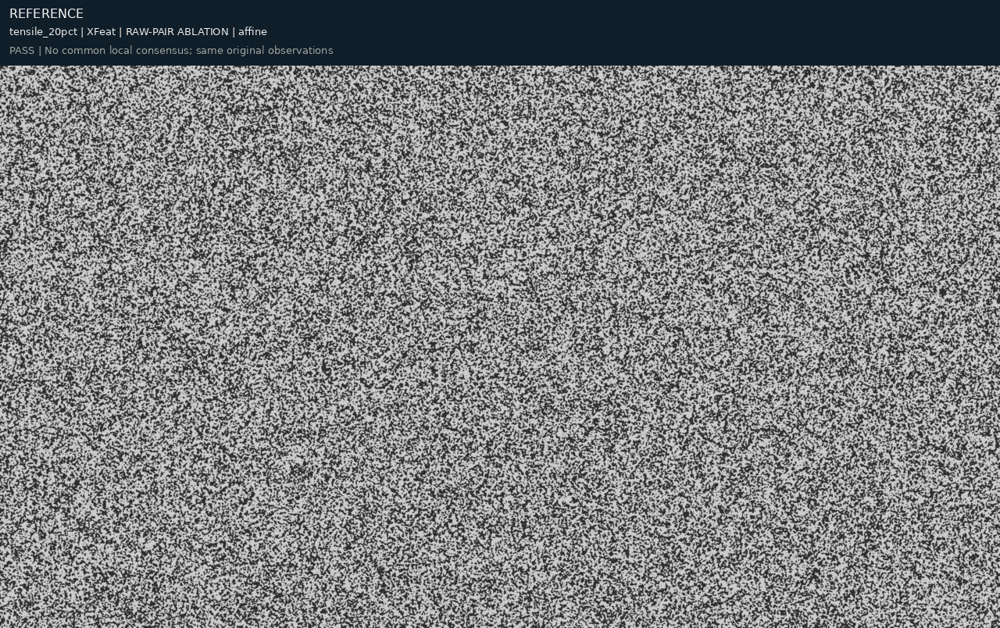

[Full metrics and provenance](tensile_20pct/xfeat/affine/result.json)

## tensile_20pct / EfficientLoFTR / affine

**Pass.** Effective basis: affine.

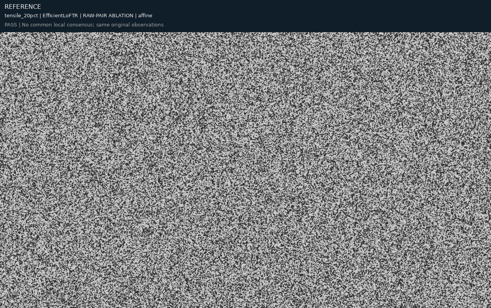

[Full metrics and provenance](tensile_20pct/efficientloftr/affine/result.json)

## tensile_20pct / RaCo-ALIKED-LightGlue+ / affine

**Pass.** Effective basis: affine.

[Full metrics and provenance](tensile_20pct/raco/affine/result.json)

## tensile_20pct / DaD + DeDoDe-B / affine

**Pass.** Effective basis: affine.

[Full metrics and provenance](tensile_20pct/dad_b/affine/result.json)

## tensile_20pct / DeDoDe v2-L + DeDoDe-B / affine

**Pass.** Effective basis: affine.

[Full metrics and provenance](tensile_20pct/dedode_b/affine/result.json)

## tensile_20pct / DIC tensor + DeDoDe-B / affine

**Pass.** Effective basis: affine.

[Full metrics and provenance](tensile_20pct/dic_tensor_b/affine/result.json)

## tensile_20pct / Learned DIC + DeDoDe-B / affine

**Pass.** Effective basis: affine.

[Full metrics and provenance](tensile_20pct/dic_learned_b/affine/result.json)

## tensile_20pct / HORG/SIFT detector + DeDoDe-B / affine

**Pass.** Effective basis: affine.

[Full metrics and provenance](tensile_20pct/horg_b/affine/result.json)

## tensile_30pct / DeepMatching INRIA hierarchy / affine

**Pass.** Effective basis: affine.

[Full metrics and provenance](tensile_30pct/deepmatching/affine/result.json)

## tensile_30pct / HORG / affine

**Fail.** Effective basis: affine.

[Full metrics and provenance](tensile_30pct/horg/affine/result.json)

## tensile_30pct / CPM-HOG / affine

**Fail.** Effective basis: affine.

[Full metrics and provenance](tensile_30pct/cpm/affine/result.json)

## tensile_30pct / XFeat / affine

**Fail.** Effective basis: affine.

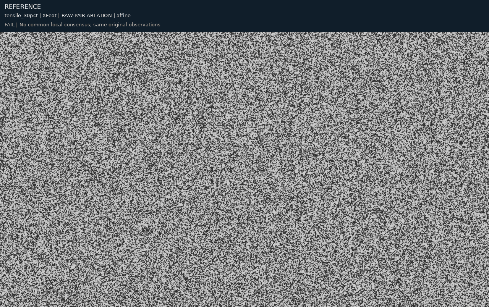

[Full metrics and provenance](tensile_30pct/xfeat/affine/result.json)

## tensile_30pct / EfficientLoFTR / affine

**Pass.** Effective basis: affine.

[Full metrics and provenance](tensile_30pct/efficientloftr/affine/result.json)

## tensile_30pct / RaCo-ALIKED-LightGlue+ / affine

**Pass.** Effective basis: affine.

[Full metrics and provenance](tensile_30pct/raco/affine/result.json)

## tensile_30pct / DaD + DeDoDe-B / affine

**Pass.** Effective basis: affine.

[Full metrics and provenance](tensile_30pct/dad_b/affine/result.json)

## tensile_30pct / DeDoDe v2-L + DeDoDe-B / affine

**Fail.** Effective basis: affine.

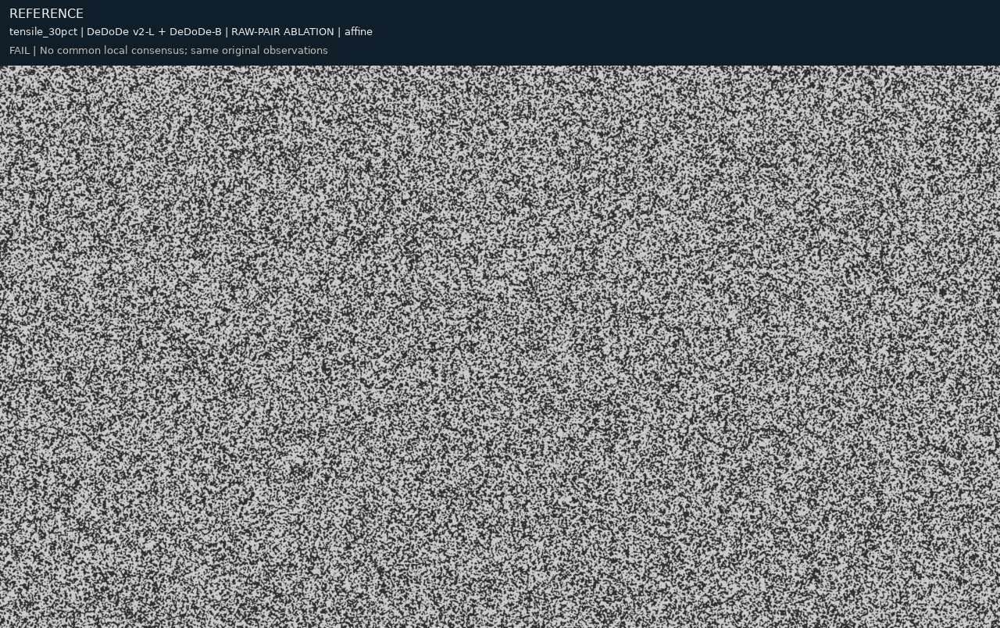

[Full metrics and provenance](tensile_30pct/dedode_b/affine/result.json)

## tensile_30pct / DIC tensor + DeDoDe-B / affine

**Fail.** Effective basis: affine.

[Full metrics and provenance](tensile_30pct/dic_tensor_b/affine/result.json)

## tensile_30pct / Learned DIC + DeDoDe-B / affine

**Pass.** Effective basis: affine.

[Full metrics and provenance](tensile_30pct/dic_learned_b/affine/result.json)

## tensile_30pct / HORG/SIFT detector + DeDoDe-B / affine

**Fail.** Effective basis: affine.

[Full metrics and provenance](tensile_30pct/horg_b/affine/result.json)

## tensile_40pct / DeepMatching INRIA hierarchy / affine

**Fail.** Effective basis: affine.

[Full metrics and provenance](tensile_40pct/deepmatching/affine/result.json)

## tensile_40pct / HORG / affine

**Fail.** Effective basis: affine.

[Full metrics and provenance](tensile_40pct/horg/affine/result.json)

## tensile_40pct / CPM-HOG / affine

**Fail.** Effective basis: affine.

[Full metrics and provenance](tensile_40pct/cpm/affine/result.json)

## tensile_40pct / XFeat / affine

**Fail.** Effective basis: affine.

[Full metrics and provenance](tensile_40pct/xfeat/affine/result.json)

## tensile_40pct / EfficientLoFTR / affine

**Pass.** Effective basis: affine.

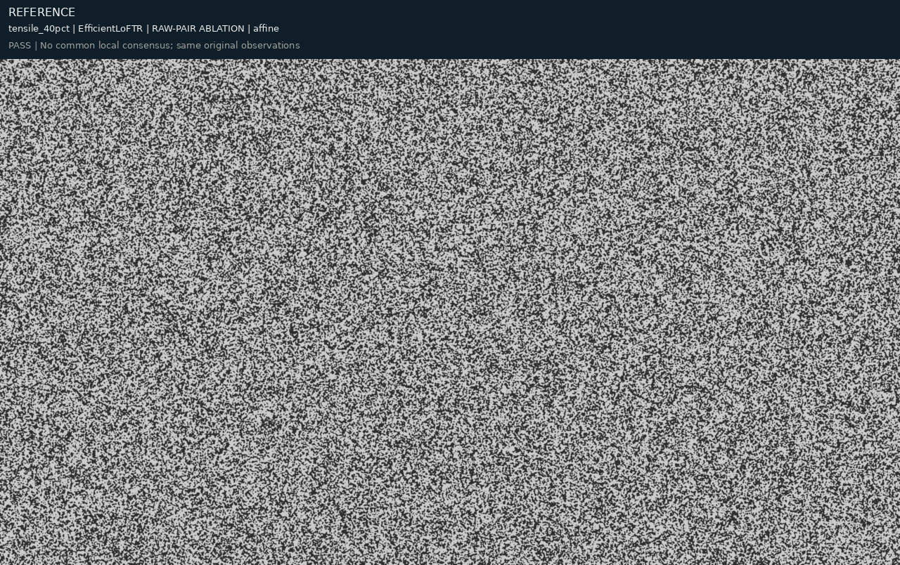

[Full metrics and provenance](tensile_40pct/efficientloftr/affine/result.json)

## tensile_40pct / RaCo-ALIKED-LightGlue+ / affine

**Pass.** Effective basis: affine.

[Full metrics and provenance](tensile_40pct/raco/affine/result.json)

## tensile_40pct / DaD + DeDoDe-B / affine

**Fail.** Effective basis: affine.

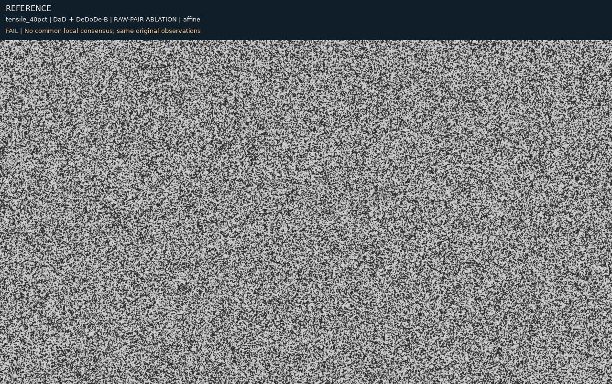

[Full metrics and provenance](tensile_40pct/dad_b/affine/result.json)

## tensile_40pct / DeDoDe v2-L + DeDoDe-B / affine

**Fail.** Effective basis: affine.

[Full metrics and provenance](tensile_40pct/dedode_b/affine/result.json)

## tensile_40pct / DIC tensor + DeDoDe-B / affine

**Fail.** Effective basis: affine.

[Full metrics and provenance](tensile_40pct/dic_tensor_b/affine/result.json)

## tensile_40pct / Learned DIC + DeDoDe-B / affine

**Fail.** Effective basis: affine.

[Full metrics and provenance](tensile_40pct/dic_learned_b/affine/result.json)

## tensile_40pct / HORG/SIFT detector + DeDoDe-B / affine

**Fail.** Effective basis: affine.

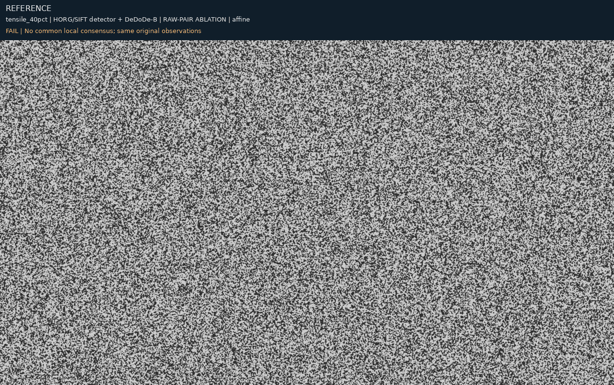

[Full metrics and provenance](tensile_40pct/horg_b/affine/result.json)

## tensile_50pct / DeepMatching INRIA hierarchy / affine

**Fail.** Effective basis: affine.

[Full metrics and provenance](tensile_50pct/deepmatching/affine/result.json)

## tensile_50pct / HORG / affine

**Fail.** Effective basis: affine.

[Full metrics and provenance](tensile_50pct/horg/affine/result.json)

## tensile_50pct / CPM-HOG / affine

**Fail.** Effective basis: affine.

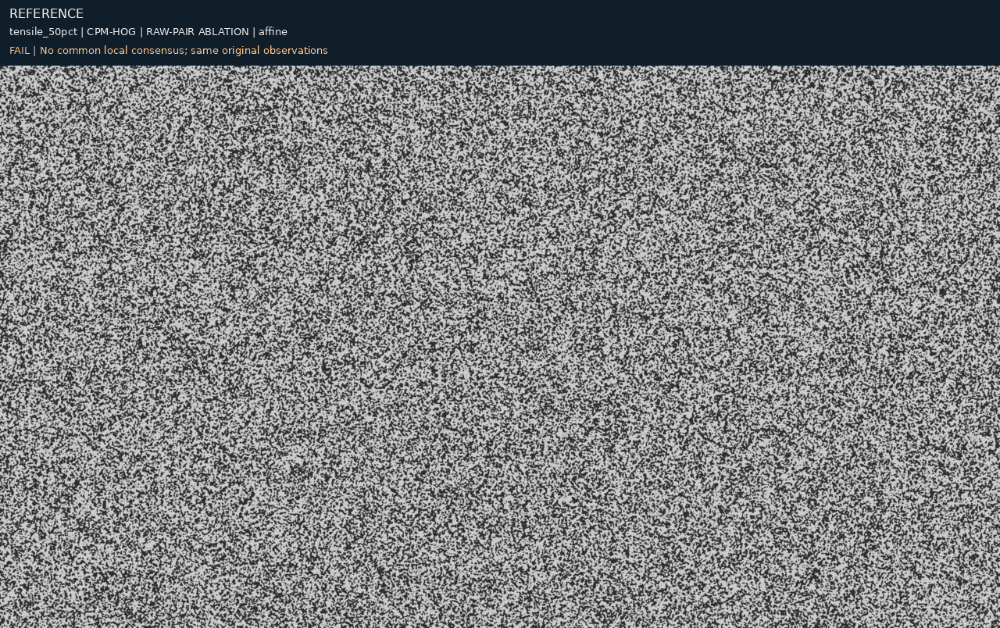

[Full metrics and provenance](tensile_50pct/cpm/affine/result.json)

## tensile_50pct / XFeat / affine

**Fail.** Effective basis: affine.

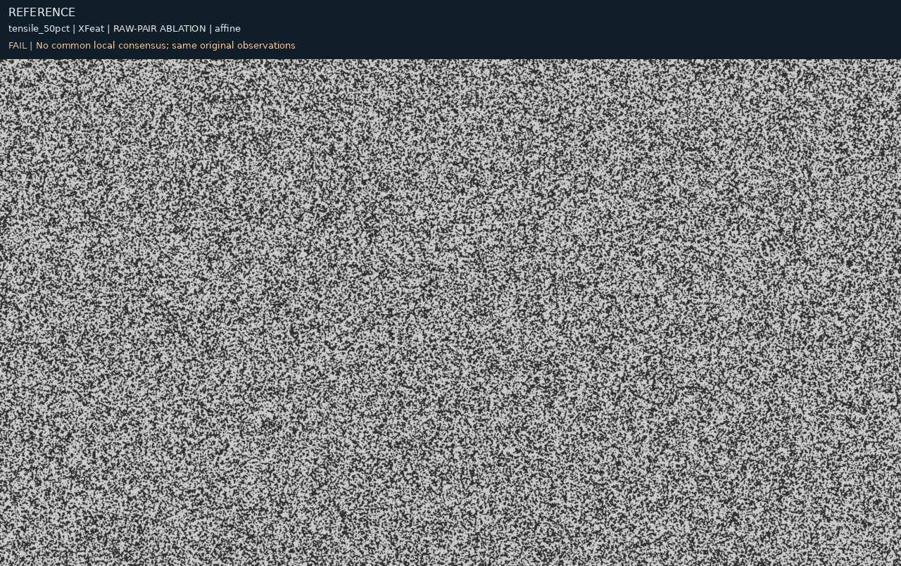

[Full metrics and provenance](tensile_50pct/xfeat/affine/result.json)

## tensile_50pct / EfficientLoFTR / affine

**Fail.** Effective basis: affine.

[Full metrics and provenance](tensile_50pct/efficientloftr/affine/result.json)

## tensile_50pct / RaCo-ALIKED-LightGlue+ / affine

**Pass.** Effective basis: affine.

[Full metrics and provenance](tensile_50pct/raco/affine/result.json)

## tensile_50pct / DaD + DeDoDe-B / affine

**Fail.** Effective basis: affine.

[Full metrics and provenance](tensile_50pct/dad_b/affine/result.json)

## tensile_50pct / DeDoDe v2-L + DeDoDe-B / affine

**Fail.** Effective basis: affine.

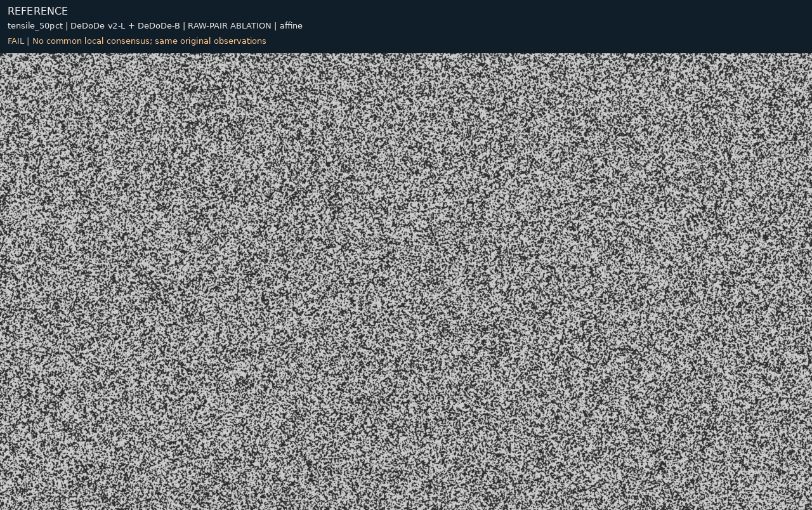

[Full metrics and provenance](tensile_50pct/dedode_b/affine/result.json)

## tensile_50pct / DIC tensor + DeDoDe-B / affine

**Fail.** Effective basis: affine.

[Full metrics and provenance](tensile_50pct/dic_tensor_b/affine/result.json)

## tensile_50pct / Learned DIC + DeDoDe-B / affine

**Fail.** Effective basis: affine.

[Full metrics and provenance](tensile_50pct/dic_learned_b/affine/result.json)

## tensile_50pct / HORG/SIFT detector + DeDoDe-B / affine

**Fail.** Effective basis: affine.

[Full metrics and provenance](tensile_50pct/horg_b/affine/result.json)

## tensile_60pct / DeepMatching INRIA hierarchy / affine

**Fail.** Effective basis: affine.

[Full metrics and provenance](tensile_60pct/deepmatching/affine/result.json)

## tensile_60pct / DeepMatching INRIA hierarchy / gaussian_rbf

**Fail.** Effective basis: gaussian_rbf.

[Full metrics and provenance](tensile_60pct/deepmatching/gaussian_rbf/result.json)

## tensile_60pct / HORG / affine

**Fail.** Effective basis: affine.

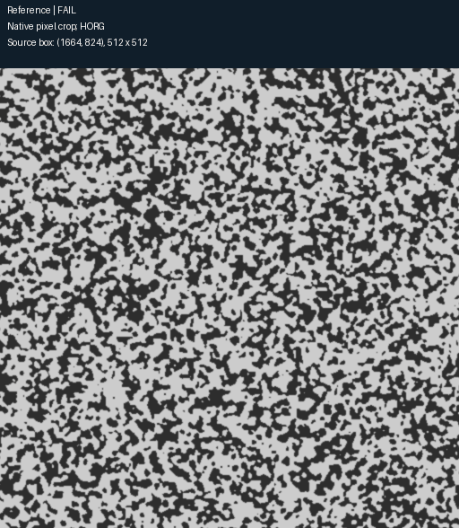

[Full metrics and provenance](tensile_60pct/horg/affine/result.json)

## tensile_60pct / HORG / gaussian_rbf

**Fail.** Effective basis: affine.

[Full metrics and provenance](tensile_60pct/horg/gaussian_rbf/result.json)

## tensile_60pct / CPM-HOG / affine

**Fail.** Effective basis: affine.

[Full metrics and provenance](tensile_60pct/cpm/affine/result.json)

## tensile_60pct / CPM-HOG / gaussian_rbf

**Fail.** Effective basis: affine.

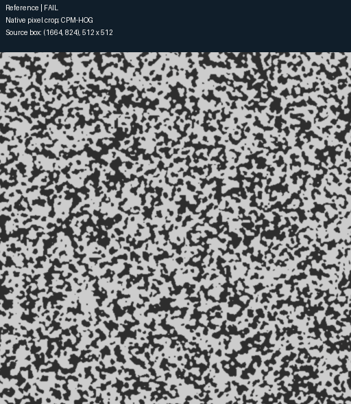

[Full metrics and provenance](tensile_60pct/cpm/gaussian_rbf/result.json)

## tensile_60pct / XFeat / affine

**Fail.** Effective basis: affine.

[Full metrics and provenance](tensile_60pct/xfeat/affine/result.json)

## tensile_60pct / XFeat / gaussian_rbf

**Fail.** Effective basis: gaussian_rbf.

[Full metrics and provenance](tensile_60pct/xfeat/gaussian_rbf/result.json)

## tensile_60pct / EfficientLoFTR / affine

**Fail.** Effective basis: affine.

[Full metrics and provenance](tensile_60pct/efficientloftr/affine/result.json)

## tensile_60pct / EfficientLoFTR / gaussian_rbf

**Fail.** Effective basis: gaussian_rbf.

[Full metrics and provenance](tensile_60pct/efficientloftr/gaussian_rbf/result.json)

## tensile_60pct / RaCo-ALIKED-LightGlue+ / affine

**Pass.** Effective basis: affine.

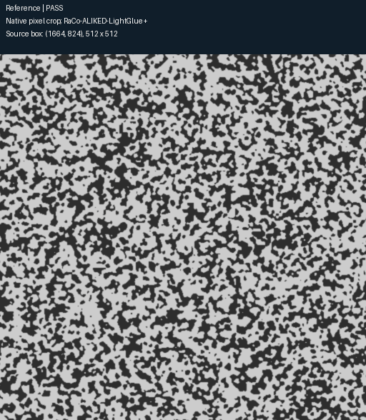

[Full metrics and provenance](tensile_60pct/raco/affine/result.json)

## tensile_60pct / RaCo-ALIKED-LightGlue+ / gaussian_rbf

**Pass.** Effective basis: affine.

[Full metrics and provenance](tensile_60pct/raco/gaussian_rbf/result.json)

## tensile_60pct / DaD + DeDoDe-B / affine

**Fail.** Effective basis: affine.

[Full metrics and provenance](tensile_60pct/dad_b/affine/result.json)

## tensile_60pct / DaD + DeDoDe-B / gaussian_rbf

**Fail.** Effective basis: gaussian_rbf.

[Full metrics and provenance](tensile_60pct/dad_b/gaussian_rbf/result.json)

## tensile_60pct / DeDoDe v2-L + DeDoDe-B / affine

**Fail.** Effective basis: affine.

[Full metrics and provenance](tensile_60pct/dedode_b/affine/result.json)

## tensile_60pct / DeDoDe v2-L + DeDoDe-B / gaussian_rbf

**Fail.** Effective basis: gaussian_rbf.

[Full metrics and provenance](tensile_60pct/dedode_b/gaussian_rbf/result.json)

## tensile_60pct / DIC tensor + DeDoDe-B / affine

**Fail.** Effective basis: affine.

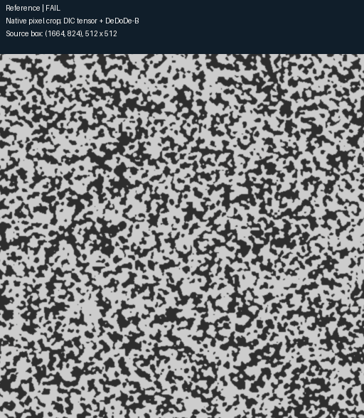

[Full metrics and provenance](tensile_60pct/dic_tensor_b/affine/result.json)

## tensile_60pct / DIC tensor + DeDoDe-B / gaussian_rbf

**Fail.** Effective basis: gaussian_rbf.

[Full metrics and provenance](tensile_60pct/dic_tensor_b/gaussian_rbf/result.json)

## tensile_60pct / Learned DIC + DeDoDe-B / affine

**Fail.** Effective basis: affine.

[Full metrics and provenance](tensile_60pct/dic_learned_b/affine/result.json)

## tensile_60pct / Learned DIC + DeDoDe-B / gaussian_rbf

**Fail.** Effective basis: gaussian_rbf.

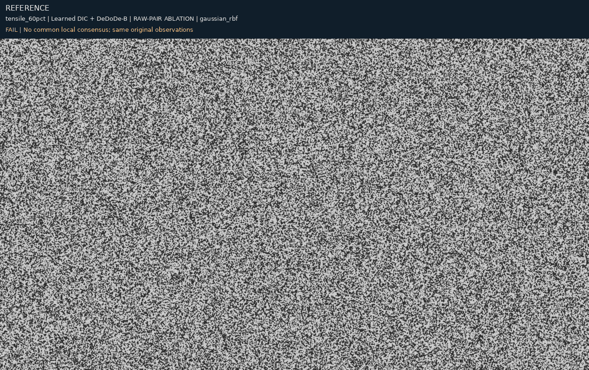

[Full metrics and provenance](tensile_60pct/dic_learned_b/gaussian_rbf/result.json)

## tensile_60pct / HORG/SIFT detector + DeDoDe-B / affine

**Fail.** Effective basis: affine.

[Full metrics and provenance](tensile_60pct/horg_b/affine/result.json)

## tensile_60pct / HORG/SIFT detector + DeDoDe-B / gaussian_rbf

**Fail.** Effective basis: gaussian_rbf.

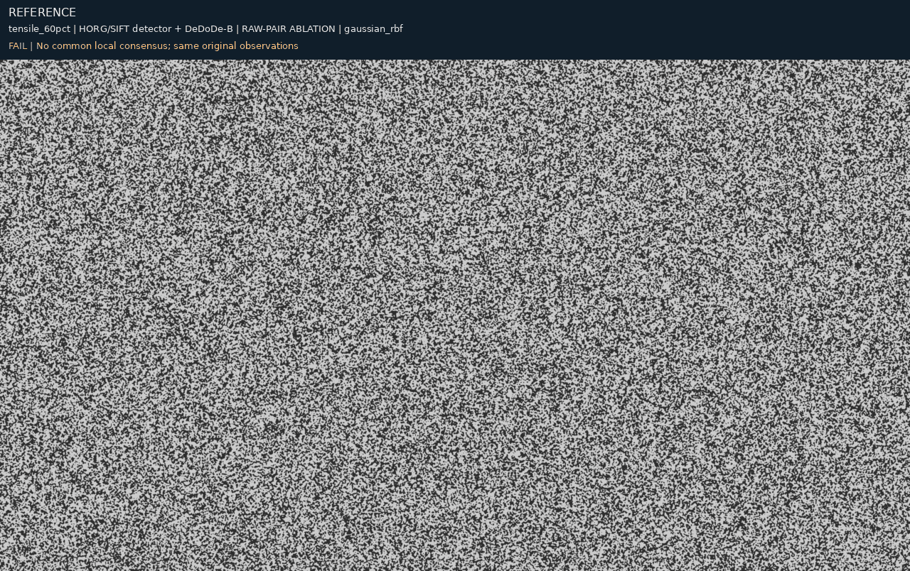

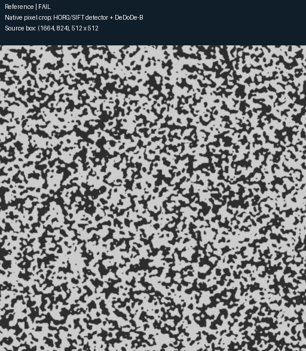

[Full metrics and provenance](tensile_60pct/horg_b/gaussian_rbf/result.json)

## adrien_000000_to_000075 / DeepMatching INRIA hierarchy / affine

**No analytic truth.** Effective basis: affine.

[Full metrics and provenance](adrien_000000_to_000075/deepmatching/affine/result.json)

## adrien_000000_to_000075 / DeepMatching INRIA hierarchy / gaussian_rbf

**No analytic truth.** Effective basis: gaussian_rbf.

[Full metrics and provenance](adrien_000000_to_000075/deepmatching/gaussian_rbf/result.json)

## adrien_000000_to_000075 / HORG / affine

**No analytic truth.** Effective basis: affine.

[Full metrics and provenance](adrien_000000_to_000075/horg/affine/result.json)

## adrien_000000_to_000075 / HORG / gaussian_rbf

**No analytic truth.** Effective basis: gaussian_rbf.

[Full metrics and provenance](adrien_000000_to_000075/horg/gaussian_rbf/result.json)

## adrien_000000_to_000075 / CPM-HOG / affine

**No analytic truth.** Effective basis: affine.

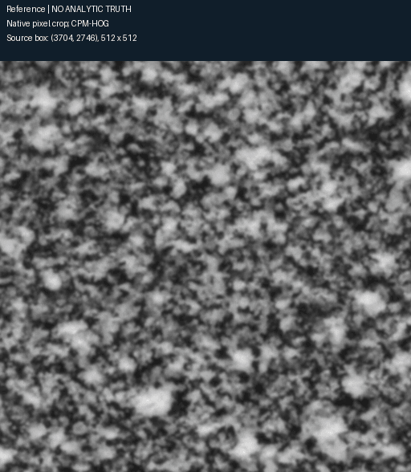

[Full metrics and provenance](adrien_000000_to_000075/cpm/affine/result.json)

## adrien_000000_to_000075 / CPM-HOG / gaussian_rbf

**No analytic truth.** Effective basis: gaussian_rbf.

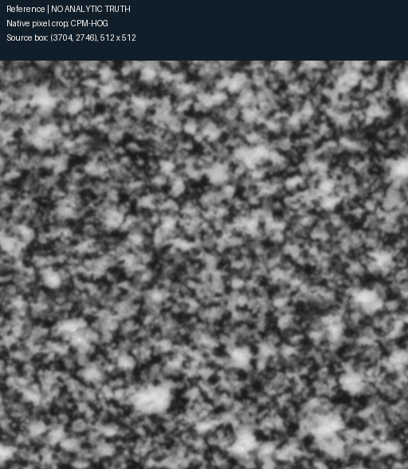

[Full metrics and provenance](adrien_000000_to_000075/cpm/gaussian_rbf/result.json)

## adrien_000000_to_000075 / XFeat / affine

**No analytic truth.** Effective basis: affine.

[Full metrics and provenance](adrien_000000_to_000075/xfeat/affine/result.json)

## adrien_000000_to_000075 / XFeat / gaussian_rbf

**No analytic truth.** Effective basis: gaussian_rbf.

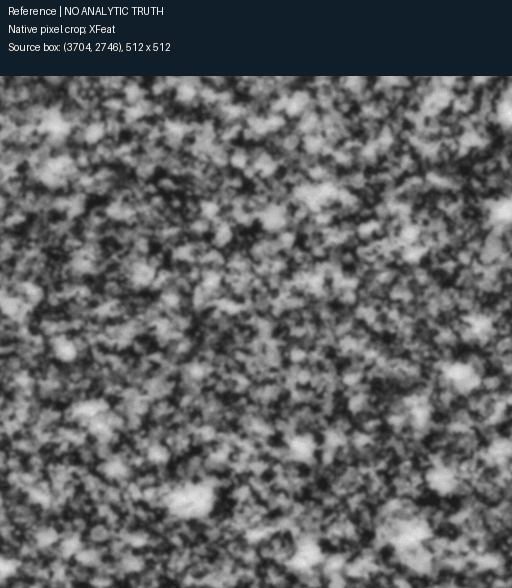

[Full metrics and provenance](adrien_000000_to_000075/xfeat/gaussian_rbf/result.json)

## adrien_000000_to_000075 / EfficientLoFTR / affine

**No analytic truth.** Effective basis: affine.

[Full metrics and provenance](adrien_000000_to_000075/efficientloftr/affine/result.json)

## adrien_000000_to_000075 / EfficientLoFTR / gaussian_rbf

**No analytic truth.** Effective basis: gaussian_rbf.

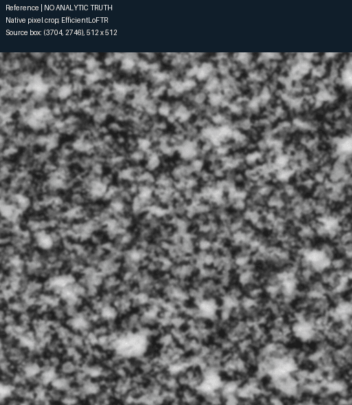

[Full metrics and provenance](adrien_000000_to_000075/efficientloftr/gaussian_rbf/result.json)

## adrien_000000_to_000075 / RaCo-ALIKED-LightGlue+ / affine

**No analytic truth.** Effective basis: affine.

[Full metrics and provenance](adrien_000000_to_000075/raco/affine/result.json)

## adrien_000000_to_000075 / RaCo-ALIKED-LightGlue+ / gaussian_rbf

**No analytic truth.** Effective basis: gaussian_rbf.

[Full metrics and provenance](adrien_000000_to_000075/raco/gaussian_rbf/result.json)

## adrien_000000_to_000075 / DaD + DeDoDe-B / affine

**No analytic truth.** Effective basis: affine.

[Full metrics and provenance](adrien_000000_to_000075/dad_b/affine/result.json)

## adrien_000000_to_000075 / DaD + DeDoDe-B / gaussian_rbf

**No analytic truth.** Effective basis: gaussian_rbf.

[Full metrics and provenance](adrien_000000_to_000075/dad_b/gaussian_rbf/result.json)

## adrien_000000_to_000075 / DeDoDe v2-L + DeDoDe-B / affine

**No analytic truth.** Effective basis: affine.

[Full metrics and provenance](adrien_000000_to_000075/dedode_b/affine/result.json)

## adrien_000000_to_000075 / DeDoDe v2-L + DeDoDe-B / gaussian_rbf

**No analytic truth.** Effective basis: gaussian_rbf.

[Full metrics and provenance](adrien_000000_to_000075/dedode_b/gaussian_rbf/result.json)

## adrien_000000_to_000075 / DIC tensor + DeDoDe-B / affine

**No analytic truth.** Effective basis: affine.

[Full metrics and provenance](adrien_000000_to_000075/dic_tensor_b/affine/result.json)

## adrien_000000_to_000075 / DIC tensor + DeDoDe-B / gaussian_rbf

**No analytic truth.** Effective basis: gaussian_rbf.

[Full metrics and provenance](adrien_000000_to_000075/dic_tensor_b/gaussian_rbf/result.json)

## adrien_000000_to_000075 / Learned DIC + DeDoDe-B / affine

**No analytic truth.** Effective basis: affine.

[Full metrics and provenance](adrien_000000_to_000075/dic_learned_b/affine/result.json)

## adrien_000000_to_000075 / Learned DIC + DeDoDe-B / gaussian_rbf

**No analytic truth.** Effective basis: gaussian_rbf.

[Full metrics and provenance](adrien_000000_to_000075/dic_learned_b/gaussian_rbf/result.json)

## adrien_000000_to_000075 / HORG/SIFT detector + DeDoDe-B / affine

**No analytic truth.** Effective basis: affine.

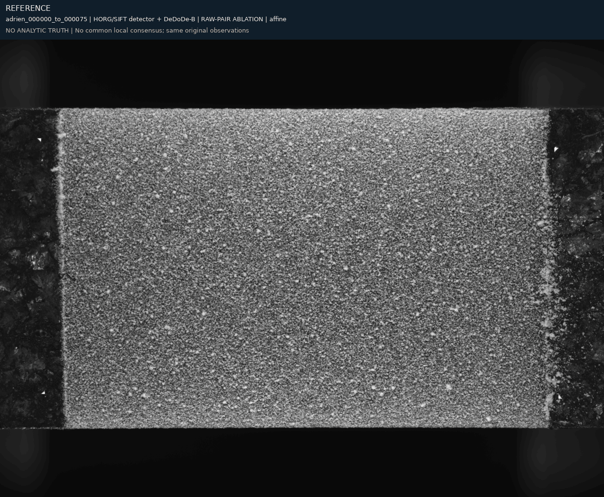

[Full metrics and provenance](adrien_000000_to_000075/horg_b/affine/result.json)

## adrien_000000_to_000075 / HORG/SIFT detector + DeDoDe-B / gaussian_rbf

**No analytic truth.** Effective basis: gaussian_rbf.

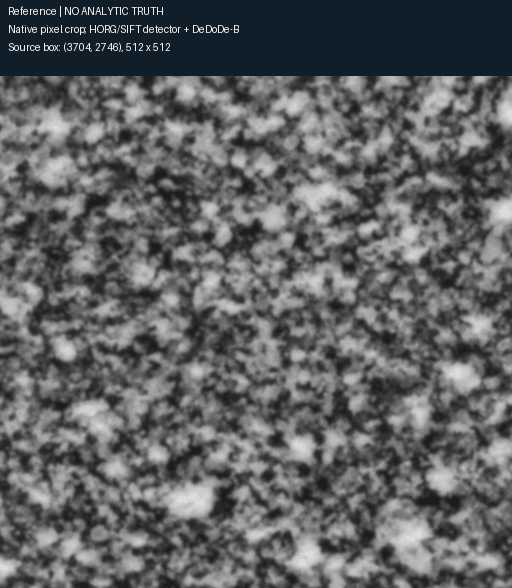

[Full metrics and provenance](adrien_000000_to_000075/horg_b/gaussian_rbf/result.json)

## Independent artifact checks

[Validation record](validation.json): 132 field records, 176 two-frame animations, cached-pair fingerprints and analytic centre errors checked. Across the 99 analytic affine comparisons, the added common verification improves correct coverage in 31 cases, preserves it in 68 and reduces it in none. This does not establish the same behaviour on untested heterogeneous motion.
