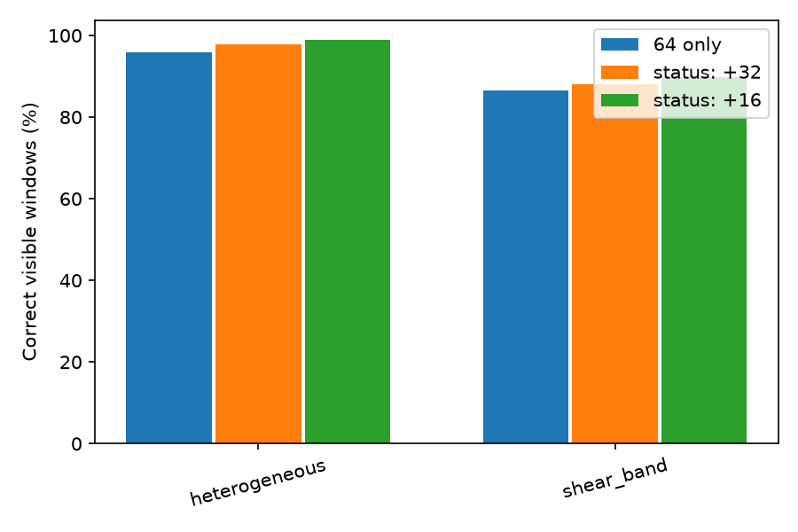

# Adaptive 64→32→16 pixel retry

All runs use the same original grid centers, image-derived coarse sources, and unchanged solver and consistency thresholds. Status-only preserves all accepted coarse states; a false accepted coarse state is not automatically detected. Truth is used only after inference. These archived data are retrospective unless the surrounding protocol explicitly states otherwise.

| Family | Visible | 64 correct / false | Status +32 correct / false | Status +16 correct / false |
| --- | ---: | ---: | ---: | ---: |
| heterogeneous | 6092 | 5837 / 0 | 5962 / 0 | 6022 / 0 |
| shear_band | 8075 | 6979 / 120 | 7111 / 120 | 7258 / 120 |

| Family | Residual flags: wrong / wrong, correct / correct | Guided +16 correct / false | Gained / lost vs 64 | Gained / lost vs status +16 |
| --- | ---: | ---: | ---: | ---: |
| heterogeneous | 0 / 0, 0 / 5837 | 6022 / 0 | 185 / 0 | 0 / 0 |
| shear_band | 119 / 120, 221 / 6979 | 7070 / 1 | 290 / 199 | 16 / 204 |

| Family | Flagged wrong recovered / unresolved | Flagged correct recovered / unresolved |
| --- | ---: | ---: |
| heterogeneous | 0 / 0 | 0 / 0 |
| shear_band | 16 / 103 | 22 / 199 |

| Pair | Visible | 64 correct / false | Status +16 correct / false | Guided +16 correct / false | Alerts wrong / correct | Residual / retry seconds |
| --- | ---: | ---: | ---: | ---: | ---: | ---: |
| heterogeneous_texture64051001_warp64091001 | 1694 | 1658 / 0 | 1682 / 0 | 1682 / 0 | 0 / 0 | 0.460 / 5.403 |
| heterogeneous_texture64051003_warp64091003 | 1030 | 974 / 0 | 1017 / 0 | 1017 / 0 | 0 / 0 | 0.060 / 5.274 |
| heterogeneous_texture64051005_warp64091005 | 774 | 725 / 0 | 759 / 0 | 759 / 0 | 0 / 0 | 0.060 / 5.239 |
| heterogeneous_texture64051007_warp64091007 | 1404 | 1342 / 0 | 1389 / 0 | 1389 / 0 | 0 / 0 | 0.061 / 5.113 |
| heterogeneous_texture64051009_warp64091009 | 1190 | 1138 / 0 | 1175 / 0 | 1175 / 0 | 0 / 0 | 0.060 / 4.953 |
| shear_band_texture64051005_warp64091005 | 1740 | 1486 / 18 | 1559 / 18 | 1521 / 0 | 18 / 38 | 0.062 / 4.857 |
| shear_band_texture64051007_warp64091007 | 1385 | 1168 / 14 | 1226 / 14 | 1198 / 0 | 14 / 27 | 0.061 / 5.487 |
| shear_band_texture64051009_warp64091009 | 1777 | 1581 / 61 | 1654 / 61 | 1585 / 1 | 60 / 95 | 0.064 / 5.664 |
| shear_band_texture64051011_warp64091011 | 1548 | 1371 / 11 | 1384 / 11 | 1365 / 0 | 11 / 23 | 0.062 / 4.838 |
| shear_band_texture64051013_warp64091013 | 1625 | 1373 / 16 | 1435 / 16 | 1401 / 0 | 16 / 38 | 0.063 / 5.194 |

The residual classifier uses one threshold frozen on three development shear pairs. Its image-only alerts are not a guarantee that the flagged windows are wrong or that unflagged windows are correct. Each reported visible false acceptance is in `analysis.json`.

The original G3 criterion is unchanged. A small support can yield false accepted results, and the final 64-pixel model can still be biased by deformation within its support. The measured retry wall times include Python orchestration, solver creation, CPU-side reference preparation and host/device transfers; they are not pure GPU times or a complete pipeline benchmark.

Per-pair metrics, all timing records, GPU stage counts and window-level provenance are retained in `analysis.json` and the source NPZ files.
