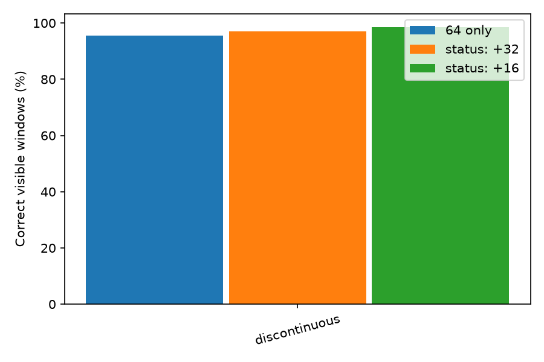

# Adaptive 64→32→16 pixel retry

All runs use the same original grid centers, image-derived coarse sources, and unchanged solver and consistency thresholds. Status-only preserves all accepted coarse states; a false accepted coarse state is not automatically detected. Truth is used only after inference. These archived data are retrospective unless the surrounding protocol explicitly states otherwise.

| Family | Visible | 64 correct / false | Status +32 correct / false | Status +16 correct / false |
| --- | ---: | ---: | ---: | ---: |
| discontinuous | 7158 | 6838 / 0 | 6938 / 0 | 7046 / 0 |

The original G3 criterion is unchanged. A small support can yield false accepted results, and the final 64-pixel model can still be biased by deformation within its support. The measured retry wall times include Python orchestration, solver creation, CPU-side reference preparation and host/device transfers; they are not pure GPU times or a complete pipeline benchmark.

Per-pair metrics, all timing records, GPU stage counts and window-level provenance are retained in `analysis.json` and the source NPZ files.
