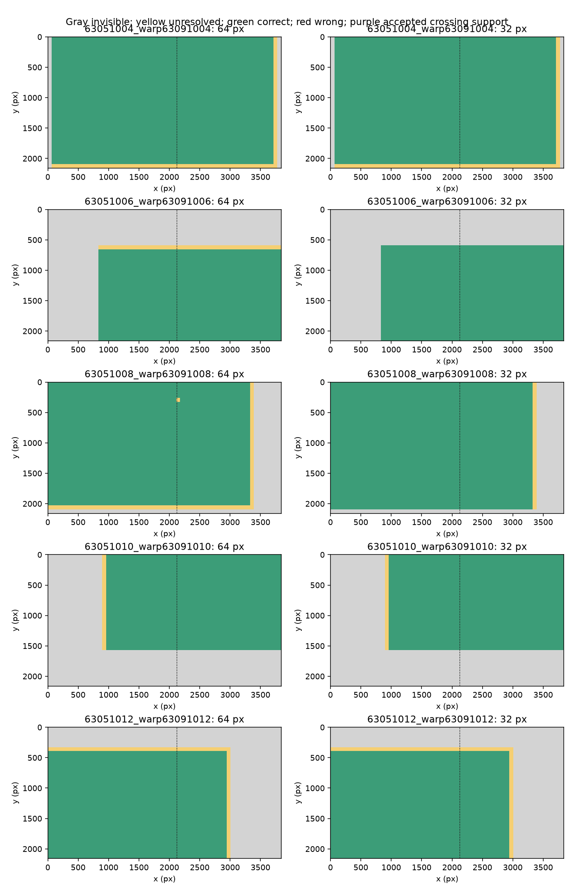

# Independent shifted-opening transfer

Five new 3840 × 2160 synthetic pairs, with the analytical opening boundary at x = 2123.52 px. The boundary, exact truth and visibility are used only after inference. The 32-pixel subset is re-solved at each available original 64-grid center from the nearest accepted image-derived 64-pixel state. This is not a dense 32/16-grid evaluation.

| Metric | Original 64 px | Re-solved 32 px |
| --- | ---: | ---: |
| Correct visible | 6838/7158 | 6938/7158 |
| False accepted visible | 0/6838 | 0/6938 |
| Original correct lost | — | 0 |
| Originally wrong recovered | — | 0 |

On these pairs, the zero-initialization 64-pixel control yields 0 correct, the original one-pass prefit 5787, the equal-work 64-pixel control 5813, and the analytical 64-pixel oracle 6838. The oracle is not a strict upper bound.

On windows correct with both methods, displacement-gradient Frobenius RMSE is 0.00243 for 64 pixels and 0.00185 for 32 pixels; this dimensionless statistic combines all four gradient components.

The fine solver accepts 0 supports that cross the true opening boundary; 0 visible initializations use an accepted source from the opposite side, and 141 use a 64-pixel source support that crosses the boundary. Of those, 139 are accepted after the fine solve, including 139 with a correct center displacement. Crossing-support counts include accepted centers whether visible or not; a correct center displacement does not validate a crossing support.

`analysis.json` enumerates every visible false acceptance and every accepted fine support crossing the boundary, including source provenance. The small synthetic test does not establish robustness near arbitrary cracks or accuracy on real images; the original G3 failure remains.

| Pair | Coarse correct | Fine correct | Visible | Fine false | Accepted crossing fine support |
| --- | ---: | ---: | ---: | ---: | ---: |
| discontinuous_texture63051004_warp63091004 | 1824 | 1824 | 1914 | 0 | 0 |
| discontinuous_texture63051006_warp63091006 | 1081 | 1128 | 1128 | 0 | 0 |
| discontinuous_texture63051008_warp63091008 | 1611 | 1664 | 1696 | 0 | 0 |
| discontinuous_texture63051010_warp63091010 | 1080 | 1080 | 1104 | 0 | 0 |
| discontinuous_texture63051012_warp63091012 | 1242 | 1242 | 1316 | 0 | 0 |

The paired coverage-gain bootstrap interval is [0.00; 3.03] percentage points, using 10,000 pair resamples and seed 63001111. With only five pairs this does not establish broad statistical generalization. Reproduction commands are in `../PROTOCOL.md`.
