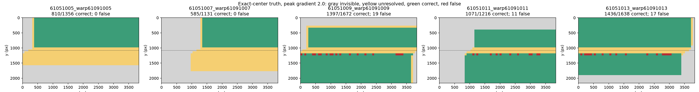

# Shear-band qualification with exact-center analytical truth

This report uses analytical truth at the exact window centers. Inference outputs, frozen thresholds and solver settings are unchanged. The synthetic shear map and its Jacobian are now evaluated analytically at each exact center; visibility is recomputed from that map. Oracle and zero-initialization controls were re-solved on the GPU.

| Peak gradient | Correct / visible | False / accepted visible | Exact oracle | One pass | Same-budget control | G3 |
| ---: | ---: | ---: | ---: | ---: | ---: | --- |
| 2.0 | 5299/7013 | 47/5346 (0.88%) | 6312 | 4168 | 4232 | fail |

| Pair | Peak gradient | Correct / visible | False / accepted visible | Oracle |
| --- | ---: | ---: | ---: | ---: |
| shear_band_texture61051005_warp61091005 | 2.0 | 810/1356 | 0/810 | 1212 |
| shear_band_texture61051007_warp61091007 | 2.0 | 585/1131 | 0/585 | 982 |
| shear_band_texture61051009_warp61091009 | 2.0 | 1397/1672 | 19/1416 | 1477 |
| shear_band_texture61051011_warp61091011 | 2.0 | 1071/1216 | 11/1082 | 1132 |
| shear_band_texture61051013_warp61091013 | 2.0 | 1436/1638 | 17/1453 | 1509 |

At peak gradient 2.0, 47 windows are falsely accepted; 47 of them are also accepted and remain incorrect after re-solving from exact analytical local affine parameters. This oracle is a diagnostic only. The fixed-size affine subset under a curved field is a plausible source of bias, but this observation alone does not establish its cause.

The textures are paired across gradients when multiple gradients are requested. This small synthetic cohort does not establish performance on experimental images or other deformation families. The exact oracle is a reference, not a mathematical upper bound.

`summary.json` records per-pair values and region counts; `false_accepted_windows.json` lists each false acceptance. NPZ files retain exact truth and re-solved oracle outputs. The protocol and reproduction commands are in `../PROTOCOL.md`.
