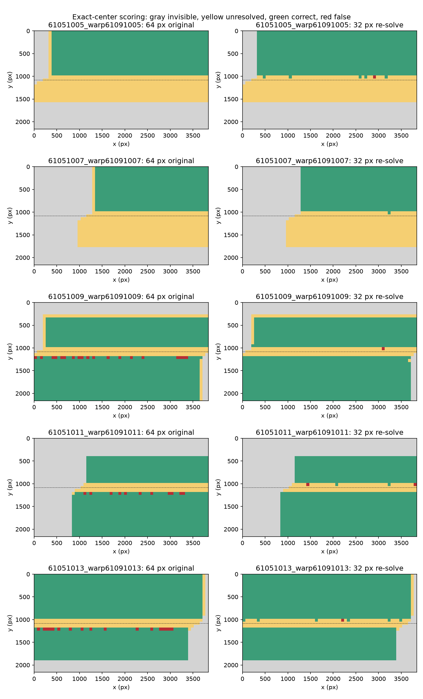

# Image-initialized fine support at the original centers

5 synthetic 3840 × 2160 pairs with peak shear gradient 2.0. Every fine state comes from the nearest accepted image-initialized 64-pixel state, transported without ground truth and re-solved with a 32-pixel subset on the same original center. The fine solver uses a 16-pixel grid solely to address those centers. These pairs were reserved before this run; this is a small independent test of the fixed transfer policy. The original frozen G3 protocol is unchanged.

| Measurement | Original 64 px | Re-solved 32 px |
| --- | ---: | ---: |
| Correct visible | 5299/7013 | 5405/7013 |
| False accepted visible | 47 | 5 / 5410 |
| Originally wrong, recovered | — | 47/47 |
| Originally correct, lost | — | 0 |

A false acceptance is at shear_band_texture61051005_warp61091005, center [2911.5, 991.5]: final error 4.424 px, versus 13.812 px at the transported initial state. Its source at [2911.5, 927.5] was accepted and its source-center error was 0.889 px. Source correctness is known only after the experiment.
A false acceptance is at shear_band_texture61051009_warp61091009, center [3103.5, 991.5]: final error 6.595 px, versus 13.492 px at the transported initial state. Its source at [3103.5, 927.5] was accepted and its source-center error was 0.764 px. Source correctness is known only after the experiment.
A false acceptance is at shear_band_texture61051011_warp61091011, center [1439.5, 991.5]: final error 7.024 px, versus 14.088 px at the transported initial state. Its source at [1439.5, 927.5] was accepted and its source-center error was 0.760 px. Source correctness is known only after the experiment.
A false acceptance is at shear_band_texture61051011_warp61091011, center [3807.5, 991.5]: final error 8.558 px, versus 14.252 px at the transported initial state. Its source at [3807.5, 927.5] was accepted and its source-center error was 0.756 px. Source correctness is known only after the experiment.
A false acceptance is at shear_band_texture61051013_warp61091013, center [2207.5, 991.5]: final error 6.600 px, versus 14.542 px at the transported initial state. Its source at [2207.5, 927.5] was accepted and its source-center error was 0.766 px. Source correctness is known only after the experiment.

These results concern only this specified shear-band family. Prior fine-subset tests also found false acceptances. No automatic production switch, accuracy claim on real images, or pass of the original G3 qualification follows from these data.



Raw per-window parameters and source indices are in NPZ files, counts are in `summary.json`, and the false-acceptance details are in `aggregated.json`. The protocol was recorded in `PROTOCOL.md` before this run. Unwarmed solver timings are diagnostic only.

Reproduce in a new directory:

```bash
base=results/seed_propagation_20261111/p3_shear_32_independent
out=results/seed_propagation_20261111/p3_shear_32_independent/transfer_new
PYTHONPATH=python/src:python/benchmarks .venv/bin/python python/benchmarks/diagnose_shear_fine_transfer.py \
  --base "$base" --live-dic-source /home/jeff/Code/tests_gpuio/DIC/LucasKanadeICGN/python/src --output-dir "$out" --seed-offset 61000000 --gradient 2.0
PYTHONPATH=python/src:python/benchmarks .venv/bin/python python/benchmarks/summarize_shear_fine_transfer.py \
  --base "$base" --directory "$out" --seed-offset 61000000 --gradient 2.0 --independent
```
