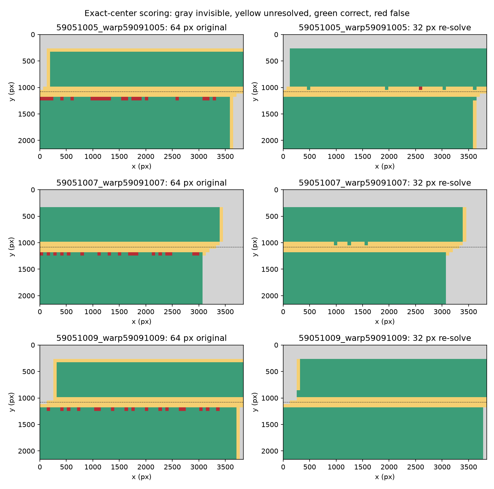

# Image-initialized fine support at the original centers

Three previously inspected synthetic 3840 × 2160 pairs with peak shear gradient 2.0. Every fine state comes from the nearest accepted image-initialized 64-pixel state, transported without ground truth and re-solved with a 32-pixel subset on the same original center. The fine solver uses a 16-pixel grid solely to address those centers. These are post-hoc diagnostics, not an independent qualification or a change to the frozen G3 protocol.

| Measurement | Original 64 px | Re-solved 32 px |
| --- | ---: | ---: |
| Correct visible | 4023/4761 | 4228/4761 |
| False accepted visible | 57 | 1 / 4229 |
| Originally wrong, recovered | — | 57/57 |
| Originally correct, lost | — | 0 |

The new false acceptance is at shear_band_texture59051005_warp59091005, center [2591.5, 991.5]: final error 9.533 px, versus 13.322 px at the transported initial state. Its source at [2591.5, 927.5] was accepted and its source-center error was 0.766 px. Source correctness is known only after the experiment.

The result illustrates both the benefit of a smaller support in this localized field and the possibility of an incorrect 32-pixel convergence from an otherwise correct neighbor. Prior fine-subset tests also found false acceptances. No automatic switch, new threshold, accuracy claim on real images, or G3 pass follows from these data.



Raw per-window parameters and source indices are in NPZ files, counts are in `summary.json`, and the false-acceptance details are in `aggregated.json`. The protocol was recorded in `PROTOCOL.md` before this run. Unwarmed solver timings are diagnostic only.

Reproduce in a new directory:

```bash
base=results/seed_propagation_20261111/p3_shear_band_frozen_protocol
out=results/seed_propagation_20261111/p3_shear_32_transfer_diagnostic_new
PYTHONPATH=python/src:python/benchmarks .venv/bin/python python/benchmarks/diagnose_shear_fine_transfer.py \
  --base "$base" --live-dic-source /home/jeff/Code/tests_gpuio/DIC/LucasKanadeICGN/python/src --output-dir "$out"
PYTHONPATH=python/src:python/benchmarks .venv/bin/python python/benchmarks/summarize_shear_fine_transfer.py \
  --base "$base" --directory "$out"
```
