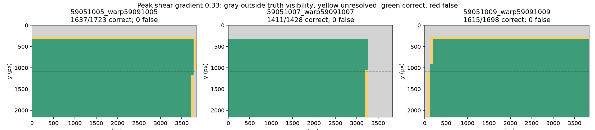
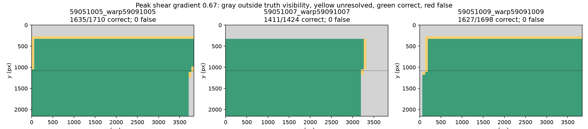
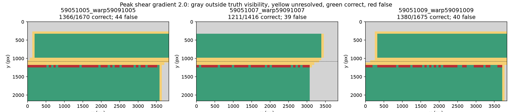

# Localized shear-band qualification

> **Superseded scoring:** this historical diagnostic used rounded-pixel truth. The corrected exact-center results and exact oracle control are in `../exact_center_analysis/README.md`. The 123-window count is not the corrected physical-center count.

The protocol was fixed in `../PROTOCOL.md`; truth is used only for scoring and maps. The cohort contains three paired textures, not independent windows for statistical inference.

| Peak gradient | Correct / visible | False / accepted visible | Oracle | One-pass | Equal-work control | G3 false limit |
| ---: | ---: | ---: | ---: | ---: | ---: | --- |
| 0.33 | 4663/4849 | 0/4663 (0.00%) | 4662 | 4200 | 4224 | pass |
| 0.67 | 4673/4832 | 0/4673 (0.00%) | 4673 | 3920 | 3954 | pass |
| 2.0 | 3957/4761 | 123/4080 (3.01%) | 4241 | 3188 | 3253 | fail |

| Pair | Peak gradient | Correct / visible | False / accepted visible | Confirmed seeds | Passes | Oracle |
| --- | ---: | ---: | ---: | ---: | ---: | ---: |
| shear_band_texture59051005_warp59091005 | 0.33 | 1637/1723 | 0/1637 | 1550 | 2 | 1637 |
| shear_band_texture59051007_warp59091007 | 0.33 | 1411/1428 | 0/1411 | 1275 | 3 | 1411 |
| shear_band_texture59051009_warp59091009 | 0.33 | 1615/1698 | 0/1615 | 1588 | 3 | 1614 |
| shear_band_texture59051005_warp59091005 | 0.67 | 1635/1710 | 0/1635 | 1508 | 12 | 1635 |
| shear_band_texture59051007_warp59091007 | 0.67 | 1411/1424 | 0/1411 | 1196 | 7 | 1411 |
| shear_band_texture59051009_warp59091009 | 0.67 | 1627/1698 | 0/1627 | 1473 | 12 | 1627 |
| shear_band_texture59051005_warp59091005 | 2.0 | 1366/1670 | 44/1410 | 1220 | 5 | 1461 |
| shear_band_texture59051007_warp59091007 | 2.0 | 1211/1416 | 39/1250 | 1062 | 21 | 1303 |
| shear_band_texture59051009_warp59091009 | 2.0 | 1380/1675 | 40/1420 | 1251 | 18 | 1477 |

Each map colors visible, unresolved windows yellow; correct accepted windows green; false accepted windows red; gray means outside truth visibility. The dashed line is the analytical band center, used only in the figure.

At gradient 2.0, 52 false windows are confirmed seeds and 71 are propagated. The one-pass affine + NCC baseline contains 53 visible false acceptances, 46 of which also appear in the propagated output. None of the 123 final false windows is oracle-correct with the same affine IC-GN solver. This is an oracle diagnostic, not an oracle criterion available to the initializer.

At gradient 2.0, 123 visible false acceptances lie between one and three analytical band widths from its center; 0 windows within one width have a correct center displacement. 5 oracle-connected regions contain a confirmed seed; 3 of them recover less than 97% of their oracle-correct windows. For the analytical initialization re-solve, see `../oracle_diagnostic/README.md`.

The analytical affine initialization is a reference, not a mathematical upper bound: a different initialization can occasionally converge correctly where it does not. The three-pair bootstrap intervals stored in `summary.json` describe only this very small paired sample and do not establish population-level uncertainty.

`summary.json` includes per-pair seed and propagation counts, oracle-connected regions, band-distance strata and gradient error. `false_accepted_windows.json` enumerates every visible false acceptance. No validation claim is made for experimental images or for untested deformation families.
