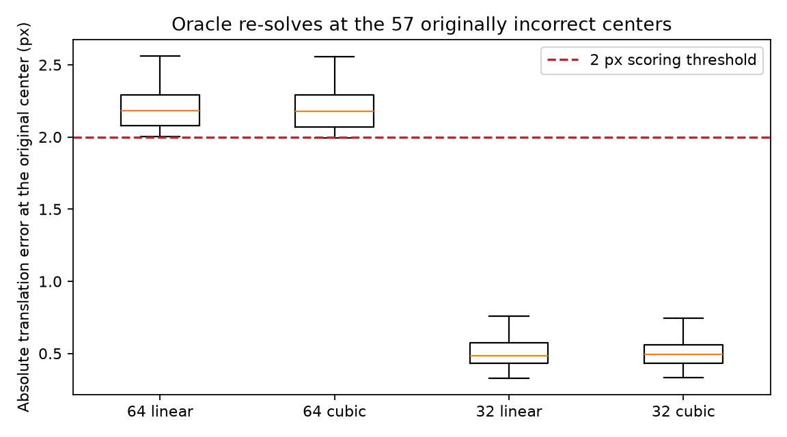

# Shear-band support and interpolation diagnostic

Three synthetic 3840 × 2160 image pairs, peak displacement gradient 2.0. Every configuration starts from the exact analytical affine state at the same original 64-pixel-grid centers. The smaller support uses a 16-pixel grid only to address those identical centers; it does not change their number. These are oracle experiments, not a deployable initialization method. The frozen production settings and G3 gate have not been changed.

| Support / interpolation | Correct / visible | False / accepted visible | Originally wrong recovered / 57 | Previously correct lost |
| --- | ---: | ---: | ---: | ---: |
| 64 px / linear | 4240/4761 | 323/4563 | 0/57 | 0 |
| 64 px / cubic | 4245/4761 | 316/4561 | 2/57 | 0 |
| 32 px / linear | 4720/4761 | 0/4720 | 57/57 | 0 |
| 32 px / cubic | 4720/4761 | 0/4720 | 57/57 | 0 |

For the linear 64-pixel analytical initialization, 323 windows are accepted yet wrong among all visible original centers; the image-derived initializer previously accepted only 57 of those errors. The exact analytical initialization is a diagnostic reference, not an upper bound on convergence or a safety guarantee.

Changing only interpolation recovers 2 of the 57 original errors. A 32-pixel support recovers all 57 and yields no false accepted visible window on these three pairs. This supports a finite-support/local-kinematics explanation for this case but does not isolate every source of bias. It does not establish that a 32-pixel production pipeline is safe: other 32-pixel development tests produced false acceptances, and these runs use truth-provided initialization.



The raw per-window results, per-pair counts and unwarmed solver wall times are saved in `summary.json`, `aggregated.json` and the NPZ files. Unwarmed wall times are diagnostic only; they are not production performance benchmarks. The protocol was fixed before these runs in `PROTOCOL.md`.

Reproduce in a new directory:

```bash
base=results/seed_propagation_20261111/p3_shear_band_frozen_protocol
out=results/seed_propagation_20261111/p3_shear_support_diagnostic_new
PYTHONPATH=python/src:python/benchmarks .venv/bin/python python/benchmarks/diagnose_shear_support.py \
  --base "$base" --live-dic-source /home/jeff/Code/tests_gpuio/DIC/LucasKanadeICGN/python/src --output-dir "$out"
PYTHONPATH=python/src:python/benchmarks .venv/bin/python python/benchmarks/summarize_shear_support.py --directory "$out"
```
