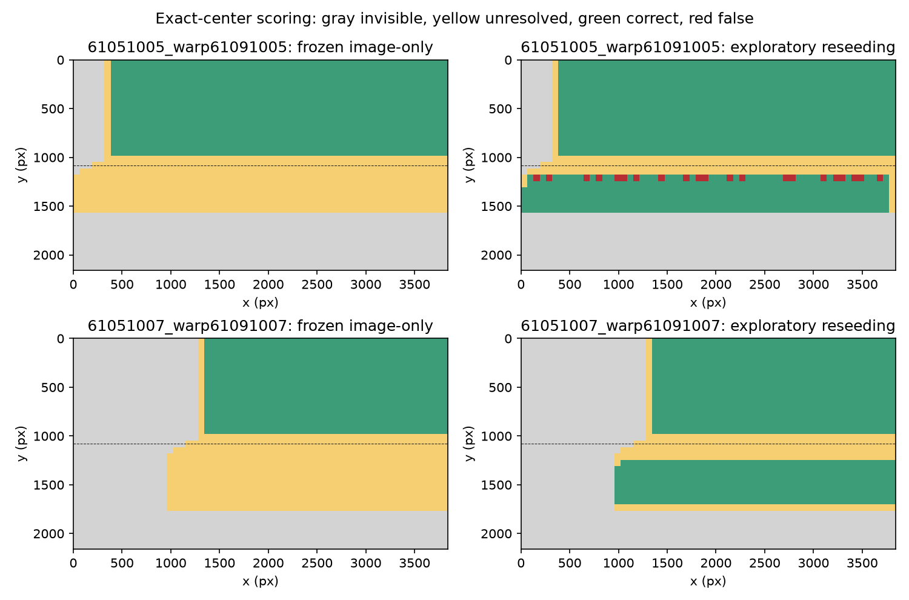

# Exploratory reseeding of unresolved shear-band regions

These two pairs were selected after inspecting their poor coverage. The run eagerly provides the three leading image-ranked rotations and enables local-affine unresolved-region escalation. Truth is used only to score the outputs. The comparison is exploratory and does not isolate the effects of the larger hypothesis set and of escalation.

| Pair | Correct baseline → exploratory | False baseline → exploratory | Accepted visible | Baseline accepted preserved |
| --- | ---: | ---: | ---: | --- |
| shear_band_texture61051005_warp61091005 | 810 → 1141 | 0 → 21 | 1162 | True |
| shear_band_texture61051007_warp61091007 | 585 → 899 | 0 → 0 | 899 | True |

Among 21 visible false acceptances, 0 are correct after exact analytical affine oracle initialization. This does not prove the cause. `comparison.json` retains every false window and the escalation stages. Timings exclude earlier rotation-hypothesis generation and are not full-pipeline benchmarks.

The six rotation-generation subprocesses took 50.64 s in total, including startup, synthetic image generation and output. This is a single unwarmed scripted measurement, not GPU kernel time or production latency.

A subsequent, also post-hoc 32-pixel re-solve is reported in `fine_transfer/README.md`. Neither exploratory result changes the frozen G3 failure.



Reproduce using the existing five-pair input archive and a new output directory:

```bash
base=results/seed_propagation_20261111/p3_shear_32_independent
out=results/seed_propagation_20261111/p3_shear_unresolved_exploration_new
weights=results/ndf_dic_20261109/p3_multiscale_physics_weight002_levels3_128pairs_seed20261114/ndf_pair_matcher.pt
solver=/home/jeff/Code/tests_gpuio/DIC/LucasKanadeICGN/python/src
frozen=results/seed_propagation_20261111/p2_calibration/frozen_parameters.json
PYTHONPATH=python/src:python/benchmarks .venv/bin/python python/benchmarks/generate_rotation_seed_hypotheses.py \
  --ranking-reports "$base/g2.0/inputs/affine_ncc/combined_seed61000000.json" --family shear_band \
  --textures 61051005 61051007 --weights "$weights" --live-dic-source "$solver" --output-dir "$out/rotations" \
  --model-width 192 --model-height 108 --shear-band-peak-gradient 2.0
PYTHONPATH=python/src:python/benchmarks .venv/bin/python python/benchmarks/qualify_image_seed_pilot.py \
  --archive "$base/g2.0/inputs" --live-dic-source "$solver" --output-dir "$out/evaluation" \
  --rotation-manifest "$out/rotations/manifest.json" --frozen-parameters "$frozen" \
  --textures 61051005 61051007 --sparse-stride 2 --tau-u 8 --tau-g .25 --minimum-anchors 3 \
  --shear-band-peak-gradient 2.0 --escalation --local-affine-escalation --escalate-unresolved \
  --batch-anchor-confirmation --same-budget-control --use-cached-solver-images
PYTHONPATH=python/src:python/benchmarks .venv/bin/python python/benchmarks/summarize_shear_reseeding.py \
  --base "$base" --experiment "$out"
```
