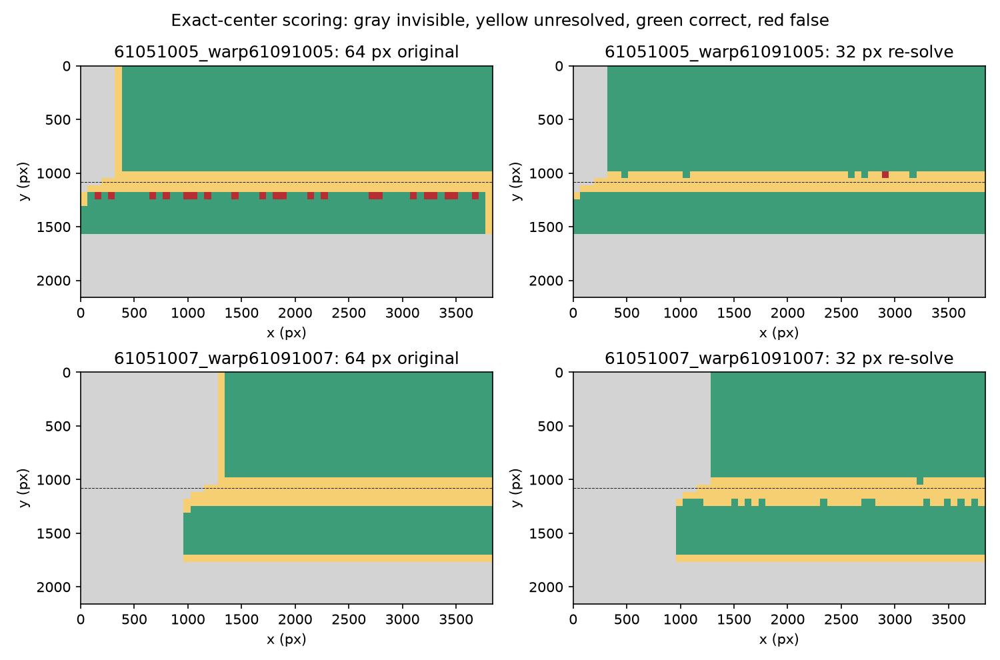

# Image-initialized fine support at the original centers

2 synthetic 3840 × 2160 pairs with peak shear gradient 2.0. Every fine state comes from the nearest accepted image-initialized 64-pixel state, transported without ground truth and re-solved with a 32-pixel subset on the same original center. The fine solver uses a 16-pixel grid solely to address those centers. These pairs were previously inspected; this is a post-hoc diagnostic. The original frozen G3 protocol is unchanged.

| Measurement | Original 64 px | Re-solved 32 px |
| --- | ---: | ---: |
| Correct visible | 2040/2487 | 2118/2487 |
| False accepted visible | 21 | 1 / 2119 |
| Originally wrong, recovered | — | 21/21 |
| Originally correct, lost | — | 0 |

A false acceptance is at shear_band_texture61051005_warp61091005, center [2911.5, 991.5]: final error 4.424 px, versus 13.812 px at the transported initial state. Its source at [2911.5, 927.5] was accepted and its source-center error was 0.889 px. Source correctness is known only after the experiment.

These results concern only this specified shear-band family. Prior fine-subset tests also found false acceptances. No automatic production switch, accuracy claim on real images, or pass of the original G3 qualification follows from these data.



Raw per-window parameters and source indices are in NPZ files, counts are in `summary.json`, and the false-acceptance details are in `aggregated.json`. The protocol was recorded in `PROTOCOL.md` before this run. Unwarmed solver timings are diagnostic only.

Reproduce in a new directory:

```bash
base=results/seed_propagation_20261111/p3_shear_32_independent
out=results/seed_propagation_20261111/p3_shear_unresolved_exploration/fine_transfer_new
PYTHONPATH=python/src:python/benchmarks .venv/bin/python python/benchmarks/diagnose_shear_fine_transfer.py \
  --base "$base" --live-dic-source /home/jeff/Code/tests_gpuio/DIC/LucasKanadeICGN/python/src --output-dir "$out" --seed-offset 61000000 --gradient 2.0 --coarse-directory results/seed_propagation_20261111/p3_shear_unresolved_exploration/evaluation
PYTHONPATH=python/src:python/benchmarks .venv/bin/python python/benchmarks/summarize_shear_fine_transfer.py \
  --base "$base" --directory "$out" --seed-offset 61000000 --gradient 2.0 --coarse-directory results/seed_propagation_20261111/p3_shear_unresolved_exploration/evaluation
```
